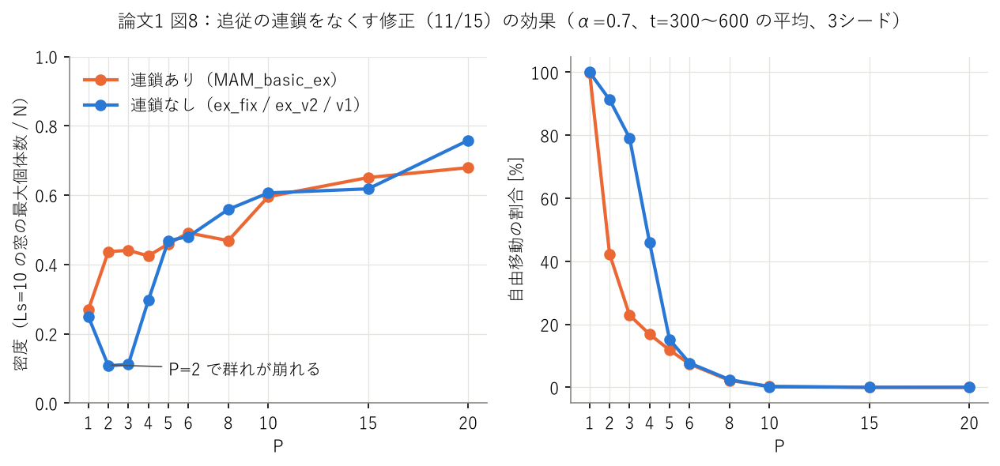
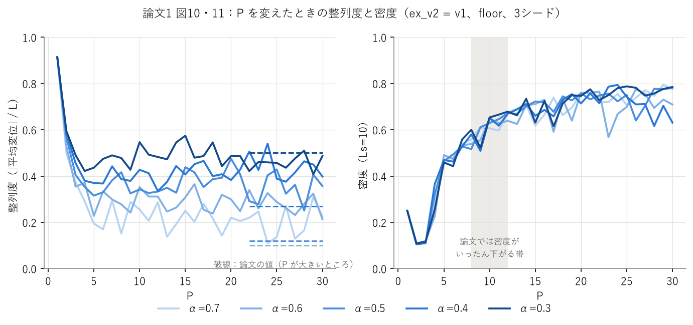
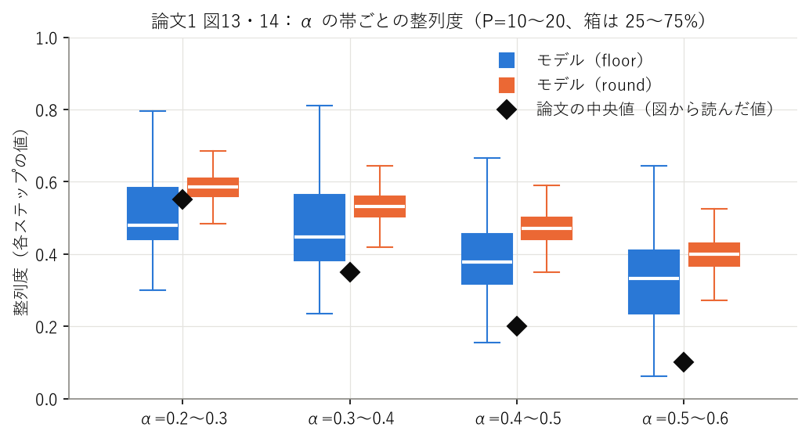
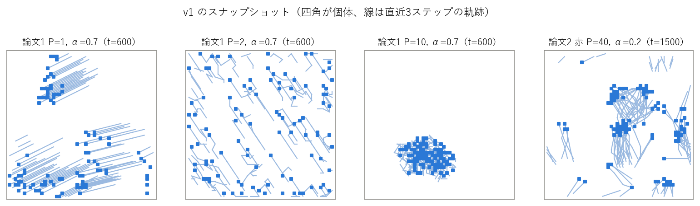
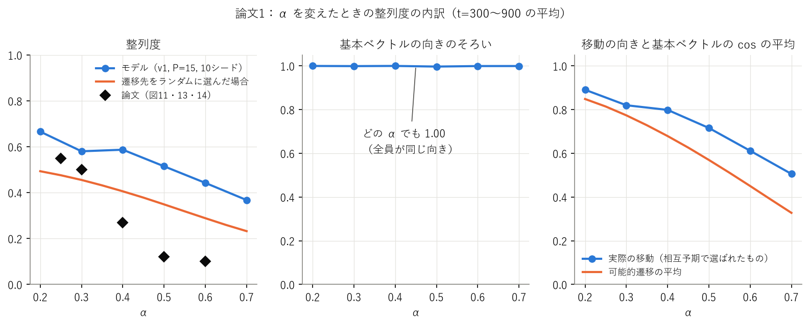
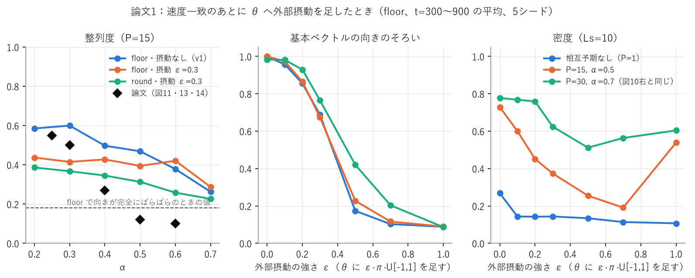
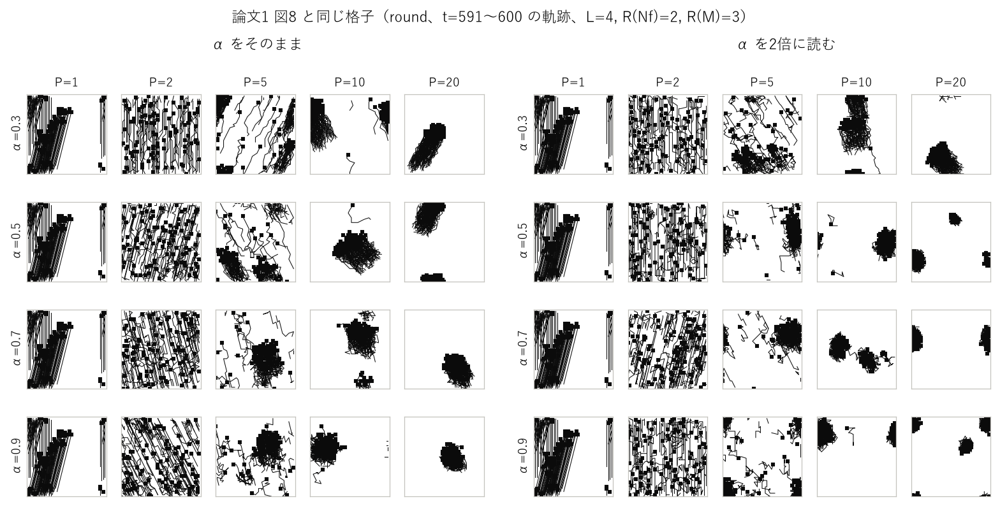
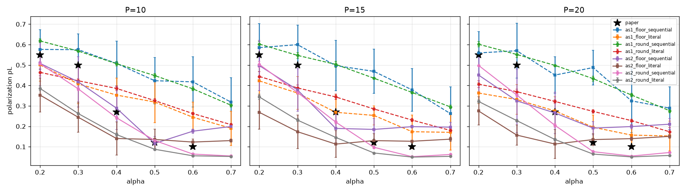
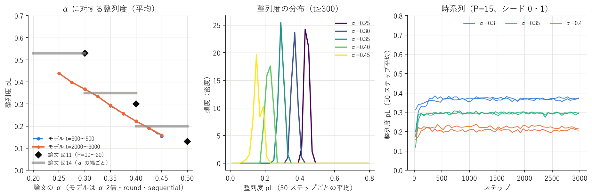

# 論文1の検証（速度一致あり）その1：整列度と α の効き方

[← 検証レポート（入口）](../検証レポート.md)

Gunji et al., *Robust swarm of soldier crabs* の再現。2.1〜2.8 節。2.9 節から先は [03_論文1_密度と相関](03_論文1_密度と相関.md)。

- 章の番号：1章（測り方とモデル）は [01](01_測り方とモデル.md)、2章（論文1）は [02](02_論文1_整列度.md)・[03](03_論文1_密度と相関.md)、3章（論文2）は [04](04_論文2_図3.md)・[05](05_論文2_他の図.md)、4章（計画）は [06](06_計画.md)。
- 11/22 に、論文1 ⇒ 論文2 の順に並べ直して番号を振り直した。古い番号との対応は入口の「番号の対応」にある。
- このレポート自身の図は fig17 のようにファイル名の番号で呼ぶ。「図3」「図11」のように書いたものは、論文の図。

---

## やったことと結果の一覧

論文1で試したことを「やったこと → 結果」で並べた表。詳しい説明と図は、この下の各節にある。新しく試したら、ここにも1行足す。

| やったこと | 結果 | 日付 |
|---|---|---|
| 速度一致を外す | 群れができない ⇒ 速度一致は必要 | 10/29 |
| 速度一致に自分を含めない／相互予期の前に行う | 違いなし | 10/27 |
| 追従のロジック（空いたセルへの移動）を変える | 変わらない | 10/8 |
| 処理を「全員の相互予期 → 全員の追従 → 全員の自由移動」の順にする | 今の論文1のもと | 10/3 |
| 追従の連鎖をなくす（相互予期で空いたセルにだけ追従） | P=2 で群れが崩れる現象が出た | 11/15、11/18 |
| 速度一致を実際の移動の平均にする | 整列度がむしろ上がった | 11/18 |
| 外部摂動を入れる（θ に乱数を足す） | 整列度が全体に下がるだけで α の傾きは平らになる。密度も下がる | 11/18 |
| 1体ずつ相互予期 → 追従 → 自由移動を判定する | P=1 が崩れて「P=1 は BOIDS と同じ」に合わない | 11/18 |
| 追従者近傍の半径を 5 にする／整列度の定義を変える | 変化なし、α の形は同じ | 11/18 |
| 競合を文字どおりにする（負けたら2番目のサイトへ） | 全体に下がるだけ。α が小さい側が低すぎる | 11/18、11/20 |
| α 2倍 × Int × 競合の8通り（計画2） | 一番近いのは α 2倍 × round × sequential（α=0.3 / 0.4 / 0.5 で 0.37 / 0.22 / 0.10、論文 0.50 / 0.27 / 0.12）。α=0.3 だけ低い | 11/20 |
| α=0.25〜0.45 を細かく、3000 ステップ（計画A） | 急な落ち方は出ない。整列度は一直線に下がり、2つの状態の行き来もない。θ がいつも完全にそろう（φ=1.00）のが原因 ⇒ 課題17 と同じ | 11/20 |
| 同率の最大人気サイトと自由移動の行き先をサイト単位で選ぶ（計画E の E1、式(4)(6)） | 効かない（整列度の変化 0.03 以内、φ も 1.00 のまま） | 11/21 |
| 速度一致で近傍の移動ベクトルそのものを平均する（計画E の E2、式(8)） | round と組むと θ がばらつく（φ 0.94→0.53）。α そのまま・round で α=0.3 が 0.51（論文 0.53）、区画 Ls=10 の密度が 0.31（図13・14 と合う）。α が大きい側は高すぎる。floor だと逆効果 | 11/21 |
| 速度一致で移動の単位ベクトルを平均する（計画E2、round で試し直し） | 移動ベクトルとほぼ同じ（差 0.01 以内）。2.3 節で効かなかったのは floor のせい。α が大きい側はどちらの α の読み方でも合わない。移動で速度一致すると密度の谷は消え、図11 の密度は低くなる | 11/22 |
| P を変えてルールの割合と密度を測る（計画G） | 相互予期は P≥10 で 98〜99%（v1・α 2倍・E2 とも）。論文2の図S2 とも合い、問題ではない。E2 は相互予期がほぼ同じでも密度が低い ⇒ 詰まりすぎは速度一致の問題。文字どおりの競合だけ相互予期が 45〜67% になる | 11/22 |
| スケールフリー相関（図15）を R(M)=2 で、速度の取り方と規格化を変えて測る（計画I） | ノートブックと同じ規格化（自分との積で割る）で、傾きは v1 で −0.07〜−0.27（論文 −0.96）。E2 で −0.5 まで近づく。1ステップの移動のぶれが個体ごとにばらばらなのが原因。R² も 0.4〜0.8 と低い | 11/22 |
| スケールフリー相関の速度を基本ベクトル θ で取る（論文 p.5 が基本ベクトルを velocity と呼ぶ）、群れの中だけで測る、N を変えて ξ を見る（計画K） | θ で取ると v1 は傾き −1.06 / 切片 1.07 / R² 0.95 で論文（−0.96 / 1.05）と合う。ただし v1 の θ はほぼそろっていて（ずれ 0.001 rad）、α 2倍・round では多くの実行で θ が完全に同じで計算できない。E2 は −0.67。群れの中だけで測っても移動では変わらない。ξ は群れの大きさに比例して伸びる | 11/22 |
| 密度の谷を10シードで確かめる（計画F） | 2倍・round の α=0.6 で P=11〜15 にだけ谷（約 0.1、標準誤差の約3倍）。論文の P=8〜12 より少しずれる。他の条件では出ない | 11/21 |
| 候補A（α 2倍・round）と候補B（α そのまま・round・移動で速度一致）の群れの様子を見る（計画J） | 候補A は1つの密な塊で、向きが完全に同じ（φ=1.00）、整列度が時間でほとんど揺れない。候補B は群れがいくつかに分かれて別の向きに進み、整列度が大きく揺れる（α=0.5 で 0.17〜0.42）。論文1 の値は2つの間（入口の 0.3 節、fig30） | 11/22 |
| 密度を論文の文面どおり「区画に分ける」方式で、Ls を変えて測り直す（計画B） | 図11 は Ls=25（2×2）で合う（群れが崩れたときの谷の底 0.31 も一致）。図13・14 は2つの可能性：Ls≈6 なら今のモデルで合う、Ls=10 なら今のモデルは密すぎる（文字どおりの競合なら合う） | 11/20 |

---

## 2. 論文1の検証

論文1で合わせたい図は次のとおり。

- 図8：P × α のスナップショット
- 図10・11：P を変えたときの整列度・密度
- 図13・14：α を変えたときの整列度
- 図15：スケールフリー相関（揺らぎの相関 C を r/ξ に対して描くと1本の直線に乗る。傾き −0.96）。結果は 2.13 節（[03](03_論文1_密度と相関.md)）

### 2.1 追従の連鎖をなくす（11/15）

**fig05** 追従の連鎖をなくす前後。

- **改善したいこと：** 図8 にある「P=2 で群れが崩れる」現象が出ない。
- **原因と考えたこと：** 論文1 p.7 には「相互予期で動いた個体の空けたサイトを埋める」とある。旧版（`MAM_basic_ex`）では、追従した個体の空けたサイトにも追従できたので、連鎖が起きていた。
- **変更：** 追従先を「相互予期で空いたサイト」だけにした。
- **結果：**
  - P=2〜3 で追従できる個体がほとんどいなくなる。自由移動が 91% になり、密度（Ls=10）が 0.44 から 0.11 に下がる。群れが崩れる。
  - これは論文1 図8 の「P=2 で群れが崩れる」現象にあたる。
  - P≥5 ではほとんど差がない。

### 2.2 今の再現状況（v1、α そのまま）

**fig06** P を変えたときの整列度（左）と密度（右）。α=0.3〜0.7、floor。

- **P=1：** 全員が同じ向きに進む（整列度 0.91）。P=2〜3 で密度が 0.11 まで下がり、群れが崩れる。
- **整列度（P が大きいところ）：** 論文は α=0.6 / 0.5 / 0.4 / 0.3 でそれぞれ 0.10 / 0.12 / 0.27 / 0.50。モデルは 0.30 / 0.43 / 0.40 / 0.50 で、α が大きい側が下がりきらない。
- **密度が上がり始める P：** 論文は 3〜4、モデルは 4〜6。
- **密度の谷：** 論文では P=8〜12 で密度がいったん 0.6〜0.7 に下がるが、モデルでは出ない。

**fig07** α の帯ごとの整列度（P=10〜20 の各ステップ）。

- 論文の中央値は、α が大きくなるにつれて 0.55 から 0.1 まで下がる。
- モデルは floor で 0.48 から 0.33 まで、round で 0.59 から 0.40 までしか下がらない。
- α そのままでは、round にするとすべての帯で 0.05〜0.1 高くなり、論文から離れる。論文1で floor を既定にしているのはこのため。
- 密度は、論文が 0.3 前後なのに対して、モデルは Ls=10 でも約 0.7 になる。論文の Ls が分からないので、比べられない。

**fig08** v1 のスナップショット。左から次の4つ。

- 論文1 の P=1（そろって直進する）
- 論文1 の P=2（崩れて散らばる）
- 論文1 の P=10（密な群れ）
- 論文2 の赤（α そのまま。いくつかの群れに分かれて、それぞれ同じ向きに進む）

### 2.3 α の効きが弱い原因：θ がそろいきってしまう

整列度は、だいたい次の2つの積で決まる。

- **(a) 基本ベクトルの向きのそろい**（全員の θ の単位ベクトルの平均の長さ）
- **(b) 実際の移動が基本ベクトルにどれだけ沿っているか**（移動の向きと θ のなす角の cos の平均）

α は可能的遷移の広がりなので、直接効くのは (b) のはず。(a) が下がるかどうかは、θ の更新のしかた（論文1は速度一致、論文2は ω の式）で決まる。

**整数化のせいではない（両方の論文に共通）。** 開発メモでは「短いベクトルが (0,0) や同じセルにつぶれて、α が効かなくなっている」と疑っていた。そこで、可能的遷移だけを作って、整数化の前後で形を比べた（動かしてはいない）。
- 前向きの成分の平均は、整数化の前後でほとんど同じだった（例：L=4, floor, α=0.5 で、実数 0.318 → 整数 0.324）。
- (0,0) になる割合は、α によらず一定だった（L=4 で、floor 約 7%、round 約 14%）。
- ⇒ 可能的遷移の段階では、α はちゃんと効いている。

**fig09** α を 0.2〜0.7 に変えたとき（P=15、10シード）。左から整列度、(a)、(b)。

- **(a) は、どの α でも 1.00 になる。**
  - 論文1の速度一致は、近傍の θ を平均するだけで、θ にノイズが入る経路がない。
  - そのため、密な群れの中では全員の θ が1つの向きに収束する。
- **α が効くのは (b) だけ。** cos は 0.89 から 0.51 まで下がる。
- **選び方をランダムにしても、論文の値には届かない（fig09 左のオレンジ線）。**
  - θ が全員同じなら、遷移先をランダムに選んでも、整列度は α=0.5 で 0.35、α=0.6 で 0.29 になる。
  - 論文の値（0.12、0.10）は、この下限より低い。
  - つまり、論文の値になるには θ がばらばら（(a) が 0.3 程度）である必要がある。
- **相互予期は、前向きの遷移先を選びやすい。** α=0.6 で、可能的遷移の cos の平均は 0.45 だが、選ばれた移動は 0.61。群れが同じ向きに進んでいると、前方のサイトの人気度が高くなるため。

1か所だけ変えた版（いずれも、α に対する整列度の下がり方は良くならなかった）。

| 変えたところ | 論文の根拠 | 結果 |
|---|---|---|
| 速度一致を、近傍の「実際の移動の向き」の平均にする | 式(8)の「average velocity direction」 | (a) は 0.97 以上のまま。整列度はむしろ上がった（α=0.7 で 0.45） |
| 人気度を、個体数ではなく遷移の本数で数える | 式(3)の文字どおりの読み方 | 10シードでは v1 と差がなかった |
| η を √（扇形の中に一様）にする／全部 1 にする | なし（原因を調べるため） | 改善しない。η=1 では整列度が上がる |

- 参考：整列度を測る期間を長くすると（300 → 600 ステップ）、整列度は 0.05〜0.1 高くなった。

### 2.4 θ をばらつかせる仕組み：外部摂動

**論文を読み直した結果**

- 基本モデルで θ が変わるのは、式(8) の速度一致 θ_{k,t+1} = <θ_{k,t}>_M だけ。ノイズを足す記述はない。
- ほかに θ を書き換えるのは、砂時計の設定の壁沿いの処理（式(10a)(10b)）だけで、基本モデルには入らない。
- 外部摂動が出てくるのは、図10左の「相互予期なし」のモデルだけ。
- 相互予期のあるモデル（図10右、図11）の横軸は「内部の揺らぎ」で、P を最大値 30 で割ったもの。
- ⇒ 論文の文面では、基本モデルに外部摂動は入っていない。

**それでも念のため入れてみた。** 図10左の書き方を Vicsek 型の角度ノイズと読み、速度一致のあとに θ += ε·π·U[−1,1] を足した。

**fig11** 左：α を変えたときの整列度。中・右：ε を変えたときの基本ベクトルのそろいと密度。

- **実装の確認：** 相互予期なし（P=1）では、ε を上げると整列度も密度も下がった（整列度 0.96 → 0.18、密度 0.27 → 0.11）。図10左と同じ傾向。
- **θ はばらつくが、α の効き方は強くならない。** 整列度が全体に下がるだけで、α に対する傾きは平らになる。
  - floor、ε=0.3：α=0.2〜0.6 で 0.44 / 0.41 / 0.43 / 0.39 / 0.42。
  - round、ε=0.3：0.39 → 0.26。論文の 0.55 → 0.10 の急な落ち方にはならない。
- **密度も下がる。** P=15、α=0.5 では 0.73 → 0.25（ε=0.5）。論文の「外部摂動に強く、高い密度を保つ」とは逆。
- **角度を数値のまま算術平均する読み方（式(8)）も試した。** v1 とほとんど変わらなかった。
- ⇒ 外部摂動は原因ではなさそう。

**分かったこと：floor のままでは、論文の整列度 0.10〜0.12 には原理的に届かない。**
- 向きが完全にばらばらでも、floor では変位の平均が (−0.5, −0.5) 側にずれる。そのため、整列度（|平均変位|/L）は 0.18 より下がらない（計算で 0.179）。
- round なら、ばらばらのときは 0.05 まで下がる（N=100 の有限サイズの分）。
- 論文の α=0.5、0.6 の値（0.12、0.10）は 0.18 より低い。したがって、次のどれかが成り立っているはず。
  - (i) 論文のコードの Int が floor ではない
  - (ii) 偏りを除いて整列度を計算している
  - (iii) 整列度の定義が違う

### 2.5 α を2倍に読む

- **原因と考えたこと：** 論文2と同じ理由（3.5 節）。論文1 p.15 の「P=20 で α>0.5 のとき、アメーバのような動きになる」も、2倍に読むと全方向になって説明しやすい。
- **結果（fig12 左、P=15、round）：**
  - α が大きい側は合う：論文の α=0.4 → 0.22（論文 0.27）、α=0.5 → 0.10（論文 0.12）。
  - α が小さい側は低め：α=0.3 → 0.37（論文 0.50）。

**fig13** 論文1 図8 と同じ P × α の格子（round、seed 0、最後の 10 ステップの軌跡）。左は α そのまま、右は2倍に読んだもの。

- 2倍に読むと、α≥0.5 で P≥10 の群れが丸い塊になる。論文の図8（α=0.7、0.9 の P=10、20）の見た目に近い。
- そのまま読むと、α=0.5〜0.9 でも塊が細長く、一方向に進んでいる。

### 2.6 効かなかった候補（論文1）

基準は v1（P=15、5シード、t=300〜900 の平均。整列度は α=0.2 → 0.6 で 0.59 → 0.38）。

| 候補 | 論文の根拠 | 結果 | 判定 |
|---|---|---|---|
| 1体ずつ (4)→(5)→(6) を判定する（段階式でなく） | p.9〜10「更新する個体をランダムに選ぶ」と式(4)〜(6)の書き方。図2の説明は段階式 | α に対する形は同じ（0.53 → 0.38）。P=1 の整列度が 0.96 → 0.54 に下がり、「P=1 は BOIDS と同じ」に合わない | × |
| 追従先を式(5)どおり「更新された個体が空けたサイト全部」にする | 式(5) の w=1 | 1つ上と組み合わせても変化なし | × |
| 追従者近傍の半径を L より大きく（R(Nf)=5） | p.10「半径は基本ベクトルの長さより大きい」。図の R(Nf)=2 と矛盾 | 段階式では変化なし。1体ずつと組み合わせると P=1 が崩れる（0.24） | × |
| 相互予期の競合を文字どおりにする（`ma_rule="literal"`） | p.8「負けた個体は2番目に人気のサイトへ」 | 全体に下がり、傾きは少し急になる（floor：0.42 → 0.17）。α が小さいところが低すぎる（論文 0.55）。密度は α とともに上がる（0.23 → 0.53） | △ |
| 整列度の定義を変える（単位ベクトルの平均、平均の歩幅で割る、floor の偏りを足し戻す） | p.17「移動の平均ベクトルの長さ」（L で割るとは書いていない） | どの定義でも α に対する形は同じ | × |
| 計測区間を最初の 100 ステップにする | 書かれていない | 0.1 ほど低いが、形は同じ | × |
| 外部摂動、角度の算術平均 | 図10左、式(8) | α の効き方は変わらない（2.4 節） | × |

### 2.7 α 2倍・round・文字どおりの競合の組み合わせ（計画2、11/20）

- **ねらい：** α を2倍に読むと、α が大きい側は合うが、α=0.3 が低い（2.5 節）。floor では整列度が 0.18 より下がらない（2.4 節）。文字どおりの競合は、α に対する傾きを少し急にする（2.6 節）。この3つを組み合わせれば、α が小さい側と大きい側が両方合うかもしれない、と考えた。
- **試したこと：** `alpha_scale`（1 / 2）× `int_mode`（floor / round）× `ma_rule`（sequential / literal）の8通り。
  - 条件：P=10 / 15 / 20、α=0.2〜0.7、5シード。全部で 720 本。
  - 測り方：900 ステップ回して t=300〜900 を平均（2.6 節と同じ）。
  - 整列度は v1 と同じ pL（移動の平均ベクトルの長さ / L）。
  - 成功の目安：α=0.3 / 0.4 / 0.5 で、論文の 0.50 / 0.27 / 0.12 の ±0.1 に入ること。
  - スクリプト：`report_scripts/plan2_grid.py`（実行）、`plan2_analyze.py`（集計と図）。結果は `report_data/plan2_grid.json`。

**fig17** 8通りの整列度（左から P=10 / 15 / 20、5シードの平均 ± 標準偏差）。実線は α 2倍、破線は α そのまま。丸は round、四角は floor。黒い星は論文の値（図11・13・14 を目で読んだもの）。

**整列度 pL**（P=10 / 15 / 20 と5シードの平均）

| 設定（alpha_scale / Int / 競合） | α=0.2 | 0.3 | 0.4 | 0.5 | 0.6 | 0.7 | α=0.3〜0.5 での最大のずれ |
|---|---|---|---|---|---|---|---|
| **論文** | 0.55 | 0.50 | 0.27 | 0.12 | 0.10 | — | — |
| 1 / floor / sequential（v1 の既定） | 0.57 | 0.58 | 0.49 | 0.46 | 0.37 | 0.29 | 0.34 |
| 1 / floor / literal | 0.43 | 0.37 | 0.30 | 0.26 | 0.19 | 0.17 | 0.14 |
| 1 / round / sequential | 0.61 | 0.56 | 0.50 | 0.44 | 0.37 | 0.29 | 0.32 |
| 1 / round / literal | 0.44 | 0.39 | 0.35 | 0.29 | 0.24 | 0.19 | 0.17 |
| 2 / floor / sequential | 0.49 | 0.37 | 0.25 | 0.16 | 0.19 | 0.20 | 0.13 |
| 2 / floor / literal | 0.30 | 0.19 | 0.12 | 0.13 | 0.13 | 0.14 | 0.31 |
| **2 / round / sequential** | **0.50** | **0.37** | **0.22** | **0.10** | **0.06** | 0.06 | **0.13** |
| 2 / round / literal | 0.35 | 0.24 | 0.15 | 0.07 | 0.05 | 0.05 | 0.26 |

- **3点とも ±0.1 に入る組み合わせは、なかった。**
- **一番近いのは「α 2倍 × round × sequential」。**
  - α=0.2、0.4、0.5、0.6 は論文の ±0.05 に入る。
  - α=0.3 だけが 0.13 低い（0.37。論文は 0.50）。
  - 論文は α=0.3 → 0.4 で急に落ちる（0.50 → 0.27）。一方、モデルはなだらかに下がる。
  - P=10 / 15 / 20 のどれでも同じ傾向（α=0.3 で 0.35〜0.38）。
- **「α 2倍 × floor」は、α≥0.5 で 0.19 前後から下がらない。** floor による下限（2.4 節）がそのまま出ている。
- **文字どおりの競合（literal）は、α が小さい側を合わせる方には効かなかった。**
  - どの組み合わせでも、整列度が全体に下がるだけだった。α=0.3 は、もともと低い値がさらに下がる。
  - ルールの割合が大きく変わる（P=15）。sequential では相互予期が 98〜100% だが、literal では相互予期が 50〜70%、追従が 26〜39% になる。
  - 密度（Ls=10）は literal の方が低く、0.25〜0.54 になる（sequential は 0.62〜0.71）。論文の密度（0.3 前後）に近いのは literal の方。ただし、論文の Ls が分かっていないので、はっきりとは比べられない。
- **round では、シードによるばらつきがほとんどない。** α=0.3〜0.5 での標準偏差は 0.01 以下。floor では 0.1 前後ある。floor のずれ (−0.5, −0.5) で群れの進む向きが決まりかけ、そのあとの動きがシードによって変わっているためだと考えている（未確認）。

### 2.8 α=0.3 → 0.4 の急な落ち方（計画A、11/20）

- **ねらい：** 一番近い設定（α 2倍・round・sequential）でも、α=0.3 の整列度だけが低い（2.7 節）。論文は α=0.3 → 0.4 で急に落ちるのに、モデルはなだらかに下がる。考えた理由は2つ。
  - 群れが「そろった状態」と「ばらばらの状態」を行き来していて、時間平均するとなだらかに見えている。
  - 計測区間（t=300〜900）が短く、そろいきる前の値を測っている。
- **試したこと：** α 2倍・round・sequential で、論文の α=0.25〜0.45 を 0.025 刻みで振った。
  - 条件：P=10 / 15 / 20、5シード、3000 ステップ（全部で 135 本）。
  - 毎ステップの整列度 pL と、基本ベクトルのそろい φ（全員の θ の単位ベクトルの平均の長さ）を記録した。
  - スクリプト：`report_scripts/planA_sweep.py`（実行）、`planA_analyze.py`（集計と図）。結果は `report_data/planA_sweep.json`。
- **論文の値も読み直した**（図11・14 を画像で確認）。
  - 図11（青線、P=10〜20 の範囲）：α=0.3 → 0.53、0.4 → 0.30、0.5 → 0.13、0.6 → 0.10。これまで使っていた値（0.50 / 0.27 / 0.12）は、P=30 寄りの値だった。差は 0.03 以内で、結論は変わらない。
  - 図14 は α を1つの値でなく、**幅（0.2〜0.3、0.3〜0.4、…）でまとめた**分布になっている。中心は 0.2〜0.3 → 0.53、0.3〜0.4 → 0.35、0.4〜0.5 → 0.20、0.5〜0.6 → 0.08。
  - 図13・14 の密度は「空間を X/Ls × X/Ls の区画に分けて、区画の中の最大個体数 / N」と書かれている。今の実装（窓をずらす）とは違う（計画B で扱う）。

**fig18** 左：α に対する整列度（P=10 / 15 / 20 と5シードの平均）。黒い菱形は論文の図11、灰色の横棒は図14 の α の幅ごとの値。中：整列度の分布（50 ステップごとの平均、t≥300）。右：時系列の例（P=15）。

| 論文の α | 0.25 | 0.275 | 0.30 | 0.325 | 0.35 | 0.375 | 0.40 | 0.425 | 0.45 |
|---|---|---|---|---|---|---|---|---|---|
| 整列度（t=300〜900） | 0.44 | 0.40 | 0.37 | 0.34 | 0.29 | 0.26 | 0.22 | 0.19 | 0.15 |
| 整列度（t=2000〜3000） | 0.44 | 0.40 | 0.37 | 0.34 | 0.29 | 0.26 | 0.22 | 0.19 | 0.16 |
| θ のそろい φ | 1.000 | 1.000 | 1.000 | 1.000 | 1.000 | 0.999 | 1.000 | 1.000 | 0.986 |

- **急な落ち方は出なかった。** 整列度は α が 0.025 増えるごとに 0.03〜0.04 ずつ、ほぼ一直線に下がる。
- **2つの状態の行き来はなかった。** 50 ステップごとの平均の分布は、どの α でも幅の狭い山が1つだけ（標準偏差 0.005）。時系列も t≈200 で一定になり、そのまま変わらない。
- **計測区間を延ばしても変わらない。** t=300〜900 と t=2000〜3000 の差は 0.007 以下。
- **なぜ一直線になるか：** θ のそろい φ が、どの α でも 1.00 のまま。全員がまったく同じ向きを向いているので、整列度は「扇（±2απ）の中から実際に選ばれる移動の、前向きの成分の平均」だけで決まる。これは α に対してなめらかに変わるので、急な落ち方にはならない。
- **⇒ 論文のように α=0.3〜0.4 で急に落ちるには、その範囲で θ 自体がばらつき始める必要がある。** 今のモデルでは、速度一致で θ が完全にそろうので、それが起きない。課題13・14 は、課題17（θ がそろいきる）と同じ原因にまとまった。
- 図14 の「0.3〜0.4 の幅で 0.35」とは、モデルの α=0.3〜0.35 の値（0.37〜0.29）が近い。論文の図14 が幅ごとにまとめた値なので、図11 の「α=0.3 で 0.53」とどちらに合わせるべきかも、先生に確認したい。
