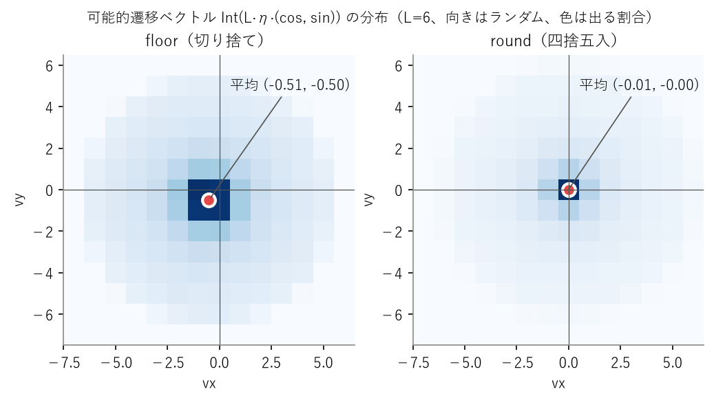
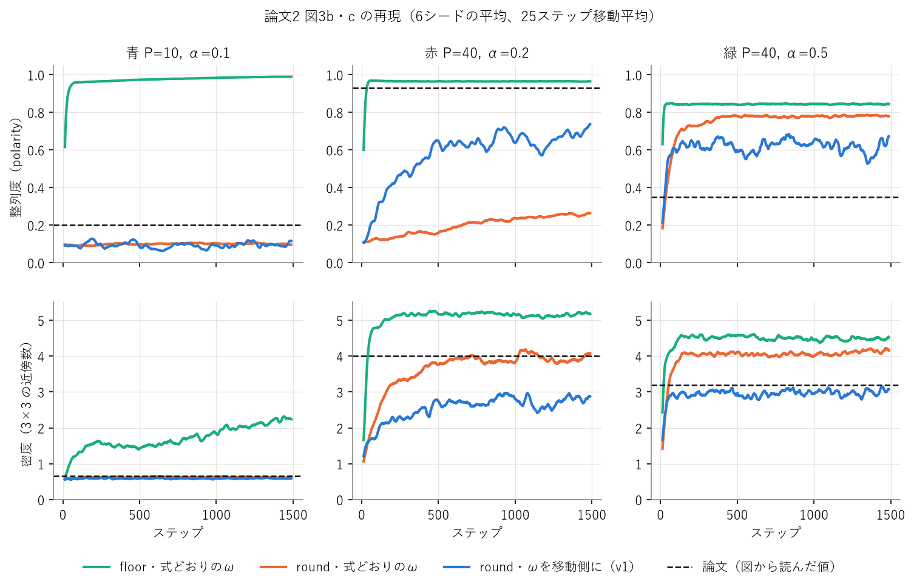
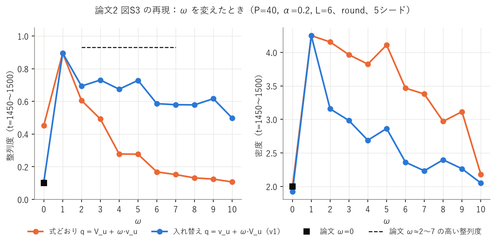
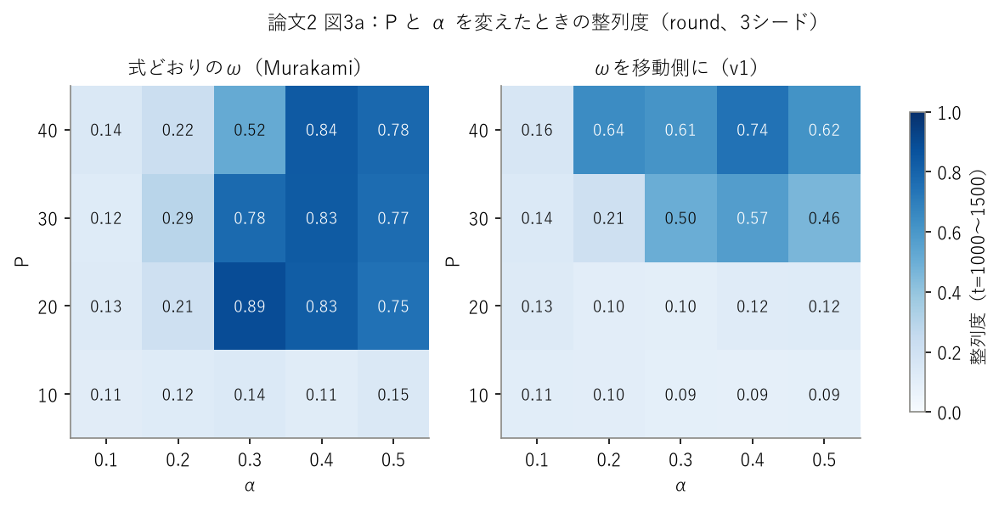
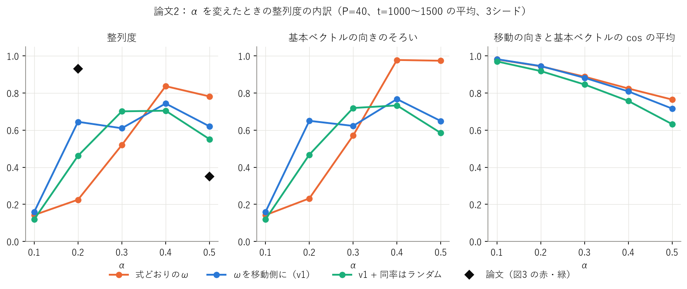
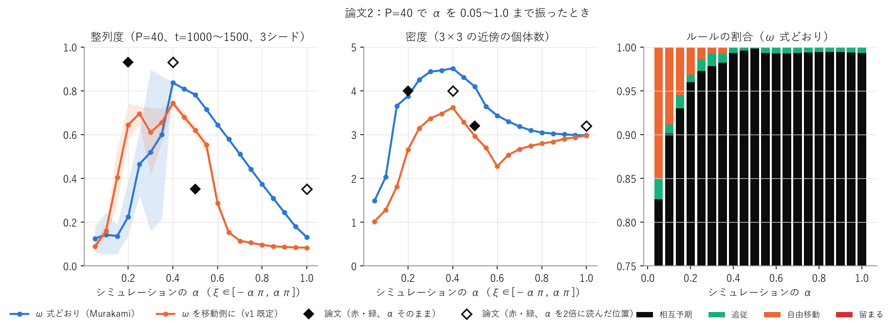
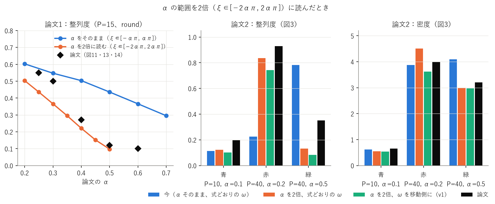
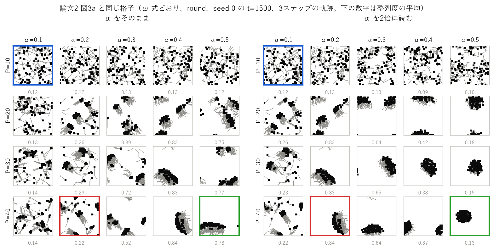
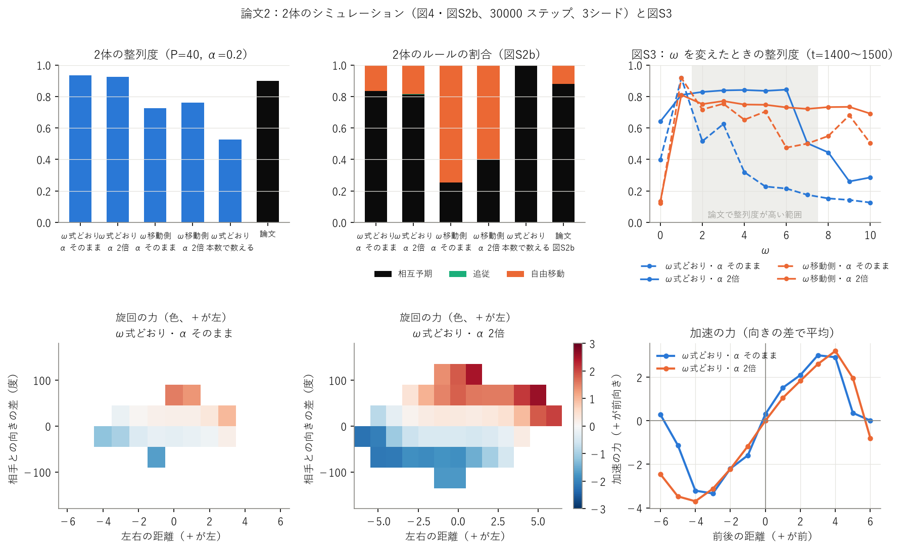
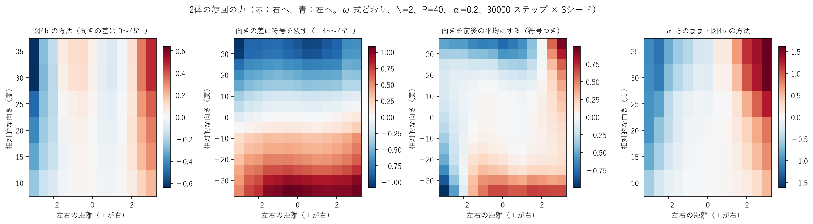

# 論文2の検証（速度一致なし）

[← 検証レポート（入口）](../検証レポート.md)

Murakami et al. 2017（Sci. Rep. 7:46447）と Appendix S1 の再現。

- 節番号は分ける前と同じ。1・2・5章は [01_測り方とモデル](01_測り方とモデル.md)、3章は [02_論文2](02_論文2.md)、4章は [03_論文1](03_論文1.md)、7章は [04_計画](04_計画.md) にある。

---

## やったことと結果の一覧

論文2で試したことを「やったこと → 結果」で並べた表。詳しい説明と図は、この下の各節にある。新しく試したら、ここにも1行足す。

| やったこと | 結果 | 日付 |
|---|---|---|
| 速度一致を外して、基本ベクトルを V と ω で更新する（Murakami の付録どおり） | 論文2のモデルはこれ。論文1とは別のモデルとして扱う | 10/30、11/1 |
| 整数化を floor から round にする | 青の整列度が下がって論文と合った（0.99 → 0.10）。赤・緑は悪くなった。floor だと収束が速すぎるのもこれが原因 | 10/30、11/18 |
| ω を移動の向き側に掛ける（図S3 の説明文に合わせる） | 図S3 の ω=0 は合う。でも2体（図S2b）では2体が離れて合わない ⇒ 式どおりの方が良さそう | 11/18、11/19 |
| α を 0.05〜1.0 まで振る | 整列度は山の形。頂上は α=0.4 で論文の2倍の位置 | 11/19 |
| α 2倍 ＋ ω 式どおり ＋ round ＋ 1個体1票 | 赤 0.84 / 緑 0.13 / 青 0.12 で、図3 の順番がはじめて出た。図3a、図S2 の赤・緑、2体の図S2b も合う | 11/18、11/19 |
| 人気度を遷移の本数で数える | 相互予期が 100% になってそろわない ⇒ 1個体1票を採用 | 11/18 |
| 同率のときランダムに選ぶ | α=0.5 も 0.2 も下がる ⇒ 基本ベクトルに近い向きを選ぶ（式どおり）のまま | 11/18 |
| 競合したら向きが近い個体が勝つ／人気度の高い個体から更新する | どちらも変わらないか、そろわない | 11/18 |
| 止まる個体がいるか調べた | 0%、原因じゃない | 11/19 |
| 図4 の旋回の力を、論文の Methods どおり（向きの差は 0〜45°、ビンを重ねる）に計算し直す（計画C） | どの設定でも縦じまになり、論文の図4b と同じ（左右の距離で決まる）。前に合わなかったのは、向きの差に符号を残し、1つ前の速度を向きに使っていたから | 11/20 |

---

## 3. 論文2の検証

論文2で合わせたい図は次のとおり。

- 図3：青（P=10, α=0.1）、赤（P=40, α=0.2）、緑（P=40, α=0.5）の整列度と密度の時間変化
- 図3a：P × α の格子
- 図S2：ルールの割合
- 図S3：ω を変えたとき
- 図4・図S2b：2体のシミュレーション

図3 の値を読み直した結果は次のとおり。

| 条件 | 整列度 | 密度 |
|---|---|---|
| 青 | 0.2 | 0.65 |
| 赤 | 0.93 | 4.0 |
| 緑 | 0.35 | 3.2 |

- 枠の色と P・α の組み合わせは、本文と図で一致している。
- 赤緑青の値の読み取りも、正しいことを確認した（ゼミの指摘への対応）。

### 3.1 整数化（Int）：floor から round へ

**図1** floor で整数化すると、遷移ベクトルが平均 (−0.51, −0.50) だけ左下にずれる。round ではずれない。

- **改善したいこと：** 青の整列度が高すぎる。収束も速すぎる（開発メモ 9/19〜10/30）。
- **原因と考えたこと：**
  - 論文2では、基本ベクトルの向きを「自分が実際に動いた向き」で更新する。
  - そのため、floor のずれが毎ステップ積み重なり、全員がそろって左下へ流れる。
- **変更：** round にした。
- **結果：**
  - floor では青も整列度 0.99 になり、50 ステップほどで収束していた。round では 0.10 になり、論文に合った（図2、表1）。
  - ただし、論文2の付録には floor（X ≤ x < X+1）と書かれている。round の方が合う、というのは結果から見た判断で、文面とは一致しない。

**図2** 青・赤・緑の3条件の、整列度と密度の時間変化（α はそのまま読んだ場合）。

**表1** t=1000〜1500 の平均（α はそのまま読んだ場合）。ルールの割合は「相互予期 / 追従 / 自由移動」で、単位は %。

| 条件 | 論文 | floor・ω 式どおり | round・ω 式どおり（Murakami） | round・ω 移動側（v1） |
|---|---|---|---|---|
| 青 P=10, α=0.1 整列度 / 密度 | 0.2 / 0.65 | 0.99 / 2.09 | **0.10 / 0.62** | **0.10 / 0.59** |
| 青のルールの割合（図S2） | 63 / 5 / 32 | 87 / 4 / 10 | **64 / 5 / 32** | **61 / 5 / 33** |
| 赤 P=40, α=0.2 | 0.93 / 4.0 | 0.96 / 5.13 | 0.25 / **3.96** | 0.66 / 2.72 |
| 緑 P=40, α=0.5 | 0.35 / 3.2 | 0.84 / 4.48 | 0.78 / 4.10 | 0.62 / **2.99** |

- round にすれば、青は ω をどちらに掛けても合う。
- ただし、α をそのまま読む限り、赤は低く緑は高い。論文と逆になっている（3.3 節で詳しく見る）。

### 3.2 ω をどちら側に掛けるか（11/18 に試し、11/19 に見直した）

- **改善したいこと：** 赤の整列度が 0.25 までしか上がらない。
- **原因と考えたこと：** 付録の式(13)は q = V_u + ω·v_u（ω は前の基本ベクトルの重み）。一方、図S3 の説明文は「ω が小さいと前の基本ベクトルのまま、大きいと速度の向きにほぼ一致する」で、式とは逆に読める。
- **変更：** 説明文の読み方 q = v_u + ω·V_u（`omega_on="velocity"`）を試した。

**図3** ω を 0〜10 に変えたときの整列度と密度（α はそのまま読んだ場合）。

- **結果（α をそのまま読んだ場合）：**
  - ω=0：入れ替えた版は整列度 0.11、密度 1.92 で、論文（0.1 / 2.0）と一致した。式どおりの版は 0.45 で合わない。
  - ω=2〜7：論文は整列度が高い（約 0.93）。式どおりの版は 0.6 から 0.15 まで下がる。入れ替えた版は 0.6〜0.7。
  - ω=1：論文は「ω≤1 で整列度が低い」としているが、どちらの版も 0.9 になる（ω=1 では2つの式が同じになる）。
  - 赤は 0.25 から 0.66 まで上がった。そこで v1 の既定にした。
- **見直し（11/19）：** 2体のシミュレーション（3.6 節）では、入れ替えた版は論文と合わず、式どおりの版が合った。α を2倍に読む場合は、式どおりの版でも図3 に合う（3.5 節）。**⇒ 今は式どおりの方が有力。**

### 3.3 α をそのまま読むと、α の効き方が逆になる

**図4** P と α を変えたときの整列度（α はそのまま読んだ場合）。論文の図3a では、整列するのは P が大きく α が小さい赤の条件。

- 式どおりの版は、α≥0.3 で整列度が 0.75〜0.89 になる。α が大きいほど整列する、という逆の傾向。
- v1（ω 移動側）でも、α=0.5 で整列度が下がるところまでは届かない。

**図5** P=40 で α を 0.1〜0.5 に変えたとき（3シード）。整列度を2つに分けた（(a) 基本ベクトルのそろい、(b) 実際の移動が基本ベクトルに沿っている度合い。4.3 節を参照）。

- (b) は、期待どおり α で下がる（0.98 → 0.72〜0.76）。α のノイズとしての効果は出ている。
- ところが (a) は、α が大きいほど上がる（式どおりの ω で 0.14 → 0.98）。
  - α が大きいと扇が広がって、遷移先が重なりやすくなる。
  - そのため相互予期が増え（90% → 100%）、密度も上がる（2.0 → 4.5）。
  - 密な群れの中では、互いの移動を通して θ がそろっていく。
- 赤（α=0.2）は、そろうのが遅く、運しだいになっている。式どおりの ω で 4000 ステップまで回すと、最後の 500 ステップの整列度はシードごとに 0.05 / 0.23 / 0.37 / 0.42 / 0.92 とばらばらだった。

### 3.4 α を広く振ると、整列度は山の形になる（ゼミの指摘への対応）

**図6** P=40 で α を 0.05〜1.0 に変えたとき（3シード、t=1000〜1500 の平均）。
- 薄い帯は、3シードの最小〜最大。
- 黒い菱形は、論文の赤・緑の値を α そのままの位置に置いたもの。
- 白い菱形は、同じ値を α を2倍に読んだ位置に置いたもの。

- **ゼミの指摘：** 「Murakami 版で α が大きくなると整列度が上がるのがおかしい。P=40 で α を変えて確認する」
- **結果：整列度は単調に上がるのではなく、山の形になった**（ω は式どおり）。
  - α=0.05〜0.2 は低い（0.12〜0.22）。シードによってばらつく。
  - α=0.4 で最大の 0.84 になり、そこから α=1.0 の 0.13 まで、なめらかに下がる。
  - これまでは α=0.1〜0.5 しか見ていなかったので、上り坂だけを見ていた。
- **山の形は論文と同じで、横にちょうど2倍ずれている。**
  - 論文は α=0.2 で高く（0.93）、α=0.5 で低い（0.35）。
  - シミュレーションで同じ値になるのは、α=0.4（0.84）と α≈0.8〜0.9（0.37〜0.24）。
- 密度も同じ形で、α=0.4 で最大（4.5）になり、α=1.0 で 3.0 に下がる。論文の赤 4.0、緑 3.2 と、2倍の位置で近い。
- **α が小さいと整列しない理由：** α が小さいと可能的遷移の扇が狭く、他の個体と遷移先が重なりにくい。相互予期の割合は 83%（α=0.05）から 99%（α=0.4）まで上がる。
- **ω 移動側（v1 の既定）では、** 頂上は α=0.25〜0.4 に来る。ただし α≥0.6 で急に 0.1 まで落ち、論文の緑（0.35）にあたる中間の値が出ない。
- **止まる個体：** すべての α で、「留まる」個体も変位が 0 の個体も 0%。

### 3.5 α を2倍に読むと、図3・図3a が再現できる

- **改善したいこと：** α の効き方が逆になる（3.3 節）。
- **原因と考えたこと：**
  - 論文2 p.4：α が大きすぎると、個体は「ほぼ全方向」の近傍と相互作用する、とある。これは緑（α=0.5）のことを指している。
  - ξ∈[−απ, απ] だと、α=0.5 は前方 ±90° にしかならない。2倍に読めば ±180° で、この記述と合う。
  - 3.4 節の山の頂上が、ちょうど2倍の位置にあることとも合う。
- **変更：** ξ∈[−2απ, 2απ] にする（v1 の `alpha_scale=2`）。
- **ただし、** 式(1)と付録の式(3)は「ξ を [−απ, απ] から選ぶ」と明記している。コードの中で α が「半周 π でなく、1周 2π に対する割合」として使われていた、といった可能性は考えられるが、確かめようがない。

**図7** 左：論文1の整列度（4.5 節）。中・右：論文2の図3 の3条件。

**表2** 論文2 の図3（round、t=1000〜1500 の平均、整列度 / 密度）

| 条件 | 論文 | α そのまま・ω 式どおり | **α 2倍・ω 式どおり** | α 2倍・ω 移動側 |
|---|---|---|---|---|
| 青 | 0.2 / 0.65 | 0.11 / 0.62 | **0.12 / 0.54** | — |
| 赤 | 0.93 / 4.0 | 0.22 / 3.88 | **0.84 / 4.51** | 0.74 |
| 緑 | 0.35 / 3.2 | 0.78 / 4.09 | **0.13 / 2.98** | 0.08 |

- 赤は高く、緑と青は低い。これまでどの版でも出なかった、論文と同じ順番が出た。
- 赤の整列度は、3シードとも t≈450〜1050 で 0.84 に達して、そのまま保たれた。3.3 節のような運しだいではない。
- 緑は 0.13 で、論文の 0.35 より低い。α=0.8（論文の α=0.4 にあたる）では 0.37 / 3.05 で、論文の緑に近い。

**図8** 論文の図3a と同じ P × α の格子（ω 式どおり、seed 0、t=1500、3ステップの軌跡、下の数字は整列度の平均）。左は α そのまま、右は2倍に読んだもの。枠の色は論文の青・赤・緑。

- **2倍に読んだ方（右）は、論文の図3a の見た目に近い。**
  - α=0.2：P≥20 で、一方向に進む細長い群れになる。
  - α=0.4〜0.5：P≥30 で、丸い塊になる。論文の緑の枠（P=40, α=0.5）も丸い塊。
- **そのまま読んだ方（左）は合わない。**
  - α=0.2 の P=20〜40 は、小さな群れに分かれる。
  - α=0.4〜0.5 は、一方向に進む細長い群れになる。

### 3.6 他の図との比較：図S2・2体（図4・図S2b）・図S3（ゼミの指摘への対応）

**図S2：ルールの割合**（ω 式どおり、t=1000〜1500 の平均。相互予期 / 追従 / 自由移動、%）

| 条件 | 論文 | α そのまま | α 2倍 |
|---|---|---|---|
| 青 | 63 / 5 / 32 | **63 / 5 / 32** | 72 / 4 / 24 |
| 赤 | 約 99 / 1 / 0（t≥600） | 96 / 1 / 3 | **99 / 1 / 0** |
| 緑 | 約 98 / 2 / 0 | **100 / 0 / 0** | **99 / 1 / 0** |

- 赤・緑は、どちらの読み方でも論文とほぼ同じ。
- 青は、そのまま読む方がぴったり合う。2倍に読むと、相互予期が少し多すぎる。
- **止まる個体：** 論文の図S2 では3つのルールの合計が 100% なので、論文にも止まる個体はいない。実装でも論文2は 0%、論文1でも最大 0.65%（P=2）。論文には、止まるルールの記述もない。**⇒ 止まる個体は原因ではない。**

**図9** 上段の左・中：2体のシミュレーション（N=2、P=40、α=0.2、30000 ステップ、3シード）。上段の右：図S3。下段：2体での社会的な力（論文の図4 と同じ考え方の解析）。

**2体（図S2b）。** 論文には次のように書かれている。
- 本文 p.6：2体は「かなり近くにいて、整列度は約 0.9 に保たれる」。
- 図S2b：ルールの割合は「相互予期 0.88 / 追従 0 / 自由移動 0.12」。

| 設定 | 整列度 | 相互予期 / 追従 / 自由移動 | 平均距離 |
|---|---|---|---|
| 論文 | 約 0.9 | 0.88 / 0 / 0.12 | 近い |
| ω 式どおり・α そのまま | **0.93** | **0.83 / 0.00 / 0.17** | 4.4 |
| ω 式どおり・α 2倍 | **0.93** | **0.81 / 0.00 / 0.19** | 5.5 |
| ω 移動側（v1 既定）・α そのまま | 0.72 | 0.25 / 0.00 / 0.75 | 15.1（離れる） |
| ω 移動側・α 2倍 | 0.76 | 0.40 / 0.00 / 0.60 | 12.7（離れる） |
| ω 式どおり・人気度を遷移の本数で数える | 0.53 | 1.00 / 0 / 0 | 19.3（離れる） |

- **ω は式どおりが合う。**
  - 2体がくっついて進み、整列度もルールの割合も論文とほぼ同じになる。
  - ω を移動側に掛けると、2体が離れてしまい、自由移動が 60〜75% になる。
- **人気度は「1個体につき1サイト1票」が合う。** 遷移の本数で数えると、1体だけでも自分の遷移どうしが重なって人気度が 2 以上になる。そのため相互予期が 100% になってしまう。
- この2つは、α の読み方によらない。

**社会的な力（図4）。** 一部だけ合う。
- **合うところ：**
  - 左右の距離で平均すると、相手のいる側に曲がる。
  - 相手が前にいると加速し、後ろにいると減速する。
  - どちらも論文と同じ向き。
- **合わないところ：**
  - 「向きの差」と「左右の距離」に分けて見ると、旋回の向きは主に向きの差で決まっていた（相手の向きに合わせて曲がる）。
  - 論文の図4b は、「向きの差より左右の距離で決まる」としている。
  - これは、今のどの設定でも同じだった。
- **注意：** ここでの解析は、1ステップの速度の差で力を求めている。ノイズの大きい速度が平均に戻る分（平均への回帰）が混ざっている可能性がある。論文の計算方法（速度をならしているか）を確かめる必要がある。

**図S3（ω を 0〜10）。** ω 式どおり・α 2倍（上段右の青の実線）の結果。
- **合うところ：**
  - ω=1〜6 で整列度が高い（0.81〜0.84）。
  - ω≥7 で下がる（0.50 → 0.26）。論文の「ω≥8 で整列度が低い」に合う。
  - α そのままでは ω≥2 から下がってしまうので、2倍に読む方がよく合う。
- **合わないところ：**
  - ω=0 では 0.64 で、論文の 0.1 より高い。
  - 論文は ω≤1 で低いとしているが、どの設定でも ω=1 で 0.8〜0.9 になる。

### 3.7 効かなかった候補（論文2）

| 変えたところ | 論文の根拠 | 結果 |
|---|---|---|
| 競合したら、遷移の向きが基本ベクトルに近い個体が取り、負けた個体は2番目へ（全員が同時に狙う） | 本文 p.4 | ω 移動側ではどの α でも 0.14 以下。ω 式どおりでも赤 0.31、緑 0.64 |
| 狙うサイトの人気度が高い個体から更新する | 本文 p.4「人気度の分布が更新の順番を決める」 | ω 式どおりで赤 0.28、緑 0.75 |
| 留まった個体（速度 0）も整列度の平均に入れる | 本文「平均単位速度のノルム」 | 留まる個体が 0% なので、値は同じ |
| Int を付録どおり floor にする | 付録の式(2) | 青も 0.98 になる（3.1 節と同じ） |
| 人気度が同率のとき、ランダムに選ぶ | なし（付録は「基本ベクトルに近いもの」） | α=0.5 は 0.55 まで下がったが、α=0.2 も 0.46 に下がった |
| 人気度を遷移の本数で数える（`dedupe_votes=False`） | 付録の式(5)の文字どおりの読み方 | どの α でも相互予期が 100% になり、整列度は 0.34 以下。2体でも合わない |
| η を √ にする | なし | 密度は上がるが、α に対する形は変わらない |
| 式(13)の v_u に (cosθ, sinθ) を使う | — | v1 と同じ |

（α はそのまま読んだ場合の結果）

### 3.8 論文2のまとめ

**表3** 設定ごとに、論文の図と合うか（○ 合う、△ 一部、× 合わない）

| 図 | α そのまま・ω 式どおり（Murakami） | α そのまま・ω 移動側（今の v1 既定） | **α 2倍・ω 式どおり** |
|---|---|---|---|
| 図3 青 | ○ | ○ | ○ |
| 図3 赤（整列する） | × 0.22 | △ 0.66 | **○ 0.84** |
| 図3 緑（整列しない） | × 0.78 | × 0.62 | **○ 0.13**（やや低い） |
| 図3a の格子 | × | × | **○** |
| 図S2 青 | ○ | ○ | △ |
| 図S2 赤・緑 | ○ | ○ | ○ |
| 図S2b・2体の整列度 | ○ | × | **○** |
| 図S3 ω=0 | × | ○ | × |
| 図S3 ω≥8 で下がる | △ | × | **○** |
| 図4b 旋回の力（論文の Methods どおりに計算、3.9 節） | ○ | ○ | ○ |

- **一番多くの図に合うのは「α 2倍・ω 式どおり」**（＋ round、1個体1票）。
- 残っているのは、図S2 の青と、図S3 の ω≤1 の2つ。図4b は、論文の Methods どおりに計算し直すと、どの設定でも合った（3.9 節、11/20）。

### 3.9 図4（2体の旋回の力）の計算方法を見直す（計画C、11/20）

- **ねらい：** 3.6 節では、旋回の向きが「向きの差」で決まっていて、論文の図4b（「左右の距離」で決まる）と合わなかった。1ステップの速度の差で力を求めていたので、速度のぶれが平均に戻る動き（平均への回帰）が混ざっているのでは、と考えた。
- **論文を読み直した結果（本文 p.6 と Methods の「Force map」）：**
  - 加速度は「速度 v_i,t から計算する」とだけあり、速度をならすとは書かれていない。
  - **図4b の縦軸「相対的な向き」は 0〜45°で、左右の符号がない。** 3.6 節の解析は −180〜180°と符号を残していたので、ここが論文と違っていた。
  - 地図はビンを重ねて作る（向きは幅 20°を 5°ずつ、左右の距離は幅 2 を 0.5 ずつずらす）。
- **試したこと：** 2体（N=2、P=40、α=0.2、30000 ステップ、3シード）を回して位置を保存し、力の地図を5通りの計算方法で作った。
  - backward：向き＝1つ前の速度、加速度＝速度の差（3.6 節と同じ）
  - central：向き＝前後2つの速度の平均、加速度は同じ
  - smooth 3 / 5 / 10：位置を移動平均でならしてから central と同じ計算
  - 設定は ω 式どおり・α そのまま、ω 式どおり・α 2倍、ω 移動側（v1 の既定）の3つ。人気度は1個体1票。
  - スクリプト：`report_scripts/planC_pair.py`（実行）、`planC_analyze.py`（集計と図）。位置は `report_data/planC_pair.npz`、地図は `report_data/planC_force.json`。

**図20** 2体の旋回の力（赤：右へ、青：左へ）。左から、図4b と同じ方法（α 2倍）、向きの差に符号を残したもの、向きを前後2つの速度の平均にしたもの（符号つき）、図4b と同じ方法（α そのまま）。

**旋回の力が何で決まるか**（ω 式どおり）

| 計算方法 | 図4b の方法で「左右の距離」で決まる割合 | 符号つきの回帰の係数（左右の距離 / 向きの差） |
|---|---|---|
| backward（α そのまま） | **1.00** | +0.06 / −0.31 |
| backward（α 2倍） | **1.00** | +0.08 / −0.51 |
| central（α そのまま） | **1.00** | **+0.10 / −0.01** |
| central（α 2倍） | **1.00** | **+0.16 / −0.05** |

「決まる割合」は、地図のばらつきのうち列（左右の距離）の違いで説明できる割合。回帰の係数は標準化したもので、正は「相手のいる側へ曲がる」、負は「相手の向きに合わせて曲がる」。

- **論文の図4b と同じ方法（向きの差を 0〜45°にする）で計算すると、どの設定でも縦じまになり、旋回の向きは左右の距離で決まる。** 相手が右にいれば右へ、左にいれば左へ曲がる。論文の図4b と同じ形。
  - α そのまま（図20 右）の大きさは ±1.5 で、論文の ±2 に近い。
  - ω 移動側（v1 の既定）でも同じ形になった。図4b は、ω の読み方を決める手がかりにはならない。
- **3.6 節で「向きの差で決まる」と見えたのは、計算方法のせい。**
  - 向きの差の符号を残すと、1つ前の速度を向きに使ったとき（backward）だけ、向きの差の係数が大きくなる（−0.31〜−0.51）。
  - 向きを前後2つの速度の平均にすると（central）、その係数はほぼ 0（−0.01〜−0.05）になり、左右の距離の係数（+0.10〜+0.16）の方が大きくなる。
  - つまり、1ステップでぶれた速度を向きとして使うと、次のステップで元に戻る動きが「相手の向きに合わせて曲がる」ように見えていた（平均への回帰）。
- 位置をならす（smooth）と、力そのものが小さくなり、地図がはっきりしなくなる。論文はならしていないので、ならす必要はない。
- 加速の力（図4c）は、どの方法・設定でも前後の距離で決まっていた（割合 0.94〜1.00）。論文と同じ。
- **⇒ 図4b・4c は再現できた（課題7 は解決）。**
