# 論文1の検証（速度一致あり）

[← 検証レポート（入口）](../検証レポート.md)

Gunji et al., *Robust swarm of soldier crabs* の再現。

- 節番号は分ける前と同じ。1・2・5章は [01_測り方とモデル](01_測り方とモデル.md)、3章は [02_論文2](02_論文2.md)、4章は [03_論文1](03_論文1.md)、7章は [04_計画](04_計画.md) にある。

---

## やったことと結果の一覧

論文1で試したことを「やったこと → 結果」で並べた表。詳しい説明と図は、この下の各節にある。新しく試したら、ここにも1行足す。

| やったこと | 結果 | 日付 |
|---|---|---|
| 速度一致を外す | 群れができない ⇒ 速度一致は必要 | 10/29 |
| 速度一致に自分を含めない／相互予期の前に行う | 違いなし | 10/27 |
| 追従のロジック（空いたセルへの移動）を変える | 変わらない | 10/8 |
| 処理を「全員の相互予期 → 全員の追従 → 全員の自由移動」の順にする | 今の論文1のもと | 10/3 |
| 追従の連鎖をなくす（相互予期で空いたセルにだけ追従） | P=2 で群れが崩れる現象が出た | 11/15、11/18 |
| 速度一致を実際の移動の平均にする | 整列度がむしろ上がった | 11/18 |
| 外部摂動を入れる（θ に乱数を足す） | 整列度が全体に下がるだけで α の傾きは平らになる。密度も下がる | 11/18 |
| 1体ずつ相互予期 → 追従 → 自由移動を判定する | P=1 が崩れて「P=1 は BOIDS と同じ」に合わない | 11/18 |
| 追従者近傍の半径を 5 にする／整列度の定義を変える | 変化なし、α の形は同じ | 11/18 |
| 競合を文字どおりにする（負けたら2番目のサイトへ） | 全体に下がるだけ。α が小さい側が低すぎる | 11/18、11/20 |
| α 2倍 × Int × 競合の8通り（計画2） | 一番近いのは α 2倍 × round × sequential（α=0.3 / 0.4 / 0.5 で 0.37 / 0.22 / 0.10、論文 0.50 / 0.27 / 0.12）。α=0.3 だけ低い | 11/20 |
| α=0.25〜0.45 を細かく、3000 ステップ（計画A） | 急な落ち方は出ない。整列度は一直線に下がり、2つの状態の行き来もない。θ がいつも完全にそろう（φ=1.00）のが原因 ⇒ 課題17 と同じ | 11/20 |
| 同率の最大人気サイトと自由移動の行き先をサイト単位で選ぶ（計画E の E1、式(4)(6)） | 効かない（整列度の変化 0.03 以内、φ も 1.00 のまま） | 11/21 |
| 速度一致で近傍の移動ベクトルそのものを平均する（計画E の E2、式(8)） | round と組むと θ がばらつく（φ 0.94→0.53）。α そのまま・round で α=0.3 が 0.51（論文 0.53）、区画 Ls=10 の密度が 0.31（図13・14 と合う）。α が大きい側は高すぎる。floor だと逆効果 | 11/21 |
| 速度一致で移動の単位ベクトルを平均する（計画E2、round で試し直し） | 移動ベクトルとほぼ同じ（差 0.01 以内）。4.3 節で効かなかったのは floor のせい。α が大きい側はどちらの α の読み方でも合わない。移動で速度一致すると密度の谷は消え、図11 の密度は低くなる | 11/22 |
| P を変えてルールの割合と密度を測る（計画G） | 相互予期は P≥10 で 98〜99%（v1・α 2倍・E2 とも）。論文2の図S2 とも合い、問題ではない。E2 は相互予期がほぼ同じでも密度が低い ⇒ 詰まりすぎは速度一致の問題。文字どおりの競合だけ相互予期が 45〜67% になる | 11/22 |
| スケールフリー相関（図15）を R(M)=2 で、速度の取り方と規格化を変えて測る（計画I） | ノートブックと同じ規格化（自分との積で割る）で、傾きは v1 で −0.07〜−0.27（論文 −0.96）。E2 で −0.5 まで近づく。1ステップの移動のぶれが個体ごとにばらばらなのが原因。R² も 0.4〜0.8 と低い | 11/22 |
| 密度の谷を10シードで確かめる（計画F） | 2倍・round の α=0.6 で P=11〜15 にだけ谷（約 0.1、標準誤差の約3倍）。論文の P=8〜12 より少しずれる。他の条件では出ない | 11/21 |
| 密度を論文の文面どおり「区画に分ける」方式で、Ls を変えて測り直す（計画B） | 図11 は Ls=25（2×2）で合う（群れが崩れたときの谷の底 0.31 も一致）。図13・14 は2つの可能性：Ls≈6 なら今のモデルで合う、Ls=10 なら今のモデルは密すぎる（文字どおりの競合なら合う） | 11/20 |

---

## 4. 論文1の検証

論文1で合わせたい図は次のとおり。

- 図8：P × α のスナップショット
- 図10・11：P を変えたときの整列度・密度
- 図13・14：α を変えたときの整列度

### 4.1 追従の連鎖をなくす（11/15）

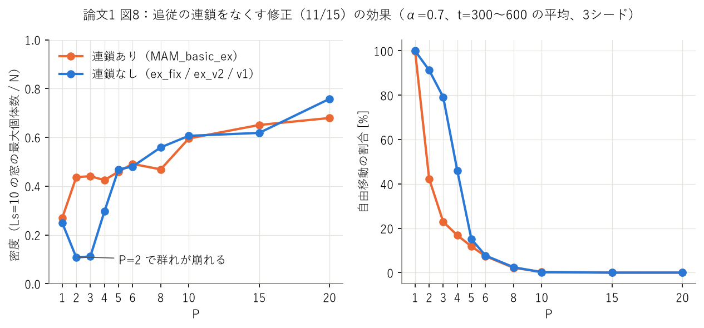

**図10** 追従の連鎖をなくす前後。

- **改善したいこと：** 図8 にある「P=2 で群れが崩れる」現象が出ない。
- **原因と考えたこと：** 論文1 p.7 には「相互予期で動いた個体の空けたサイトを埋める」とある。旧版（`MAM_basic_ex`）では、追従した個体の空けたサイトにも追従できたので、連鎖が起きていた。
- **変更：** 追従先を「相互予期で空いたサイト」だけにした。
- **結果：**
  - P=2〜3 で追従できる個体がほとんどいなくなる。自由移動が 91% になり、密度（Ls=10）が 0.44 から 0.11 に下がる。群れが崩れる。
  - これは論文1 図8 の「P=2 で群れが崩れる」現象にあたる。
  - P≥5 ではほとんど差がない。

### 4.2 今の再現状況（v1、α そのまま）

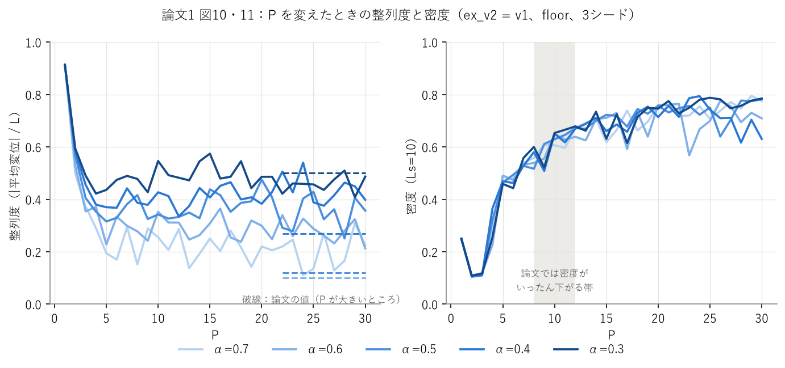

**図11** P を変えたときの整列度（左）と密度（右）。α=0.3〜0.7、floor。

- **P=1：** 全員が同じ向きに進む（整列度 0.91）。P=2〜3 で密度が 0.11 まで下がり、群れが崩れる。
- **整列度（P が大きいところ）：** 論文は α=0.6 / 0.5 / 0.4 / 0.3 でそれぞれ 0.10 / 0.12 / 0.27 / 0.50。モデルは 0.30 / 0.43 / 0.40 / 0.50 で、α が大きい側が下がりきらない。
- **密度が上がり始める P：** 論文は 3〜4、モデルは 4〜6。
- **密度の谷：** 論文では P=8〜12 で密度がいったん 0.6〜0.7 に下がるが、モデルでは出ない。

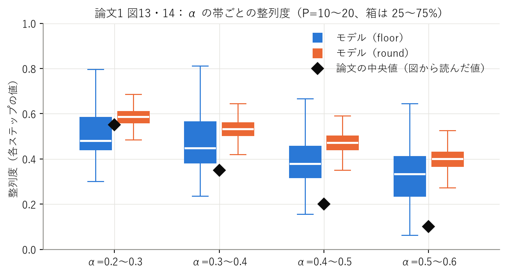

**図12** α の帯ごとの整列度（P=10〜20 の各ステップ）。

- 論文の中央値は、α が大きくなるにつれて 0.55 から 0.1 まで下がる。
- モデルは floor で 0.48 から 0.33 まで、round で 0.59 から 0.40 までしか下がらない。
- α そのままでは、round にするとすべての帯で 0.05〜0.1 高くなり、論文から離れる。論文1で floor を既定にしているのはこのため。
- 密度は、論文が 0.3 前後なのに対して、モデルは Ls=10 でも約 0.7 になる。論文の Ls が分からないので、比べられない。

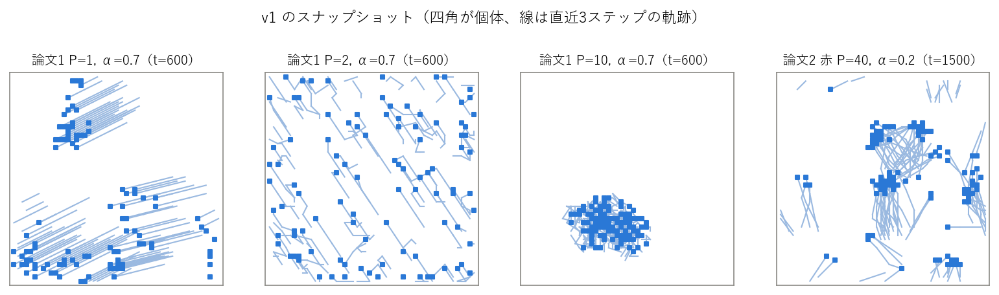

**図13** v1 のスナップショット。左から次の4つ。

- 論文1 の P=1（そろって直進する）
- 論文1 の P=2（崩れて散らばる）
- 論文1 の P=10（密な群れ）
- 論文2 の赤（α そのまま。いくつかの群れに分かれて、それぞれ同じ向きに進む）

### 4.3 α の効きが弱い原因：θ がそろいきってしまう

整列度は、だいたい次の2つの積で決まる。

- **(a) 基本ベクトルの向きのそろい**（全員の θ の単位ベクトルの平均の長さ）
- **(b) 実際の移動が基本ベクトルにどれだけ沿っているか**（移動の向きと θ のなす角の cos の平均）

α は可能的遷移の広がりなので、直接効くのは (b) のはず。(a) が下がるかどうかは、θ の更新のしかた（論文1は速度一致、論文2は ω の式）で決まる。

**整数化のせいではない（両方の論文に共通）。** 開発メモでは「短いベクトルが (0,0) や同じセルにつぶれて、α が効かなくなっている」と疑っていた。そこで、可能的遷移だけを作って、整数化の前後で形を比べた（動かしてはいない）。
- 前向きの成分の平均は、整数化の前後でほとんど同じだった（例：L=4, floor, α=0.5 で、実数 0.318 → 整数 0.324）。
- (0,0) になる割合は、α によらず一定だった（L=4 で、floor 約 7%、round 約 14%）。
- ⇒ 可能的遷移の段階では、α はちゃんと効いている。

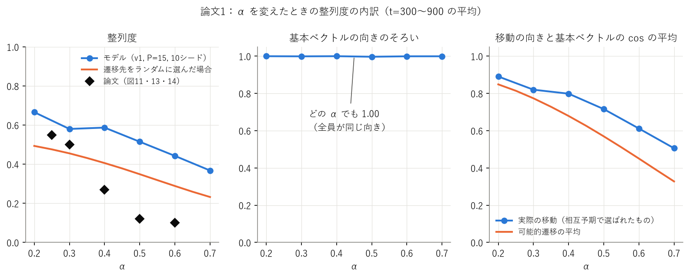

**図14** α を 0.2〜0.7 に変えたとき（P=15、10シード）。左から整列度、(a)、(b)。

- **(a) は、どの α でも 1.00 になる。**
  - 論文1の速度一致は、近傍の θ を平均するだけで、θ にノイズが入る経路がない。
  - そのため、密な群れの中では全員の θ が1つの向きに収束する。
- **α が効くのは (b) だけ。** cos は 0.89 から 0.51 まで下がる。
- **選び方をランダムにしても、論文の値には届かない（図14 左のオレンジ線）。**
  - θ が全員同じなら、遷移先をランダムに選んでも、整列度は α=0.5 で 0.35、α=0.6 で 0.29 になる。
  - 論文の値（0.12、0.10）は、この下限より低い。
  - つまり、論文の値になるには θ がばらばら（(a) が 0.3 程度）である必要がある。
- **相互予期は、前向きの遷移先を選びやすい。** α=0.6 で、可能的遷移の cos の平均は 0.45 だが、選ばれた移動は 0.61。群れが同じ向きに進んでいると、前方のサイトの人気度が高くなるため。

1か所だけ変えた版（いずれも、α に対する整列度の下がり方は良くならなかった）。

| 変えたところ | 論文の根拠 | 結果 |
|---|---|---|
| 速度一致を、近傍の「実際の移動の向き」の平均にする | 式(8)の「average velocity direction」 | (a) は 0.97 以上のまま。整列度はむしろ上がった（α=0.7 で 0.45） |
| 人気度を、個体数ではなく遷移の本数で数える | 式(3)の文字どおりの読み方 | 10シードでは v1 と差がなかった |
| η を √（扇形の中に一様）にする／全部 1 にする | なし（原因を調べるため） | 改善しない。η=1 では整列度が上がる |

- 参考：整列度を測る期間を長くすると（300 → 600 ステップ）、整列度は 0.05〜0.1 高くなった。

### 4.4 θ をばらつかせる仕組み：外部摂動

**論文を読み直した結果**

- 基本モデルで θ が変わるのは、式(8) の速度一致 θ_{k,t+1} = <θ_{k,t}>_M だけ。ノイズを足す記述はない。
- ほかに θ を書き換えるのは、砂時計の設定の壁沿いの処理（式(10a)(10b)）だけで、基本モデルには入らない。
- 外部摂動が出てくるのは、図10左の「相互予期なし」のモデルだけ。
- 相互予期のあるモデル（図10右、図11）の横軸は「内部の揺らぎ」で、P を最大値 30 で割ったもの。
- ⇒ 論文の文面では、基本モデルに外部摂動は入っていない。

**それでも念のため入れてみた。** 図10左の書き方を Vicsek 型の角度ノイズと読み、速度一致のあとに θ += ε·π·U[−1,1] を足した。

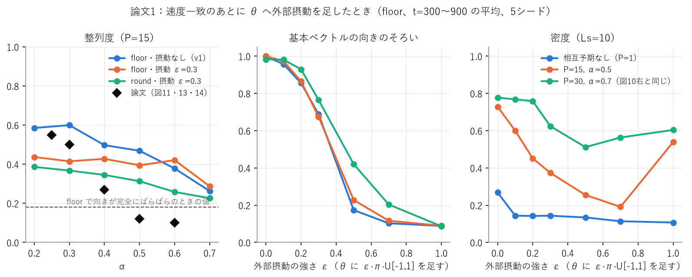

**図15** 左：α を変えたときの整列度。中・右：ε を変えたときの基本ベクトルのそろいと密度。

- **実装の確認：** 相互予期なし（P=1）では、ε を上げると整列度も密度も下がった（整列度 0.96 → 0.18、密度 0.27 → 0.11）。図10左と同じ傾向。
- **θ はばらつくが、α の効き方は強くならない。** 整列度が全体に下がるだけで、α に対する傾きは平らになる。
  - floor、ε=0.3：α=0.2〜0.6 で 0.44 / 0.41 / 0.43 / 0.39 / 0.42。
  - round、ε=0.3：0.39 → 0.26。論文の 0.55 → 0.10 の急な落ち方にはならない。
- **密度も下がる。** P=15、α=0.5 では 0.73 → 0.25（ε=0.5）。論文の「外部摂動に強く、高い密度を保つ」とは逆。
- **角度を数値のまま算術平均する読み方（式(8)）も試した。** v1 とほとんど変わらなかった。
- ⇒ 外部摂動は原因ではなさそう。

**分かったこと：floor のままでは、論文の整列度 0.10〜0.12 には原理的に届かない。**
- 向きが完全にばらばらでも、floor では変位の平均が (−0.5, −0.5) 側にずれる。そのため、整列度（|平均変位|/L）は 0.18 より下がらない（計算で 0.179）。
- round なら、ばらばらのときは 0.05 まで下がる（N=100 の有限サイズの分）。
- 論文の α=0.5、0.6 の値（0.12、0.10）は 0.18 より低い。したがって、次のどれかが成り立っているはず。
  - (i) 論文のコードの Int が floor ではない
  - (ii) 偏りを除いて整列度を計算している
  - (iii) 整列度の定義が違う

### 4.5 α を2倍に読む

- **原因と考えたこと：** 論文2と同じ理由（3.5 節）。論文1 p.15 の「P=20 で α>0.5 のとき、アメーバのような動きになる」も、2倍に読むと全方向になって説明しやすい。
- **結果（図7 左、P=15、round）：**
  - α が大きい側は合う：論文の α=0.4 → 0.22（論文 0.27）、α=0.5 → 0.10（論文 0.12）。
  - α が小さい側は低め：α=0.3 → 0.37（論文 0.50）。

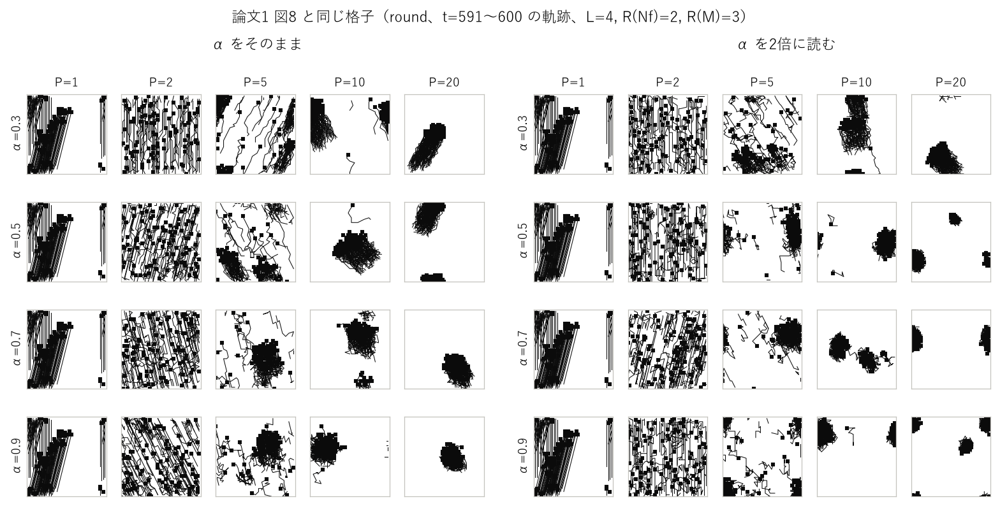

**図16** 論文1 図8 と同じ P × α の格子（round、seed 0、最後の 10 ステップの軌跡）。左は α そのまま、右は2倍に読んだもの。

- 2倍に読むと、α≥0.5 で P≥10 の群れが丸い塊になる。論文の図8（α=0.7、0.9 の P=10、20）の見た目に近い。
- そのまま読むと、α=0.5〜0.9 でも塊が細長く、一方向に進んでいる。

### 4.6 効かなかった候補（論文1）

基準は v1（P=15、5シード、t=300〜900 の平均。整列度は α=0.2 → 0.6 で 0.59 → 0.38）。

| 候補 | 論文の根拠 | 結果 | 判定 |
|---|---|---|---|
| 1体ずつ (4)→(5)→(6) を判定する（段階式でなく） | p.9〜10「更新する個体をランダムに選ぶ」と式(4)〜(6)の書き方。図2の説明は段階式 | α に対する形は同じ（0.53 → 0.38）。P=1 の整列度が 0.96 → 0.54 に下がり、「P=1 は BOIDS と同じ」に合わない | × |
| 追従先を式(5)どおり「更新された個体が空けたサイト全部」にする | 式(5) の w=1 | 1つ上と組み合わせても変化なし | × |
| 追従者近傍の半径を L より大きく（R(Nf)=5） | p.10「半径は基本ベクトルの長さより大きい」。図の R(Nf)=2 と矛盾 | 段階式では変化なし。1体ずつと組み合わせると P=1 が崩れる（0.24） | × |
| 相互予期の競合を文字どおりにする（`ma_rule="literal"`） | p.8「負けた個体は2番目に人気のサイトへ」 | 全体に下がり、傾きは少し急になる（floor：0.42 → 0.17）。α が小さいところが低すぎる（論文 0.55）。密度は α とともに上がる（0.23 → 0.53） | △ |
| 整列度の定義を変える（単位ベクトルの平均、平均の歩幅で割る、floor の偏りを足し戻す） | p.17「移動の平均ベクトルの長さ」（L で割るとは書いていない） | どの定義でも α に対する形は同じ | × |
| 計測区間を最初の 100 ステップにする | 書かれていない | 0.1 ほど低いが、形は同じ | × |
| 外部摂動、角度の算術平均 | 図10左、式(8) | α の効き方は変わらない（4.4 節） | × |

### 4.7 α 2倍・round・文字どおりの競合の組み合わせ（計画2、11/20）

- **ねらい：** α を2倍に読むと、α が大きい側は合うが、α=0.3 が低い（4.5 節）。floor では整列度が 0.18 より下がらない（4.4 節）。文字どおりの競合は、α に対する傾きを少し急にする（4.6 節）。この3つを組み合わせれば、α が小さい側と大きい側が両方合うかもしれない、と考えた。
- **試したこと：** `alpha_scale`（1 / 2）× `int_mode`（floor / round）× `ma_rule`（sequential / literal）の8通り。
  - 条件：P=10 / 15 / 20、α=0.2〜0.7、5シード。全部で 720 本。
  - 測り方：900 ステップ回して t=300〜900 を平均（4.6 節と同じ）。
  - 整列度は v1 と同じ pL（移動の平均ベクトルの長さ / L）。
  - 成功の目安：α=0.3 / 0.4 / 0.5 で、論文の 0.50 / 0.27 / 0.12 の ±0.1 に入ること。
  - スクリプト：`report_scripts/plan2_grid.py`（実行）、`plan2_analyze.py`（集計と図）。結果は `report_data/plan2_grid.json`。

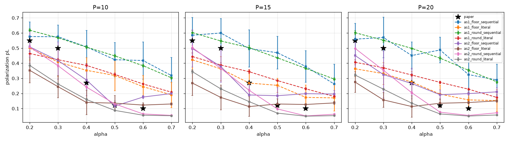

**図17** 8通りの整列度（左から P=10 / 15 / 20、5シードの平均 ± 標準偏差）。実線は α 2倍、破線は α そのまま。丸は round、四角は floor。黒い星は論文の値（図11・13・14 を目で読んだもの）。

**整列度 pL**（P=10 / 15 / 20 と5シードの平均）

| 設定（alpha_scale / Int / 競合） | α=0.2 | 0.3 | 0.4 | 0.5 | 0.6 | 0.7 | α=0.3〜0.5 での最大のずれ |
|---|---|---|---|---|---|---|---|
| **論文** | 0.55 | 0.50 | 0.27 | 0.12 | 0.10 | — | — |
| 1 / floor / sequential（v1 の既定） | 0.57 | 0.58 | 0.49 | 0.46 | 0.37 | 0.29 | 0.34 |
| 1 / floor / literal | 0.43 | 0.37 | 0.30 | 0.26 | 0.19 | 0.17 | 0.14 |
| 1 / round / sequential | 0.61 | 0.56 | 0.50 | 0.44 | 0.37 | 0.29 | 0.32 |
| 1 / round / literal | 0.44 | 0.39 | 0.35 | 0.29 | 0.24 | 0.19 | 0.17 |
| 2 / floor / sequential | 0.49 | 0.37 | 0.25 | 0.16 | 0.19 | 0.20 | 0.13 |
| 2 / floor / literal | 0.30 | 0.19 | 0.12 | 0.13 | 0.13 | 0.14 | 0.31 |
| **2 / round / sequential** | **0.50** | **0.37** | **0.22** | **0.10** | **0.06** | 0.06 | **0.13** |
| 2 / round / literal | 0.35 | 0.24 | 0.15 | 0.07 | 0.05 | 0.05 | 0.26 |

- **3点とも ±0.1 に入る組み合わせは、なかった。**
- **一番近いのは「α 2倍 × round × sequential」。**
  - α=0.2、0.4、0.5、0.6 は論文の ±0.05 に入る。
  - α=0.3 だけが 0.13 低い（0.37。論文は 0.50）。
  - 論文は α=0.3 → 0.4 で急に落ちる（0.50 → 0.27）。一方、モデルはなだらかに下がる。
  - P=10 / 15 / 20 のどれでも同じ傾向（α=0.3 で 0.35〜0.38）。
- **「α 2倍 × floor」は、α≥0.5 で 0.19 前後から下がらない。** floor による下限（4.4 節）がそのまま出ている。
- **文字どおりの競合（literal）は、α が小さい側を合わせる方には効かなかった。**
  - どの組み合わせでも、整列度が全体に下がるだけだった。α=0.3 は、もともと低い値がさらに下がる。
  - ルールの割合が大きく変わる（P=15）。sequential では相互予期が 98〜100% だが、literal では相互予期が 50〜70%、追従が 26〜39% になる。
  - 密度（Ls=10）は literal の方が低く、0.25〜0.54 になる（sequential は 0.62〜0.71）。論文の密度（0.3 前後）に近いのは literal の方。ただし、論文の Ls が分かっていないので、はっきりとは比べられない。
- **round では、シードによるばらつきがほとんどない。** α=0.3〜0.5 での標準偏差は 0.01 以下。floor では 0.1 前後ある。floor のずれ (−0.5, −0.5) で群れの進む向きが決まりかけ、そのあとの動きがシードによって変わっているためだと考えている（未確認）。

### 4.8 α=0.3 → 0.4 の急な落ち方（計画A、11/20）

- **ねらい：** 一番近い設定（α 2倍・round・sequential）でも、α=0.3 の整列度だけが低い（4.7 節）。論文は α=0.3 → 0.4 で急に落ちるのに、モデルはなだらかに下がる。考えた理由は2つ。
  - 群れが「そろった状態」と「ばらばらの状態」を行き来していて、時間平均するとなだらかに見えている。
  - 計測区間（t=300〜900）が短く、そろいきる前の値を測っている。
- **試したこと：** α 2倍・round・sequential で、論文の α=0.25〜0.45 を 0.025 刻みで振った。
  - 条件：P=10 / 15 / 20、5シード、3000 ステップ（全部で 135 本）。
  - 毎ステップの整列度 pL と、基本ベクトルのそろい φ（全員の θ の単位ベクトルの平均の長さ）を記録した。
  - スクリプト：`report_scripts/planA_sweep.py`（実行）、`planA_analyze.py`（集計と図）。結果は `report_data/planA_sweep.json`。
- **論文の値も読み直した**（図11・14 を画像で確認）。
  - 図11（青線、P=10〜20 の範囲）：α=0.3 → 0.53、0.4 → 0.30、0.5 → 0.13、0.6 → 0.10。これまで使っていた値（0.50 / 0.27 / 0.12）は、P=30 寄りの値だった。差は 0.03 以内で、結論は変わらない。
  - 図14 は α を1つの値でなく、**幅（0.2〜0.3、0.3〜0.4、…）でまとめた**分布になっている。中心は 0.2〜0.3 → 0.53、0.3〜0.4 → 0.35、0.4〜0.5 → 0.20、0.5〜0.6 → 0.08。
  - 図13・14 の密度は「空間を X/Ls × X/Ls の区画に分けて、区画の中の最大個体数 / N」と書かれている。今の実装（窓をずらす）とは違う（計画B で扱う）。

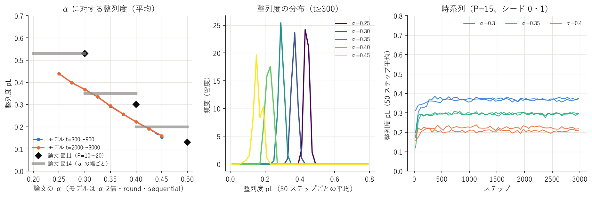

**図18** 左：α に対する整列度（P=10 / 15 / 20 と5シードの平均）。黒い菱形は論文の図11、灰色の横棒は図14 の α の幅ごとの値。中：整列度の分布（50 ステップごとの平均、t≥300）。右：時系列の例（P=15）。

| 論文の α | 0.25 | 0.275 | 0.30 | 0.325 | 0.35 | 0.375 | 0.40 | 0.425 | 0.45 |
|---|---|---|---|---|---|---|---|---|---|
| 整列度（t=300〜900） | 0.44 | 0.40 | 0.37 | 0.34 | 0.29 | 0.26 | 0.22 | 0.19 | 0.15 |
| 整列度（t=2000〜3000） | 0.44 | 0.40 | 0.37 | 0.34 | 0.29 | 0.26 | 0.22 | 0.19 | 0.16 |
| θ のそろい φ | 1.000 | 1.000 | 1.000 | 1.000 | 1.000 | 0.999 | 1.000 | 1.000 | 0.986 |

- **急な落ち方は出なかった。** 整列度は α が 0.025 増えるごとに 0.03〜0.04 ずつ、ほぼ一直線に下がる。
- **2つの状態の行き来はなかった。** 50 ステップごとの平均の分布は、どの α でも幅の狭い山が1つだけ（標準偏差 0.005）。時系列も t≈200 で一定になり、そのまま変わらない。
- **計測区間を延ばしても変わらない。** t=300〜900 と t=2000〜3000 の差は 0.007 以下。
- **なぜ一直線になるか：** θ のそろい φ が、どの α でも 1.00 のまま。全員がまったく同じ向きを向いているので、整列度は「扇（±2απ）の中から実際に選ばれる移動の、前向きの成分の平均」だけで決まる。これは α に対してなめらかに変わるので、急な落ち方にはならない。
- **⇒ 論文のように α=0.3〜0.4 で急に落ちるには、その範囲で θ 自体がばらつき始める必要がある。** 今のモデルでは、速度一致で θ が完全にそろうので、それが起きない。課題13・14 は、課題17（θ がそろいきる）と同じ原因にまとまった。
- 図14 の「0.3〜0.4 の幅で 0.35」とは、モデルの α=0.3〜0.35 の値（0.37〜0.29）が近い。論文の図14 が幅ごとにまとめた値なので、図11 の「α=0.3 で 0.53」とどちらに合わせるべきかも、先生に確認したい。

### 4.9 密度の測り方を論文と合わせる（計画B、11/20）

- **ねらい：** 論文1の密度は、図11 では 0.6〜0.9、図13・14 では 0.3 前後と、同じ P=10〜20 でも値が大きく違う。今の実装（Ls=10 の窓をずらす）では約 0.7 で、どちらとも合わない（課題19）。P=8〜12 の密度の谷（課題18）も出ていない。測り方が論文と違うのではないかと考えた。
- **論文の文面（p.17）：** 「密度は、群れの大きさの正方形の中の最大個体数を正規化したもの。群れの半径を Ls とみなせるなら、X×X の空間を X/Ls × X/Ls 個の区画に分け、区画の中の最大個体数を全個体数で割る」。
  - つまり、窓をずらすのではなく、**空間を区画に分ける**。
  - Ls は**群れの半径くらい**にとる。具体的な値は書かれていない。
  - 測る時刻や平均の取り方も書かれていない。
- **試したこと：** 位置を保存しながら回し、密度を測り方と Ls を変えて測り直した。
  - 条件：P=1〜30、α=0.3〜0.6、3シード、900 ステップ（t=300〜900 の 10 ステップごと）。v1 の既定と、α 2倍・round の2通り。
  - 測り方：窓をずらす（Ls=5〜25）と、区画に分ける（2×2〜10×10、Ls=25〜5）。
  - 群れの半径の目安として、回転半径 Rg（重心からの距離の2乗平均の平方根）も測った。
  - スクリプト：`report_scripts/planB_sim.py`（実行）、`planB_analyze.py`（測り直しと図）。集計結果は `report_data/planB_density.json`（位置の生データは大きいので置いていない）。

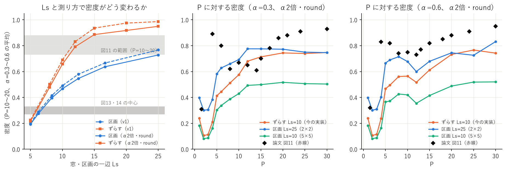

**図19** 左：窓・区画の一辺 Ls と密度（P=10〜20、α=0.3〜0.6 の平均）。灰色の帯は論文の値。中・右：P に対する密度（α 2倍・round）。黒い菱形は論文の図11 の赤線を目で読んだもの。

**P=10〜20 の密度**（α=0.3〜0.6 の範囲、α 2倍・round）

| 測り方 | 密度 | 論文で近い図 |
|---|---|---|
| ずらす Ls=10（今の実装） | 0.61〜0.70 | どちらとも合わない |
| 区画 Ls=6.25（8×8） | 0.26〜0.29 | **図13・14（0.3 前後）** |
| 区画 Ls=10（5×5） | 0.42〜0.50 | — |
| 区画 Ls=25（2×2） | 0.68〜0.78 | **図11（0.6〜0.88）** |
| 群れの回転半径 Rg | 5.0〜9.2 | — |

- **図13・14 は、区画に分けて Ls≈6 にすると合う。** 密度は 0.26〜0.29 で、論文の 0.3 前後に近い。
  - Ls≈6 は、群れの回転半径（5〜9）とほぼ同じ。論文の「群れの半径を Ls とみなせるなら」という文面とも合う。
- **図11 は、区画に分けて Ls=25（空間を 2×2 に分ける）にすると合う。**
  - 一番の根拠は、群れが崩れる P=2〜3 の値。全員がばらばらに散らばったとき、2×2 の区画の最大個体数は 0.30 になる（ランダムに置いて計算した値も 0.30）。論文の図11 で P≈1〜2 の谷の底は 0.31〜0.32 で、これとぴったり合う。今の実装（ずらす Ls=10）では 0.11 になる。
  - P=10〜20 の値（0.68〜0.78）も、論文の範囲（0.6〜0.88）に入る。
  - ただし P=30 では 0.75〜0.83 で、論文（0.93〜0.95）より低い。
  - α=0.6 では、P=12 で密度が一度下がる（0.60。前後は P=8 で 0.72、P=20 で 0.74）。論文の P=8〜12 の谷（課題18）に似ている。ただし α=0.3 では出ず、3シードしかないので、谷が再現できたとはまだ言えない。
- **⇒ 図11 と図13・14 では Ls が違うと考えると、両方の値の大きさが説明できる。** ただし、図13・14 の Ls については2つの読み方があり、**どちらの可能性もある**（下の表）。文面には Ls の値がないので、先生に確認したいことに足す。あとでまた考える。

**図13・14 の Ls の2つの読み方**（11/20 追記）

| | 読み方1：Ls≈6 | 読み方2：Ls=10 |
|---|---|---|
| 根拠 | 文面の「群れの半径を Ls とみなす」。群れの回転半径（5〜9）とほぼ同じ | パラメータ（L=4、R(M)=3 など）を考えると、10 より小さい Ls は考えにくい。S=50 を割り切れる Ls は、10 以上なら 10 と 25 だけ |
| 今のモデル（sequential）の密度 | 0.26〜0.29。論文の 0.3 に合う | 0.43〜0.50。論文の 0.3 より高い |
| 意味すること | 測り方を直せば合う | 測り方ではなく、**今のモデルの群れが論文より詰まりすぎている**。相互予期が 99% で追従・自由移動がほとんど起きないこと（課題20）とつながっていそう |
| 合う設定 | α 2倍・round・sequential（計画2で一番近い設定） | 計画2のデータを区画 Ls=10 で集計し直すと、競合を文字どおりにした版（α そのまま・floor・literal）が α=0.3 / 0.4 / 0.5 で 0.24 / 0.29 / 0.34 になり、論文の 0.3 に合う。ただし literal は整列度が全体に下がりすぎる（4.7 節） |

- どちらの読み方でも、**図11 は Ls=25（2×2）** で変わらない。Ls=10 だと、全員ばらばらのときの値は 0.08 にしかならず、図11 の谷の底（0.31）を説明できない。
- 図13・14 を Ls=25 で測った可能性は低い。Ls=25 で 0.3 は「全員ばらばら」と同じ値になり、「密度の高い群れ」という論文の主張と合わない。
- **測る時刻（移動の前か後か、課題26）：** 時間平均を取る場合、移動の前に測った値の並びは、1ステップ前の移動の後に測った値の並びと同じになる。違うのは区間の端の1回だけなので、平均には効かない。
- 密度の定義を変えても、整列度は変わらない（整列度は移動から計算するため）。

### 4.10 θ がばらつく仕組みを文面から探す（計画E、11/21）

- **ねらい：** 速度一致で θ が完全にそろうこと（φ=1.00）が、α の効きが弱い原因だった（4.3・4.8 節）。式(4)〜(8) を読み直し、実装と文面がずれていそうな2か所を変えた。
  - **E1（式(4)・式(6)）：** 「最大人気のサイトが複数あれば、そのうち1つをランダムに選ぶ」「Rd{集合}」。v1 は遷移（本数）単位で選んでいて、同じサイトを指す遷移が多い前向きのサイトほど選ばれやすかった。サイト単位で一様に選ぶようにした（v1 の `choose_by="site"`）。
  - **E2（式(8)）：** 速度一致の説明は「近傍 M の平均の速度の向き」。v1 は近傍の基本ベクトルの向き θ を平均していた。近傍の個体の移動ベクトルそのもの（長さ込み、留まった個体は 0）を平均するようにした（v1 の `vm_source="disp"`）。
- **試したこと：** 計画2 と同じ条件（P=10 / 15 / 20、α=0.2〜0.7、5シード、900 ステップで t=300〜900 の平均）で、α の読み方3通り（そのまま・floor、そのまま・round、2倍・round）と組み合わせた。
  - スクリプト：`report_scripts/planE_sweep.py`、`planE_extra.py`（そのまま・round の分）、`planE_analyze.py`（集計と図）。結果は `report_data/planE_sweep.json`、`planE_extra.json`。
  - v1 に足したオプションは、既定（`choose_by="vector"`、`vm_source="theta"`）でこれまでと同じ結果になることを確かめた（6通りの設定 × 2シード × 150 ステップで、位置・向き・ルールの回数が一致）。

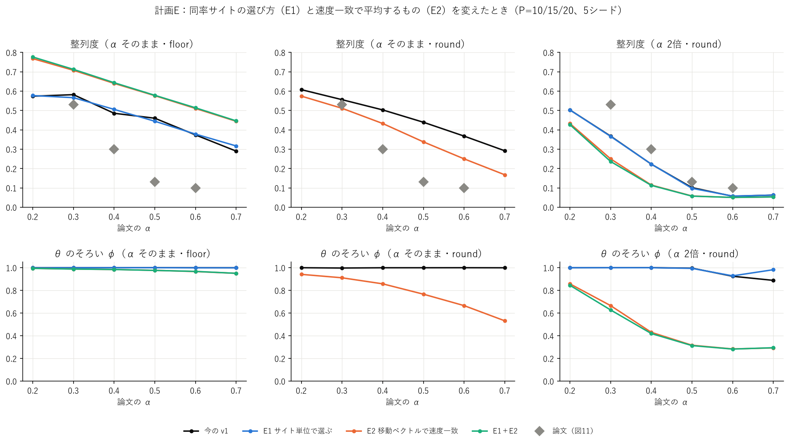

**図22** 上：整列度。下：θ のそろい φ。左から α そのまま・floor、そのまま・round、2倍・round。灰色の菱形は論文の図11。

**整列度**（P=10 / 15 / 20 と5シードの平均）

| 設定 | α=0.3 | 0.4 | 0.5 | 0.6 | θ のそろい φ（α=0.2 → 0.7） | 密度（区画 Ls=10） |
|---|---|---|---|---|---|---|
| **論文（図11）** | 0.53 | 0.30 | 0.13 | 0.10 | — | 0.3 前後（図13・14） |
| そのまま・floor（v1） | 0.58 | 0.49 | 0.46 | 0.37 | 1.00 → 1.00 | 0.48 |
| そのまま・floor ＋ E2 | 0.71 | 0.64 | 0.58 | 0.51 | 0.99 → 0.95 | 0.35 |
| そのまま・round | 0.56 | 0.50 | 0.44 | 0.37 | 1.00 → 1.00 | 0.48 |
| **そのまま・round ＋ E2** | **0.51** | 0.43 | 0.34 | 0.25 | **0.94 → 0.53** | **0.31** |
| 2倍・round | 0.37 | 0.22 | 0.10 | 0.06 | 1.00 → 0.89 | 0.47 |
| **2倍・round ＋ E2** | 0.25 | 0.11 | 0.06 | 0.05 | **0.86 → 0.29** | **0.32** |

E1 は、どの読み方でも整列度の変化が 0.03 以内で、φ も変わらなかったので、表から省いた（図22 の青線）。E1＋E2 も E2 とほぼ同じ。

- **E1（同率サイトの選び方）は効かなかった。** 前向きのサイトの選ばれやすさは、θ のそろい方にほとんど影響しない。
- **E2（移動ベクトルで速度一致）にすると、θ がばらつくようになった（round のとき）。**
  - θ のそろい φ が、α が大きいほど下がる（そのまま・round で 0.94 → 0.53、2倍・round で 0.86 → 0.29）。これまでのどの版でも φ はほぼ 1.00 だったので、**論文1で θ がばらつく仕組みが初めて見つかった**。
  - 仕組み：近傍の個体の実際の移動は、扇の中でばらばらの向きに出る。それを平均して θ にするので、α が大きいほど θ にばらつきが入る。
  - **そのまま・round ＋ E2 は、α=0.3 の整列度が 0.51 で、論文の 0.53 と合った。** これまで一番近かった「2倍・round」（0.37）の弱点だった所。ただし α が大きい側は高すぎる（α=0.5 で 0.34、論文 0.13）。
  - 2倍・round ＋ E2 は、全体に論文より低い（α=0.3 で 0.25）。論文の値は、2つの読み方の間にある。
  - **密度も変わった。** 区画 Ls=10 で 0.31〜0.32 になり、図13・14 を Ls=10 で読んだときの値（0.3 前後）と合う。4.9 節の「Ls=10 なら今のモデルの群れが詰まりすぎ」という問題が、E2 で解消する。相互予期の割合は 97〜98% で、ほとんど変わらない。
- **floor のままだと、E2 は逆効果。** 整列度が全体に上がる（α=0.3 で 0.71）。floor のずれ (−0.5, −0.5) が移動ベクトルに乗り、それが速度一致で θ に入って、全員が同じ向きに流れるため（論文2 で floor のときに起きたことと同じ、3.1 節）。4.3 節で「速度一致を近傍の実際の移動の向きの平均にしても、φ は 0.97 以上のまま」だったのは、floor で試していたことも効いていた可能性がある。
- **⇒ 式(8) の「平均の速度の向き」を、移動ベクトルの平均と読むと（E2）、θ にばらつきが入り、α=0.3 の整列度と図13・14 の密度（Ls=10）が論文に近づく。** ただし round と組み合わせる必要がある。α が大きい側を合わせるには、まだ何かが足りない。

### 4.11 密度の谷をシードを増やして確かめる（計画F、11/21）

- **ねらい：** 計画B（3シード）で、区画 2×2 の密度に、α=0.6 の P=12 で谷らしきものが出た（4.9 節）。本物かどうかを確かめた。
- **試したこと：** v1 の既定と 2倍・round で、P=4〜20（1刻み）、α=0.3〜0.6、10シード、900 ステップ。区画 2×2 の密度の平均と標準誤差を出した。
  - スクリプト：`report_scripts/planF_dip.py`、`planF_analyze.py`。結果は `report_data/planF_dip.json`。

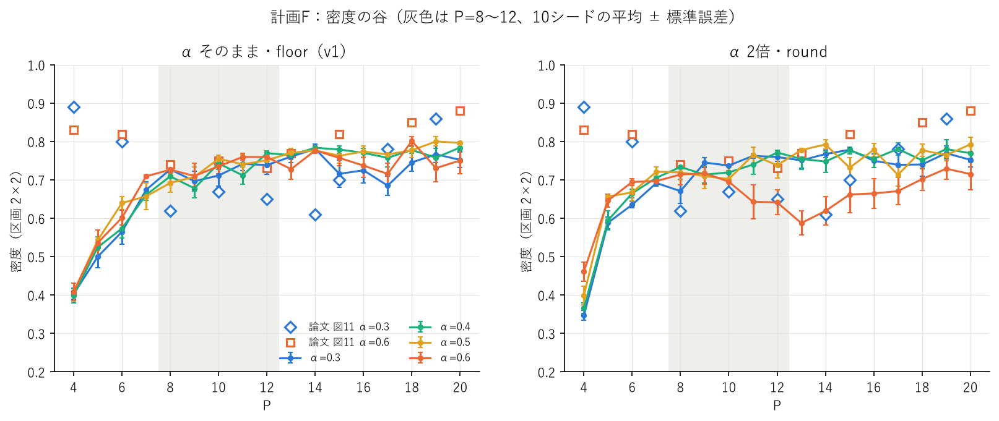

**図23** 区画 2×2 の密度（10シードの平均 ± 標準誤差）。白抜きの記号は論文の図11（赤線を目で読んだもの）。灰色は P=8〜12。

- **谷が出たのは、2倍・round の α=0.6 だけ。** P=7〜10 で 0.70〜0.72 だった密度が、P=11〜15 で 0.59〜0.66 に下がり、P=19〜20 で 0.72〜0.73 に戻る。下がり幅は約 0.1 で、標準誤差（0.03〜0.04）の約3倍あるので、偶然ではない。
  - ただし、論文の谷（P=8〜12）より少し大きい P にずれている。
  - 論文では P=4〜6 ですでに密度が高い（0.82〜0.89）が、モデルは P=4 で 0.35〜0.46 と低く、P=7 ごろまで上がり続ける。谷の手前の山が、論文ほどはっきりしない。
- **それ以外（v1 の全 α、2倍・round の α=0.3〜0.5）では谷は出ない。** P=8 ごろまで上がったあと、0.70〜0.80 で ±0.03 ほど揺れるだけ。
- 論文の α=0.3 の深い谷（0.60〜0.67）は出ない。
- **⇒ 谷は「α 2倍・α が大きいとき」にだけ、場所をずらして出る。** 論文の谷を再現できたとはまだ言えない。E2（4.10 節）で群れの形が変わるので、E2 でも確かめる必要がある。

### 4.12 速度一致で移動を平均する読み方を詰める（計画E2、11/22）

- **ねらい：** E2（速度一致で移動ベクトルを平均）で θ がばらつくようになったが、α そのまま・round では α が大きい側の整列度が高すぎた（4.10 節）。式(8) の「平均の速度の向き」のもう1つの読み方として、移動の**単位ベクトル**を平均する版（`vm_source="unit_disp"`）を round で試した。4.3 節では floor で試して効かなかった版。あわせて、E2 の設定で密度の谷（4.11 節）も確かめた。
- **試したこと：**
  - 整列度：α そのまま・round と 2倍・round に unit_disp を組み合わせ、計画E と同じ条件（P=10 / 15 / 20、α=0.2〜0.7、5シード）。
  - 密度の谷：α の読み方2通り × disp / unit_disp の4通りで、区画 2×2、P=4〜20、α=0.3〜0.6、10シード（計画F と同じ）。
  - スクリプト：`report_scripts/planE2_sweep.py`、`planE2_dip.py`、`planE2_analyze.py`。結果は `report_data/planE2_sweep.json`、`planE2_dip.json`。

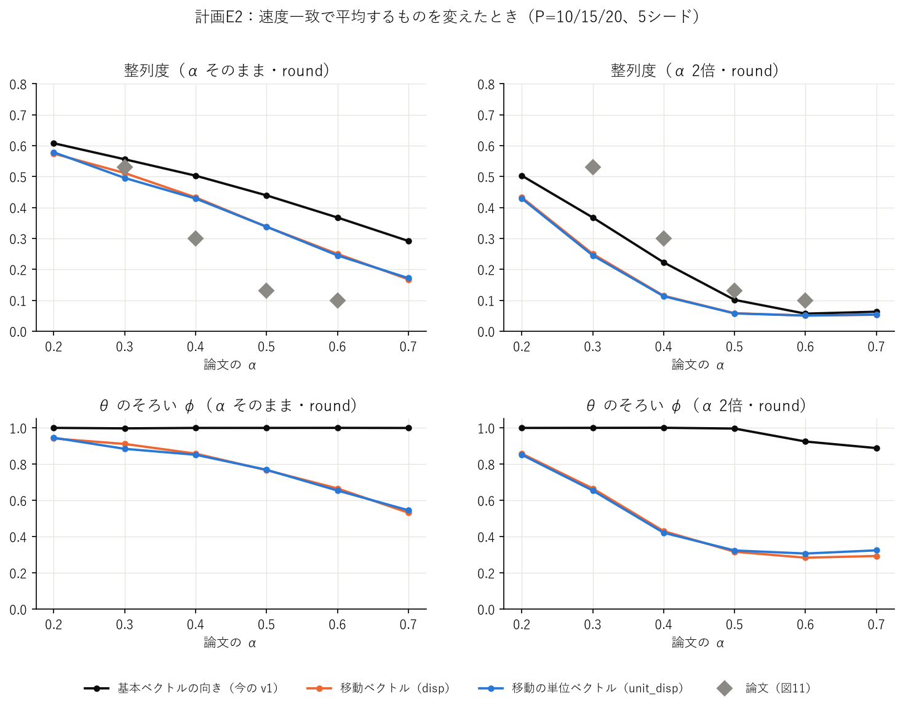

**図24** 速度一致で平均するもの3通り（黒：基本ベクトルの向き＝今の v1、橙：移動ベクトル、青：移動の単位ベクトル）。上が整列度、下が θ のそろい φ。

| 設定（すべて round） | α=0.3 | 0.4 | 0.5 | 0.6 | φ（α=0.2 → 0.7） | 密度（区画 Ls=10） |
|---|---|---|---|---|---|---|
| **論文（図11）** | 0.53 | 0.30 | 0.13 | 0.10 | — | 0.3 前後 |
| そのまま・基本ベクトルの向き | 0.56 | 0.50 | 0.44 | 0.37 | 1.00 → 1.00 | 0.48 |
| そのまま・移動ベクトル | 0.51 | 0.43 | 0.34 | 0.25 | 0.94 → 0.53 | 0.31 |
| そのまま・移動の単位ベクトル | 0.50 | 0.43 | 0.34 | 0.24 | 0.95 → 0.55 | 0.32 |
| 2倍・基本ベクトルの向き | 0.37 | 0.22 | 0.10 | 0.06 | 1.00 → 0.89 | 0.47 |
| 2倍・移動ベクトル | 0.25 | 0.11 | 0.06 | 0.05 | 0.86 → 0.29 | 0.32 |
| 2倍・移動の単位ベクトル | 0.24 | 0.11 | 0.06 | 0.05 | 0.85 → 0.32 | 0.32 |

- **移動の単位ベクトルで平均しても、移動ベクトルとほぼ同じ結果になった**（どの α でも差は 0.01 以内）。長さで重みをつけるかどうかは効かない。効いているのは、「基本ベクトルの向き θ」ではなく「実際の移動」を平均すること。
- **4.3 節で「移動の向きの平均」が効かなかったのは、floor で試していたため**だと分かった。round なら θ がばらつく。
- **α が大きい側は、この読み方の中では合わせられなかった。** α そのままでは高すぎ（α=0.5 で 0.34、論文 0.13）、2倍では全体に低すぎる（α=0.3 で 0.24、論文 0.53）。論文の値は、2つの読み方のちょうど間にある。

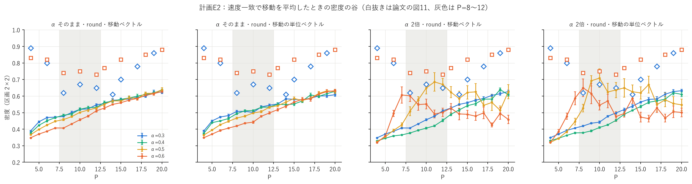

**図25** 速度一致で移動を平均したときの、区画 2×2 の密度（10シードの平均 ± 標準誤差）。白抜きは論文の図11。

- **移動を平均すると、密度の谷は出ない。** α そのままでは、密度は P とともにゆっくり上がり続ける（P=4 で 0.35〜0.39、P=20 で 0.61〜0.64）。谷がないだけでなく、図11 の値（P=10〜20 で 0.6〜0.88）よりも低い。
- 2倍の α=0.5〜0.6 では、P=8〜10 で山（0.61〜0.71）ができ、そのあと 0.45〜0.55 に下がったまま戻らない。論文の「下がってまた上がる」谷とは形が違う。
- **⇒ 密度については、読み方によって合う図が入れ替わる。**
  - 基本ベクトルの向きで速度一致（今の v1）：図11 の密度（区画 2×2）に近い（0.70〜0.80）。図13・14 は Ls≈6 なら合う。
  - 移動で速度一致（E2）：図13・14 を Ls=10 で読んだ値（0.3）に合う。図11 の密度は低すぎる。
  - どちらがよいかは、図13・14 の Ls（課題19、先生に確認したいこと 4）で決まる。

### 4.13 スケールフリー相関（計画I、11/22）

- **ねらい：** 論文1の図15 では、相関関数 C を相関長 ξ で割った距離 r/ξ に対して描くと、1本の直線に乗る（図15d のモデルは C ≈ 1.05 − 0.96·r/ξ、図15c の実際のカニは C ≈ 0.88 − 0.88·r/ξ。どちらも目で読んだもの）。前にノートブックで試したときは傾きが違っていた（値の記録はない）。
- **論文の定義（p.22）：** 揺らぎベクトル u_i = v_i − (全員の速度の平均)、C(r) = Σ u_i·u_j δ(r − r_ij) / Σ δ(r − r_ij)、ξ は C(r)=0 になる距離。図15 は L=4、R(Nf)=2、**R(M)=2**。P と α は書かれていない。**C をどう規格化したか（何で割ったか）も書かれていない。**
- **大事な性質：** ξ を「C が 0 になる距離」で決めるので、どの曲線も r/ξ=1 で 0 を通る。そのため、直線の傾き ≒ −（r/ξ=0 での C の値）になる。傾きが合うかどうかは、**近い個体どうしの速度の揺らぎが、どれだけそろっているか**で決まる。
- **試したこと：** R(M)=2 にして、4つの設定（v1、α 2倍・round、α そのまま・round＋E2、α 2倍・round＋E2）× P=10 / 15 / 20 × α=0.3 / 0.5 / 0.7 × 3シード。500 ステップ回してから 600 ステップ記録し、3 ステップごとのスナップショットで C(r) と ξ を求め、r/ξ=0〜1.2 の点に直線を引いた。
  - 速度は、1ステップの移動（論文の「スナップショットの移動」）と、3・5・10・20 ステップの移動を割ったものの5通り。
  - 規格化は3通り：自分との積の平均 <u_i·u_i> で割る（ノートブック、Cavagna et al. 2010 と同じ）／一番近い距離ビンの C で割る／割らない。
  - 計算方法はノートブック `MAM_valid.ipynb` の関数と同じで、論文の定義と1文ずつ合っていることを確かめた。
  - スクリプト：`report_scripts/planI_scalefree.py`、`planI_analyze.py`。結果は `report_data/planI_scalefree.json`。

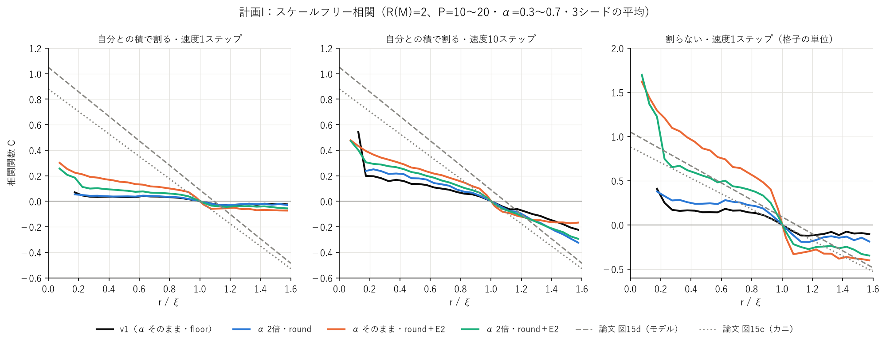

**図26** C を r/ξ に対して描いたもの（P・α・シードの平均）。破線・点線は論文の図15d・図15c。左：自分との積で割る・速度1ステップ。中：同じく速度10ステップ。右：割らない・速度1ステップ。

**自分との積で割ったときの傾き / 切片 / R²**（P・α・シードの平均）

| 設定 | 速度1ステップ | 速度5ステップ | 速度10ステップ |
|---|---|---|---|
| **論文（図15d）** | 傾き −0.96 / 切片 1.05 | | |
| v1（α そのまま・floor） | −0.07 / 0.07 / 0.36 | −0.17 / 0.17 / 0.64 | −0.27 / 0.27 / 0.74 |
| α 2倍・round | −0.08 / 0.08 / 0.38 | −0.22 / 0.22 / 0.72 | −0.35 / 0.35 / 0.84 |
| α そのまま・round＋E2 | −0.28 / 0.29 / 0.49 | −0.50 / 0.51 / 0.58 | −0.49 / 0.50 / 0.55 |
| α 2倍・round＋E2 | −0.16 / 0.17 / 0.48 | −0.35 / 0.35 / 0.71 | −0.42 / 0.43 / 0.75 |

- **ノートブックと同じ規格化（自分との積で割る）では、傾きが論文よりずっと緩い。** v1 は 1ステップで −0.07、10ステップでも −0.27（論文 −0.96）。これが「前に試したとき傾きが違っていた」の正体だと考えられる。
  - 原因：1ステップの移動は、P 本の可能的遷移からどれを選ぶかで大きくぶれる。このぶれは個体ごとにばらばらなので、自分との積（分母）だけが大きくなり、近い個体どうしの積（分子）はあまり大きくならない。そのため r/ξ=0 での C が 0.07 程度にしかならない。
  - 速度を何ステップか分にすると、ぶれが平均されて傾きが急になる（10ステップで −0.27〜−0.35）。20ステップでは少し戻る。
  - P と α で傾きはほとんど変わらない（v1 は −0.06〜−0.08）。図15 の P・α が書かれていないことは、結論に効かない。
- **速度一致で移動を平均すると（E2）、傾きが急になる。** α そのまま・round＋E2 は 1ステップで −0.28、5ステップで −0.50。近くの個体の実際の移動にそろえるので、近い個体どうしの揺らぎがそろうため。相関長 ξ も長くなる（v1 の 3.2 から 7.1 へ）。それでも論文の半分くらい。
- **直線のそろい方（R²）も低い。** 0.36〜0.84 で、図26 の曲線は r/ξ が小さい所で曲がっている。論文の図15d ほどきれいな1本の直線にはならない。
- **規格化を変えた場合：**
  - 一番近い距離ビンの C で割ると、そのビンの値が小さくばらつくので、結果が大きく乱れて使えなかった（傾き −1.3〜−20）。
  - 割らない（格子の単位のまま）と、E2 の設定では切片が 1 前後になり、α 2倍・round＋E2 の1ステップは傾き −1.05 / 切片 1.08 と論文の値に近い。ただし、割らない C は速度の単位で値が変わるので、実際のカニ（図15c、座標は画素の単位）と同じ傾きになるのは偶然とは考えにくい。論文も何らかの規格化をしているはず。R² も 0.47 と低い。
- **⇒ 論文と同じ規格化（自分との積）では、モデルの傾きは論文の 1/10〜1/2 しかない。** 速度一致で移動を平均すると（E2）近づくが、まだ半分。論文の C の規格化と速度の取り方が分からないので、先生に確認したいことに足す。

### 4.14 相互予期が多すぎるか（計画G、11/22）

- **ねらい：** 今の論文1のモデルでは、相互予期が 99% で、追従と自由移動がほとんど起きない（課題20）。図13・14 の密度を Ls=10 で読むと、群れが詰まりすぎていることになる（4.9 節）。相互予期が多すぎることが原因かを調べた。
- **論文の記述：** 論文1には、ルールの割合を示す図はない。本文 p.7〜8 と図1・図2 の説明は、相互予期（人気度が閾値 1 を超えるサイトへ）→ 追従 → 自由移動の順で、割合については何も言っていない。論文2の図S2 では、赤・緑（P=40）の相互予期は 98〜99%、青（P=10）は 63%。
- **試したこと：** P=1〜30（論文の α=0.5）で、4つの設定（v1、α 2倍・round、α そのまま・round＋E2、文字どおりの競合）のルールの割合と密度を測った（5シード、900 ステップ）。
  - スクリプト：`report_scripts/planG_rules.py`、`planG_analyze.py`。結果は `report_data/planG_rules.json`。

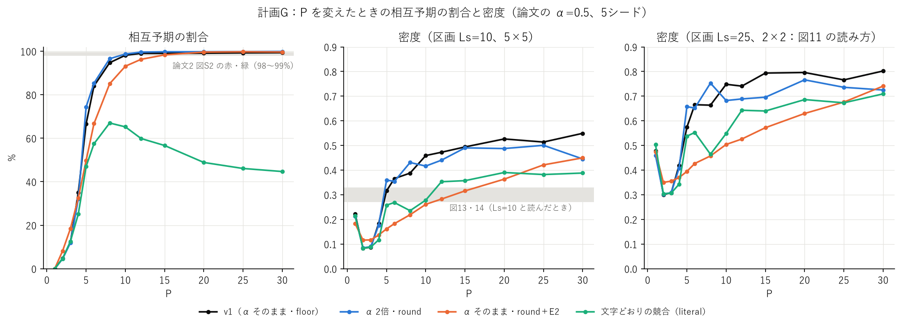

**図28** 左：相互予期の割合。中：密度（区画 Ls=10）。右：密度（区画 Ls=25、図11 の読み方）。

| 設定 | 相互予期の割合（P=5 / 10 / 20） | 密度 区画 Ls=10（P=10〜30） | 密度 区画 Ls=25（P=10〜30） |
|---|---|---|---|
| v1 | 67 / 98 / 99% | 0.46〜0.55 | 0.74〜0.80 |
| α 2倍・round | 74 / 99 / 100% | 0.42〜0.50 | 0.68〜0.77 |
| α そのまま・round＋E2 | 50 / 93 / 100% | 0.26〜0.45 | 0.50〜0.74 |
| 文字どおりの競合 | 47 / 65 / 49% | 0.28〜0.39 | 0.55〜0.71 |
| 論文 | （図なし。論文2の P=40 は 98〜99%） | 0.3 前後（図13・14 を Ls=10 で読んだとき） | 0.6〜0.88（図11） |

- **相互予期の割合は P で決まり、P≥10 で 98〜99% になる。** P=2〜3 では自由移動が 80〜90%、P=5 で相互予期が半分を超え、P=8 で 95% になる。これは、v1・α 2倍・E2 のどれでもほぼ同じ（E2 は少し遅れて増える）。
  - 式(4) の決まり（自分の可能的遷移の中に人気度 2 以上の空きサイトがあれば相互予期）では、群れの中の個体はたいてい誰かと遷移先が重なるので、P が大きいとほぼ全員が相互予期で動く。論文2でも P=40 で 98〜99% なので、**99% はモデルの決まりから自然に出る値で、バグではない**と考えられる。
- **相互予期の割合は、密度を決めていない。** E2 は相互予期が 93〜100% と v1 とほぼ同じなのに、区画 Ls=10 の密度は 0.26〜0.45 と低い。群れが詰まるかどうかは、相互予期の割合ではなく、速度一致で θ がそろいきるかどうか（4.10 節）で決まっている。
- **相互予期の割合が大きく変わるのは、文字どおりの競合（4.6 節）のときだけ。** 負けた個体が2番目のサイトにも入れないと、追従や自由移動に回るので、相互予期は 45〜67% になる。論文1 p.8 の「残りは2番目に人気のサイトへ動く」を文字どおりに読むと、こちらになる。どちらが正しいかは、論文1に割合の図がないので決められない。
- 図2 の説明には「まず基本ベクトルに速度一致を行い、次に相互予期を判定する」とある。速度一致を相互予期の前に行う版は 10/27 に試していて、違いはほとんどなかった（課題23）。
- **⇒ 課題20（相互予期 99%）は問題ではない。** 文面どおりの順番の相互予期なら 99% は自然な値で、論文2の図S2 とも合う。群れの詰まりすぎ（Ls=10 の読み方のとき）は、速度一致の読み方（課題17、確認したいこと 8）の問題。

### 4.15 論文1のまとめ

- **P=2 の崩壊は再現できた**（追従の連鎖をなくした）。
- **α の効きが弱いのは、速度一致で θ が全員そろいきってしまうため。** 遷移先の選び方を変えても、外部摂動を入れても、論文の値には届かない。**ただし、速度一致で移動ベクトルそのものを平均すると（E2、round）、θ がばらつき、α=0.3 の整列度と図13・14 の密度（Ls=10）が論文に近づく（4.10 節）。**
- **α を2倍に読むと、α が大きい側は合う。** α が小さい側は低め。
- **floor のままでは、整列度が 0.18 より下がらない。** 論文の値（0.10〜0.12）に合わせるには、round にするか、整列度の計算方法を論文に合わせる必要がある。
- **一番近い組み合わせは「α 2倍 × round × sequential」（4.7 節）。** α=0.3 だけが 0.13 低い。文字どおりの競合を組み合わせても、α が小さい側は合わない。
- **α=0.3 → 0.4 の急な落ち方は、今のモデルでは出ない（4.8 節）。** θ がいつも完全にそろう（φ=1.00）ので、整列度は扇の広がりだけで決まり、α に対して一直線に下がる。急な落ち方には θ のばらつきが要る。2つの状態の行き来や、計測区間の短さが原因ではなかった。
- **密度は、論文の文面どおり「区画に分ける」方式で測るべき（4.9 節）。** 図11 は Ls=25（2×2）でほぼ決まり（群れが崩れたときの谷の底 0.31 が、2×2 でばらばらに置いた値 0.30 と一致）。図13・14 は2つの可能性がある：Ls≈6 なら今のモデルで合う。Ls=10 なら今のモデルの群れが密すぎる（文字どおりの競合なら合う）。
- **密度の谷は、2倍・round の α=0.6 で P=11〜15 にだけ出る（4.11 節）。** 論文の位置（P=8〜12）より少しずれていて、他の条件では出ない。
- **移動の単位ベクトルで平均しても、移動ベクトルと同じ結果（4.12 節）。** α が大きい側は、どちらの α の読み方でも合わない（論文の値は2つの間）。移動で速度一致すると密度の谷は消え、図11 の密度は低くなる。密度について合う図が、速度一致の読み方で入れ替わる。
- **スケールフリー相関の傾きは、論文よりずっと緩い（4.13 節）。** ノートブックと同じ規格化で、v1 は −0.07（速度1ステップ）〜−0.27（10ステップ）、論文は −0.96。1ステップの移動のぶれが個体ごとにばらばらなのが原因。速度一致で移動を平均すると（E2）−0.5 まで近づく。論文の C の規格化と速度の取り方が書かれていない。
- **相互予期 99% はモデルの決まりから自然に出る値で、問題ではない（4.14 節）。** 群れが詰まるかどうかは、相互予期の割合ではなく、速度一致の読み方で決まる。
- 次に確認すること：図11 と図14 の値のどちらに合わせるか、密度の Ls、式(8) で何を平均するか、スケールフリー相関の規格化と速度の取り方を先生に確認する。
