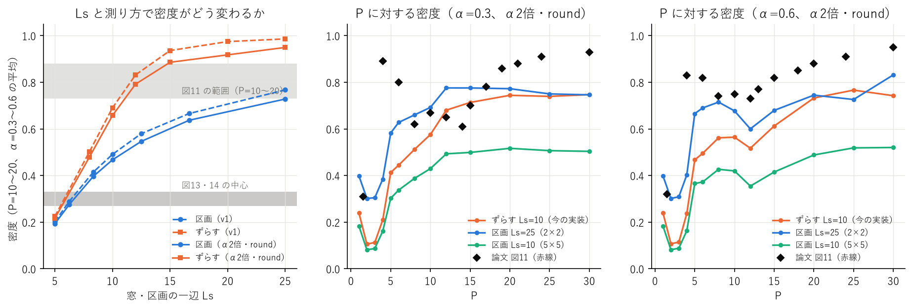
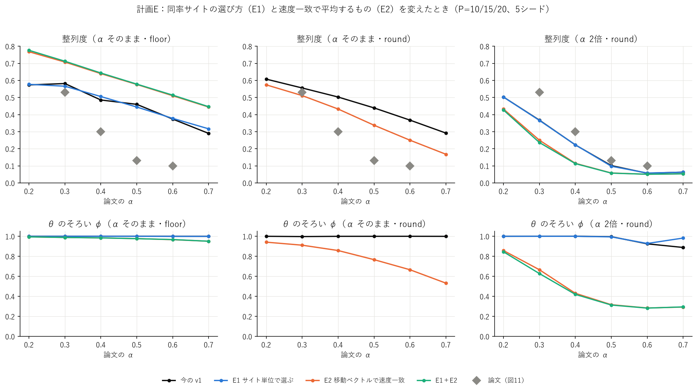
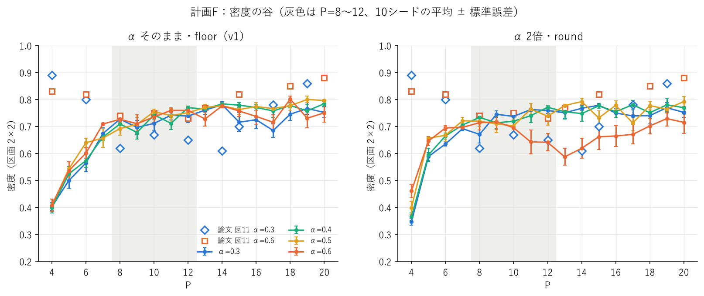
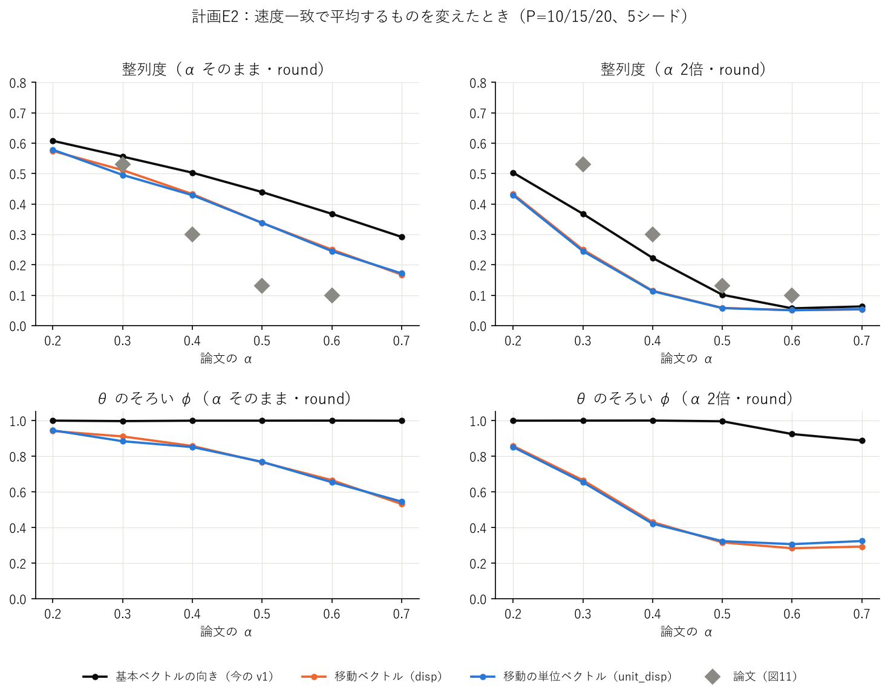
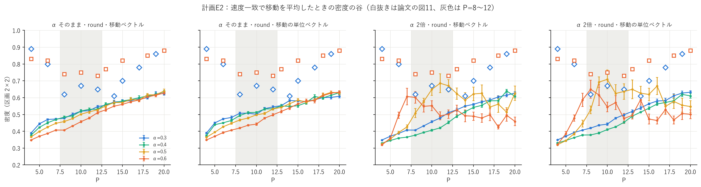
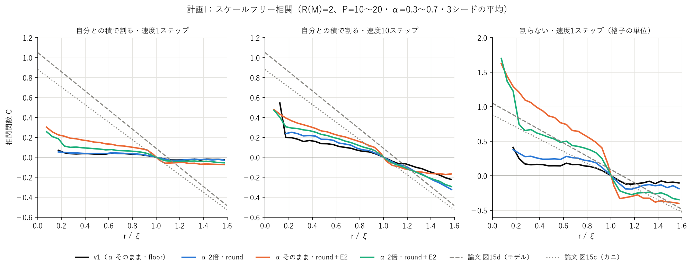
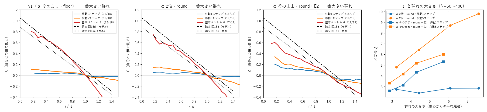
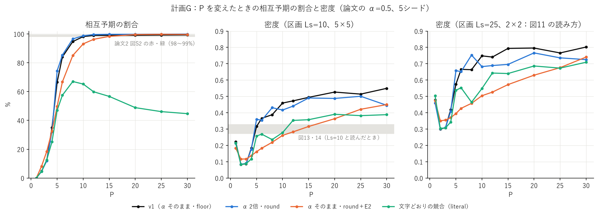

# 論文1の検証（速度一致あり）その2：密度・速度一致の読み方・スケールフリー相関

[← 検証レポート（入口）](../検証レポート.md)

2.9〜2.15 節。2.1〜2.8 節と「やったこと → 結果」の表は [02_論文1_整列度](02_論文1_整列度.md)。

- 章の番号：1章（測り方とモデル）は [01](01_測り方とモデル.md)、2章（論文1）は [02](02_論文1_整列度.md)・[03](03_論文1_密度と相関.md)、3章（論文2）は [04](04_論文2_図3.md)・[05](05_論文2_他の図.md)、4章（計画）は [06](06_計画.md)。
- 11/22 に、論文1 ⇒ 論文2 の順に並べ直して番号を振り直した。古い番号との対応は入口の「番号の対応」にある。
- このレポート自身の図は fig17 のようにファイル名の番号で呼ぶ。「図3」「図11」のように書いたものは、論文の図。

---

### 2.9 密度の測り方を論文と合わせる（計画B、11/20）

- **ねらい：** 論文1の密度は、図11 では 0.6〜0.9、図13・14 では 0.3 前後と、同じ P=10〜20 でも値が大きく違う。今の実装（Ls=10 の窓をずらす）では約 0.7 で、どちらとも合わない（課題19）。P=8〜12 の密度の谷（課題18）も出ていない。測り方が論文と違うのではないかと考えた。
- **論文の文面（p.17）：** 「密度は、群れの大きさの正方形の中の最大個体数を正規化したもの。群れの半径を Ls とみなせるなら、X×X の空間を X/Ls × X/Ls 個の区画に分け、区画の中の最大個体数を全個体数で割る」。
  - つまり、窓をずらすのではなく、**空間を区画に分ける**。
  - Ls は**群れの半径くらい**にとる。具体的な値は書かれていない。
  - 測る時刻や平均の取り方も書かれていない。
- **試したこと：** 位置を保存しながら回し、密度を測り方と Ls を変えて測り直した。
  - 条件：P=1〜30、α=0.3〜0.6、3シード、900 ステップ（t=300〜900 の 10 ステップごと）。v1 の既定と、α 2倍・round の2通り。
  - 測り方：窓をずらす（Ls=5〜25）と、区画に分ける（2×2〜10×10、Ls=25〜5）。
  - 群れの半径の目安として、回転半径 Rg（重心からの距離の2乗平均の平方根）も測った。
  - スクリプト：`report_scripts/planB_sim.py`（実行）、`planB_analyze.py`（測り直しと図）。集計結果は `report_data/planB_density.json`（位置の生データは大きいので置いていない）。

**fig19** 左：窓・区画の一辺 Ls と密度（P=10〜20、α=0.3〜0.6 の平均）。灰色の帯は論文の値。中・右：P に対する密度（α 2倍・round）。黒い菱形は論文の図11 の赤線を目で読んだもの。

**P=10〜20 の密度**（α=0.3〜0.6 の範囲、α 2倍・round）

| 測り方 | 密度 | 論文で近い図 |
|---|---|---|
| ずらす Ls=10（今の実装） | 0.61〜0.70 | どちらとも合わない |
| 区画 Ls=6.25（8×8） | 0.26〜0.29 | **図13・14（0.3 前後）** |
| 区画 Ls=10（5×5） | 0.42〜0.50 | — |
| 区画 Ls=25（2×2） | 0.68〜0.78 | **図11（0.6〜0.88）** |
| 群れの回転半径 Rg | 5.0〜9.2 | — |

- **図13・14 は、区画に分けて Ls≈6 にすると合う。** 密度は 0.26〜0.29 で、論文の 0.3 前後に近い。
  - Ls≈6 は、群れの回転半径（5〜9）とほぼ同じ。論文の「群れの半径を Ls とみなせるなら」という文面とも合う。
- **図11 は、区画に分けて Ls=25（空間を 2×2 に分ける）にすると合う。**
  - 一番の根拠は、群れが崩れる P=2〜3 の値。全員がばらばらに散らばったとき、2×2 の区画の最大個体数は 0.30 になる（ランダムに置いて計算した値も 0.30）。論文の図11 で P≈1〜2 の谷の底は 0.31〜0.32 で、これとぴったり合う。今の実装（ずらす Ls=10）では 0.11 になる。
  - P=10〜20 の値（0.68〜0.78）も、論文の範囲（0.6〜0.88）に入る。
  - ただし P=30 では 0.75〜0.83 で、論文（0.93〜0.95）より低い。
  - α=0.6 では、P=12 で密度が一度下がる（0.60。前後は P=8 で 0.72、P=20 で 0.74）。論文の P=8〜12 の谷（課題18）に似ている。ただし α=0.3 では出ず、3シードしかないので、谷が再現できたとはまだ言えない。
- **⇒ 図11 と図13・14 では Ls が違うと考えると、両方の値の大きさが説明できる。** ただし、図13・14 の Ls については2つの読み方があり、**どちらの可能性もある**（下の表）。文面には Ls の値がないので、先生に確認したいことに足す。あとでまた考える。

**図13・14 の Ls の2つの読み方**（11/20 追記）

| | 読み方1：Ls≈6 | 読み方2：Ls=10 |
|---|---|---|
| 根拠 | 文面の「群れの半径を Ls とみなす」。群れの回転半径（5〜9）とほぼ同じ | パラメータ（L=4、R(M)=3 など）を考えると、10 より小さい Ls は考えにくい。S=50 を割り切れる Ls は、10 以上なら 10 と 25 だけ |
| 今のモデル（sequential）の密度 | 0.26〜0.29。論文の 0.3 に合う | 0.43〜0.50。論文の 0.3 より高い |
| 意味すること | 測り方を直せば合う | 測り方ではなく、**今のモデルの群れが論文より詰まりすぎている**。相互予期が 99% で追従・自由移動がほとんど起きないこと（課題20）とつながっていそう |
| 合う設定 | α 2倍・round・sequential（計画2で一番近い設定） | 計画2のデータを区画 Ls=10 で集計し直すと、競合を文字どおりにした版（α そのまま・floor・literal）が α=0.3 / 0.4 / 0.5 で 0.24 / 0.29 / 0.34 になり、論文の 0.3 に合う。ただし literal は整列度が全体に下がりすぎる（2.7 節） |

- どちらの読み方でも、**図11 は Ls=25（2×2）** で変わらない。Ls=10 だと、全員ばらばらのときの値は 0.08 にしかならず、図11 の谷の底（0.31）を説明できない。
- 図13・14 を Ls=25 で測った可能性は低い。Ls=25 で 0.3 は「全員ばらばら」と同じ値になり、「密度の高い群れ」という論文の主張と合わない。
- **測る時刻（移動の前か後か、課題26）：** 時間平均を取る場合、移動の前に測った値の並びは、1ステップ前の移動の後に測った値の並びと同じになる。違うのは区間の端の1回だけなので、平均には効かない。
- 密度の定義を変えても、整列度は変わらない（整列度は移動から計算するため）。

### 2.10 θ がばらつく仕組みを文面から探す（計画E、11/21）

- **ねらい：** 速度一致で θ が完全にそろうこと（φ=1.00）が、α の効きが弱い原因だった（2.3・2.8 節）。式(4)〜(8) を読み直し、実装と文面がずれていそうな2か所を変えた。
  - **E1（式(4)・式(6)）：** 「最大人気のサイトが複数あれば、そのうち1つをランダムに選ぶ」「Rd{集合}」。v1 は遷移（本数）単位で選んでいて、同じサイトを指す遷移が多い前向きのサイトほど選ばれやすかった。サイト単位で一様に選ぶようにした（v1 の `choose_by="site"`）。
  - **E2（式(8)）：** 速度一致の説明は「近傍 M の平均の速度の向き」。v1 は近傍の基本ベクトルの向き θ を平均していた。近傍の個体の移動ベクトルそのもの（長さ込み、留まった個体は 0）を平均するようにした（v1 の `vm_source="disp"`）。
- **試したこと：** 計画2 と同じ条件（P=10 / 15 / 20、α=0.2〜0.7、5シード、900 ステップで t=300〜900 の平均）で、α の読み方3通り（そのまま・floor、そのまま・round、2倍・round）と組み合わせた。
  - スクリプト：`report_scripts/planE_sweep.py`、`planE_extra.py`（そのまま・round の分）、`planE_analyze.py`（集計と図）。結果は `report_data/planE_sweep.json`、`planE_extra.json`。
  - v1 に足したオプションは、既定（`choose_by="vector"`、`vm_source="theta"`）でこれまでと同じ結果になることを確かめた（6通りの設定 × 2シード × 150 ステップで、位置・向き・ルールの回数が一致）。

**fig22** 上：整列度。下：θ のそろい φ。左から α そのまま・floor、そのまま・round、2倍・round。灰色の菱形は論文の図11。

**整列度**（P=10 / 15 / 20 と5シードの平均）

| 設定 | α=0.3 | 0.4 | 0.5 | 0.6 | θ のそろい φ（α=0.2 → 0.7） | 密度（区画 Ls=10） |
|---|---|---|---|---|---|---|
| **論文（図11）** | 0.53 | 0.30 | 0.13 | 0.10 | — | 0.3 前後（図13・14） |
| そのまま・floor（v1） | 0.58 | 0.49 | 0.46 | 0.37 | 1.00 → 1.00 | 0.48 |
| そのまま・floor ＋ E2 | 0.71 | 0.64 | 0.58 | 0.51 | 0.99 → 0.95 | 0.35 |
| そのまま・round | 0.56 | 0.50 | 0.44 | 0.37 | 1.00 → 1.00 | 0.48 |
| **そのまま・round ＋ E2** | **0.51** | 0.43 | 0.34 | 0.25 | **0.94 → 0.53** | **0.31** |
| 2倍・round | 0.37 | 0.22 | 0.10 | 0.06 | 1.00 → 0.89 | 0.47 |
| **2倍・round ＋ E2** | 0.25 | 0.11 | 0.06 | 0.05 | **0.86 → 0.29** | **0.32** |

E1 は、どの読み方でも整列度の変化が 0.03 以内で、φ も変わらなかったので、表から省いた（fig22 の青線）。E1＋E2 も E2 とほぼ同じ。

- **E1（同率サイトの選び方）は効かなかった。** 前向きのサイトの選ばれやすさは、θ のそろい方にほとんど影響しない。
- **E2（移動ベクトルで速度一致）にすると、θ がばらつくようになった（round のとき）。**
  - θ のそろい φ が、α が大きいほど下がる（そのまま・round で 0.94 → 0.53、2倍・round で 0.86 → 0.29）。これまでのどの版でも φ はほぼ 1.00 だったので、**論文1で θ がばらつく仕組みが初めて見つかった**。
  - 仕組み：近傍の個体の実際の移動は、扇の中でばらばらの向きに出る。それを平均して θ にするので、α が大きいほど θ にばらつきが入る。
  - **そのまま・round ＋ E2 は、α=0.3 の整列度が 0.51 で、論文の 0.53 と合った。** これまで一番近かった「2倍・round」（0.37）の弱点だった所。ただし α が大きい側は高すぎる（α=0.5 で 0.34、論文 0.13）。
  - 2倍・round ＋ E2 は、全体に論文より低い（α=0.3 で 0.25）。論文の値は、2つの読み方の間にある。
  - **密度も変わった。** 区画 Ls=10 で 0.31〜0.32 になり、図13・14 を Ls=10 で読んだときの値（0.3 前後）と合う。2.9 節の「Ls=10 なら今のモデルの群れが詰まりすぎ」という問題が、E2 で解消する。相互予期の割合は 97〜98% で、ほとんど変わらない。
- **floor のままだと、E2 は逆効果。** 整列度が全体に上がる（α=0.3 で 0.71）。floor のずれ (−0.5, −0.5) が移動ベクトルに乗り、それが速度一致で θ に入って、全員が同じ向きに流れるため（論文2 で floor のときに起きたことと同じ、3.1 節）。2.3 節で「速度一致を近傍の実際の移動の向きの平均にしても、φ は 0.97 以上のまま」だったのは、floor で試していたことも効いていた可能性がある。
- **⇒ 式(8) の「平均の速度の向き」を、移動ベクトルの平均と読むと（E2）、θ にばらつきが入り、α=0.3 の整列度と図13・14 の密度（Ls=10）が論文に近づく。** ただし round と組み合わせる必要がある。α が大きい側を合わせるには、まだ何かが足りない。

### 2.11 密度の谷をシードを増やして確かめる（計画F、11/21）

- **ねらい：** 計画B（3シード）で、区画 2×2 の密度に、α=0.6 の P=12 で谷らしきものが出た（2.9 節）。本物かどうかを確かめた。
- **試したこと：** v1 の既定と 2倍・round で、P=4〜20（1刻み）、α=0.3〜0.6、10シード、900 ステップ。区画 2×2 の密度の平均と標準誤差を出した。
  - スクリプト：`report_scripts/planF_dip.py`、`planF_analyze.py`。結果は `report_data/planF_dip.json`。

**fig23** 区画 2×2 の密度（10シードの平均 ± 標準誤差）。白抜きの記号は論文の図11（赤線を目で読んだもの）。灰色は P=8〜12。

- **谷が出たのは、2倍・round の α=0.6 だけ。** P=7〜10 で 0.70〜0.72 だった密度が、P=11〜15 で 0.59〜0.66 に下がり、P=19〜20 で 0.72〜0.73 に戻る。下がり幅は約 0.1 で、標準誤差（0.03〜0.04）の約3倍あるので、偶然ではない。
  - ただし、論文の谷（P=8〜12）より少し大きい P にずれている。
  - 論文では P=4〜6 ですでに密度が高い（0.82〜0.89）が、モデルは P=4 で 0.35〜0.46 と低く、P=7 ごろまで上がり続ける。谷の手前の山が、論文ほどはっきりしない。
- **それ以外（v1 の全 α、2倍・round の α=0.3〜0.5）では谷は出ない。** P=8 ごろまで上がったあと、0.70〜0.80 で ±0.03 ほど揺れるだけ。
- 論文の α=0.3 の深い谷（0.60〜0.67）は出ない。
- **⇒ 谷は「α 2倍・α が大きいとき」にだけ、場所をずらして出る。** 論文の谷を再現できたとはまだ言えない。E2（2.10 節）で群れの形が変わるので、E2 でも確かめる必要がある。

### 2.12 速度一致で移動を平均する読み方を詰める（計画E2、11/22）

- **ねらい：** E2（速度一致で移動ベクトルを平均）で θ がばらつくようになったが、α そのまま・round では α が大きい側の整列度が高すぎた（2.10 節）。式(8) の「平均の速度の向き」のもう1つの読み方として、移動の**単位ベクトル**を平均する版（`vm_source="unit_disp"`）を round で試した。2.3 節では floor で試して効かなかった版。あわせて、E2 の設定で密度の谷（2.11 節）も確かめた。
- **試したこと：**
  - 整列度：α そのまま・round と 2倍・round に unit_disp を組み合わせ、計画E と同じ条件（P=10 / 15 / 20、α=0.2〜0.7、5シード）。
  - 密度の谷：α の読み方2通り × disp / unit_disp の4通りで、区画 2×2、P=4〜20、α=0.3〜0.6、10シード（計画F と同じ）。
  - スクリプト：`report_scripts/planE2_sweep.py`、`planE2_dip.py`、`planE2_analyze.py`。結果は `report_data/planE2_sweep.json`、`planE2_dip.json`。

**fig24** 速度一致で平均するもの3通り（黒：基本ベクトルの向き＝今の v1、橙：移動ベクトル、青：移動の単位ベクトル）。上が整列度、下が θ のそろい φ。

| 設定（すべて round） | α=0.3 | 0.4 | 0.5 | 0.6 | φ（α=0.2 → 0.7） | 密度（区画 Ls=10） |
|---|---|---|---|---|---|---|
| **論文（図11）** | 0.53 | 0.30 | 0.13 | 0.10 | — | 0.3 前後 |
| そのまま・基本ベクトルの向き | 0.56 | 0.50 | 0.44 | 0.37 | 1.00 → 1.00 | 0.48 |
| そのまま・移動ベクトル | 0.51 | 0.43 | 0.34 | 0.25 | 0.94 → 0.53 | 0.31 |
| そのまま・移動の単位ベクトル | 0.50 | 0.43 | 0.34 | 0.24 | 0.95 → 0.55 | 0.32 |
| 2倍・基本ベクトルの向き | 0.37 | 0.22 | 0.10 | 0.06 | 1.00 → 0.89 | 0.47 |
| 2倍・移動ベクトル | 0.25 | 0.11 | 0.06 | 0.05 | 0.86 → 0.29 | 0.32 |
| 2倍・移動の単位ベクトル | 0.24 | 0.11 | 0.06 | 0.05 | 0.85 → 0.32 | 0.32 |

- **移動の単位ベクトルで平均しても、移動ベクトルとほぼ同じ結果になった**（どの α でも差は 0.01 以内）。長さで重みをつけるかどうかは効かない。効いているのは、「基本ベクトルの向き θ」ではなく「実際の移動」を平均すること。
- **2.3 節で「移動の向きの平均」が効かなかったのは、floor で試していたため**だと分かった。round なら θ がばらつく。
- **α が大きい側は、この読み方の中では合わせられなかった。** α そのままでは高すぎ（α=0.5 で 0.34、論文 0.13）、2倍では全体に低すぎる（α=0.3 で 0.24、論文 0.53）。論文の値は、2つの読み方のちょうど間にある。

**fig25** 速度一致で移動を平均したときの、区画 2×2 の密度（10シードの平均 ± 標準誤差）。白抜きは論文の図11。

- **移動を平均すると、密度の谷は出ない。** α そのままでは、密度は P とともにゆっくり上がり続ける（P=4 で 0.35〜0.39、P=20 で 0.61〜0.64）。谷がないだけでなく、図11 の値（P=10〜20 で 0.6〜0.88）よりも低い。
- 2倍の α=0.5〜0.6 では、P=8〜10 で山（0.61〜0.71）ができ、そのあと 0.45〜0.55 に下がったまま戻らない。論文の「下がってまた上がる」谷とは形が違う。
- **⇒ 密度については、読み方によって合う図が入れ替わる。**
  - 基本ベクトルの向きで速度一致（今の v1）：図11 の密度（区画 2×2）に近い（0.70〜0.80）。図13・14 は Ls≈6 なら合う。
  - 移動で速度一致（E2）：図13・14 を Ls=10 で読んだ値（0.3）に合う。図11 の密度は低すぎる。
  - どちらがよいかは、図13・14 の Ls（課題19、先生に確認したいこと 7）で決まる。

### 2.13 スケールフリー相関（計画I、11/22）

- **ねらい：** 論文1の図15 では、相関関数 C を相関長 ξ で割った距離 r/ξ に対して描くと、1本の直線に乗る（図15d のモデルは C ≈ 1.05 − 0.96·r/ξ、図15c の実際のカニは C ≈ 0.88 − 0.88·r/ξ。どちらも目で読んだもの）。前にノートブックで試したときは傾きが違っていた（値の記録はない）。
- **論文の定義（p.22）：** 揺らぎベクトル u_i = v_i − (全員の速度の平均)、C(r) = Σ u_i·u_j δ(r − r_ij) / Σ δ(r − r_ij)、ξ は C(r)=0 になる距離。図15 は L=4、R(Nf)=2、**R(M)=2**。P と α は書かれていない。**C をどう規格化したか（何で割ったか）も書かれていない。**
- **大事な性質：** ξ を「C が 0 になる距離」で決めるので、どの曲線も r/ξ=1 で 0 を通る。そのため、直線の傾き ≒ −（r/ξ=0 での C の値）になる。傾きが合うかどうかは、**近い個体どうしの速度の揺らぎが、どれだけそろっているか**で決まる。
- **試したこと：** R(M)=2 にして、4つの設定（v1、α 2倍・round、α そのまま・round＋E2、α 2倍・round＋E2）× P=10 / 15 / 20 × α=0.3 / 0.5 / 0.7 × 3シード。500 ステップ回してから 600 ステップ記録し、3 ステップごとのスナップショットで C(r) と ξ を求め、r/ξ=0〜1.2 の点に直線を引いた。
  - 速度は、1ステップの移動（論文の「スナップショットの移動」）と、3・5・10・20 ステップの移動を割ったものの5通り。
  - 規格化は3通り：自分との積の平均 <u_i·u_i> で割る（ノートブック、Cavagna et al. 2010 と同じ）／一番近い距離ビンの C で割る／割らない。
  - 計算方法はノートブック `MAM_valid.ipynb` の関数と同じで、論文の定義と1文ずつ合っていることを確かめた。
  - スクリプト：`report_scripts/planI_scalefree.py`、`planI_analyze.py`。結果は `report_data/planI_scalefree.json`。

**fig26** C を r/ξ に対して描いたもの（P・α・シードの平均）。破線・点線は論文の図15d・図15c。左：自分との積で割る・速度1ステップ。中：同じく速度10ステップ。右：割らない・速度1ステップ。

**自分との積で割ったときの傾き / 切片 / R²**（P・α・シードの平均）

| 設定 | 速度1ステップ | 速度5ステップ | 速度10ステップ |
|---|---|---|---|
| **論文（図15d）** | 傾き −0.96 / 切片 1.05 | | |
| v1（α そのまま・floor） | −0.07 / 0.07 / 0.36 | −0.17 / 0.17 / 0.64 | −0.27 / 0.27 / 0.74 |
| α 2倍・round | −0.08 / 0.08 / 0.38 | −0.22 / 0.22 / 0.72 | −0.35 / 0.35 / 0.84 |
| α そのまま・round＋E2 | −0.28 / 0.29 / 0.49 | −0.50 / 0.51 / 0.58 | −0.49 / 0.50 / 0.55 |
| α 2倍・round＋E2 | −0.16 / 0.17 / 0.48 | −0.35 / 0.35 / 0.71 | −0.42 / 0.43 / 0.75 |

- **ノートブックと同じ規格化（自分との積で割る）では、傾きが論文よりずっと緩い。** v1 は 1ステップで −0.07、10ステップでも −0.27（論文 −0.96）。これが「前に試したとき傾きが違っていた」の正体だと考えられる。
  - 原因：1ステップの移動は、P 本の可能的遷移からどれを選ぶかで大きくぶれる。このぶれは個体ごとにばらばらなので、自分との積（分母）だけが大きくなり、近い個体どうしの積（分子）はあまり大きくならない。そのため r/ξ=0 での C が 0.07 程度にしかならない。
  - 速度を何ステップか分にすると、ぶれが平均されて傾きが急になる（10ステップで −0.27〜−0.35）。20ステップでは少し戻る。
  - P と α で傾きはほとんど変わらない（v1 は −0.06〜−0.08）。図15 の P・α が書かれていないことは、結論に効かない。
- **速度一致で移動を平均すると（E2）、傾きが急になる。** α そのまま・round＋E2 は 1ステップで −0.28、5ステップで −0.50。近くの個体の実際の移動にそろえるので、近い個体どうしの揺らぎがそろうため。相関長 ξ も長くなる（v1 の 3.2 から 7.1 へ）。それでも論文の半分くらい。
- **直線のそろい方（R²）も低い。** 0.36〜0.84 で、fig26 の曲線は r/ξ が小さい所で曲がっている。論文の図15d ほどきれいな1本の直線にはならない。
- **規格化を変えた場合：**
  - 一番近い距離ビンの C で割ると、そのビンの値が小さくばらつくので、結果が大きく乱れて使えなかった（傾き −1.3〜−20）。
  - 割らない（格子の単位のまま）と、E2 の設定では切片が 1 前後になり、α 2倍・round＋E2 の1ステップは傾き −1.05 / 切片 1.08 と論文の値に近い。ただし、割らない C は速度の単位で値が変わるので、実際のカニ（図15c、座標は画素の単位）と同じ傾きになるのは偶然とは考えにくい。論文も何らかの規格化をしているはず。R² も 0.47 と低い。
- **⇒ 論文と同じ規格化（自分との積）では、モデルの傾きは論文の 1/10〜1/2 しかない。** 速度一致で移動を平均すると（E2）近づくが、まだ半分。論文の C の規格化と速度の取り方が分からないので、先生に確認したいことに足す。

#### 2.13 の続き：速度を基本ベクトルで取る・群れの中だけで測る（計画K、11/22）

- **読み直したこと：** 論文1 p.5 に「An individual has its own basic vector (**velocity**)」とあり、論文は基本ベクトルを「速度」と呼んでいる（p.18 の壁の式でも q を velocity と呼ぶ）。図15 の v_i も基本ベクトル L·(cosθ, sinθ) と読める。また p.22 の「N is the number of individuals in a swarm」を、1つの群れの中の個体数と読むこともできる。計画I はどちらも試していなかった。
- **試したこと：** 3つの設定（v1、α 2倍・round、α そのまま・round＋E2）× P=10/15/20 × α=0.3/0.5 × 3シード、R(M)=2。速度は「移動1ステップ」「移動5ステップ」「基本ベクトル θ」、範囲は「全体」「一番大きい群れ（距離 2 以下でつながる個体）」。規格化は自分との積（Cavagna と同じ）。さらに、スケールフリーなら相関長 ξ が群れの大きさに比例するはずなので、N=50〜400（密度が同じになるよう S も変える）で ξ を測った。スクリプト：`report_scripts/planK_scalefree2.py`、`planK_size.py`、`planK_analyze.py`。

**fig31** 左3つ：一番大きい群れの中で測った C（色は速度の取り方）。破線・点線は論文の図15d・図15c。右：ξ と群れの大きさ。

**一番大きい群れの中で測ったときの 傾き / 切片 / R²**（計算できた実行の平均。カッコは計算できた実行数 / 18）

| 設定 | 移動1ステップ | 移動5ステップ | 基本ベクトル θ |
|---|---|---|---|
| **論文（図15d）** | 傾き −0.96 / 切片 1.05 | | |
| v1 | −0.07 / 0.08 / 0.37 | −0.15 / 0.15 / 0.59 | **−1.06 / 1.07 / 0.95**（12/18） |
| α 2倍・round | −0.09 / 0.09 / 0.38 | −0.21 / 0.21 / 0.70 | −0.90 / 0.91 / 0.89（7/18） |
| α そのまま・round＋E2 | −0.23 / 0.23 / 0.43 | −0.35 / 0.35 / 0.51 | −0.67 / 0.67 / 0.70（18/18） |

- **速度を基本ベクトル θ で取ると、傾きが論文とほぼ同じになる。** v1 は傾き −1.06、切片 1.07、R² 0.95 で、論文の図15d（−0.96 / 1.05）ときれいに重なる（fig31 左）。速度一致で θ を近くの個体にそろえるので、近い個体どうしの θ の揺らぎがほぼ同じになり、r→0 で C≈1 になる。
  - **ただし注意：** v1 と α 2倍・round では θ がほぼ完全にそろっている（φ=0.99996）。v1 の θ のずれは中央値 0.001 rad で、群れに戻ってきた個体の向きが速度一致で少しずつ広がっていく名残。α 2倍・round では多くの実行で θ が完全に同じになり、揺らぎが 0 なので C を計算できない（18 本中 11 本）。**「とても小さな揺らぎが、なめらかに広がっている」状態の相関を測っている**ことになる。自分との積で割るので揺らぎの大きさは結果に効かないが、論文がこれを測っていたかは分からない。
  - E2 では θ のずれが中央値 0.32 rad と十分大きく、どの実行でも計算できる。傾きは −0.67 で、移動で測るより論文に近い。
- **群れの中だけで測っても、移動で取る限り傾きはほとんど変わらない。** v1・α 2倍は群れが1つなので全体とほぼ同じ。E2 は群れがいくつかに分かれるので、群れの中だけにすると ξ が 7.9→3.5 と短くなり、傾きもかえって緩くなる（−0.31→−0.23）。
- **ξ は群れの大きさに比例して伸びる（スケールフリーの本来の性質、fig31 右）。** 移動5ステップでは、N=50→400 で群れの大きさが 3.2→7.6 に伸びると、ξ も 4.8→9.8 に伸び、ξ / 大きさ はほぼ一定（α 2倍・round 1.3〜1.5、E2 1.05〜1.2）。ただし α 2倍・round の移動1ステップだけは、ξ が 2.4〜2.8 のまま伸びない（1ステップのぶれが大きく、相関がすぐ切れる）。
- **⇒ 傾きのずれは、「速度」を何で取るかでほぼ説明できる。** 論文の呼び方どおり速度＝基本ベクトルと読むと、傾きは論文と合う。移動で取ると、1ステップのぶれのせいで 1/10 しかない。ただし v1 の θ はほとんどそろっていて、測っているのはとても小さな揺らぎ。先生に確認したいこと 5 に「v_i は基本ベクトルか、実際の移動か」を足す。

### 2.14 相互予期が多すぎるか（計画G、11/22）

- **ねらい：** 今の論文1のモデルでは、相互予期が 99% で、追従と自由移動がほとんど起きない（課題20）。図13・14 の密度を Ls=10 で読むと、群れが詰まりすぎていることになる（2.9 節）。相互予期が多すぎることが原因かを調べた。
- **論文の記述：** 論文1には、ルールの割合を示す図はない。本文 p.7〜8 と図1・図2 の説明は、相互予期（人気度が閾値 1 を超えるサイトへ）→ 追従 → 自由移動の順で、割合については何も言っていない。論文2の図S2 では、赤・緑（P=40）の相互予期は 98〜99%、青（P=10）は 63%。
- **試したこと：** P=1〜30（論文の α=0.5）で、4つの設定（v1、α 2倍・round、α そのまま・round＋E2、文字どおりの競合）のルールの割合と密度を測った（5シード、900 ステップ）。
  - スクリプト：`report_scripts/planG_rules.py`、`planG_analyze.py`。結果は `report_data/planG_rules.json`。

**fig28** 左：相互予期の割合。中：密度（区画 Ls=10）。右：密度（区画 Ls=25、図11 の読み方）。

| 設定 | 相互予期の割合（P=5 / 10 / 20） | 密度 区画 Ls=10（P=10〜30） | 密度 区画 Ls=25（P=10〜30） |
|---|---|---|---|
| v1 | 67 / 98 / 99% | 0.46〜0.55 | 0.74〜0.80 |
| α 2倍・round | 74 / 99 / 100% | 0.42〜0.50 | 0.68〜0.77 |
| α そのまま・round＋E2 | 50 / 93 / 100% | 0.26〜0.45 | 0.50〜0.74 |
| 文字どおりの競合 | 47 / 65 / 49% | 0.28〜0.39 | 0.55〜0.71 |
| 論文 | （図なし。論文2の P=40 は 98〜99%） | 0.3 前後（図13・14 を Ls=10 で読んだとき） | 0.6〜0.88（図11） |

- **相互予期の割合は P で決まり、P≥10 で 98〜99% になる。** P=2〜3 では自由移動が 80〜90%、P=5 で相互予期が半分を超え、P=8 で 95% になる。これは、v1・α 2倍・E2 のどれでもほぼ同じ（E2 は少し遅れて増える）。
  - 式(4) の決まり（自分の可能的遷移の中に人気度 2 以上の空きサイトがあれば相互予期）では、群れの中の個体はたいてい誰かと遷移先が重なるので、P が大きいとほぼ全員が相互予期で動く。論文2でも P=40 で 98〜99% なので、**99% はモデルの決まりから自然に出る値で、バグではない**と考えられる。
- **相互予期の割合は、密度を決めていない。** E2 は相互予期が 93〜100% と v1 とほぼ同じなのに、区画 Ls=10 の密度は 0.26〜0.45 と低い。群れが詰まるかどうかは、相互予期の割合ではなく、速度一致で θ がそろいきるかどうか（2.10 節）で決まっている。
- **相互予期の割合が大きく変わるのは、文字どおりの競合（2.6 節）のときだけ。** 負けた個体が2番目のサイトにも入れないと、追従や自由移動に回るので、相互予期は 45〜67% になる。論文1 p.8 の「残りは2番目に人気のサイトへ動く」を文字どおりに読むと、こちらになる。どちらが正しいかは、論文1に割合の図がないので決められない。
- 図2 の説明には「まず基本ベクトルに速度一致を行い、次に相互予期を判定する」とある。速度一致を相互予期の前に行う版は 10/27 に試していて、違いはほとんどなかった（課題23）。
- **⇒ 課題20（相互予期 99%）は問題ではない。** 文面どおりの順番の相互予期なら 99% は自然な値で、論文2の図S2 とも合う。群れの詰まりすぎ（Ls=10 の読み方のとき）は、速度一致の読み方（課題17、確認したいこと 4）の問題。

### 2.15 論文1のまとめ

- **P=2 の崩壊は再現できた**（追従の連鎖をなくした）。
- **α の効きが弱いのは、速度一致で θ が全員そろいきってしまうため。** 遷移先の選び方を変えても、外部摂動を入れても、論文の値には届かない。**ただし、速度一致で移動ベクトルそのものを平均すると（E2、round）、θ がばらつき、α=0.3 の整列度と図13・14 の密度（Ls=10）が論文に近づく（2.10 節）。**
- **α を2倍に読むと、α が大きい側は合う。** α が小さい側は低め。
- **floor のままでは、整列度が 0.18 より下がらない。** 論文の値（0.10〜0.12）に合わせるには、round にするか、整列度の計算方法を論文に合わせる必要がある。
- **一番近い組み合わせは「α 2倍 × round × sequential」（2.7 節）。** α=0.3 だけが 0.13 低い。文字どおりの競合を組み合わせても、α が小さい側は合わない。
- **α=0.3 → 0.4 の急な落ち方は、今のモデルでは出ない（2.8 節）。** θ がいつも完全にそろう（φ=1.00）ので、整列度は扇の広がりだけで決まり、α に対して一直線に下がる。急な落ち方には θ のばらつきが要る。2つの状態の行き来や、計測区間の短さが原因ではなかった。
- **密度は、論文の文面どおり「区画に分ける」方式で測るべき（2.9 節）。** 図11 は Ls=25（2×2）でほぼ決まり（群れが崩れたときの谷の底 0.31 が、2×2 でばらばらに置いた値 0.30 と一致）。図13・14 は2つの可能性がある：Ls≈6 なら今のモデルで合う。Ls=10 なら今のモデルの群れが密すぎる（文字どおりの競合なら合う）。
- **密度の谷は、2倍・round の α=0.6 で P=11〜15 にだけ出る（2.11 節）。** 論文の位置（P=8〜12）より少しずれていて、他の条件では出ない。
- **移動の単位ベクトルで平均しても、移動ベクトルと同じ結果（2.12 節）。** α が大きい側は、どちらの α の読み方でも合わない（論文の値は2つの間）。移動で速度一致すると密度の谷は消え、図11 の密度は低くなる。密度について合う図が、速度一致の読み方で入れ替わる。
- **スケールフリー相関の傾きは、速度を何で取るかで決まる（2.13 節）。** 速度を移動で取ると、ノートブックと同じ規格化で v1 は −0.07（1ステップ）〜−0.27（10ステップ）と、論文の −0.96 よりずっと緩い。論文が「velocity」と呼んでいる基本ベクトル θ で取ると、v1 は −1.06（R² 0.95）で論文と合う。ただし v1 の θ はほぼ完全にそろっていて（ずれ 0.001 rad）、とても小さな揺らぎを測っている。ξ は群れの大きさに比例して伸びる。
- **相互予期 99% はモデルの決まりから自然に出る値で、問題ではない（2.14 節）。** 群れが詰まるかどうかは、相互予期の割合ではなく、速度一致の読み方で決まる。
- 次に確認すること：図11 と図14 の値のどちらに合わせるか、密度の Ls、式(8) で何を平均するか、スケールフリー相関の規格化と速度の取り方を先生に確認する。
