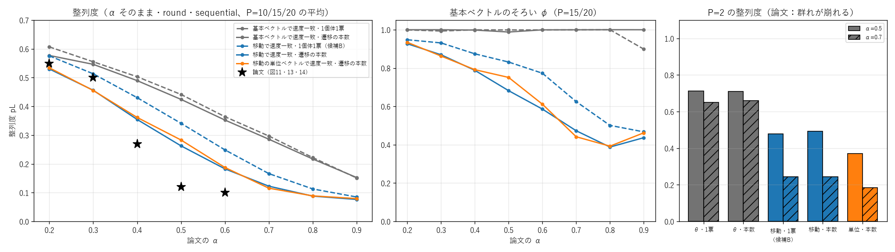

# 論文1：α を文面どおりに読んだときの、ほかの読み方（2.16〜）

11/24 に作ったファイル。02・03 が長くなったので、論文1 の続きはここに書く。
きっかけ：論文1 は α=0.7・0.9（図8・図10）や「a>0.5」（p.15）を使っていて、α を2倍に読むと α=0.5 で扇が一周してしまう（2.5 節の反論）。そこで、**α は文面どおり**のまま、ほかに文面から読める所を見直した。

## 2.16 文面の見直しと、人気度の数え方（計画L、11/24）

### 文面を読み直して分かったこと（論文1 の2章 Model）

| 箇所 | 文面 | 今の実装 | 判断 |
|---|---|---|---|
| p.6 の A・B・C の例 | 3体が同じ重なったサイトを狙うと、順番はランダム（例えば B, C, A）。B が先にそのサイトへ動き、C は「空いていれば別の重なったサイトへ」、最後に A も「空いていれば別の重なったサイトへ」 | sequential（空いている次に人気のサイトへ何番目でも） | **文面どおり。** p.8 の「残りは2番目に人気のサイトへ」は2体のときの言い方と読める。literal は使わない（課題15 を解決） |
| p.7 の人気度 | 「the number of transitions reaching that site is counted as the popularity」（そのサイトに届く**遷移の本数**）。式(3) も遷移先 t(k,t;i) の数 | **1個体1票**（論文2 の図S2 に合わせて決めた数え方を、そのまま使っていた） | **文面と違っていた。** `popularity="transition"` を足した（既定は今までどおり） |
| 図11 の説明（p.17） | 「この傾向（密度が高く整列度が低い）は α によらない」 | — | 図11 は P に対する傾向の図で、α の値どうしを比べることが主目的ではない |
| 密度の Ls | 値は書かれていない | 図ごとに Ls を変えて測る | 図ごとに合う Ls を探してよい（自分で決めた、11/24） |

- 遷移の本数で数えると、1体の遷移が2本同じサイトに重なるだけで人気度が 2（閾値）になる。そのため、ほぼ全員がいつも相互予期で動く（相互予期 100%、追従 0%）。

### 試したこと

- 条件はすべて α そのまま・round・sequential（`alpha_scale=1, int_mode="round", ma_rule="sequential"`）。
- 速度一致で平均するもの（基本ベクトル θ / 移動 / 移動の単位ベクトル）× 人気度の数え方（1個体1票 / 遷移の本数）の5通り。
- P=10 / 15 / 20、α=0.2〜0.9、3シード、900 ステップ（t=300〜900 の平均）。P=1・2 も α=0.5・0.7 で。全部で 420 本。
- スクリプト：`report_scripts/planL_paper1_alt.py`（実行）、`planL_analyze.py`（集計と図）。結果は `report_data/planL_paper1_alt.json`。

**fig33** 左：整列度（P=10/15/20 の平均）、黒い星が論文。中：基本ベクトルのそろい φ。右：P=2 の整列度。灰色＝基本ベクトルで速度一致、青＝移動で速度一致、橙＝移動の単位ベクトルで速度一致。破線＝1個体1票、実線＝遷移の本数。

**整列度**（P=10/15/20 と3シードの平均）

| 設定 | α=0.2 | 0.3 | 0.4 | 0.5 | 0.6 | 0.7 | 0.8 | 0.9 |
|---|---|---|---|---|---|---|---|---|
| **論文** | 0.55 | 0.50 | 0.27 | 0.12 | 0.10 | — | — | — |
| 基本ベクトル・1個体1票 | 0.61 | 0.56 | 0.50 | 0.44 | 0.36 | 0.30 | 0.22 | 0.15 |
| 基本ベクトル・遷移の本数 | 0.58 | 0.55 | 0.49 | 0.42 | 0.35 | 0.29 | 0.22 | 0.15 |
| 移動・1個体1票（候補B） | 0.58 | 0.51 | 0.43 | 0.34 | 0.25 | 0.17 | 0.11 | 0.08 |
| **移動・遷移の本数** | 0.53 | 0.46 | **0.35** | **0.26** | **0.18** | 0.12 | 0.09 | 0.08 |
| 移動の単位ベクトル・遷移の本数 | 0.53 | 0.46 | 0.36 | 0.28 | 0.19 | 0.12 | 0.09 | 0.08 |

### 結果

- **遷移の本数で数えると、移動で速度一致する版（候補B）の整列度が、どの α でも 0.05〜0.08 下がり、論文に近づいた。**
  - α=0.4 / 0.5 / 0.6 で 0.35 / 0.26 / 0.18（論文 0.27 / 0.12 / 0.10）。候補B（0.43 / 0.34 / 0.25）より近い。
  - α=0.2 / 0.3 は 0.53 / 0.46（論文 0.55 / 0.50）で、少し低いが ±0.05 に入る。
  - それでも α=0.5 は論文より 0.14 高い。論文の値には、α を 0.2 ほど大きくしたところ（α=0.7 で 0.12）で届く。
  - α=0.3 → 0.4 の急な落ち方は出ない（なだらかに下がる）。
- **基本ベクトルで速度一致する版は、人気度の数え方を変えてもほとんど変わらない。** θ が完全にそろったまま（φ=1.00）なので、α が効きにくい（課題17 と同じ）。
- **P=2 で群れが崩れるのは、移動で速度一致する版だけ。** α=0.7 で整列度 0.24（基本ベクトルの版は 0.65）。論文の「P=2 で集団の動きが崩れる」と合う。P=1 はどれも 1.0 前後で、全員そろって直進する。
- **移動で速度一致する版は、整列度が時間で揺れる**（標準偏差 0.06〜0.09、基本ベクトルの版は 0.03）。図14 の「整列度が広く分布する」様子に近い。
- 密度（P=15/20）は、移動・遷移の本数で Ls=6 が 0.18〜0.22、Ls=10 が 0.27〜0.33、Ls=25 が 0.50〜0.57。図13・14 の 0.1〜0.3 には Ls=6〜10 で入る。図11 の Ls=25 の値（0.7 前後）より低い。
- **P が大きいほど整列度が上がる。** 移動・遷移の本数の α=0.5 は、P=10 / 15 / 20 で 0.23 / 0.25 / 0.31。図10・11 の P は 30 までなので、P が大きい所ではさらに高くなるはず（未確認）。

### まとめ

- α を文面どおり読むなら、**移動で速度一致・遷移の本数で人気度を数える版**が、今のところ一番よい。数え方は p.7 の文面どおりで、拡大解釈ではない（残る拡大解釈は round だけ）。
- 課題は、α が大きい側（α=0.4〜0.6）がまだ 0.08〜0.14 高いことと、P が大きいと整列度が上がること。
- 次に見るとよいこと：P=25・30 での値、図10（α=0.7、P を変える）と図8（α=0.7・0.9）との比較、速度一致の半径 R(M)=2（図9・図15 の値）。
