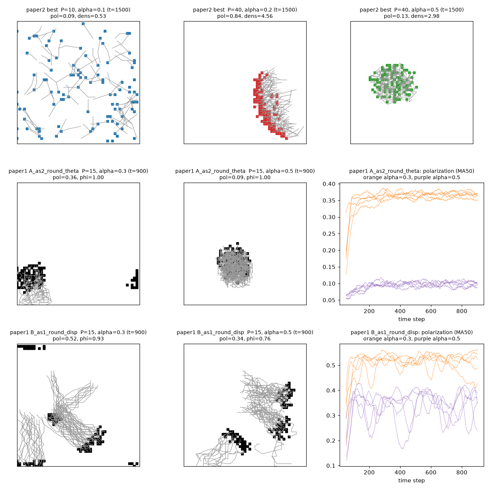

# 相互予期モデル 検証レポート

2026/11/22 時点のまとめ。このファイルは入口で、**0章 現状のまとめ**・**課題一覧**・目次だけを置いている。詳しい中身は、下の目次のファイルに分けた。

- 論文1：Gunji et al., *Robust swarm of soldier crabs*（速度一致あり）
- 論文2：Murakami et al. 2017, *Sci. Rep.* 7:46447 と Appendix S1（速度一致なし）
- 論文の値は、論文の図を目で読んだもの。シードは 3〜10 本なので、0.05 くらいの差は誤差の範囲。
- **このレポート自身の図は fig17 のようにファイル名の番号で呼ぶ**（図は `report_fig/` にある）。「図3」「図11」のように書いたものは、論文の図。

## 目次

| ファイル | 章・節 | 中身 |
|---|---|---|
| [検証/01_測り方とモデル.md](検証/01_測り方とモデル.md) | 1章 | モデルの流れ、評価指標、変更の経緯、`MAM_basic_v1.py`、再現方法。共通の「やったこと → 結果」の表 |
| [検証/02_論文1_整列度.md](検証/02_論文1_整列度.md) | 2.1〜2.8 | 論文1：追従の連鎖、α の効き方、外部摂動、α 2倍、組み合わせ8通り、急な落ち方。論文1の「やったこと → 結果」の表 |
| [検証/03_論文1_密度と相関.md](検証/03_論文1_密度と相関.md) | 2.9〜2.15 | 論文1：密度の測り方、速度一致の読み方（E2）、密度の谷、スケールフリー相関、相互予期の割合、まとめ |
| [検証/04_論文2_図3.md](検証/04_論文2_図3.md) | 3.1〜3.6 | 論文2：Int、ω、α の効き方、α 2倍、図3b,c のそろう時間と平均の取り方。論文2の「やったこと → 結果」の表 |
| [検証/05_論文2_他の図.md](検証/05_論文2_他の図.md) | 3.7〜3.12 | 論文2：図S2・2体・図S3、図4 の力、青のルールの割合、ω≤1、効かなかった候補、まとめ |
| [検証/06_計画.md](検証/06_計画.md) | 4章 | 終わった計画の一覧、これからやること |
| [検証/07_論文1_α文面どおり.md](検証/07_論文1_α文面どおり.md) | 2.16〜 | 論文1：α を文面どおりに読んだときの見直し（A・B・C の例、人気度を遷移の本数で数える、計画L。P=1〜30 と図8 の格子、計画M） |
| [変更一覧.md](変更一覧.md) | — | 変更ごとの根拠（論文の箇所）・実装・結果・採否 |
| [../開発メモ.md](../開発メモ.md) | — | 日付ごとのメモ（11月分。それより前は `開発メモ/`） |

<details>
<summary>番号の対応（11/22 に、論文1 ⇒ 論文2 の順に並べ直して番号を振り直した）</summary>

開発メモや古いスライドには古い番号が出てくる。

| 古い番号 | 新しい番号 |
|---|---|
| 1章・2章・5章・付録 | 1.1〜1.2・1.3・1.4・1.5 |
| 4.1〜4.15（論文1） | 2.1〜2.15 |
| 3.1〜3.5（論文2） | 3.1〜3.5（同じ） |
| 3.6 他の図との比較 | 3.7 |
| 3.7 効かなかった候補 | 3.11 |
| 3.8 論文2のまとめ | 3.12 |
| 3.9 図4 の力 / 3.10 青 / 3.11 図S3 | 3.8 / 3.9 / 3.10 |
| （新しい節） | 3.6 図3b,c のそろう時間と平均の取り方 |
| 7章・7.1〜7.6（計画） | 4章・4.1〜4.4（整理して短くした） |
| レポートの図1〜28 | fig01〜fig28（ファイル名の番号。古い図N とは番号が違うものがある） |

</details>

---

## 0. 現状のまとめ（11/22）

### 0.1 ひとことで言うと

- **論文2（速度一致なし）は、ほぼ再現できた。** ただし、数値まで合わせるには、論文の式と違う読み方を2つ入れている（α の範囲を2倍、Int を round）。
- **論文1（速度一致あり）は、群れができる・崩れる、といった振る舞いは出ている。** ただし、α の効き方は合いきっていない。速度一致で「何を平均するか」の読み方によって、合う図が入れ替わる。
- **一番大きな判断は、α を2倍に読んでよいか。** これは結果に合わせて決めた読み方で、文面とは違う（0.4 節）。先生の確認がないと「再現できた」とは言えない。
- **論文1 では、α 2倍の読み方は苦しい（11/24）。** 論文1 は α=0.7・0.9 や「a>0.5」を使っていて、2倍だと α=0.5 で扇が一周してしまう（2.5 節）。α をそのまま読む中では、候補B（round・実際の移動で速度一致）に、人気度を p.7 の文面どおり「遷移の本数」で数える読み方を足した版が一番よい（α=0.4/0.5/0.6 で 0.35/0.26/0.18、論文 0.27/0.12/0.10。2.16 節、計画L）。

### 0.2 できていること・考えなければいけないこと

**論文1**（○ 合う、△ 一部、× 合わない）

| 論文の図・現象 | 状況 | どの読み方で | 節 |
|---|---|---|---|
| 図8：P=2 で群れが崩れる | ○ | 文面どおりの修正だけ（追従の連鎖なし） | 2.1 |
| P=1 で全員そろって直進する（BOIDS と同じ） | ○ | どの読み方でも | 2.2 |
| 図11・14：α が大きいと整列度が下がる | △ | 候補A（α 2倍）は α≥0.4 が合い α=0.3 が低い。候補B（移動で速度一致）は α=0.3 が合い α が大きい側が高い | 2.7・2.12 |
| 図11：α=0.3 → 0.4 で急に落ちる | × | どの読み方でも出ない（候補A は θ が完全にそろうため） | 2.8 |
| 図11：密度の値（区画 Ls=25） | ○（候補A）／ × （候補B は低い） | 文面どおりの「区画に分ける」測り方。Ls の値は結果から決めた | 2.9・2.12 |
| 図11：P=8〜12 の密度の谷 | × | 候補A の α=0.6 だけ、位置をずらして出る | 2.11 |
| 図13・14：密度の値 | Ls しだい | Ls≈6 なら候補A、Ls=10 なら候補B が合う | 2.9・2.10 |
| 図15：スケールフリー相関の傾き | △ | 速度を移動で取ると論文の 1/10〜1/2。論文が velocity と呼ぶ基本ベクトル θ で取ると v1 で −1.06（論文 −0.96）と合うが、θ はほぼそろっていて揺らぎがとても小さい。ξ は群れの大きさに比例する | 2.13 |

**論文2**

| 論文の図・現象 | 状況 | どの読み方で | 節 |
|---|---|---|---|
| 図3：赤は整列、緑・青は整列しない（順番） | ○ | α 2倍のときだけ。α そのままだと赤と緑が逆 | 3.5 |
| 図3：値 | △ | 赤 0.84 / 4.5（論文 0.93 / 4.0）、緑 0.13 / 3.0（0.35 / 3.2）、青 0.12 / 0.54（0.2 / 0.65） | 3.5・3.6 |
| 図3b,c：そろうまでの時間 | ○ | round なら赤は t=181〜1292（論文 t≈600）。floor だと 60 ステップで速すぎる | 3.6 |
| 図3a：P × α の格子の見た目 | ○ | α 2倍 | 3.5 |
| 図S2：赤・緑のルールの割合 | ○ | どの読み方でも | 3.7 |
| 図S2：青のルールの割合 | ○（α そのまま）／ △（α 2倍） | α 2倍とは両立しない | 3.9 |
| 図S2b：2体の整列度とルールの割合 | ○ | ω 式どおり・1個体1票 | 3.7 |
| 図4b,c：2体の旋回・加速の力 | ○ | 論文の Methods どおりに計算すれば、どの設定でも | 3.8 |
| 図S3：ω=2〜7 で高く、ω≥8 で下がる | ○ | ω 式どおり・α 2倍 | 3.7・3.10 |
| 図S3：ω=0 で低い | × | ω を説明文どおりに読んだときだけ合う | 3.10 |

**考えなければいけないこと**（大事な順）

1. **α を2倍に読むか**（課題1）。両方の論文で、数値の合い方を一番大きく左右する。文面とは違う。
2. **Int は floor か round か**（課題2）。文面は floor。floor だと論文2はすべての条件で整列し、論文1は整列度が 0.18 より下がらない。
3. **論文1の速度一致で何を平均するか**（課題17）。基本ベクトルの向き（候補A）か、実際の移動（候補B）か。合う図が入れ替わる。
4. **論文2の ω をどちら側に掛けるか**（課題4）。式どおりが多くの図に合うが、図S3 の ω=0 だけは説明文どおりでないと出ない。
5. **論文1の密度の Ls**（課題19）と、**スケールフリー相関の速度 v_i を何で取るか**（課題28）。Ls は論文に書かれていない。v_i は、基本ベクトル（論文は velocity と呼ぶ）なら傾きが合い、実際の移動なら合わない。
6. **何をもって「再現できた」とするか**（課題29）。論文の図は1本のシミュレーションの値なので、シードの範囲に入るかで判断するのがよいと考えている（3.6 節）。

### 0.3 今のベストのモデルと、その挙動



**fig30** 今のベストのモデルのスナップショット（灰色の線は最後の数ステップの軌跡）。上段：論文2 のベスト（t=1500）。中段：論文1 の候補A（t=900）。下段：論文1 の候補B（t=900）。右の列は、論文1 の整列度の時系列（5シード）。

**論文2 のベスト**：α 2倍・ω 式どおり・round・1個体1票

```python
SoldierCrabSwarm_v1(model="paper2", P=40, alpha=0.2, alpha_scale=2, omega_on="principal", int_mode="round")
```

| 条件 | 群れの様子 | 整列度 / 密度（中央値） | 相互予期 |
|---|---|---|---|
| 赤（P=40, α=0.2） | 最初はばらばら。t≈260 までに密な群れになり、そのあとシードごとに t=181〜1292 のどこかで一気に向きがそろって、帯の形の群れが一方向に進む | 0.83 / 4.52 | 99% |
| 緑（P=40, α=0.5） | 丸い塊になって、ほぼその場にとどまる。塊の中では個体がばらばらの向きに動き回る（論文の「ユスリカの群れのよう」に近い） | 0.13 / 2.99 | 99% |
| 青（P=10, α=0.1） | 群れにならず、ばらばらに動く | 0.10 / 0.54 | 72% |

- 論文の記述（赤は密でそろった群れ、緑は密だがそろわない群れ、青は群れにならない）と、見た目は合う。
- 値は、赤の整列度が論文より 0.1 低く、密度が 0.5 高い。緑の整列度は論文より 0.2 低い。

**論文1 は、1つに決まっていない。** 2つの候補がある。

| | 候補A：α 2倍・round・基本ベクトルの向きで速度一致 | 候補B：α そのまま・round・実際の移動で速度一致（E2） |
|---|---|---|
| 設定 | `alpha_scale=2, int_mode="round", vm_source="theta"` | `alpha_scale=1, int_mode="round", vm_source="disp"` |
| 群れの様子（P=15） | 1つの密な塊になる。全員の向きが完全に同じ（φ=1.00）。α=0.3 では塊が一方向に進み、α=0.5 ではほぼその場にとどまる丸い塊になる | 群れがいくつかに分かれて、それぞれ別の向きに進む（seed 0 の t=900）。向きは完全にはそろわない（φ=0.92 / 0.78） |
| 整列度の時間変化 | t≈100 で一定になり、そのあとほとんど揺れない | 大きく揺れ続ける（α=0.5 で 0.17〜0.42） |
| 整列度（α=0.3 / 0.5、論文 0.53 / 0.13） | 0.37 / 0.10 | 0.52 / 0.34 |
| 密度（区画 Ls=10 / Ls=25） | 0.51 / 0.78、0.49 / 0.70 | 0.34 / 0.58、0.32 / 0.57 |
| 合う図 | 図11 の α が大きい側、図11 の密度（Ls=25）、図8 の見た目（丸い塊） | 図11 の α=0.3、図13・14 の密度（Ls=10 と読んだとき） |

- **候補A は「動きが固すぎる」。** 全員の向きが完全に同じで、整列度が時間で変わらない。論文の図14 のように、整列度が時間で広く分布する様子は出ない。
- **候補B は「群れがまとまらない」。** 向きはばらつくが、群れが分かれやすく、図11 の密度（Ls=25）が低い。
- 論文1 の値は、ちょうど2つの候補の間にある（2.12 節）。

### 0.4 拡大解釈になっていないかのチェック

ベストの設定に入っている読み方を、論文の文面と1つずつ比べた。

| 読み方 | 論文の文面 | 判定 | 注意 |
|---|---|---|---|
| **α の範囲を2倍**（両方） | 式(1)・付録の式(3)は「ξ を [−απ, απ] から選ぶ」と明記 | **文面と違う（拡大解釈）** | 結果に合わせて決めた。支える根拠は、論文2 p.4 の「α が大きいとほぼ全方向と相互作用する」という言葉の記述と、合う図が多いこと（論文2 の図3・3a・S3、論文1 の α が大きい側）。反対に、論文2 の図S2 の青は合わなくなる。**論文1 は α=0.7・0.9・「a>0.5」を使っていて、2倍だと α=0.5 で扇が一周し、それより大きい α が不自然になる（11/24、2.5 節）。** **「α が大きいと乱れる」こと自体は、α をそのまま読んでも、α を広く振れば山の形で出る**（山の位置が2倍ずれるだけ、3.4 節） |
| **Int を round**（両方） | 付録の式(2)の下「X ≤ x < X+1」＝ floor | **文面と違う（拡大解釈）** | floor では論文2 がすべての条件で整列し、論文1 の整列度は 0.18 より下がらない。論文1 の値（0.10〜0.12）は floor では原理的に出ないので、論文のコードが floor でなかった可能性はある。ただし推測 |
| ω を式どおり（論文2） | 式(13)・本文 p.4 | 文面どおり | 図S3 の説明文とは逆。今の v1 の既定（説明文どおり）は見直す |
| 人気度は1個体1票（論文2） | 付録の式(5)は、遷移の本数とも読める | 文面の範囲内の解釈 | 図S2・図S2b に合う方を選んだ |
| 速度一致で実際の移動を平均（論文1 の候補B） | 式(8) は θ の平均、言葉の説明は「平均の速度の向き」 | 文面の範囲内の解釈 | 式の記号と言葉のどちらを取るかで読み方が分かれる |
| 「全員の相互予期 → 全員の追従 → 全員の自由移動」の段階式（論文1） | 図2 の説明 | 文面の範囲内 | 本文 p.9〜10 は1体ずつとも読める。1体ずつだと P=1 が崩れる |
| 追従の連鎖なし（論文1） | p.7 | 文面どおり | — |
| 競合で負けた個体は、空いている次に人気のサイトへ（sequential、論文1） | p.8「残りは2番目に人気のサイトへ」。ただし p.6 の A・B・C の例は「B が先に動き、C は空いていれば別の重なったサイトへ、最後に A も空いていれば別のサイトへ」 | 文面どおり（11/24 に見直し） | p.6 の例は3体目以降も別のサイトへ動ける書き方で、sequential と同じ。p.8 の「2番目」は2体のときの説明と読める（自分で確認、11/24） |
| スケールフリー相関の v_i を基本ベクトル θ で取る（論文1） | p.5「basic vector (velocity)」、p.22「v_i is the velocity」 | 文面の範囲内の解釈 | 論文が基本ベクトルを velocity と呼んでいるので、文面に沿う。ただし「移動（transitions）のスナップショット」（p.22）とも書かれていて、移動とも読める |
| 密度を区画に分けて測る（論文1） | p.17 | 文面どおり | Ls の値は文面にない。Ls=25・6・10 は結果から推した |
| 整列度を L で割る（論文1） | p.17「平均ベクトルの長さ」 | 文面の範囲内 | どの定義でも α に対する形は同じ（2.6 節） |
| 図4 の力の計算 | Methods の「Force map」 | 文面どおり | — |
| シードを増やして時間平均で比べる | 論文の図3b,c・図S3 は1本の値 | 比べ方の違い | 論文の値がシードの範囲に入るかで見るのがよい（3.6 節） |

- **文面と違う読み方は2つ（α 2倍、round）。** sequential は、p.6 の A・B・C の例から文面どおりと見直した（11/24）。 どれも「合う方」を選んだ結果なので、それで図が合っても、論文どおりに実装できた証拠にはならない。
- **文面どおり（α そのまま・floor・式どおりの ω）で合うのは**、論文1 では P=2 の崩壊、P=1 の直進、図11 の密度（区画 Ls=25）。α に対する整列度の下がり方は弱すぎる。論文2 は floor のせいで青まで整列してしまい、ほとんど合わない。round だけ入れると（α そのまま）、論文2 の青・図S2 の青・2体・図4 が合い、赤と緑の順番は逆になる。
- 先生に確認するときは、「この2つを入れると何が合い、入れないと何が合わないか」をセットで見せる。文面どおりの版の結果を1つの表にまとめるのは、これからやる（課題30）。

### 0.5 先生に確認したいこと（11/24 に並べ直した）

共通 → 論文1 → 論文2 → 進め方 の順。それぞれの中は大事な順。11/24 より前のメモに出てくる番号は、古い並び（対応は末尾）。

**A. 両方の論文に共通**

> **先生の答え（11/24）：1 と 2 は、論文に合うなら α 2倍・round で進めてよい。** 論文2 の全図をベストの設定で作り直した結果は、別のレポート [論文2_全図の再現.md](論文2_全図の再現.md) にまとめた。

1. **α の範囲（一番大事）。** 式は ξ∈[−απ, απ]。2倍に読むと論文2 の図3（赤と緑の順番）は合う。ただし論文1 は α=0.7・0.9（図8・図10）や「a>0.5」（p.15）を使っていて、2倍だと α=0.5 で扇が一周してしまう（2.5 節）。論文2 でも図S2 の青は、そのまま読まないと合わない（3.5・3.9 節）。→ α は文面どおりでよいか。論文1 と論文2 で読み方が違ってよいか。
2. **Int は floor か round か。** 文面は floor。floor だと移動が平均 (−0.5, −0.5) ずれ、論文2 はすべての条件で整列し、論文1 は整列度が 0.18 より下がらない（論文 0.10）。round なら合う（3.1・2.4 節）。→ 実際のコードは floor だったか。
3. **どの程度合えば「再現できた」とするか。** 論文の図3b,c・図S3 は1本のシミュレーションの値。→ シードの範囲に論文の値が入るかで判断してよいか（3.6 節）。

**B. 論文1**

4. **速度一致（式(8)）で何を平均するか。** 基本ベクトルの向き（式の記号どおり）か、近傍の実際の移動（言葉の「平均の速度の向き」）か。α を文面どおり読むなら、実際の移動を平均する候補B が出発点。α=0.3 の整列度と図13・14 の密度は合うが、α が大きい側が下がりきらない（α=0.5 で 0.34、論文 0.12）（2.10・2.12 節）。
5. **スケールフリー相関（図15）の v_i は何か。** 基本ベクトル（p.5 で velocity と呼んでいる）なら傾き −1.06 で論文（−0.96）と合うが、θ はほとんどそろっていて揺らぎがとても小さい。実際の移動なら傾きは論文の 1/10〜1/2。C の規格化、図15 の P と α も（2.13 節）。
6. ~~競合で負けた個体の動き方。~~ **自分で答えた（11/24）：** p.6 の A・B・C の例に「C は空いていれば別の重なったサイトへ、最後に A も空いていれば別のサイトへ」とあるので、3番目以降にも動ける（今の sequential のまま）（2.6・2.7 節）。
7. ~~密度の窓の大きさ Ls。~~ **自分で答えた（11/24）：** 論文に値がないので、図ごとに合う Ls を探してよい（図11 は Ls=25、図13・14 は Ls≈6 か 10）。ただし、Ls を決めたら図に必ず書く（2.9 節）。
8. **整列度は図11 と図14 のどちらに合わせるか。** α=0.3 は図11 で 0.53、図14 の「0.3〜0.4 の幅」で 0.35（2.8 節）。

**C. 論文2**

9. **ω の掛け方。** 式(13)・本文 p.4 と、図S3 の説明文で逆（ω を読むか 1/ω を読むかの違い）。2体と図S3 の ω≥8 で下がる所は式どおり、図S3 の ω=0 で低い所だけは説明文どおりを支持する（3.2・3.10 節）。

**D. 進め方**

10. **次の進め方。** 次は論文1（α を文面どおり読んだうえで、候補B の α が大きい側をどう下げるか）と、スケールフリー相関を中心に進めてよいか。

<details>
<summary>古い番号との対応（11/24 より前）</summary>

| 古い番号 | 新しい番号 |
|---|---|
| 1 α の範囲 / 2 Int | 1 / 2 |
| 3 ω の掛け方 | 9 |
| 4 速度一致 | 4 |
| 5 競合 | 6 |
| 6 Ls | 7 |
| 7 図11 と図14 | 8 |
| 8 図15 の v_i | 5 |
| 9 再現の基準 | 3 |
| 10 進め方 | 10 |

</details>

### 0.6 自分で決めたこと（11/21）

- 本と論文で書いてあることが違うときは、論文を優先する。
- 時計（砂時計）と体長の大きい個体の実装は、モデルの検証が終わってから。体長の大きい個体で参考にするものは、先生があとでくれる。
- モデルのまとめとして、論文1・論文2それぞれ別のファイルで最終版のコードを作る。

---

## 課題一覧（11/22 時点）

今どんな課題があるかを、1行に1つずつ並べた。解決・確認できたものも、経緯が分かるように残している。番号は課題の名前として使っているので、並べ替えても変えない。

- **状況**
  - 未解決：まだ論文と合っていない
  - 確認待ち：シミュレーションでは答えの候補があり、先生に確認したい
  - 解決：原因が分かった、または論文と合った
  - 確認済み：問題ではないことを確かめた

### 両方の論文に共通

| # | 課題 | 状況 | 節 |
|---|---|---|---|
| 1 | **α の範囲。** 式は ξ∈[−απ, απ]。2倍の [−2απ, 2απ] に読むと、両方の論文で図に合う。論文2 p.4「α が大きいとほぼ全方向と相互作用する」とも合う。ただし論文2の図S2 の青は、そのまま読まないと合わない（課題5）。→ 論文1 は α=0.7・0.9・「a>0.5」を使っていて、2倍だと α=0.5 で一周してしまうので、論文1 には2倍は合いにくい（11/24） | 先生の答え：論文に合うなら2倍でよい（11/24） | 2.5・3.5・3.9 |
| 2 | **整数化（Int）。** 文面は floor。floor だと移動が平均 (−0.5, −0.5) ずれ、整列度が下がりきらない。round の方が図に合う | 先生の答え：論文に合うなら round でよい（11/24） | 2.4・3.1 |
| 3 | **整列度の計算方法。** 論文1は「移動の平均ベクトルの長さ」。L で割るのか、floor のずれを含めて計算しているのかが分からない | 確認待ち | 2.4・2.6 |
| 29 | **平均の取り方（11/22 に追加）。** 論文の図3b,c・図S3 は1本のシミュレーションの値で、平均の取り方は書かれていない。こちらは「t=1000〜1500 の時間平均 → シードの平均」で比べていた。→ 各シードの時間平均を出し、シードの中央値と範囲で比べ、論文の値が範囲に入るかを見るのがよい（3.6 節） | 方針を決めた（集計し直しはこれから） | 3.6 |
| 30 | **拡大解釈になっていないか（11/22 に追加）。** 文面と違う読み方（α 2倍、round）を入れた版で「合った」と言っている所がある。→ 0.4 のチェック表。文面どおりの版の結果を1つの表にまとめる | これから | 0.4 |

### 論文1（速度一致あり）

| # | 課題 | 状況 | 節 |
|---|---|---|---|
| 13 | **α=0.3 の整列度が低い。** 組み合わせ8通りのうち一番近い「α 2倍・round・sequential」でも 0.37（論文の図11 は 0.53）。図14 の「0.3〜0.4 の幅で 0.35」には近い。どちらの図に合わせるかも確認したい | 未解決（原因は課題17 と同じ） | 2.7・2.8 |
| 14 | **α=0.3 → 0.4 の急な落ち方。** → 細かく 3000 ステップ回しても出ない。θ がいつも完全にそろう（φ=1.00）ので、整列度が扇の広がりだけで決まるため（計画A） | 原因が分かった（課題17 にまとめた） | 2.8 |
| 15 | 競合を文字どおり（負けたら2番目に人気のサイトへ）にしても、整列度が全体に下がるだけで、α が小さい側は合わない。→ p.6 の A・B・C の例から、3番目以降にも動ける sequential が文面どおりと判断した（11/24） | 解決 | 2.6・2.7 |
| 16 | floor だと整列度が 0.18 より下がらない。→ round なら 0.05 まで下がる。どちらが正しいかは課題2 | 解決（課題2 に移した） | 2.4・2.7 |
| 17 | **速度一致で向き θ が全員そろいきり、α が効きにくい。** 外部摂動を入れても直らない。→ 速度一致で近傍の実際の移動を平均すると（E2、式(8)「平均の速度の向き」の読み方）、round のとき θ がばらつく（φ 0.94→0.53）。α=0.3 の整列度は合うが、α が大きい側は高すぎる。α を2倍に読むと全体に低すぎ、論文の値は2つの間（計画E・E2）。式(8) で何を平均するかは確認したいこと 4 | 手がかりあり（確認待ち） | 2.3・2.4・2.8・2.10・2.12 |
| 18 | **P=8〜12 で密度が下がる谷が出ない。** → 谷が出るのは α 2倍・round の α=0.6 だけで、P=11〜15 と少しずれる（計画F） | 未解決（一部だけ出る） | 2.2・2.9・2.11 |
| 19 | **密度の値が論文と合わない。** → 文面どおり「区画に分ける」と、図11 は Ls=25（2×2）で合う。図13・14 は Ls≈6 なら今のモデルで、Ls=10 なら E2 か文字どおりの競合で合う（計画B・E）。→ Ls は論文にないので、図ごとに合う値を探してよいことにした（11/24） | 方針を決めた | 2.2・2.9・2.10 |
| 20 | 相互予期が 99% で、追従と自由移動がほとんど起きない。→ 式(4) の決まりから自然に出る値で、論文2の図S2（P=40 で 98〜99%）とも合う（計画G） | 確認済み（問題ではない） | 2.7・2.14 |
| 21 | 追従者近傍の半径。本文は「L より大きい」、図は R(Nf)=2 で食い違う。→ R(Nf)=5 にしても、段階式では変化なし | 確認済み | 2.6 |
| 22 | P=2 で群れが崩れる現象。→ 追従の連鎖をなくして再現できた | 解決 | 2.1 |
| 23 | 速度一致の順番（相互予期より前か）と、近傍に自分を含めるか。→ どちらも違いなし | 確認済み | [変更一覧](変更一覧.md) 1-14 |
| 24 | for ループの構造（段階ごとか、1体ずつか）。→ 1体ずつだと P=1 が崩れるので、段階ごとのまま | 確認済み | 2.6 |
| 25 | 基本ベクトルを、論文にない処理で更新していないか。→ θ が変わるのは式(8)の速度一致だけ | 確認済み | 2.3・2.4 |
| 26 | 計測のタイミング（移動の前か後か）。→ 時間平均では1ステップずれるだけで、平均には効かない | 確認済み | 2.9 |
| 27 | 可能的遷移の作り方（η の分布など）。η を √ にしても α の形は同じ | 一部確認 | [変更一覧](変更一覧.md) 2-11 |
| 28 | **スケールフリー相関（図15）の傾き。** → 速度を移動で取ると −0.07〜−0.27（論文 −0.96、計画I）。論文が velocity と呼ぶ基本ベクトル θ で取ると v1 で −1.06 / R² 0.95 と合う。ただし v1 の θ はほぼそろっていて揺らぎがとても小さい（計画K）。ξ は群れの大きさに比例する。v_i を何で取るかは先生に確認 | 一部解決（確認待ち） | 2.13 |

### 論文2（速度一致なし）

| # | 課題 | 状況 | 節 |
|---|---|---|---|
| 4 | **ω の掛け方。** 式(13) と図S3 の説明文で、言っていることが逆。2体（図S2b）と図S3 の ω≥8 は式どおりが合い、図S3 の ω=0 だけは説明文どおりが合う。2つの読み方は ω と 1/ω の入れ替え。v1 の既定（説明文どおり）は見直し候補 | 確認待ち | 3.2・3.7・3.10 |
| 5 | **図S2 の青のルールの割合。** → 相互予期の割合は実際の扇の広さで決まり、論文の 63% になるのは α そのままのときだけ。α 2倍とは両立しない（計画D） | 原因は分かった（課題1 の確認待ち） | 3.7・3.9 |
| 6 | **図S3。** ω≤1 で整列度が下がらない。→ 低いのは主に ω=0 で、ω の読み方次第（課題4）（計画H） | 原因が分かった（課題4 の確認待ち） | 3.7・3.10 |
| 7 | 図4b の旋回の力。→ 論文の Methods どおりに計算し直すと、どの設定でも論文と同じ形（計画C） | 解決 | 3.7・3.8 |
| 8 | α を大きくすると整列度が上がる。→ α を広く振ると山の形で、頂上が論文の2倍の位置 | 解決 | 3.4 |
| 9 | 止まる（遷移しない）個体がいるか。→ 0% で、原因ではない | 確認済み | 3.7 |
| 10 | 図3 の赤・緑・青の P・α と値の読み取り。→ 正しい | 確認済み | 3.7 |
| 11 | **収束が速すぎる。** → floor が原因。今のベストの設定（round）を10シードで確かめると、赤がそろうのは t=181〜1292（中央値 418）で、論文の t≈600 は範囲に入る。floor だと 60 ステップでそろう（計画J） | 解決 | 3.1・3.6 |
| 12 | 人気度の数え方。→ 1個体1票の方が図S2・図S2b に合う | 解決 | 3.7 |

### 次に取り組むこと

計画2・A〜J はすべて終わった（一覧は [06_計画](検証/06_計画.md) の 4.1）。残りの多くは先生の答え待ち（0.5 の確認したいこと）。答えによらずできることは、文面どおりの版の結果のまとめ（課題30）と、平均の取り方をそろえた集計し直し（課題29）。
