# 相互予期モデル 検証レポート

2026/11/20 時点のまとめ（11/20：計画2の結果を 4.7 節に、課題一覧を冒頭に追加。7章の計画を考え直した）。

- 論文1：Gunji et al., *Robust swarm of soldier crabs*（速度一致あり）
- 論文2：Murakami et al. 2017, *Sci. Rep.* 7:46447 と Appendix S1（速度一致なし）
- 図はすべて `report_fig/` にある。
- 論文の値は、論文の図を目で読んだもの。
- シードは 3〜6 本なので、0.05 くらいの差は誤差の範囲。
- 変更ごとの根拠は [変更一覧.md](変更一覧.md) にまとめた。

---

## 課題一覧（11/20 時点）

今どんな課題があるかを、1行に1つずつ並べた。11/19・20 に解決・確認できたものも、経緯が分かるように残している。

- **状況**
  - 未解決：まだ論文と合っていない
  - 確認待ち：シミュレーションでは答えの候補があり、先生に確認したい
  - 解決：原因が分かった、または論文と合った
  - 確認済み：問題ではないことを確かめた

### 両方の論文に共通

| # | 課題 | 状況 | 節 |
|---|---|---|---|
| 1 | **α の範囲。** 式は ξ∈[−απ, απ]。2倍の [−2απ, 2απ] に読むと、両方の論文で図に合う。論文2 p.4「α が大きいとほぼ全方向と相互作用する」とも合う | 確認待ち | 3.5・4.5 |
| 2 | **整数化（Int）。** 文面は floor。floor だと移動が平均 (−0.5, −0.5) ずれ、整列度が下がりきらない。round の方が図に合う | 確認待ち | 3.1・4.4 |
| 3 | **整列度の計算方法。** 論文1は「移動の平均ベクトルの長さ」。L で割るのか、floor のずれを含めて計算しているのかが分からない | 確認待ち | 4.4・4.6 |

### 論文2（速度一致なし）

| # | 課題 | 状況 | 節 |
|---|---|---|---|
| 4 | **ω の掛け方。** 式(13) と図S3 の説明文で、言っていることが逆。2体（図S2b）は式どおりの方が合う。v1 の既定（ω を移動側に掛ける）は見直し候補 | 確認待ち | 3.2・3.6 |
| 5 | **図S2 の青のルールの割合。** α を2倍に読むと 72 / 4 / 24%（論文は 63 / 5 / 32%） | 未解決 | 3.6 |
| 6 | **図S3。** ω≤1 で整列度が下がらない | 未解決 | 3.6 |
| 7 | **図4b。** 2体の旋回の向きが「向きの差」で決まっていて、論文の「左右の距離」と合わない | 未解決 | 3.6 |
| 8 | α を大きくすると整列度が上がる。→ α を 0.05〜1.0 まで振ると山の形になり、頂上は論文の2倍の位置。α 2倍で説明できる（11/19） | 解決 | 3.4 |
| 9 | 止まる（遷移しない）個体がいるか。→ 0% で、原因ではない（11/19） | 確認済み | 3.6 |
| 10 | 図3 の赤・緑・青の P・α と値の読み取り。→ 正しい（11/19） | 確認済み | 3.6 |
| 11 | 収束が速すぎる。→ floor が原因。round だと、赤は t≈450〜1050 で整列する | 解決 | 3.1・3.5 |
| 12 | 人気度の数え方（遷移の本数か、1個体1票か）。→ 1個体1票の方が図S2・図S2b に合う | 解決 | 3.6 |

### 論文1（速度一致あり）

| # | 課題 | 状況 | 節 |
|---|---|---|---|
| 13 | **α=0.3 の整列度が低い。** 組み合わせ8通りのうち一番近い「α 2倍・round・sequential」でも 0.37（論文は 0.50）。α=0.2、0.4〜0.6 は ±0.05 に入る（11/20） | 未解決 | 4.7 |
| 14 | **α=0.3 → 0.4 の急な落ち方。** 論文は 0.50 → 0.27 と急に落ちるが、モデルはなだらかに下がる（11/20） | 未解決 | 4.7 |
| 15 | 競合を文字どおり（負けたら2番目に人気のサイトへ）にしても、整列度が全体に下がるだけで、α が小さい側は合わない（11/20） | 確認済み | 4.6・4.7 |
| 16 | floor だと整列度が 0.18 より下がらない。→ round なら 0.05 まで下がる（11/20）。どちらが正しいかは課題2 | 解決（課題2 に移した） | 4.4・4.7 |
| 17 | **速度一致で向き θ が全員そろいきり、α が効きにくい。** 外部摂動を入れても直らない | 未解決 | 4.3・4.4 |
| 18 | **P=8〜12 で密度が下がる谷が出ない** | 未解決 | 4.2 |
| 19 | **密度の値が論文（0.3 前後）より高い**（Ls=10 で 0.6〜0.7）。論文の Ls の決め方が分からない。文字どおりの競合だと 0.25〜0.54 に下がる | 未解決 | 4.2・4.7 |
| 20 | **相互予期が 99% で、追従と自由移動がほとんど起きない。** 論文の想定どおりかが分からない | 未解決 | 4.7 |
| 21 | 追従者近傍の半径。本文は「L より大きい」、図は R(Nf)=2 で食い違う。→ R(Nf)=5 にしても、段階式では変化なし | 確認済み | 4.6 |
| 22 | P=2 で群れが崩れる現象。→ 追従の連鎖をなくして再現できた（11/15 の修正、11/18 確認） | 解決 | 4.1 |
| 23 | 速度一致の順番（相互予期より前か）と、近傍に自分を含めるか。→ どちらも違いなし（10/27） | 確認済み | 変更一覧 1-14 |
| 24 | for ループの構造（全員を段階ごとに動かすか、1体ずつ動かすか）。→ 1体ずつだと P=1 が崩れるので、段階ごとのまま（11/18） | 確認済み | 4.6 |
| 25 | 基本ベクトルを、論文にない処理で更新していないか。→ v1 の論文1では、θ が変わるのは式(8)の速度一致だけ（11/18） | 確認済み | 4.3・4.4 |

### 以前から疑っていて、まだ調べていないところ

| # | 課題 | 状況 |
|---|---|---|
| 26 | 計測のタイミング。ノートブックの `run` の中で密度を計算していて、論文と測る時点（移動の前か後か）が違うかもしれない | 未確認 |
| 27 | 可能的遷移の作り方（η の分布、基本ベクトル自体を候補に入れるか）。η を √ にしても α の形は同じだった（変更一覧 2-11） | 一部確認 |

### 今週取り組む課題（詳しくは7章）

先生の答えによらない課題を先にやる（11/20 に考え直した）。
- **計画A（課題13・14、論文1）：** α=0.3 → 0.4 で整列度が急に落ちる仕組みを調べる。
- **計画B（課題19・26、論文1）：** 密度と計測のタイミングを、論文の測り方と合わせる。
- **計画C（課題7、論文2）：** 図4 の旋回の力を、速度をならしてから計算し直す。
- **計画D（課題5、論文2）：** α を2倍に読んだときの、青のルールの割合のずれを調べる。
- 課題1〜4 は先生に確認し、答えに合わせて v1 の既定値を決める。課題6（図S3 の ω≤1）は、ω の答えが出てから。

---

## 0. 結論

### ひとことで言うと

**一番の鍵は「α の範囲を2倍（ξ∈[−2απ, 2απ]）に読む」こと。** そう読むと、両方の論文で「α が大きいと整列度が下がる」が出る。ただし、論文の式には [−απ, απ] と書いてあるので、先生に確認したい。

### 論文ごとの状況

| | 再現できたこと | まだ再現できていないこと |
|---|---|---|
| **論文2** | 次の設定で、ほとんどの図が再現できた：**ω は式どおり ＋ α を2倍に読む ＋ round ＋ 人気度は1個体1票**<br>・図3：赤は整列し（0.84）、緑と青は整列しない（0.13、0.12）<br>・図3a：格子の見た目<br>・図S2：赤・緑のルールの割合<br>・図S2b：2体の整列度とルールの割合<br>・図S3：ω が大きい側 | ・図S2：2倍に読むと、青のルールの割合が少しずれる<br>・図S3：ω≤1 で整列度が下がらない<br>・図4b：旋回の向きが、論文と違う量で決まっている |
| **論文1** | ・図8：P=2 で群れが崩れる（追従の連鎖をなくして出た）<br>・α を2倍に読むと、α が大きい側（0.4〜0.5）の整列度が合う<br>・一番近い組み合わせは「α 2倍 × round × sequential」。α=0.2、0.4〜0.6 は ±0.05（4.7 節） | ・α=0.3 の整列度が低め（0.37。論文は 0.50）。文字どおりの競合を組み合わせても合わない（4.7 節）<br>・floor では、整列度が 0.18 より下がらない（論文は 0.10〜0.12）<br>・P=8〜12 の密度の谷 |

### ここまでで分かったこと

1. **論文2の「α を大きくすると整列度が上がる」は、間違いではなかった。** α を 0.05〜1.0 まで広く振ると、整列度は山の形になる。これまでは山の上り坂だけを見ていた。山の頂上は α=0.4 で、論文（0.2〜0.3）のちょうど2倍の位置にある（3.4 節）。
2. **論文2の ω は、式どおり（q = V_u + ω·v_u）が正しそう。** 2体のシミュレーション（図S2b）は、式どおりのときだけ論文と合った。今の v1 の既定（ω を移動側に掛ける）は見直した方がよい（3.6 節）。
3. **整数化（Int）は、論文2では round の方が合う。** 付録には floor と書かれている。しかし floor だと遷移が左下にずれて、どの条件でも整列してしまう（3.1 節）。
4. **論文1で α が効きにくいのは、全員の向き θ が完全にそろってしまうため。** 外部摂動を入れても直らなかった（4.3〜4.4 節）。
5. **止まる個体（遷移しない個体）は、論文にも実装にもいない。** 原因ではない（3.6 節）。

### 先生に確認したいこと

1. **α の範囲。** 式(1)と付録の式(3)は [−απ, απ]。一方で、論文2 p.4 には「α が大きいと、ほぼ全方向の個体と相互作用する」とある。シミュレーションも、2倍に読むと論文に合う。
2. **論文2の ω の掛け方。** 式(13)どおりにするか、図S3 の説明文に合わせて逆にするか。2体の結果は、式どおりを支持している。
3. **Int。** 文面は floor だが、論文2は round でないと合わない。論文1も、floor では整列度に 0.18 の下限ができる。

次の1週間で試すことは7章にまとめた。

---

## 1. 対象と測り方

### 1.1 モデルの流れ（両方の論文で共通の部分）

1ステップでは、次の順に処理する。

1. **可能的遷移を作る。**
   - 各個体が P 本の遷移ベクトル v = Int(L·η·(cos(θ+ξ), sin(θ+ξ))) を作る。
   - η は [0,1]、ξ は [−απ, απ] の一様乱数。
   - i=0 は基本ベクトル（η=1, ξ=0）。
2. **人気度 ζ を数える。** ζ は、そのサイトを遷移先に含む個体の数。
3. **相互予期。** 空いている遷移先の中で、ζ が最大かつ c 以上のサイトへ移る。
4. **追従。** 相互予期で空いたサイトへ移る。
   - 論文1：追従者近傍 R(Nf) の中の空いたサイト
   - 論文2：自分の遷移先に入っている空いたサイト
5. **自由移動。** 空いている遷移先へランダムに移る。空きがなければ、その場に留まる。
6. **向きを更新する。**
   - 論文1：速度一致（R(M) の近傍の向きの平均にそろえる）
   - 論文2：自分の直前の移動 V と、基本ベクトルの重み ω で更新する

### 1.2 評価指標

| | 整列度 | 密度 |
|---|---|---|
| 論文1 | 変位ベクトルの平均の長さ / L | Ls×Ls の窓をトーラス上でずらしたときの最大個体数 / N |
| 論文2 | 単位変位ベクトルの平均の長さ | 周り 3×3 にいる個体数の平均（自分は含まない） |

- 変位は、トーラスをまたいだ分を補正してから使う。
- 論文1は最初の 300 ステップ、論文2は最初の 1000 ステップを捨ててから平均した。

---

## 2. 変更の経緯（時系列）

開発メモとモデルファイルから整理した。根拠となる論文の箇所は [変更一覧.md](変更一覧.md) に書いた。

| 時期 | ファイル | 変えたこと | 結果 |
|---|---|---|---|
| 8/30 | `MAM_noVM` | 最初の実装（速度一致なし、ω で向きを更新） | — |
| 9/7 | `MAM_basic_step` | 論文1の形にした。速度一致を入れ、1体ずつ「相互予期 → 追従 → 自由移動」を判定する | P=10, α=0.1 で整列度が高すぎる問題が出る（9/19） |
| 9/19〜9/23 | `step_pop`, `step_noVM`, `step_pop_noVM` | 埋まっているセルの人気度を、最初から −1 として扱う | 最初から −1 の方が良さそう。ただし違いは分かりにくい |
| 9/24 | 同上 | 人気度を「遷移の本数」で数えるか「個体の数」で数えるか | 違いはほとんどない |
| 9/30 | `step_popnew` | 人気度の数え方の整理 | — |
| 10/3 | `MAM_basic_ex`, `mix`, `popnew_noVM` | 処理の順を「全員の相互予期 → 全員の追従 → 全員の自由移動」に変えた | 現在の論文1系統のもと |
| 10/8 | — | 追従のロジックを変える／個体数を減らして挙動を確認する | どちらも変化なし |
| 10/25 | `step_recalc` | 1体が遷移するたびに人気度を計算し直す | そこまでする必要はなさそう |
| 10/25 | — | 速度一致に自分を含めるかどうか | 変えても違いなし |
| 10/26 | `step_pop_dynamic` | 移動が決まった個体の票を人気度から除く | — |
| 10/27 | `step_popVM` | 速度一致を相互予期の前に行う／自分を含めない | あまり違いなし |
| 10/28 | `step_pop_v2` | 追従先を自分の可能的遷移に限る（`follow_own`）／動いた個体の票を除く（`pop_dynamic`） | — |
| 10/29 | — | 速度一致を外した | 密度は上がるが整列度が上がらず、群れができない |
| 10/30〜10/31 | `MAM_basic_noVM` | 論文2の付録の式どおりに実装し、Int を floor から round にした | 青の整列度は下がって論文に合ったが、赤と緑が悪くなった。⇒ 論文1と論文2は別のモデルとして扱う |
| 11/1 | `MAM_basic_Murakami` | 論文2の最新版。付録の式(1)〜(13)、round、図S2 に合う票の数え方 | 青は合う。赤は「小さな群れが同じ向きに進む」だけで、論文のようにまとまらない |
| 11/15 | `MAM_basic_ex_fix` / `ex_v2` | 論文1の最新版。追従は「相互予期で空いたサイト」だけにして、連鎖をなくした。`int_mode`, `ma_rule`, `free_wait` を追加 | P=2 の崩壊が出た（4.1 節） |
| 11/18 | `MAM_basic_v1` | 2つの最新版をまとめた。論文2の ω を移動の向き側に掛ける設定を既定にした | 5章 |
| 11/18 | 調査用スクリプト | α の効き方の原因調査、外部摂動、論文と実装の違いの候補 13 個 | α を2倍に読むのが一番効いた（3.5・4.5 節） |
| 11/19 | `MAM_basic_v1` | `alpha_scale` オプションを追加（既定 1.0 でこれまでと同じ） | ゼミの指摘に対応した（3.4・3.6 節） |

---

## 3. 論文2の検証

論文2で合わせたい図は次のとおり。

- 図3：青（P=10, α=0.1）、赤（P=40, α=0.2）、緑（P=40, α=0.5）の整列度と密度の時間変化
- 図3a：P × α の格子
- 図S2：ルールの割合
- 図S3：ω を変えたとき
- 図4・図S2b：2体のシミュレーション

図3 の値を読み直した結果は次のとおり。

| 条件 | 整列度 | 密度 |
|---|---|---|
| 青 | 0.2 | 0.65 |
| 赤 | 0.93 | 4.0 |
| 緑 | 0.35 | 3.2 |

- 枠の色と P・α の組み合わせは、本文と図で一致している。
- 赤緑青の値の読み取りも、正しいことを確認した（ゼミの指摘への対応）。

### 3.1 整数化（Int）：floor から round へ

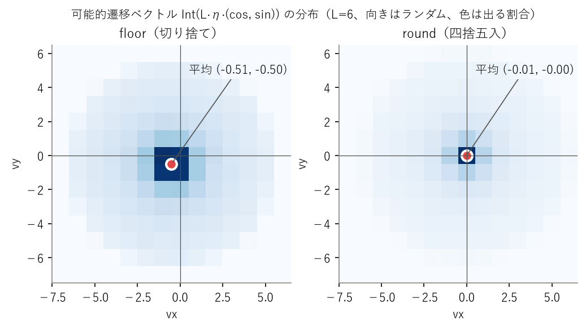

**図1** floor で整数化すると、遷移ベクトルが平均 (−0.51, −0.50) だけ左下にずれる。round ではずれない。

- **改善したいこと：** 青の整列度が高すぎる。収束も速すぎる（開発メモ 9/19〜10/30）。
- **原因と考えたこと：**
  - 論文2では、基本ベクトルの向きを「自分が実際に動いた向き」で更新する。
  - そのため、floor のずれが毎ステップ積み重なり、全員がそろって左下へ流れる。
- **変更：** round にした。
- **結果：**
  - floor では青も整列度 0.99 になり、50 ステップほどで収束していた。round では 0.10 になり、論文に合った（図2、表1）。
  - ただし、論文2の付録には floor（X ≤ x < X+1）と書かれている。round の方が合う、というのは結果から見た判断で、文面とは一致しない。

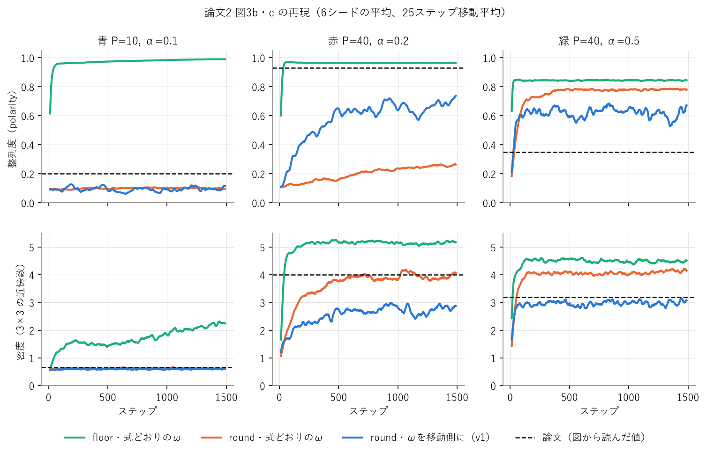

**図2** 青・赤・緑の3条件の、整列度と密度の時間変化（α はそのまま読んだ場合）。

**表1** t=1000〜1500 の平均（α はそのまま読んだ場合）。ルールの割合は「相互予期 / 追従 / 自由移動」で、単位は %。

| 条件 | 論文 | floor・ω 式どおり | round・ω 式どおり（Murakami） | round・ω 移動側（v1） |
|---|---|---|---|---|
| 青 P=10, α=0.1 整列度 / 密度 | 0.2 / 0.65 | 0.99 / 2.09 | **0.10 / 0.62** | **0.10 / 0.59** |
| 青のルールの割合（図S2） | 63 / 5 / 32 | 87 / 4 / 10 | **64 / 5 / 32** | **61 / 5 / 33** |
| 赤 P=40, α=0.2 | 0.93 / 4.0 | 0.96 / 5.13 | 0.25 / **3.96** | 0.66 / 2.72 |
| 緑 P=40, α=0.5 | 0.35 / 3.2 | 0.84 / 4.48 | 0.78 / 4.10 | 0.62 / **2.99** |

- round にすれば、青は ω をどちらに掛けても合う。
- ただし、α をそのまま読む限り、赤は低く緑は高い。論文と逆になっている（3.3 節で詳しく見る）。

### 3.2 ω をどちら側に掛けるか（11/18 に試し、11/19 に見直した）

- **改善したいこと：** 赤の整列度が 0.25 までしか上がらない。
- **原因と考えたこと：** 付録の式(13)は q = V_u + ω·v_u（ω は前の基本ベクトルの重み）。一方、図S3 の説明文は「ω が小さいと前の基本ベクトルのまま、大きいと速度の向きにほぼ一致する」で、式とは逆に読める。
- **変更：** 説明文の読み方 q = v_u + ω·V_u（`omega_on="velocity"`）を試した。

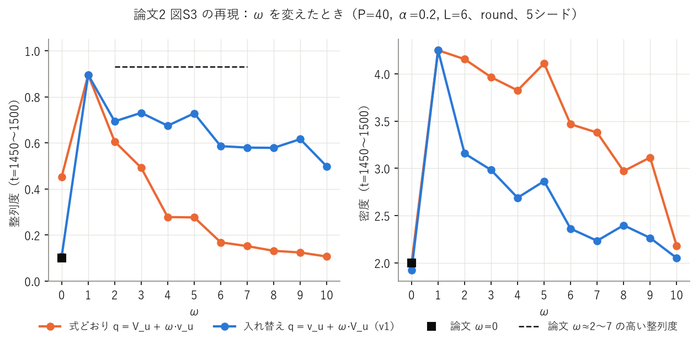

**図3** ω を 0〜10 に変えたときの整列度と密度（α はそのまま読んだ場合）。

- **結果（α をそのまま読んだ場合）：**
  - ω=0：入れ替えた版は整列度 0.11、密度 1.92 で、論文（0.1 / 2.0）と一致した。式どおりの版は 0.45 で合わない。
  - ω=2〜7：論文は整列度が高い（約 0.93）。式どおりの版は 0.6 から 0.15 まで下がる。入れ替えた版は 0.6〜0.7。
  - ω=1：論文は「ω≤1 で整列度が低い」としているが、どちらの版も 0.9 になる（ω=1 では2つの式が同じになる）。
  - 赤は 0.25 から 0.66 まで上がった。そこで v1 の既定にした。
- **見直し（11/19）：** 2体のシミュレーション（3.6 節）では、入れ替えた版は論文と合わず、式どおりの版が合った。α を2倍に読む場合は、式どおりの版でも図3 に合う（3.5 節）。**⇒ 今は式どおりの方が有力。**

### 3.3 α をそのまま読むと、α の効き方が逆になる

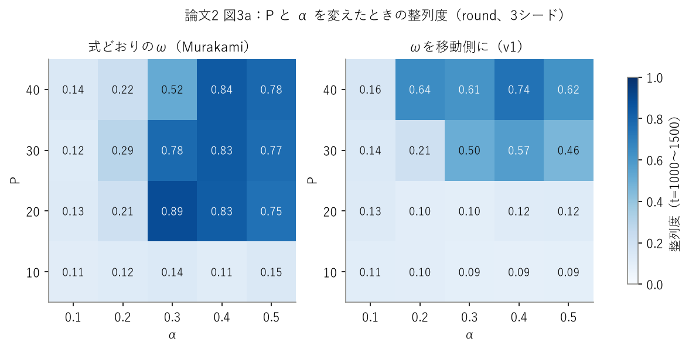

**図4** P と α を変えたときの整列度（α はそのまま読んだ場合）。論文の図3a では、整列するのは P が大きく α が小さい赤の条件。

- 式どおりの版は、α≥0.3 で整列度が 0.75〜0.89 になる。α が大きいほど整列する、という逆の傾向。
- v1（ω 移動側）でも、α=0.5 で整列度が下がるところまでは届かない。

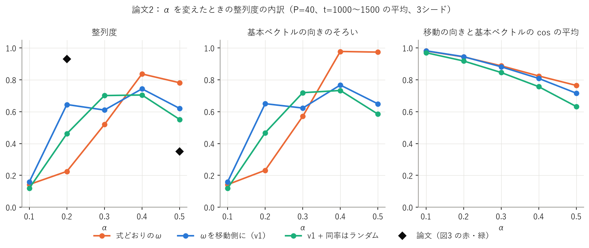

**図5** P=40 で α を 0.1〜0.5 に変えたとき（3シード）。整列度を2つに分けた（(a) 基本ベクトルのそろい、(b) 実際の移動が基本ベクトルに沿っている度合い。4.3 節を参照）。

- (b) は、期待どおり α で下がる（0.98 → 0.72〜0.76）。α のノイズとしての効果は出ている。
- ところが (a) は、α が大きいほど上がる（式どおりの ω で 0.14 → 0.98）。
  - α が大きいと扇が広がって、遷移先が重なりやすくなる。
  - そのため相互予期が増え（90% → 100%）、密度も上がる（2.0 → 4.5）。
  - 密な群れの中では、互いの移動を通して θ がそろっていく。
- 赤（α=0.2）は、そろうのが遅く、運しだいになっている。式どおりの ω で 4000 ステップまで回すと、最後の 500 ステップの整列度はシードごとに 0.05 / 0.23 / 0.37 / 0.42 / 0.92 とばらばらだった。

### 3.4 α を広く振ると、整列度は山の形になる（ゼミの指摘への対応）

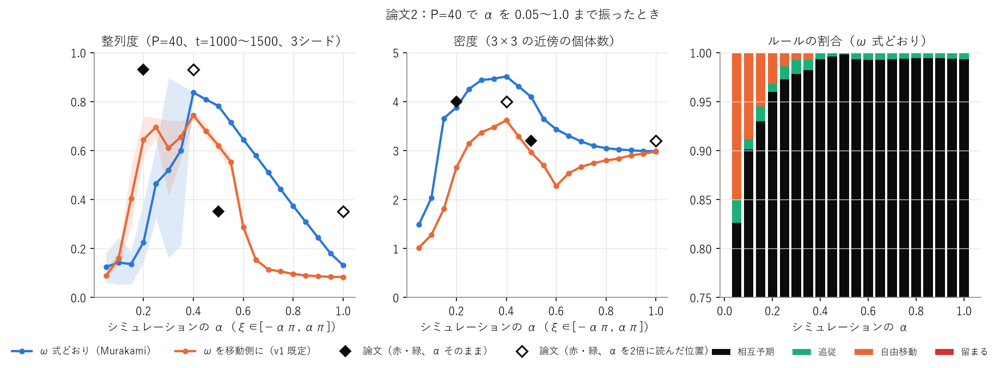

**図6** P=40 で α を 0.05〜1.0 に変えたとき（3シード、t=1000〜1500 の平均）。
- 薄い帯は、3シードの最小〜最大。
- 黒い菱形は、論文の赤・緑の値を α そのままの位置に置いたもの。
- 白い菱形は、同じ値を α を2倍に読んだ位置に置いたもの。

- **ゼミの指摘：** 「Murakami 版で α が大きくなると整列度が上がるのがおかしい。P=40 で α を変えて確認する」
- **結果：整列度は単調に上がるのではなく、山の形になった**（ω は式どおり）。
  - α=0.05〜0.2 は低い（0.12〜0.22）。シードによってばらつく。
  - α=0.4 で最大の 0.84 になり、そこから α=1.0 の 0.13 まで、なめらかに下がる。
  - これまでは α=0.1〜0.5 しか見ていなかったので、上り坂だけを見ていた。
- **山の形は論文と同じで、横にちょうど2倍ずれている。**
  - 論文は α=0.2 で高く（0.93）、α=0.5 で低い（0.35）。
  - シミュレーションで同じ値になるのは、α=0.4（0.84）と α≈0.8〜0.9（0.37〜0.24）。
- 密度も同じ形で、α=0.4 で最大（4.5）になり、α=1.0 で 3.0 に下がる。論文の赤 4.0、緑 3.2 と、2倍の位置で近い。
- **α が小さいと整列しない理由：** α が小さいと可能的遷移の扇が狭く、他の個体と遷移先が重なりにくい。相互予期の割合は 83%（α=0.05）から 99%（α=0.4）まで上がる。
- **ω 移動側（v1 の既定）では、** 頂上は α=0.25〜0.4 に来る。ただし α≥0.6 で急に 0.1 まで落ち、論文の緑（0.35）にあたる中間の値が出ない。
- **止まる個体：** すべての α で、「留まる」個体も変位が 0 の個体も 0%。

### 3.5 α を2倍に読むと、図3・図3a が再現できる

- **改善したいこと：** α の効き方が逆になる（3.3 節）。
- **原因と考えたこと：**
  - 論文2 p.4：α が大きすぎると、個体は「ほぼ全方向」の近傍と相互作用する、とある。これは緑（α=0.5）のことを指している。
  - ξ∈[−απ, απ] だと、α=0.5 は前方 ±90° にしかならない。2倍に読めば ±180° で、この記述と合う。
  - 3.4 節の山の頂上が、ちょうど2倍の位置にあることとも合う。
- **変更：** ξ∈[−2απ, 2απ] にする（v1 の `alpha_scale=2`）。
- **ただし、** 式(1)と付録の式(3)は「ξ を [−απ, απ] から選ぶ」と明記している。コードの中で α が「半周 π でなく、1周 2π に対する割合」として使われていた、といった可能性は考えられるが、確かめようがない。

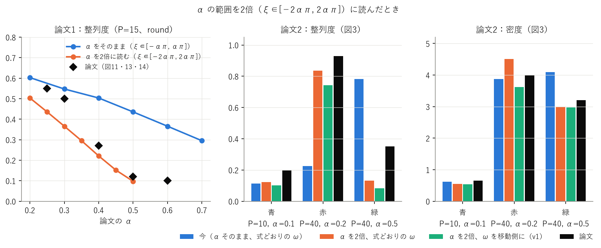

**図7** 左：論文1の整列度（4.5 節）。中・右：論文2の図3 の3条件。

**表2** 論文2 の図3（round、t=1000〜1500 の平均、整列度 / 密度）

| 条件 | 論文 | α そのまま・ω 式どおり | **α 2倍・ω 式どおり** | α 2倍・ω 移動側 |
|---|---|---|---|---|
| 青 | 0.2 / 0.65 | 0.11 / 0.62 | **0.12 / 0.54** | — |
| 赤 | 0.93 / 4.0 | 0.22 / 3.88 | **0.84 / 4.51** | 0.74 |
| 緑 | 0.35 / 3.2 | 0.78 / 4.09 | **0.13 / 2.98** | 0.08 |

- 赤は高く、緑と青は低い。これまでどの版でも出なかった、論文と同じ順番が出た。
- 赤の整列度は、3シードとも t≈450〜1050 で 0.84 に達して、そのまま保たれた。3.3 節のような運しだいではない。
- 緑は 0.13 で、論文の 0.35 より低い。α=0.8（論文の α=0.4 にあたる）では 0.37 / 3.05 で、論文の緑に近い。

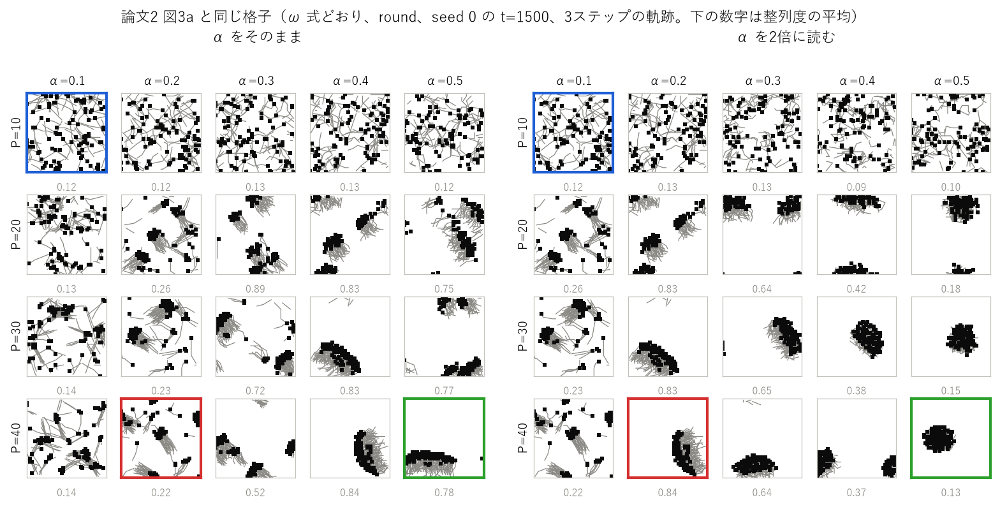

**図8** 論文の図3a と同じ P × α の格子（ω 式どおり、seed 0、t=1500、3ステップの軌跡、下の数字は整列度の平均）。左は α そのまま、右は2倍に読んだもの。枠の色は論文の青・赤・緑。

- **2倍に読んだ方（右）は、論文の図3a の見た目に近い。**
  - α=0.2：P≥20 で、一方向に進む細長い群れになる。
  - α=0.4〜0.5：P≥30 で、丸い塊になる。論文の緑の枠（P=40, α=0.5）も丸い塊。
- **そのまま読んだ方（左）は合わない。**
  - α=0.2 の P=20〜40 は、小さな群れに分かれる。
  - α=0.4〜0.5 は、一方向に進む細長い群れになる。

### 3.6 他の図との比較：図S2・2体（図4・図S2b）・図S3（ゼミの指摘への対応）

**図S2：ルールの割合**（ω 式どおり、t=1000〜1500 の平均。相互予期 / 追従 / 自由移動、%）

| 条件 | 論文 | α そのまま | α 2倍 |
|---|---|---|---|
| 青 | 63 / 5 / 32 | **63 / 5 / 32** | 72 / 4 / 24 |
| 赤 | 約 99 / 1 / 0（t≥600） | 96 / 1 / 3 | **99 / 1 / 0** |
| 緑 | 約 98 / 2 / 0 | **100 / 0 / 0** | **99 / 1 / 0** |

- 赤・緑は、どちらの読み方でも論文とほぼ同じ。
- 青は、そのまま読む方がぴったり合う。2倍に読むと、相互予期が少し多すぎる。
- **止まる個体：** 論文の図S2 では3つのルールの合計が 100% なので、論文にも止まる個体はいない。実装でも論文2は 0%、論文1でも最大 0.65%（P=2）。論文には、止まるルールの記述もない。**⇒ 止まる個体は原因ではない。**

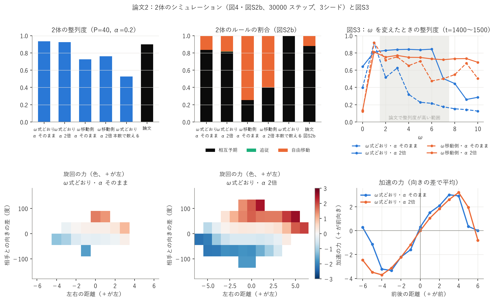

**図9** 上段の左・中：2体のシミュレーション（N=2、P=40、α=0.2、30000 ステップ、3シード）。上段の右：図S3。下段：2体での社会的な力（論文の図4 と同じ考え方の解析）。

**2体（図S2b）。** 論文には次のように書かれている。
- 本文 p.6：2体は「かなり近くにいて、整列度は約 0.9 に保たれる」。
- 図S2b：ルールの割合は「相互予期 0.88 / 追従 0 / 自由移動 0.12」。

| 設定 | 整列度 | 相互予期 / 追従 / 自由移動 | 平均距離 |
|---|---|---|---|
| 論文 | 約 0.9 | 0.88 / 0 / 0.12 | 近い |
| ω 式どおり・α そのまま | **0.93** | **0.83 / 0.00 / 0.17** | 4.4 |
| ω 式どおり・α 2倍 | **0.93** | **0.81 / 0.00 / 0.19** | 5.5 |
| ω 移動側（v1 既定）・α そのまま | 0.72 | 0.25 / 0.00 / 0.75 | 15.1（離れる） |
| ω 移動側・α 2倍 | 0.76 | 0.40 / 0.00 / 0.60 | 12.7（離れる） |
| ω 式どおり・人気度を遷移の本数で数える | 0.53 | 1.00 / 0 / 0 | 19.3（離れる） |

- **ω は式どおりが合う。**
  - 2体がくっついて進み、整列度もルールの割合も論文とほぼ同じになる。
  - ω を移動側に掛けると、2体が離れてしまい、自由移動が 60〜75% になる。
- **人気度は「1個体につき1サイト1票」が合う。** 遷移の本数で数えると、1体だけでも自分の遷移どうしが重なって人気度が 2 以上になる。そのため相互予期が 100% になってしまう。
- この2つは、α の読み方によらない。

**社会的な力（図4）。** 一部だけ合う。
- **合うところ：**
  - 左右の距離で平均すると、相手のいる側に曲がる。
  - 相手が前にいると加速し、後ろにいると減速する。
  - どちらも論文と同じ向き。
- **合わないところ：**
  - 「向きの差」と「左右の距離」に分けて見ると、旋回の向きは主に向きの差で決まっていた（相手の向きに合わせて曲がる）。
  - 論文の図4b は、「向きの差より左右の距離で決まる」としている。
  - これは、今のどの設定でも同じだった。
- **注意：** ここでの解析は、1ステップの速度の差で力を求めている。ノイズの大きい速度が平均に戻る分（平均への回帰）が混ざっている可能性がある。論文の計算方法（速度をならしているか）を確かめる必要がある。

**図S3（ω を 0〜10）。** ω 式どおり・α 2倍（上段右の青の実線）の結果。
- **合うところ：**
  - ω=1〜6 で整列度が高い（0.81〜0.84）。
  - ω≥7 で下がる（0.50 → 0.26）。論文の「ω≥8 で整列度が低い」に合う。
  - α そのままでは ω≥2 から下がってしまうので、2倍に読む方がよく合う。
- **合わないところ：**
  - ω=0 では 0.64 で、論文の 0.1 より高い。
  - 論文は ω≤1 で低いとしているが、どの設定でも ω=1 で 0.8〜0.9 になる。

### 3.7 効かなかった候補（論文2）

| 変えたところ | 論文の根拠 | 結果 |
|---|---|---|
| 競合したら、遷移の向きが基本ベクトルに近い個体が取り、負けた個体は2番目へ（全員が同時に狙う） | 本文 p.4 | ω 移動側ではどの α でも 0.14 以下。ω 式どおりでも赤 0.31、緑 0.64 |
| 狙うサイトの人気度が高い個体から更新する | 本文 p.4「人気度の分布が更新の順番を決める」 | ω 式どおりで赤 0.28、緑 0.75 |
| 留まった個体（速度 0）も整列度の平均に入れる | 本文「平均単位速度のノルム」 | 留まる個体が 0% なので、値は同じ |
| Int を付録どおり floor にする | 付録の式(2) | 青も 0.98 になる（3.1 節と同じ） |
| 人気度が同率のとき、ランダムに選ぶ | なし（付録は「基本ベクトルに近いもの」） | α=0.5 は 0.55 まで下がったが、α=0.2 も 0.46 に下がった |
| 人気度を遷移の本数で数える（`dedupe_votes=False`） | 付録の式(5)の文字どおりの読み方 | どの α でも相互予期が 100% になり、整列度は 0.34 以下。2体でも合わない |
| η を √ にする | なし | 密度は上がるが、α に対する形は変わらない |
| 式(13)の v_u に (cosθ, sinθ) を使う | — | v1 と同じ |

（α はそのまま読んだ場合の結果）

### 3.8 論文2のまとめ

**表3** 設定ごとに、論文の図と合うか（○ 合う、△ 一部、× 合わない）

| 図 | α そのまま・ω 式どおり（Murakami） | α そのまま・ω 移動側（今の v1 既定） | **α 2倍・ω 式どおり** |
|---|---|---|---|
| 図3 青 | ○ | ○ | ○ |
| 図3 赤（整列する） | × 0.22 | △ 0.66 | **○ 0.84** |
| 図3 緑（整列しない） | × 0.78 | × 0.62 | **○ 0.13**（やや低い） |
| 図3a の格子 | × | × | **○** |
| 図S2 青 | ○ | ○ | △ |
| 図S2 赤・緑 | ○ | ○ | ○ |
| 図S2b・2体の整列度 | ○ | × | **○** |
| 図S3 ω=0 | × | ○ | × |
| 図S3 ω≥8 で下がる | △ | × | **○** |
| 図4b 旋回の力 | × | × | × |

- **一番多くの図に合うのは「α 2倍・ω 式どおり」**（＋ round、1個体1票）。
- 残っているのは、図S2 の青、図S3 の ω≤1、図4b の3つ。

---

## 4. 論文1の検証

論文1で合わせたい図は次のとおり。

- 図8：P × α のスナップショット
- 図10・11：P を変えたときの整列度・密度
- 図13・14：α を変えたときの整列度

### 4.1 追従の連鎖をなくす（11/15）

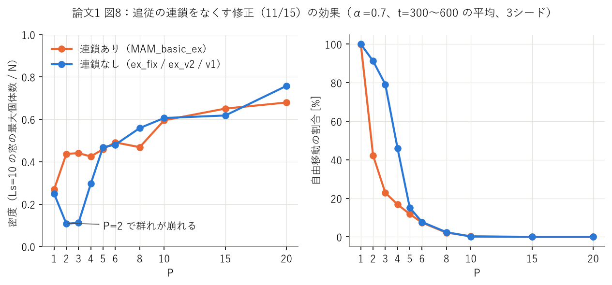

**図10** 追従の連鎖をなくす前後。

- **改善したいこと：** 図8 にある「P=2 で群れが崩れる」現象が出ない。
- **原因と考えたこと：** 論文1 p.7 には「相互予期で動いた個体の空けたサイトを埋める」とある。旧版（`MAM_basic_ex`）では、追従した個体の空けたサイトにも追従できたので、連鎖が起きていた。
- **変更：** 追従先を「相互予期で空いたサイト」だけにした。
- **結果：**
  - P=2〜3 で追従できる個体がほとんどいなくなる。自由移動が 91% になり、密度（Ls=10）が 0.44 から 0.11 に下がる。群れが崩れる。
  - これは論文1 図8 の「P=2 で群れが崩れる」現象にあたる。
  - P≥5 ではほとんど差がない。

### 4.2 今の再現状況（v1、α そのまま）

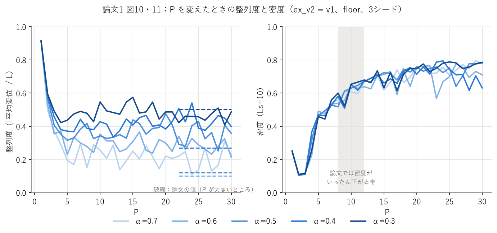

**図11** P を変えたときの整列度（左）と密度（右）。α=0.3〜0.7、floor。

- **P=1：** 全員が同じ向きに進む（整列度 0.91）。P=2〜3 で密度が 0.11 まで下がり、群れが崩れる。
- **整列度（P が大きいところ）：** 論文は α=0.6 / 0.5 / 0.4 / 0.3 でそれぞれ 0.10 / 0.12 / 0.27 / 0.50。モデルは 0.30 / 0.43 / 0.40 / 0.50 で、α が大きい側が下がりきらない。
- **密度が上がり始める P：** 論文は 3〜4、モデルは 4〜6。
- **密度の谷：** 論文では P=8〜12 で密度がいったん 0.6〜0.7 に下がるが、モデルでは出ない。

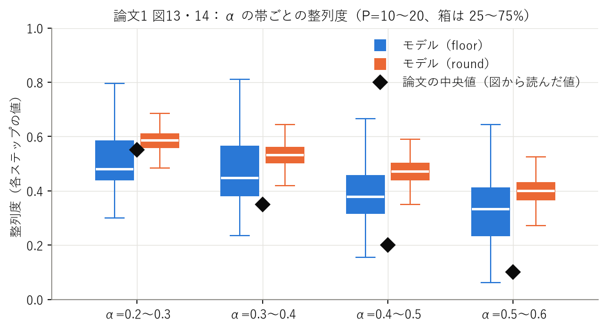

**図12** α の帯ごとの整列度（P=10〜20 の各ステップ）。

- 論文の中央値は、α が大きくなるにつれて 0.55 から 0.1 まで下がる。
- モデルは floor で 0.48 から 0.33 まで、round で 0.59 から 0.40 までしか下がらない。
- α そのままでは、round にするとすべての帯で 0.05〜0.1 高くなり、論文から離れる。論文1で floor を既定にしているのはこのため。
- 密度は、論文が 0.3 前後なのに対して、モデルは Ls=10 でも約 0.7 になる。論文の Ls が分からないので、比べられない。

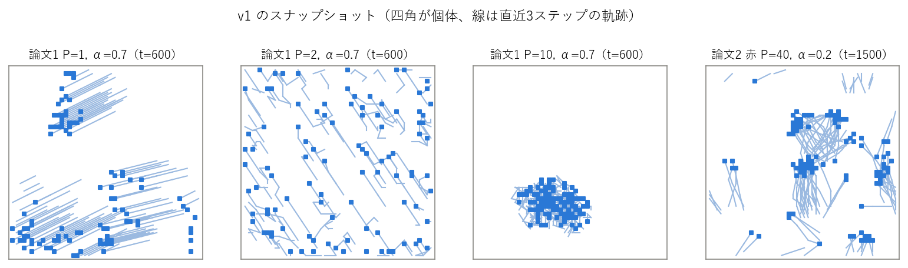

**図13** v1 のスナップショット。左から次の4つ。

- 論文1 の P=1（そろって直進する）
- 論文1 の P=2（崩れて散らばる）
- 論文1 の P=10（密な群れ）
- 論文2 の赤（α そのまま。いくつかの群れに分かれて、それぞれ同じ向きに進む）

### 4.3 α の効きが弱い原因：θ がそろいきってしまう

整列度は、だいたい次の2つの積で決まる。

- **(a) 基本ベクトルの向きのそろい**（全員の θ の単位ベクトルの平均の長さ）
- **(b) 実際の移動が基本ベクトルにどれだけ沿っているか**（移動の向きと θ のなす角の cos の平均）

α は可能的遷移の広がりなので、直接効くのは (b) のはず。(a) が下がるかどうかは、θ の更新のしかた（論文1は速度一致、論文2は ω の式）で決まる。

**整数化のせいではない（両方の論文に共通）。** 開発メモでは「短いベクトルが (0,0) や同じセルにつぶれて、α が効かなくなっている」と疑っていた。そこで、可能的遷移だけを作って、整数化の前後で形を比べた（動かしてはいない）。
- 前向きの成分の平均は、整数化の前後でほとんど同じだった（例：L=4, floor, α=0.5 で、実数 0.318 → 整数 0.324）。
- (0,0) になる割合は、α によらず一定だった（L=4 で、floor 約 7%、round 約 14%）。
- ⇒ 可能的遷移の段階では、α はちゃんと効いている。

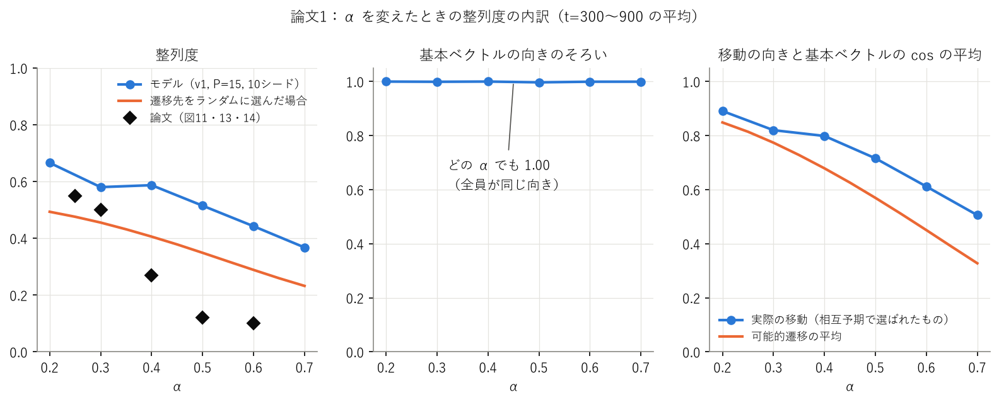

**図14** α を 0.2〜0.7 に変えたとき（P=15、10シード）。左から整列度、(a)、(b)。

- **(a) は、どの α でも 1.00 になる。**
  - 論文1の速度一致は、近傍の θ を平均するだけで、θ にノイズが入る経路がない。
  - そのため、密な群れの中では全員の θ が1つの向きに収束する。
- **α が効くのは (b) だけ。** cos は 0.89 から 0.51 まで下がる。
- **選び方をランダムにしても、論文の値には届かない（図14 左のオレンジ線）。**
  - θ が全員同じなら、遷移先をランダムに選んでも、整列度は α=0.5 で 0.35、α=0.6 で 0.29 になる。
  - 論文の値（0.12、0.10）は、この下限より低い。
  - つまり、論文の値になるには θ がばらばら（(a) が 0.3 程度）である必要がある。
- **相互予期は、前向きの遷移先を選びやすい。** α=0.6 で、可能的遷移の cos の平均は 0.45 だが、選ばれた移動は 0.61。群れが同じ向きに進んでいると、前方のサイトの人気度が高くなるため。

1か所だけ変えた版（いずれも、α に対する整列度の下がり方は良くならなかった）。

| 変えたところ | 論文の根拠 | 結果 |
|---|---|---|
| 速度一致を、近傍の「実際の移動の向き」の平均にする | 式(8)の「average velocity direction」 | (a) は 0.97 以上のまま。整列度はむしろ上がった（α=0.7 で 0.45） |
| 人気度を、個体数ではなく遷移の本数で数える | 式(3)の文字どおりの読み方 | 10シードでは v1 と差がなかった |
| η を √（扇形の中に一様）にする／全部 1 にする | なし（原因を調べるため） | 改善しない。η=1 では整列度が上がる |

- 参考：整列度を測る期間を長くすると（300 → 600 ステップ）、整列度は 0.05〜0.1 高くなった。

### 4.4 θ をばらつかせる仕組み：外部摂動

**論文を読み直した結果**

- 基本モデルで θ が変わるのは、式(8) の速度一致 θ_{k,t+1} = <θ_{k,t}>_M だけ。ノイズを足す記述はない。
- ほかに θ を書き換えるのは、砂時計の設定の壁沿いの処理（式(10a)(10b)）だけで、基本モデルには入らない。
- 外部摂動が出てくるのは、図10左の「相互予期なし」のモデルだけ。
- 相互予期のあるモデル（図10右、図11）の横軸は「内部の揺らぎ」で、P を最大値 30 で割ったもの。
- ⇒ 論文の文面では、基本モデルに外部摂動は入っていない。

**それでも念のため入れてみた。** 図10左の書き方を Vicsek 型の角度ノイズと読み、速度一致のあとに θ += ε·π·U[−1,1] を足した。

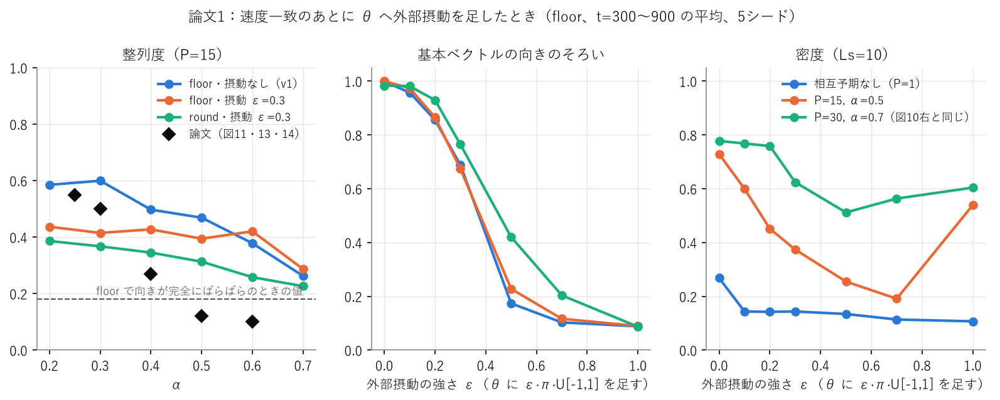

**図15** 左：α を変えたときの整列度。中・右：ε を変えたときの基本ベクトルのそろいと密度。

- **実装の確認：** 相互予期なし（P=1）では、ε を上げると整列度も密度も下がった（整列度 0.96 → 0.18、密度 0.27 → 0.11）。図10左と同じ傾向。
- **θ はばらつくが、α の効き方は強くならない。** 整列度が全体に下がるだけで、α に対する傾きは平らになる。
  - floor、ε=0.3：α=0.2〜0.6 で 0.44 / 0.41 / 0.43 / 0.39 / 0.42。
  - round、ε=0.3：0.39 → 0.26。論文の 0.55 → 0.10 の急な落ち方にはならない。
- **密度も下がる。** P=15、α=0.5 では 0.73 → 0.25（ε=0.5）。論文の「外部摂動に強く、高い密度を保つ」とは逆。
- **角度を数値のまま算術平均する読み方（式(8)）も試した。** v1 とほとんど変わらなかった。
- ⇒ 外部摂動は原因ではなさそう。

**分かったこと：floor のままでは、論文の整列度 0.10〜0.12 には原理的に届かない。**
- 向きが完全にばらばらでも、floor では変位の平均が (−0.5, −0.5) 側にずれる。そのため、整列度（|平均変位|/L）は 0.18 より下がらない（計算で 0.179）。
- round なら、ばらばらのときは 0.05 まで下がる（N=100 の有限サイズの分）。
- 論文の α=0.5、0.6 の値（0.12、0.10）は 0.18 より低い。したがって、次のどれかが成り立っているはず。
  - (i) 論文のコードの Int が floor ではない
  - (ii) 偏りを除いて整列度を計算している
  - (iii) 整列度の定義が違う

### 4.5 α を2倍に読む

- **原因と考えたこと：** 論文2と同じ理由（3.5 節）。論文1 p.15 の「P=20 で α>0.5 のとき、アメーバのような動きになる」も、2倍に読むと全方向になって説明しやすい。
- **結果（図7 左、P=15、round）：**
  - α が大きい側は合う：論文の α=0.4 → 0.22（論文 0.27）、α=0.5 → 0.10（論文 0.12）。
  - α が小さい側は低め：α=0.3 → 0.37（論文 0.50）。

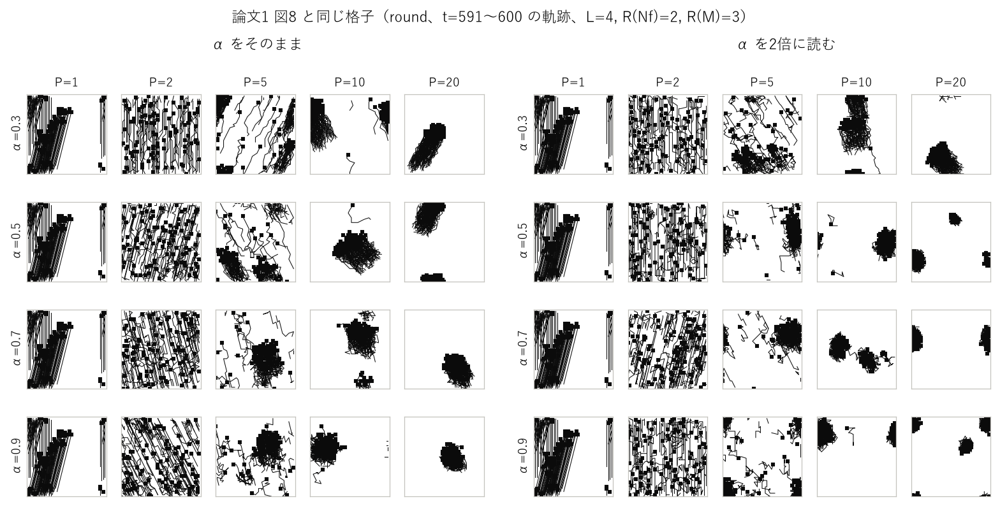

**図16** 論文1 図8 と同じ P × α の格子（round、seed 0、最後の 10 ステップの軌跡）。左は α そのまま、右は2倍に読んだもの。

- 2倍に読むと、α≥0.5 で P≥10 の群れが丸い塊になる。論文の図8（α=0.7、0.9 の P=10、20）の見た目に近い。
- そのまま読むと、α=0.5〜0.9 でも塊が細長く、一方向に進んでいる。

### 4.6 効かなかった候補（論文1）

基準は v1（P=15、5シード、t=300〜900 の平均。整列度は α=0.2 → 0.6 で 0.59 → 0.38）。

| 候補 | 論文の根拠 | 結果 | 判定 |
|---|---|---|---|
| 1体ずつ (4)→(5)→(6) を判定する（段階式でなく） | p.9〜10「更新する個体をランダムに選ぶ」と式(4)〜(6)の書き方。図2の説明は段階式 | α に対する形は同じ（0.53 → 0.38）。P=1 の整列度が 0.96 → 0.54 に下がり、「P=1 は BOIDS と同じ」に合わない | × |
| 追従先を式(5)どおり「更新された個体が空けたサイト全部」にする | 式(5) の w=1 | 1つ上と組み合わせても変化なし | × |
| 追従者近傍の半径を L より大きく（R(Nf)=5） | p.10「半径は基本ベクトルの長さより大きい」。図の R(Nf)=2 と矛盾 | 段階式では変化なし。1体ずつと組み合わせると P=1 が崩れる（0.24） | × |
| 相互予期の競合を文字どおりにする（`ma_rule="literal"`） | p.8「負けた個体は2番目に人気のサイトへ」 | 全体に下がり、傾きは少し急になる（floor：0.42 → 0.17）。α が小さいところが低すぎる（論文 0.55）。密度は α とともに上がる（0.23 → 0.53） | △ |
| 整列度の定義を変える（単位ベクトルの平均、平均の歩幅で割る、floor の偏りを足し戻す） | p.17「移動の平均ベクトルの長さ」（L で割るとは書いていない） | どの定義でも α に対する形は同じ | × |
| 計測区間を最初の 100 ステップにする | 書かれていない | 0.1 ほど低いが、形は同じ | × |
| 外部摂動、角度の算術平均 | 図10左、式(8) | α の効き方は変わらない（4.4 節） | × |

### 4.7 α 2倍・round・文字どおりの競合の組み合わせ（計画2、11/20）

- **ねらい：** α を2倍に読むと、α が大きい側は合うが、α=0.3 が低い（4.5 節）。floor では整列度が 0.18 より下がらない（4.4 節）。文字どおりの競合は、α に対する傾きを少し急にする（4.6 節）。この3つを組み合わせれば、α が小さい側と大きい側が両方合うかもしれない、と考えた。
- **試したこと：** `alpha_scale`（1 / 2）× `int_mode`（floor / round）× `ma_rule`（sequential / literal）の8通り。
  - 条件：P=10 / 15 / 20、α=0.2〜0.7、5シード。全部で 720 本。
  - 測り方：900 ステップ回して t=300〜900 を平均（4.6 節と同じ）。
  - 整列度は v1 と同じ pL（移動の平均ベクトルの長さ / L）。
  - 成功の目安：α=0.3 / 0.4 / 0.5 で、論文の 0.50 / 0.27 / 0.12 の ±0.1 に入ること。
  - スクリプト：`report_scripts/plan2_grid.py`（実行）、`plan2_analyze.py`（集計と図）。結果は `report_data/plan2_grid.json`。

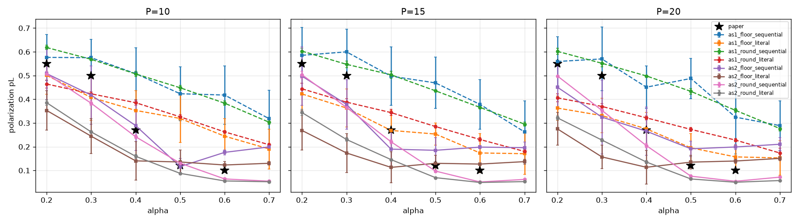

**図17** 8通りの整列度（左から P=10 / 15 / 20、5シードの平均 ± 標準偏差）。実線は α 2倍、破線は α そのまま。丸は round、四角は floor。黒い星は論文の値（図11・13・14 を目で読んだもの）。

**整列度 pL**（P=10 / 15 / 20 と5シードの平均）

| 設定（alpha_scale / Int / 競合） | α=0.2 | 0.3 | 0.4 | 0.5 | 0.6 | 0.7 | α=0.3〜0.5 での最大のずれ |
|---|---|---|---|---|---|---|---|
| **論文** | 0.55 | 0.50 | 0.27 | 0.12 | 0.10 | — | — |
| 1 / floor / sequential（v1 の既定） | 0.57 | 0.58 | 0.49 | 0.46 | 0.37 | 0.29 | 0.34 |
| 1 / floor / literal | 0.43 | 0.37 | 0.30 | 0.26 | 0.19 | 0.17 | 0.14 |
| 1 / round / sequential | 0.61 | 0.56 | 0.50 | 0.44 | 0.37 | 0.29 | 0.32 |
| 1 / round / literal | 0.44 | 0.39 | 0.35 | 0.29 | 0.24 | 0.19 | 0.17 |
| 2 / floor / sequential | 0.49 | 0.37 | 0.25 | 0.16 | 0.19 | 0.20 | 0.13 |
| 2 / floor / literal | 0.30 | 0.19 | 0.12 | 0.13 | 0.13 | 0.14 | 0.31 |
| **2 / round / sequential** | **0.50** | **0.37** | **0.22** | **0.10** | **0.06** | 0.06 | **0.13** |
| 2 / round / literal | 0.35 | 0.24 | 0.15 | 0.07 | 0.05 | 0.05 | 0.26 |

- **3点とも ±0.1 に入る組み合わせは、なかった。**
- **一番近いのは「α 2倍 × round × sequential」。**
  - α=0.2、0.4、0.5、0.6 は論文の ±0.05 に入る。
  - α=0.3 だけが 0.13 低い（0.37。論文は 0.50）。
  - 論文は α=0.3 → 0.4 で急に落ちる（0.50 → 0.27）。一方、モデルはなだらかに下がる。
  - P=10 / 15 / 20 のどれでも同じ傾向（α=0.3 で 0.35〜0.38）。
- **「α 2倍 × floor」は、α≥0.5 で 0.19 前後から下がらない。** floor による下限（4.4 節）がそのまま出ている。
- **文字どおりの競合（literal）は、α が小さい側を合わせる方には効かなかった。**
  - どの組み合わせでも、整列度が全体に下がるだけだった。α=0.3 は、もともと低い値がさらに下がる。
  - ルールの割合が大きく変わる（P=15）。sequential では相互予期が 98〜100% だが、literal では相互予期が 50〜70%、追従が 26〜39% になる。
  - 密度（Ls=10）は literal の方が低く、0.25〜0.54 になる（sequential は 0.62〜0.71）。論文の密度（0.3 前後）に近いのは literal の方。ただし、論文の Ls が分かっていないので、はっきりとは比べられない。
- **round では、シードによるばらつきがほとんどない。** α=0.3〜0.5 での標準偏差は 0.01 以下。floor では 0.1 前後ある。floor のずれ (−0.5, −0.5) で群れの進む向きが決まりかけ、そのあとの動きがシードによって変わっているためだと考えている（未確認）。

### 4.8 論文1のまとめ

- **P=2 の崩壊は再現できた**（追従の連鎖をなくした）。
- **α の効きが弱いのは、速度一致で θ が全員そろいきってしまうため。** 遷移先の選び方を変えても、外部摂動を入れても、論文の値には届かない。
- **α を2倍に読むと、α が大きい側は合う。** α が小さい側は低め。
- **floor のままでは、整列度が 0.18 より下がらない。** 論文の値（0.10〜0.12）に合わせるには、round にするか、整列度の計算方法を論文に合わせる必要がある。
- **一番近い組み合わせは「α 2倍 × round × sequential」（4.7 節）。** α=0.3 だけが 0.13 低い。文字どおりの競合を組み合わせても、α が小さい側は合わない。
- 次に試すこと：α=0.3 → 0.4 での急な落ち方が、何で決まるかを調べる。論文の図の α=0.3 の値の読み取りも見直す（6章）。

---

## 5. MAM_basic_v1.py

`model/MAM_basic_v1.py` の `SoldierCrabSwarm_v1` に、2つの最新版をまとめた。論文1と論文2は別のモデルなので、`model` 引数で切り替える。

```python
from model.MAM_basic_v1 import SoldierCrabSwarm_v1, simulate

swarm = SoldierCrabSwarm_v1(model="paper1", P=10, alpha=0.3, seed=0)   # 論文1（L=4, R_Nf=2, R_M=3）
swarm = SoldierCrabSwarm_v1(model="paper2", P=40, alpha=0.2, seed=0)   # 論文2（L=6, ω=5）
swarm.step(); swarm.run(600, record_history=True)                       # 使い方はこれまでと同じ
pol, dens, rules = simulate(1500, model="paper2", P=40, alpha=0.2, seed=0)   # 整列度・密度・ルールの割合の時系列

# 論文2 で一番多くの図に合う設定（3.8 節）
swarm = SoldierCrabSwarm_v1(model="paper2", P=40, alpha=0.2, alpha_scale=2, omega_on="principal", seed=0)
```

| | 既定値 | 理由 |
|---|---|---|
| 共通 | `alpha_scale=1.0` | 式(1)の文面どおり。2.0 にすると ξ∈[−2απ, 2απ]（3.5・4.5 節）。先生に確認してから既定を決める |
| paper1 | `int_mode="floor"` | 論文の Int の定義どおり。α そのままでは、round にすると図10〜14 から離れる（図12） |
| paper1 | `follow_chain=False` | 論文1 p.7 の記述どおり。P=2 の崩壊が出る（4.1 節） |
| paper1 | `ma_rule="sequential"` | これまでと同じ。"literal" は 4.6 節 |
| paper2 | `int_mode="round"` | 青と図S2 が合う。floor だと全条件で整列してしまう（3.1 節） |
| paper2 | `omega_on="velocity"` | 図S3 の ω=0 に合わせて採った。**ただし図S2b（2体）では "principal"（式どおり）の方が合う。見直し候補**（3.2・3.6 節） |

- **旧版と同じ結果になることを確認した。**
  - `model="paper1"` は `MAM_basic_ex_v2` と同じ処理。
  - `model="paper2", omega_on="principal"` は `MAM_basic_Murakami` と同じ処理。
  - 同じ seed で動かし、全ステップで位置・向き・ルールの回数が一致することを確かめた（オプションを変えた 13 通り、各2シード、150〜200 ステップ）。
  - `alpha_scale=2, alpha=0.1` と `alpha=0.2` は、軌跡が完全に一致する。
- **旧版のバグを直した（結果は変わらない）。**
  - Murakami の人気度の計算にあった「占有セルの除外」は効いていなかったので、消した。
  - `dedupe_votes=False` で起きていたエラーを直した。
- 評価用の関数も入れた：`polarization1` / `polarization2` / `density_sliding` / `density_paper2`。中身はノートブックと同じ定義。

---

## 6. 残っている問題と次にやること

### 先生に確認したいこと

1. **α の範囲**：[−απ, απ]（式の文面）か [−2απ, 2απ]（本文 p.4 の「ほぼ全方向」とシミュレーション）か。
2. **論文2の ω**：式(13)どおりか、図S3 の説明文どおりか。2体の結果は式どおりを支持している。
3. **Int**：文面は floor だが、論文2は round でないと合わない。論文1も floor では整列度に 0.18 の下限ができる。

### 残っている問題

| | 問題 | 次にやること |
|---|---|---|
| 論文2 | 2倍に読むと、図S2 の青のルールの割合が少しずれる（72 / 4 / 24。論文 63 / 5 / 32） | P=10 で、相互予期が増える原因を調べる |
| 論文2 | 図S3 の ω≤1 で整列度が下がらない | ω=0、1 のときの θ の動きを調べる |
| 論文2 | 図4b：旋回の向きが「向きの差」で決まる | 速度を数ステップ平均してから力を計算し直す |
| 論文1 | α=0.3 の整列度が低め（一番近い「α 2倍 × round × sequential」で 0.37。論文は 0.50） | 組み合わせ8通りは試した（4.7 節、文字どおりの競合は効かない）。α=0.3 → 0.4 での急な落ち方が何で決まるかを調べる。論文の図の読み取りも見直す |
| 論文1 | floor では整列度が 0.18 より下がらない | round なら 0.05〜0.06 まで下がることを確かめた（4.7 節）。Int と整列度の計算方法を先生と確認する |
| 論文1 | P=8〜12 の密度の谷、密度の絶対値（Ls） | 論文の Ls の決め方を確認する |

---

## 7. 1週間の計画（11/20 に考え直した、11/21〜11/27）

### 考え直した理由

- 最初の計画（11/19）のうち、計画2（論文1の組み合わせ8通り）は 11/20 に終わった。その結果、論文1で残る差は「α=0.3 だけ低い」ことに絞れた（4.7 節）。
- 残っている課題の多く（課題1〜4：α の範囲、Int、整列度の計算方法、ω の掛け方）は、**先生の答えで条件が変わる**。答えが出る前に、それを前提にした実験を細かく回しても、やり直しになるかもしれない。
- そこで、次の順に並べ直した。
  1. **先生の答えによらず、意味がある課題**を先にやる。
  2. その中でも、**時間がかからない確認**から始める。
  3. 先生の答えで決まる課題（図S3 の ω≤1 など）は、答えが出てからにする。

### 優先順位

| 順 | 計画 | 関係する課題 | 先生の答えによるか | かかる時間 |
|---|---|---|---|---|
| 1 | 計画A：論文1で α=0.3 → 0.4 の急な落ち方を調べる | 13・14 | よらない（α 2倍・round でも、そのままでも出ていない） | 1〜2日（シミュレーション 約1時間） |
| 2 | 計画B：測り方を論文と合わせる（計測のタイミング・密度の窓 Ls） | 19・26（18） | よらない | 半日（主に論文を読む） |
| 3 | 計画C：図4（2体の旋回の力）の計算方法を見直す | 7 | よらない | 半日（2体は1本 5秒ほど） |
| 4 | 計画D：論文2の青のルールの割合のずれ | 5 | α の範囲による（2倍に読んだときだけ出るずれ） | 1日 |
| 後 | 図S3 の ω≤1 | 6 | ω の掛け方による | 答えが出てから |
| 後 | v1 の既定値を決める（`alpha_scale`、`omega_on`、論文1の `int_mode`） | 1・2・4 | 答えそのもの | 答えが出てから |

### 計画A：論文1で α=0.3 → 0.4 の急な落ち方を調べる（課題13・14）

- **改善したいこと：** 一番近い設定（α 2倍・round・sequential）でも、α=0.3 の整列度だけが 0.37 と低い（論文は 0.50）。論文は α=0.3 → 0.4 で 0.50 → 0.27 と急に落ちるが、モデルはなだらかに下がる。
- **効くと考えていること：**
  - 論文で急に落ちるのは、群れが「そろって進む状態」と「ばらばらの状態」を行き来する境目が α=0.3〜0.4 にあるからかもしれない。
  - 今は時間平均だけを見ているので、2つの状態が混ざると、なだらかな平均に見える。
  - 計測区間（t=300〜900）が短くて、そろいきる前の値を測っている可能性もある。
- **どう試すか：**
  1. 論文の図11・13・14 の α=0.3 付近の値を読み直す（図13・14 は箱ひげ図なので、中央値だけでなく広がりも見る）。
  2. α 2倍・round・sequential で、α=0.25〜0.45 を 0.025 刻みで振る（P=10・15・20、5シード、3000 ステップ）。
  3. 整列度の時系列とヒストグラムを見て、山が2つに分かれていないか（2つの状態を行き来していないか）を確かめる。
  4. 計測区間を変えて（t=300〜900 と t=2000〜3000）、値が変わるかを確かめる。
- **成功の目安：** 急な落ち方が出ること。出なければ、「なだらかになる理由」を論文の記述と照らして1文で説明できること。

### 計画B：測り方を論文と合わせる（課題19・26、18）

- **改善したいこと：**
  - 論文1の密度が、論文（0.3 前後）より高い（Ls=10 で 0.6〜0.7）。
  - 密度を測るタイミング（移動の前か後か）が、論文と同じか分からない。
- **効くと考えていること：**
  - 密度は窓の大きさ Ls で大きく変わる（Ls=25 ならほぼ 1）。論文の Ls や窓の置き方（区切るのか、ずらすのか）が違えば、それだけで値が合わない。
  - P=8〜12 の密度の谷（課題18）も、測り方が違えば見え方が変わるかもしれない。
- **どう試すか：**
  1. 論文1の本文から、密度と整列度の定義（Ls、窓の置き方、測る時刻、平均の取り方）をすべて抜き出して、今の実装と1文ずつ比べる。
  2. 違うところがあれば、その測り方で、既にある結果を測り直す（新しくシミュレーションを回さずに済むものは、そうする）。
  3. Ls を 5〜25 に変えて、論文の 0.3 前後に合う Ls があるかを見る。
- **成功の目安：** 論文の測り方が文面から決まるかどうかをはっきりさせること。決まらなければ、先生に確認したいことに足す。

### 計画C：図4（2体の旋回の力）の計算方法を見直す（課題7）

- **改善したいこと：** 旋回の向きが「向きの差」で決まっている。論文の図4b は「左右の距離」で決まるとしている（3.6 節）。
- **効くと考えていること：**
  - 今は、1ステップの速度の差で力を計算している。
  - 速度は可能的遷移のノイズで大きくぶれるので、ぶれた次のステップで元に戻る動き（平均への回帰）が混ざる。これが「向きの差」の効果に見えている可能性がある。
  - 論文が参考にした Katz et al. は、軌跡をならしてから力を求めている。
- **どう試すか：** 速度を 3・5・10 ステップの移動平均にしてから、力を計算し直す。ならし方ごとに、図4b と同じ地図を描いて比べる。ω 式どおり・α 2倍と、α そのままの2通りで見る。
- **成功の目安：** ならすと旋回の向きが「左右の距離」で決まるようになるか、をはっきりさせること。変わらなければ、モデルと論文の違いとして記録する。

### 計画D：論文2の青のルールの割合のずれ（課題5）

- **改善したいこと：** α を2倍に読むと、青（P=10, α=0.1）のルールの割合が 72 / 4 / 24% になる（論文は 63 / 5 / 32%）。α をそのまま読むとぴったり合う。
- **効くと考えていること：** α を2倍に読むと扇が広がり、他の個体と遷移先が重なりやすくなる。そのため相互予期が増える。P=10 は遷移先が少ないので、この効果が強く出ているのかもしれない。
- **どう試すか：** P=10 で α を 0.05〜0.3 に振り、ルールの割合と整列度・密度の変わり方を見る。2倍に読んだときに、青の3つの値（整列度・密度・ルールの割合）がそろって合う α があるかを調べる。
- **成功の目安：** ずれの原因を1文で説明できること。α を2倍に読む読み方の弱点として、先生に伝えられる形にする。
- 先生の答えが「α はそのまま」だった場合は、この計画は不要になる。

### 日程

| 日 | やること |
|---|---|
| 11/21（土） | 計画A の掃引を回し始める（約1時間）。待っている間に、計画B の論文の読み直しと、計画A の論文の値の読み直し |
| 11/22（日） | 計画A の解析（時系列・ヒストグラム・計測区間）。計画B で測り直しが必要なら行う |
| 11/23（月） | 計画C：移動平均で力を計算し直し、図4b と比べる |
| 11/24（火） | 計画D：P=10 の α 掃引 |
| 11/25（水） | 先生の答えをもとに、v1 の既定値を決める。ω の掛け方が決まったら、図S3 の ω≤1 を調べる |
| 11/26（木） | 予備日（遅れた計画の続き） |
| 11/27（金） | レポート・開発メモ・変更一覧・課題一覧にまとめる |

- 先生の答えで α の読み方や ω が変わった場合は、計画A・D の条件をそれに合わせて回し直す。
- 試した内容と結果は、そのつど開発メモと [変更一覧.md](変更一覧.md) に書き足し、課題一覧の状況も直す。

### 前の計画（11/19）からの変更点

| 前の計画 | 今の扱い |
|---|---|
| 計画1：論文2の青と図S3 の ω≤1 | 2つに分けた。青は計画D、図S3 の ω≤1 は ω の答えが出てから |
| 計画2：論文1の組み合わせ8通り | 11/20 に終わった（4.7 節） |
| 計画3：図4 の計算方法 | 計画C としてそのまま |
| 計画4：論文1の α=0.3 → 0.4 | 計画A として一番先にした |
| なし | 計画B（測り方を論文と合わせる）を新しく足した。課題26 は今まで一度も調べていなかったため |

---

## 付録：再現方法

- スクリプトは `report_scripts/` にある。
  - `check_p1.py`, `check_p2.py`：旧版（ex_v2・Murakami）で回したもの
  - `run_report.py`, `make_figs.py`：v1 で回したものと、その図（図1〜4、10〜13）
  - `alpha_*.py`：α の効き方の原因調査（図5、14）
  - `perturb*.py`：外部摂動（図15）
  - `cand_*.py`, `fig8_grid.py`：論文と実装の違いの候補（図7、16）
  - `seminar_p2.py`, `seminar_s3.py`, `seminar_figs.py`, `seminar_analyze.py`：ゼミの指摘への対応（図6、8、9）
- 結果の JSON は大きいので、ここには置いていない。スクリプトを回すと作り直せる。
- **論文1：** 300 ステップを捨てて、その後の 300 ステップを測った（4.6 節の候補は 300〜900 ステップ）。
  - 図10・11：P=1〜30、α=0.3〜0.7、3シード
  - 図13・14：P=10〜20、α=0.2〜0.6、3シード
- **論文2：** 1500 ステップ回し、t=1000〜1500 を平均した。
  - 図3：6シード（表2・図6 は3シード）
  - 図S3：5シード（図9 は3シード、t=1400〜1500）
  - 図3a：3シード（図8 は2〜3シード）
  - 2体：30000 ステップ、3シード
