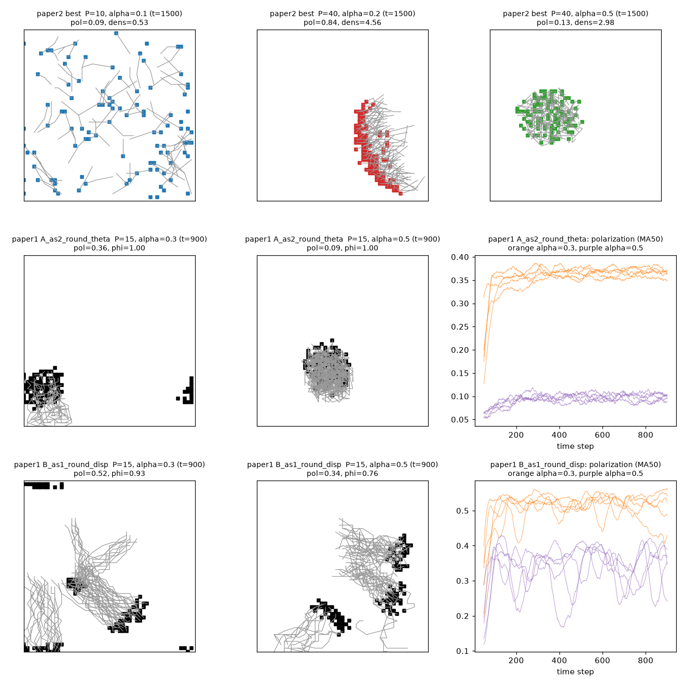

# 論文1（速度一致あり）：まとめと課題

[← 検証（入口）](../README.md)　｜　論文1：[00 まとめと課題](00_まとめと課題.md)・[01 整列度](01_整列度.md)・[02 密度と相関](02_密度と相関.md)・[03 α 文面どおり](03_α文面どおり.md)　｜　共通：[測り方とモデル](../測り方とモデル.md)・[計画](../計画.md)・[変更一覧](../変更一覧.md)

論文1：Gunji et al., *Robust swarm of soldier crabs*。今の状況（0.2・0.3 節）と、論文1 の課題の一覧。0.2・0.3 の番号は、もとの検証レポートの 0章の番号をそのまま使っている（モデルやノートブックから「検証レポート 0.3 節」のように参照されているため）。

- 詳しい中身：[01 整列度](01_整列度.md)（2.1〜2.8）、[02 密度と相関](02_密度と相関.md)（2.9〜2.15）、[03 α 文面どおり](03_α文面どおり.md)（2.16〜）。
- 両方の論文に共通すること（ひとことで言うと・拡大解釈のチェック・先生に確認したいこと・共通の課題）は [入口](../README.md) にある。

---

## 0.2 できていること・考えなければいけないこと（論文1）

**論文1**（○ 合う、△ 一部、× 合わない）

| 論文の図・現象 | 状況 | どの読み方で | 節 |
|---|---|---|---|
| 図8：P=2 で群れが崩れる | ○ | 文面どおりの修正だけ（追従の連鎖なし） | 2.1 |
| P=1 で全員そろって直進する（BOIDS と同じ） | ○ | どの読み方でも | 2.2 |
| 図11・14：α が大きいと整列度が下がる | △ | 候補A（α 2倍）は α≥0.4 が合い α=0.3 が低い。候補B（移動で速度一致）は α=0.3 が合い α が大きい側が高い | 2.7・2.12 |
| 図11：α=0.3 → 0.4 で急に落ちる | × | どの読み方でも出ない（候補A は θ が完全にそろうため） | 2.8 |
| 図11：密度の値（区画 Ls=25） | ○（候補A）／ × （候補B は低い） | 文面どおりの「区画に分ける」測り方。Ls の値は結果から決めた | 2.9・2.12 |
| 図11：P=8〜12 の密度の谷 | × | 候補A の α=0.6 だけ、位置をずらして出る | 2.11 |
| 図13・14：密度の値 | Ls しだい | Ls≈6 なら候補A、Ls=10 なら候補B が合う | 2.9・2.10 |
| 図15：スケールフリー相関の傾き | △ | 速度を移動で取ると論文の 1/10〜1/2。論文が velocity と呼ぶ基本ベクトル θ で取ると v1 で −1.06（論文 −0.96）と合うが、θ はほぼそろっていて揺らぎがとても小さい。ξ は群れの大きさに比例する | 2.13 |

## 0.3 今のベストのモデルと、その挙動（論文1）

**11/26 の試し直し（計画Q、2.18 節）：** 前に古い設定で試した文面の読み方6つを今の一番よい版で試し直したが、P=10・30 ではどれも差 0.03 以内だった（floor は遠ざかる）。P が大きいと密度と θ のそろいが一緒に上がり、扇は変わらない。このモデルでは速度一致を通して「密になる」と「そろう」が結びついていて、論文の図11 の「密なのにそろわない」は出せない。

**11/24 の見直し：** 論文1 は α を2倍にせず、そのまま読む方が有力になった（α=0.7・0.9・「a>0.5」を使うので、2倍だと α=0.5 で扇が一周する。2.5 節）。α をそのまま読む中で一番近いのは、候補B に人気度を p.7 の文面どおり「遷移の本数」で数える読み方を足した版（α=0.4/0.5/0.6 で 0.35/0.26/0.18、論文 0.27/0.12/0.10。2.16 節・計画L）。P=1〜30 では P が大きいほど整列度が上がり、密度（Ls=25）はどの P でも論文より低い（2.17 節・計画M）。下の候補A・B は 11/22 時点の比較。

**fig30** 今のベストのモデルのスナップショット（灰色の線は最後の数ステップの軌跡）。上段：論文2 のベスト（t=1500）。中段：論文1 の候補A（t=900）。下段：論文1 の候補B（t=900）。右の列は、論文1 の整列度の時系列（5シード）。

**論文1 は、1つに決まっていない。** 2つの候補がある。

| | 候補A：α 2倍・round・基本ベクトルの向きで速度一致 | 候補B：α そのまま・round・実際の移動で速度一致（E2） |
|---|---|---|
| 設定 | `alpha_scale=2, int_mode="round", vm_source="theta"` | `alpha_scale=1, int_mode="round", vm_source="disp"` |
| 群れの様子（P=15） | 1つの密な塊になる。全員の向きが完全に同じ（φ=1.00）。α=0.3 では塊が一方向に進み、α=0.5 ではほぼその場にとどまる丸い塊になる | 群れがいくつかに分かれて、それぞれ別の向きに進む（seed 0 の t=900）。向きは完全にはそろわない（φ=0.92 / 0.78） |
| 整列度の時間変化 | t≈100 で一定になり、そのあとほとんど揺れない | 大きく揺れ続ける（α=0.5 で 0.17〜0.42） |
| 整列度（α=0.3 / 0.5、論文 0.53 / 0.13） | 0.37 / 0.10 | 0.52 / 0.34 |
| 密度（区画 Ls=10 / Ls=25） | 0.51 / 0.78、0.49 / 0.70 | 0.34 / 0.58、0.32 / 0.57 |
| 合う図 | 図11 の α が大きい側、図11 の密度（Ls=25）、図8 の見た目（丸い塊） | 図11 の α=0.3、図13・14 の密度（Ls=10 と読んだとき） |

- **候補A は「動きが固すぎる」。** 全員の向きが完全に同じで、整列度が時間で変わらない。論文の図14 のように、整列度が時間で広く分布する様子は出ない。
- **候補B は「群れがまとまらない」。** 向きはばらつくが、群れが分かれやすく、図11 の密度（Ls=25）が低い。
- 論文1 の値は、ちょうど2つの候補の間にある（2.12 節）。

---

## 課題一覧（論文1）

番号は課題の名前として使っているので、並べ替えても変えない。状況の言葉の意味と、共通の課題（1〜3・29・30）は [入口](../README.md#課題一覧) にある。

| # | 課題 | 状況 | 節 |
|---|---|---|---|
| 13 | **α=0.3 の整列度が低い。** 組み合わせ8通りのうち一番近い「α 2倍・round・sequential」でも 0.37（論文の図11 は 0.53）。図14 の「0.3〜0.4 の幅で 0.35」には近い。どちらの図に合わせるかも確認したい | 未解決（原因は課題17 と同じ） | 2.7・2.8 |
| 14 | **α=0.3 → 0.4 の急な落ち方。** → 細かく 3000 ステップ回しても出ない。θ がいつも完全にそろう（φ=1.00）ので、整列度が扇の広がりだけで決まるため（計画A） | 原因が分かった（課題17 にまとめた） | 2.8 |
| 15 | 競合を文字どおり（負けたら2番目に人気のサイトへ）にしても、整列度が全体に下がるだけで、α が小さい側は合わない。→ p.6 の A・B・C の例から、3番目以降にも動ける sequential が文面どおりと判断した（11/24） | 解決 | 2.6・2.7 |
| 16 | floor だと整列度が 0.18 より下がらない。→ round なら 0.05 まで下がる。どちらが正しいかは課題2 | 解決（課題2 に移した） | 2.4・2.7 |
| 17 | **速度一致で向き θ が全員そろいきり、α が効きにくい。** 外部摂動を入れても直らない。→ 速度一致で近傍の実際の移動を平均すると（E2、式(8)「平均の速度の向き」の読み方）、round のとき θ がばらつく（φ 0.94→0.53）。α=0.3 の整列度は合うが、α が大きい側は高すぎる。α を2倍に読むと全体に低すぎ、論文の値は2つの間（計画E・E2）。式(8) で何を平均するかは確認したいこと 4 | 手がかりあり（確認待ち） | 2.3・2.4・2.8・2.10・2.12 |
| 18 | **P=8〜12 で密度が下がる谷が出ない。** → 谷が出るのは α 2倍・round の α=0.6 だけで、P=11〜15 と少しずれる（計画F） | 未解決（一部だけ出る） | 2.2・2.9・2.11 |
| 19 | **密度の値が論文と合わない。** → 文面どおり「区画に分ける」と、図11 は Ls=25（2×2）で合う。図13・14 は Ls≈6 なら今のモデルで、Ls=10 なら E2 か文字どおりの競合で合う（計画B・E）。→ Ls は論文にないので、図ごとに合う値を探してよいことにした（11/24） | 方針を決めた | 2.2・2.9・2.10 |
| 20 | 相互予期が 99% で、追従と自由移動がほとんど起きない。→ 式(4) の決まりから自然に出る値で、論文2の図S2（P=40 で 98〜99%）とも合う（計画G） | 確認済み（問題ではない） | 2.7・2.14 |
| 21 | 追従者近傍の半径。本文は「L より大きい」、図は R(Nf)=2 で食い違う。→ R(Nf)=5 にしても、段階式では変化なし。→ 今の一番よい版では、P=2 の崩れ方だけが強くなる（0.63 → 0.45、α=0.3）。P≥10 は変わらない（計画Q） | 確認済み（どちらの値にするかは確認したい） | 2.6・2.18 |
| 22 | P=2 で群れが崩れる現象。→ 追従の連鎖をなくして再現できた | 解決 | 2.1 |
| 23 | 速度一致の順番（相互予期より前か）と、近傍に自分を含めるか。→ どちらも違いなし | 確認済み | [変更一覧](../変更一覧.md) 1-14 |
| 24 | for ループの構造（段階ごとか、1体ずつか）。→ 1体ずつだと P=1 が崩れるので、段階ごとのまま | 確認済み | 2.6 |
| 25 | 基本ベクトルを、論文にない処理で更新していないか。→ θ が変わるのは式(8)の速度一致だけ | 確認済み | 2.3・2.4 |
| 26 | 計測のタイミング（移動の前か後か）。→ 時間平均では1ステップずれるだけで、平均には効かない | 確認済み | 2.9 |
| 27 | 可能的遷移の作り方（η の分布など）。η を √ にしても α の形は同じ | 一部確認 | [変更一覧](../変更一覧.md) 2-11 |
| 28 | **スケールフリー相関（図15）の傾き。** → 速度を移動で取ると −0.07〜−0.27（論文 −0.96、計画I）。論文が velocity と呼ぶ基本ベクトル θ で取ると v1 で −1.06 / R² 0.95 と合う。ただし v1 の θ はほぼそろっていて揺らぎがとても小さい（計画K）。ξ は群れの大きさに比例する。v_i を何で取るかは先生に確認 | 一部解決（確認待ち） | 2.13 |
