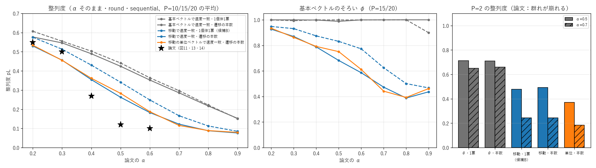
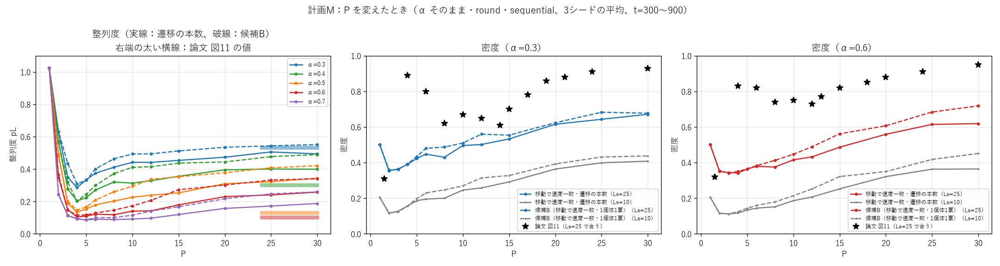
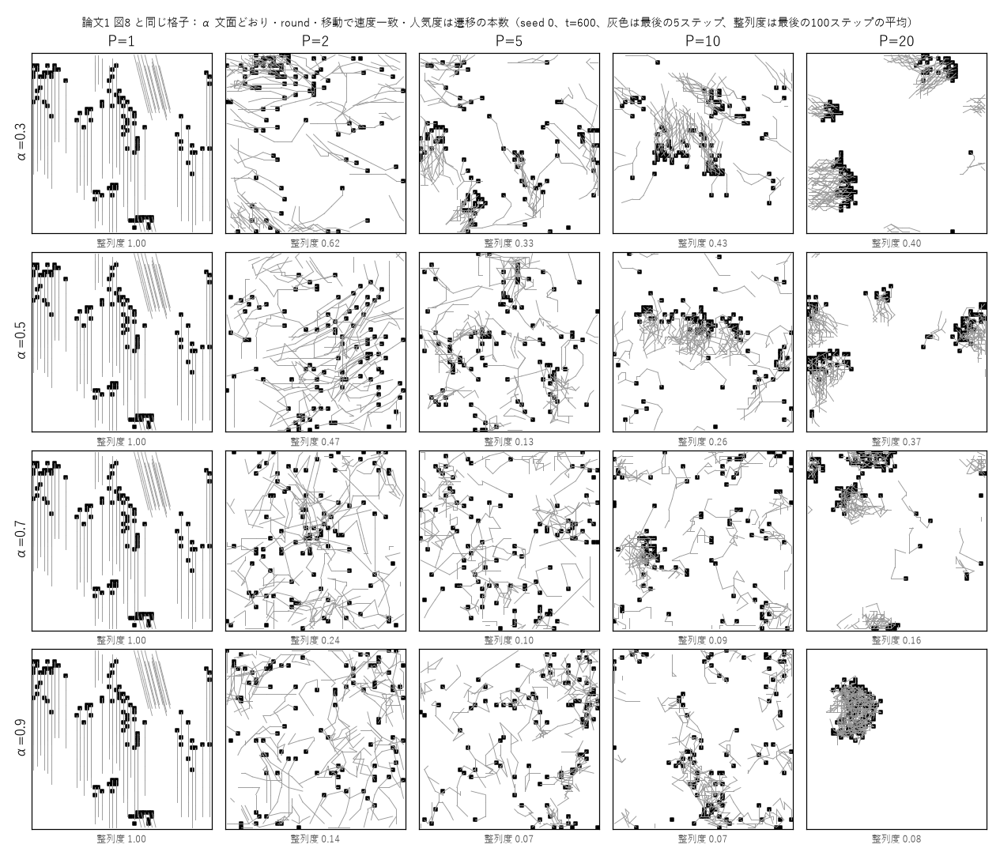

# 論文1：α を文面どおりに読んだときの、ほかの読み方（2.16〜）

[← 検証（入口）](../README.md)　｜　論文1：[00 まとめと課題](00_まとめと課題.md)・[01 整列度](01_整列度.md)・[02 密度と相関](02_密度と相関.md)・[03 α 文面どおり](03_α文面どおり.md)・[04 本の動画](04_本の動画.md)　｜　共通：[測り方とモデル](../測り方とモデル.md)・[計画](../計画.md)・[変更一覧](../変更一覧.md)

11/24 に作ったファイル。01・02 が長くなったので、論文1 の続きはここに書く。
きっかけ：論文1 は α=0.7・0.9（図8・図10）や「a>0.5」（p.15）を使っていて、α を2倍に読むと α=0.5 で扇が一周してしまう（2.5 節の反論）。そこで、**α は文面どおり**のまま、ほかに文面から読める所を見直した。

## 2.16 文面の見直しと、人気度の数え方（計画L、11/24）

### 文面を読み直して分かったこと（論文1 の2章 Model）

| 箇所 | 文面 | 今の実装 | 判断 |
|---|---|---|---|
| p.6 の A・B・C の例 | 3体が同じ重なったサイトを狙うと、順番はランダム（例えば B, C, A）。B が先にそのサイトへ動き、C は「空いていれば別の重なったサイトへ」、最後に A も「空いていれば別の重なったサイトへ」 | sequential（空いている次に人気のサイトへ何番目でも） | **文面どおり。** p.8 の「残りは2番目に人気のサイトへ」は2体のときの言い方と読める。literal は使わない（課題15 を解決） |
| p.7 の人気度 | 「the number of transitions reaching that site is counted as the popularity」（そのサイトに届く**遷移の本数**）。式(3) も遷移先 t(k,t;i) の数 | **1個体1票**（論文2 の図S2 に合わせて決めた数え方を、そのまま使っていた） | **文面と違っていた。** `popularity="transition"` を足した（既定は今までどおり） |
| 図11 の説明（p.17） | 「この傾向（密度が高く整列度が低い）は α によらない」 | — | 図11 は P に対する傾向の図で、α の値どうしを比べることが主目的ではない |
| 密度の Ls | 値は書かれていない | 図ごとに Ls を変えて測る | 図ごとに合う Ls を探してよい（自分で決めた、11/24） |

- 遷移の本数で数えると、1体の遷移が2本同じサイトに重なるだけで人気度が 2（閾値）になる。そのため、ほぼ全員がいつも相互予期で動く（相互予期 100%、追従 0%）。

### 試したこと

- 条件はすべて α そのまま・round・sequential（`alpha_scale=1, int_mode="round", ma_rule="sequential"`）。
- 速度一致で平均するもの（基本ベクトル θ / 移動 / 移動の単位ベクトル）× 人気度の数え方（1個体1票 / 遷移の本数）の5通り。
- P=10 / 15 / 20、α=0.2〜0.9、3シード、900 ステップ（t=300〜900 の平均）。P=1・2 も α=0.5・0.7 で。全部で 420 本。
- スクリプト：`report_scripts/planL_paper1_alt.py`（実行）、`planL_analyze.py`（集計と図）。結果は `report_data/planL_paper1_alt.json`。

**fig33** 左：整列度（P=10/15/20 の平均）、黒い星が論文。中：基本ベクトルのそろい φ。右：P=2 の整列度。灰色＝基本ベクトルで速度一致、青＝移動で速度一致、橙＝移動の単位ベクトルで速度一致。破線＝1個体1票、実線＝遷移の本数。

**整列度**（P=10/15/20 と3シードの平均）

| 設定 | α=0.2 | 0.3 | 0.4 | 0.5 | 0.6 | 0.7 | 0.8 | 0.9 |
|---|---|---|---|---|---|---|---|---|
| **論文** | 0.55 | 0.50 | 0.27 | 0.12 | 0.10 | — | — | — |
| 基本ベクトル・1個体1票 | 0.61 | 0.56 | 0.50 | 0.44 | 0.36 | 0.30 | 0.22 | 0.15 |
| 基本ベクトル・遷移の本数 | 0.58 | 0.55 | 0.49 | 0.42 | 0.35 | 0.29 | 0.22 | 0.15 |
| 移動・1個体1票（候補B） | 0.58 | 0.51 | 0.43 | 0.34 | 0.25 | 0.17 | 0.11 | 0.08 |
| **移動・遷移の本数** | 0.53 | 0.46 | **0.35** | **0.26** | **0.18** | 0.12 | 0.09 | 0.08 |
| 移動の単位ベクトル・遷移の本数 | 0.53 | 0.46 | 0.36 | 0.28 | 0.19 | 0.12 | 0.09 | 0.08 |

### 結果

- **遷移の本数で数えると、移動で速度一致する版（候補B）の整列度が、どの α でも 0.05〜0.08 下がり、論文に近づいた。**
  - α=0.4 / 0.5 / 0.6 で 0.35 / 0.26 / 0.18（論文 0.27 / 0.12 / 0.10）。候補B（0.43 / 0.34 / 0.25）より近い。
  - α=0.2 / 0.3 は 0.53 / 0.46（論文 0.55 / 0.50）で、少し低いが ±0.05 に入る。
  - それでも α=0.5 は論文より 0.14 高い。論文の値には、α を 0.2 ほど大きくしたところ（α=0.7 で 0.12）で届く。
  - α=0.3 → 0.4 の急な落ち方は出ない（なだらかに下がる）。
- **基本ベクトルで速度一致する版は、人気度の数え方を変えてもほとんど変わらない。** θ が完全にそろったまま（φ=1.00）なので、α が効きにくい（課題17 と同じ）。
- **P=2 で群れが崩れるのは、移動で速度一致する版だけ。** α=0.7 で整列度 0.24（基本ベクトルの版は 0.65）。論文の「P=2 で集団の動きが崩れる」と合う。P=1 はどれも 1.0 前後で、全員そろって直進する。
- **移動で速度一致する版は、整列度が時間で揺れる**（標準偏差 0.06〜0.09、基本ベクトルの版は 0.03）。図14 の「整列度が広く分布する」様子に近い。
- 密度（P=15/20）は、移動・遷移の本数で Ls=6 が 0.18〜0.22、Ls=10 が 0.27〜0.33、Ls=25 が 0.50〜0.57。図13・14 の 0.1〜0.3 には Ls=6〜10 で入る。図11 の Ls=25 の値（0.7 前後）より低い。
- **P が大きいほど整列度が上がる。** 移動・遷移の本数の α=0.5 は、P=10 / 15 / 20 で 0.23 / 0.25 / 0.31。図10・11 の P は 30 までなので、P が大きい所ではさらに高くなるはず（未確認）。

### まとめ

- α を文面どおり読むなら、**移動で速度一致・遷移の本数で人気度を数える版**が、今のところ一番よい。数え方は p.7 の文面どおりで、拡大解釈ではない（残る拡大解釈は round だけ）。
- 課題は、α が大きい側（α=0.4〜0.6）がまだ 0.08〜0.14 高いことと、P が大きいと整列度が上がること。
- 次に見るとよいこと：P=25・30 での値、図10（α=0.7、P を変える）と図8（α=0.7・0.9）との比較、速度一致の半径 R(M)=2（図9・図15 の値）。

## 2.17 P を 1〜30 まで変えて、図8・図10・図11 と比べる（計画M、11/24）

- **ねらい：** 2.16 節で一番よかった版（α そのまま・round・sequential・移動で速度一致・人気度は遷移の本数）が、P を変えたときの図（図10・11）と、P × α のスナップショット（図8）に合うかを見る。比べる相手は候補B（人気度が1個体1票）。
- **試したこと：** P=1〜30（13通り）× α=0.3〜0.7、3シード、900 ステップ（t=300〜900 の平均）。密度は区画 Ls=25（図11 で合った測り方）と Ls=10。図8 の格子は P=1/2/5/10/20 × α=0.3/0.5/0.7/0.9、seed 0、t=600。
- スクリプト：`report_scripts/planM_Psweep.py`（実行）、`planM_analyze.py`（集計と図）、`planM_fig8.py`（図8 の格子）。結果は `report_data/planM_Psweep.json`。
- 論文の値は、前に目で読んだもの（`論文1_図をつくる.ipynb` と同じ）。図11 の整列度は「P が大きい所」の値で、P ごとの曲線は読んでいない。

**fig34** 左：整列度（実線＝遷移の本数、破線＝候補B。右端の太い横線が論文 図11 の値）。中・右：密度（α=0.3 / 0.6。色つき＝Ls=25、灰色＝Ls=10、黒い星＝論文 図11）。

**fig35** 論文1 図8 と同じ P × α の格子（遷移の本数の版）。

**整列度（遷移の本数の版、3シードの平均）**

| α | P=1 | 2 | 3 | 4 | 6 | 8 | 10 | 15 | 20 | 30 | 論文 図11 |
|---|---|---|---|---|---|---|---|---|---|---|---|
| 0.3 | 1.03 | 0.63 | 0.35 | 0.29 | 0.37 | 0.41 | 0.44 | 0.45 | 0.47 | 0.49 | 0.53 |
| 0.4 | 1.03 | 0.57 | 0.28 | 0.20 | 0.27 | 0.32 | 0.31 | 0.36 | 0.40 | 0.40 | 0.30 |
| 0.5 | 1.03 | 0.49 | 0.19 | 0.13 | 0.18 | 0.20 | 0.23 | 0.25 | 0.31 | 0.34 | 0.13 |
| 0.6 | 1.03 | 0.35 | 0.15 | 0.11 | 0.12 | 0.12 | 0.14 | 0.18 | 0.23 | 0.26 | 0.10 |
| 0.7 | 1.03 | 0.24 | 0.11 | 0.09 | 0.09 | 0.09 | 0.09 | 0.12 | 0.16 | 0.19 | — |

### 結果

- **形は図10・11 と同じ。** P=1 で 1.0（全員そろって直進）、P=2〜4 で一気に下がり（P=2 で群れが崩れる）、P≥5 でゆっくり上がる。
- **P=8〜10 では、論文の値にかなり近い。** α=0.3 / 0.4 / 0.5 / 0.6 で 0.41〜0.44 / 0.31〜0.32 / 0.20〜0.23 / 0.12〜0.14（論文 0.53 / 0.30 / 0.13 / 0.10）。α=0.4 と 0.6 は合い、α=0.3 は少し低く、α=0.5 は少し高い。
- **ただし P が大きくなるほど整列度が上がり、P=30 では α=0.5 / 0.6 が 0.34 / 0.26 と、論文の 2〜3 倍になる。** 論文の図11 は「P が大きい所でも低い」ので、ここは合わない。候補B はさらに高い。
- **密度（Ls=25）は、どの P でも論文よりかなり低い。** 論文は P=4 で 0.8〜0.9 まで一気に上がるが、モデルは P=4 で 0.33〜0.39、P=30 でも 0.61〜0.67。群れがゆるく、いくつかに分かれる。候補A（α 2倍・θ で速度一致）は図11 の密度に合っていたので（2.9 節）、移動で速度一致する版の弱点。
- **P=8〜12 の密度の谷**は、遷移の本数の版の α=0.3 で P=8 にだけ小さく出る（0.45 → 0.43 → 0.50）。3シードなので、はっきりとは言えない。
- **図8 の見た目：**
  - P=1 は全員が同じ向きに直進、P=2 はばらばら（論文と同じ）。
  - P=20 では、α=0.3〜0.7 で密な群れがいくつかでき、**α=0.9 では丸い塊1つになり、中で個体がばらばらに動く**。p.15 の「P=20、a>0.5 でアメーバのような動き、楕円の群れの中に乱れがある」に近い。α を文面どおりに読んでも、α>0.5 で論文の書く様子が出る。
  - P=5・10 で α≥0.5 では、群れがまとまりきらない。

### まとめ

- 遷移の本数の版は、**P=1・2 の振る舞い、P=8〜10 での整列度、P=20・α=0.9 のアメーバのような塊**が、α を文面どおりに読んだまま出る。
- 合わないのは **(1) P が大きいと整列度が上がっていくこと**、**(2) 密度（Ls=25）がどの P でも低いこと**。どちらも「群れがゆるく、いくつかに分かれる」ことと関係していそう。
- 次の候補：速度一致の半径 R(M)（今は 3。図9・図15 は 2）、追従者近傍の半径（p.7「基本ベクトルの長さより大きい」）、速度一致で自分の移動を含めるか。

## 2.18 文面で分かれる読み方を、今の一番よい版で試し直す（計画Q、11/26）

- **ねらい：** 2.17 節で残ったずれ（P が大きいと整列度が上がる、密度（Ls=25）が低い）を、論文の文面で分かれる読み方で直せるかを見る。下の読み方は、前に古い設定（θ で速度一致・1個体1票）で試して「変化なし」「不採用」になったもので、今の一番よい版（α そのまま・round・sequential・移動で速度一致・遷移の本数）では試していなかった。
- **試した読み方：**

| 名前 | 変えたところ | 論文の根拠 | 前の結果 |
|---|---|---|---|
| 1体ずつ | 選ばれた個体が、その場で (4)相互予期 → (5)追従 → (6)自由移動 を判定する（各個体1回） | p.9「更新する個体を w=0 のサイトからランダムに選ぶ」と式(4)〜(6) | 変更一覧 1-8（P=1 が崩れる） |
| 追従先は w 全部 | 相互予期に限らず、更新された個体が空けたサイトへ追従できる | 式(5) の w=1 | 1-9（変化なし） |
| R(Nf)=5 | 追従者近傍の半径を L=4 より大きくする | p.10「半径は基本ベクトルの長さより大きい」（図は R(Nf)=2） | 1-10（変化なし） |
| サイト単位 | 同率の最大人気サイトと自由移動の行き先を、サイト単位で選ぶ | 式(4) の下、式(6) の Rd{t(k,t;i)} | 1-16 |
| floor | Int を文面どおり floor にする | 式(1) の下「X ≤ x < X+1」 | 1-5 |
| 自分を含めない | 速度一致の近傍 M に自分を含めない | なし（式(8) は書いていない） | 1-14（違いなし） |

- P=1・2・10・30 × α=0.3〜0.6 × 3シード、900 ステップ（t=300〜900 の平均）。L=4、R(Nf)=2、R(M)=3（図10・11 と同じ）。φ は θ のそろい、扇は実際の移動の向きと θ の差（二乗平均の平方根）。
- 「今の一番よい版」は `CrabSwarmPaper1` と同じ軌跡になることを確かめた（`python planQ_paper1_readings.py check`）。
- スクリプト：`report_scripts/planQ_paper1_readings.py`。データ：`report_data/planQ_paper1_readings.json`。

**表11** 整列度（α=0.3 / 0.4 / 0.5 / 0.6）と密度（Ls=25、α の平均）。論文 図11（P が大きい所）は 0.53 / 0.30 / 0.13 / 0.10、密度 0.8〜0.9

| 読み方 | P=1 | P=2 | P=10 | P=30 | 密度 P=10 / 30 |
|---|---|---|---|---|---|
| 今の一番よい版 | 1.03 | 0.63 / 0.57 / 0.49 / 0.35 | 0.44 / 0.31 / 0.23 / 0.14 | 0.49 / 0.40 / 0.34 / 0.26 | 0.45 / 0.64 |
| 1体ずつ | 0.99 | 0.64 / 0.58 / 0.51 / 0.34 | 0.43 / 0.34 / 0.22 / 0.13 | 0.50 / 0.39 / 0.33 / 0.24 | 0.44 / 0.65 |
| 追従先は w 全部 | **0.77** | **0.21 / 0.20 / 0.18 / 0.16** | 0.44 / 0.32 / 0.22 / 0.13 | 0.50 / 0.41 / 0.33 / 0.25 | 0.45 / 0.63 |
| R(Nf)=5 | 1.00 | 0.45 / 0.39 / 0.32 / 0.24 | 0.43 / 0.34 / 0.23 / 0.14 | 0.50 / 0.41 / 0.34 / 0.26 | 0.46 / 0.64 |
| サイト単位 | 1.03 | 0.62 / 0.56 / 0.47 / 0.34 | 0.44 / 0.32 / 0.23 / 0.14 | 0.51 / 0.39 / 0.34 / 0.26 | 0.45 / 0.63 |
| floor | 1.24 | 0.79 / 0.75 / 0.71 / 0.66 | **0.61 / 0.57 / 0.51 / 0.46** | **0.67 / 0.62 / 0.56 / 0.49** | 0.44 / 0.68 |
| 自分を含めない | 0.99 | 0.56 / 0.49 / 0.37 / 0.26 | 0.44 / 0.34 / 0.22 / 0.14 | 0.50 / 0.42 / 0.32 / 0.25 | 0.45 / 0.64 |

**表12** 今の一番よい版の θ のそろい φ・密度・扇（度）

| α | P=10：φ / 密度 / 扇 | P=30：φ / 密度 / 扇 |
|---|---|---|
| 0.3 | 0.82 / 0.48 / 32 | 0.92 / 0.66 / 34 |
| 0.4 | 0.68 / 0.47 / 41 | 0.84 / 0.64 / 44 |
| 0.5 | 0.52 / 0.45 / 51 | 0.81 / 0.64 / 53 |
| 0.6 | 0.36 / 0.41 / 60 | 0.75 / 0.62 / 64 |

（floor 以外の6つの読み方をまとめた値。読み方どうしの差は小さい）

### 分かったこと

- **P=10・30 では、どの読み方でも結果がほとんど変わらない**（整列度の差 0.03 以内、密度の差 0.02 以内）。相互予期が 97〜100% なので、追従・自由移動・1体ずつかどうかは、ほとんど効かない。
- 1体ずつは、前の設定では P=1 が 0.54 に崩れた（1-8）が、今の版では 0.99 で崩れない。P=10・30 は段階ごとと同じなので、どちらでもよい。
- **floor（文面どおり）は、どの P でも整列度が 0.15〜0.3 上がり、論文から遠ざかる。** 遷移が平均 (−0.5, −0.5) ずれるので、全員が左下にそろって動く（1-5 と同じ）。round は残す。
- **P=1・2 にだけ効く読み方がある。**
  - 追従先は w 全部：P=1 が 0.77 に崩れる（論文は「P=1 は BOIDS と同じ」で 1.0 前後）。今までどおり使わない。
  - R(Nf)=5：P=2 の崩れ方が強くなる（0.45〜0.24）。P=1 は 1.00 のまま。p.10 の文面どおりで、図8・図10 の「P=2 で崩れる」により近い。ただし図10・11 の説明は R(Nf)=2 なので、どちらを使うかは決めきれない。
- **P が大きいと整列度が上がる理由が分かった。** 扇（実際に動く向きのばらつき）は P=10 と 30 でほとんど同じ（2〜4° しか変わらない）。変わるのは θ のそろい φ（α=0.5 で 0.52 → 0.81）と密度（0.45 → 0.64）で、2つは一緒に上がる（α ごとの相関 0.86〜0.99。ただし相関の大部分は P の違いから来ている）。
  - 移動で速度一致するので、θ は近傍の個体の移動の平均になる。群れが密になると近傍の個体が増え、平均するとばらつきが消えるので、θ がそろう。
  - つまりこのモデルでは、**「密になる」と「そろう」が速度一致を通して結びついている。** 論文の図11（P が大きい所）は「密度 0.8〜0.9 で整列度 0.10〜0.13」、つまり密なのにそろわない状態で、今の作りでは同時に出せない。これは 3.3（[これまでの検証](../これまでの検証.md)）の「密でそろわない状態が出せない」と同じことを、P の向きから見たもの。
- **⇒ 文面で分かれる所（式(1)(4)〜(8)、p.9〜10）を今の版で試し直しても、P が大きい所の整列度と密度は直らなかった。** 残るのは、式(8) の「近傍 M の平均の速度の向き」で何を平均するか（確認したいこと 4）と、R(Nf) の値（本文と図の食い違い、課題21）。

## 2.19 速度一致をする順番（計画S、11/26）

- **ねらい：** 速度一致（式(8)）を相互予期の前にすると変わるかを見る。論文1 の図2 の説明は「First, velocity matching is applied to the basic vectors」で、郡司研の YouTube の動画（本『群れは意識をもつ』の図3-8）の説明にも「velocity matching before mutual anticipation」とある。式(8) の前の文は「Finally, … velocity matching」で、順番の書き方が分かれている。
- **考えたこと：** 全員一斉に速度一致するなら、ステップの最後にしても次のステップの最初にしても「動く → 速度一致 → 動く → …」の同じ列になる（平均する移動も近傍の位置も同じ）。違いが出るのは、速度一致を1体ずつ非同期に行う読み方だけ。
- **試した読み方**（今の一番よい版：α そのまま・round・sequential・移動で速度一致・遷移の本数。P=1・2・10・30 × α=0.3〜0.6 × 3シード、900 ステップ、t=300〜900 の平均）
  - 速度一致を前に（一斉）
  - 1体ずつ（速度一致は最後）：計画Q の「1体ずつ」。順番の効果だけを見る比較
  - 1体ずつ・速度一致→判定：ランダムな順に1体ずつ、①近傍の最新の移動（先に動いた個体はこのステップの移動）の平均に θ をそろえ、②その θ で可能的遷移を作り直し（人気度の自分の票も入れ替える）、③その場で相互予期 → 追従 → 自由移動を判定する
  - θ で速度一致（一斉 / 1体ずつ）：θ を平均する版で、1体ずつは先にそろえた隣の θ をすぐ使う
- スクリプト：`report_scripts/planS_paper1_vm_order.py`（`check` で、今の一番よい版が `CrabSwarmPaper1` と同じ軌跡になるのを確かめた）。データ：`report_data/planS_paper1_vm_order.json`。

**表13** 整列度（α=0.3 / 0.4 / 0.5 / 0.6）と密度（Ls=25、α の平均）。論文 図11（P が大きい所）は 0.53 / 0.30 / 0.13 / 0.10、密度 0.8〜0.9

| 読み方 | P=1 | P=2 | P=10 | P=30 | 密度 P=10 / 30 |
|---|---|---|---|---|---|
| 今の一番よい版 | 1.03 | 0.63 / 0.57 / 0.49 / 0.35 | 0.44 / 0.31 / 0.23 / 0.14 | 0.49 / 0.40 / 0.34 / 0.26 | 0.45 / 0.64 |
| 速度一致を前に（一斉） | 1.03 | **同じ** | **同じ** | **同じ** | 0.45 / 0.64 |
| 1体ずつ（速度一致は最後） | 0.99 | 0.64 / 0.58 / 0.51 / 0.34 | 0.43 / 0.34 / 0.22 / 0.13 | 0.50 / 0.39 / 0.33 / 0.24 | 0.44 / 0.65 |
| 1体ずつ・速度一致→判定 | 1.00 | **0.58 / 0.49 / 0.38 / 0.28** | 0.40 / 0.29 / 0.22 / 0.13 | 0.45 / 0.42 / 0.33 / 0.28 | 0.44 / 0.64 |
| θ で速度一致（一斉） | 1.04 | 0.72 / 0.70 / 0.71 / 0.68 | 0.55 / 0.49 / 0.43 / 0.37 | 0.55 / 0.48 / 0.41 / 0.34 | 0.67 / 0.75 |
| θ で速度一致（1体ずつ） | 0.98 | 0.74 / 0.68 / 0.74 / 0.65 | 0.54 / 0.49 / 0.43 / 0.38 | 0.54 / 0.48 / 0.42 / 0.33 | 0.68 / 0.79 |

### 分かったこと

- **速度一致を全員一斉に前へ移しても、軌跡まで同じになる**（整列度・密度・ルールの割合がすべて一致）。図2 の「First」と式(8) の前の「Finally」は、一斉なら同じモデルを言っている。
- **1体ずつ速度一致してその場で判定すると、P=2 の崩れ方だけが少し強くなる**（α=0.5 で 0.49 → 0.38、論文の「P=2 で崩れる」の向き）。P=10・30 は差 0.04 以内で、P が大きい所で整列度が上がる問題（2.17・2.18 節）は直らない。
- θ で速度一致する版も、一斉と1体ずつでほとんど同じ（θ が全員そろいきる φ=1.00 のまま）。
- **⇒ 速度一致の順番は、課題17（P・α が大きい所で整列度が下がりきらない）の理由ではない。** 課題23 の「違いなし」は、今の一番よい版でも同じ。

### 本の動画（郡司研の YouTube、11/26 に見た）

- チャンネル「YukioPegioGunjiLab」の7本は、本『群れは意識をもつ』（PHP サイエンス・ワールド新書、2013）の図3-6a,b（速度一致なし）、図3-8（P=4・10・15・25、速度一致あり。P=1・2 は説明文のリンクのみ）、図3-12（水たまり）の動画。論文1 の図そのものではない。
- 図3-8 の説明文：「basic transition is adjusted by velocity matching before mutual anticipation」。上のとおり、一斉なら順番は結果に効かない。
- P=10 の動画は、画素から数えると約 200体・格子 100×100 くらい（論文の図8 は N=100・S=50）。小さな塊がいくつもでき、合わさっていき、最後に1つの大きな塊になる。速度一致なし（図3-6b）は、すぐに丸く密な塊になる。条件が論文と違うので、数値ではなく見た目の比べ方にしか使えない。
