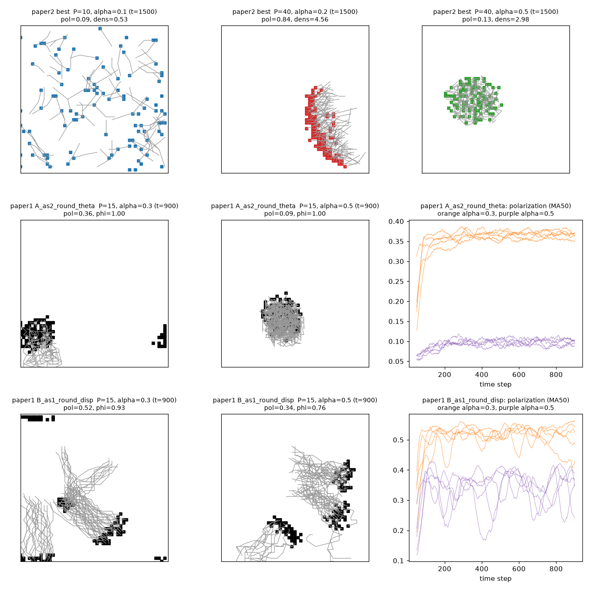

# 論文2（速度一致なし）：まとめと課題

[← 検証（入口）](../README.md)　｜　論文2：[00 まとめと課題](00_まとめと課題.md)・[01 図3](01_図3.md)・[02 他の図](02_他の図.md)・[α 2倍の全図の再現](α2倍_全図の再現.md)・[03 残ったずれ](03_残ったずれ.md)　｜　共通：[測り方とモデル](../測り方とモデル.md)・[計画](../計画.md)・[変更一覧](../変更一覧.md)

論文2：Murakami et al. 2017, *Sci. Rep.* 7:46447 と Appendix S1。今の状況（0.2・0.3 節）と、論文2 の課題の一覧。0.2・0.3 の番号は、もとの検証レポートの 0章の番号をそのまま使っている。

- 詳しい中身：[01 図3](01_図3.md)（3.1〜3.6）、[02 他の図](02_他の図.md)（3.7〜3.12）。
- **今のベストの設定（α 2倍・round・ω 式どおり・1個体1票）で、論文2 と付録のすべての図を作り直したレポートは [α2倍_全図の再現.md](α2倍_全図の再現.md)**（11/24、計画N、fig36〜40）。先生の答え（11/24）：α 2倍と round は、論文に合うならそれで進めてよい。
- 両方の論文に共通すること（ひとことで言うと・拡大解釈のチェック・先生に確認したいこと・共通の課題）は [入口](../README.md) にある。

---

## 0.2 できていること・考えなければいけないこと（論文2）

**論文2**

| 論文の図・現象 | 状況 | どの読み方で | 節 |
|---|---|---|---|
| 図3：赤は整列、緑・青は整列しない（順番） | ○ | α 2倍のときだけ。α そのままだと赤と緑が逆 | 3.5 |
| 図3：値 | △ | 赤 0.84 / 4.5（論文 0.93 / 4.0）、緑 0.13 / 3.0（0.35 / 3.2）、青 0.12 / 0.54（0.2 / 0.65） | 3.5・3.6 |
| 図3b,c：そろうまでの時間 | ○ | round なら赤は t=181〜1292（論文 t≈600）。floor だと 60 ステップで速すぎる | 3.6 |
| 図3a：P × α の格子の見た目 | ○ | α 2倍 | 3.5 |
| 図S2：赤・緑のルールの割合 | ○ | どの読み方でも | 3.7 |
| 図S2：青のルールの割合 | ○（α そのまま）／ △（α 2倍） | α 2倍とは両立しない | 3.9 |
| 図S2b：2体の整列度とルールの割合 | ○ | ω 式どおり・1個体1票 | 3.7 |
| 図4b,c：2体の旋回・加速の力 | ○ | 論文の Methods どおりに計算すれば、どの設定でも | 3.8 |
| 図S3：ω=2〜7 で高く、ω≥8 で下がる | ○ | ω 式どおり・α 2倍 | 3.7・3.10 |
| 図S3：ω=0 で低い | × | ω を説明文どおりに読んだときだけ合う | 3.10 |

**11/24 の全図の再現（計画N）で分かったこと：** 合うのは図3a の見た目、赤・緑・青の順番、赤がそろう時刻（167〜1280）、赤・緑のルールの割合、2体、図4b,c の形、図S3 の ω=1〜8、図S4（3体）の主な形。合わないのは、緑の整列度 0.13（論文 0.35）、青の相互予期 72%（63%）、図S3 の ω=0 と ω=9・10、図4b の旋回の力の大きさ（±0.6、論文 ±2）、図S4 の旋回の残差の場所。緑・青・旋回の力のずれは、どれも α 2倍で値がずれる所（[α2倍_全図の再現.md](α2倍_全図の再現.md)）。

**α 1倍との比較（11/25、[α2倍_全図の再現.md](α2倍_全図の再現.md) の 8節、fig41〜46）：** 同じ図を α 1倍でも作って並べた。α 2倍でないと出ないのは群れ全体の振る舞い（図3 の順番、図3a の並び、図S3 の ω=2〜8）。α 1倍の方が合うのは1体ずつの細かい値（青のルールの割合 63.6 / 5.0 / 31.4、青・赤の密度、図4b の旋回の力の幅 1.37）。2体、図S4 の形、図S3 の ω=0・9・10 は α によらない。
**α 以外で理由を探した（11/25〜26）：** θ の入れ方（式(2) の丸め、式(13)、計画O）も、遷移の選び方の読み方（本文 p.4 の競合・人気度の順・2番目は c 未満でも・追従はサイトごと、計画P）も、α 2倍で残ったずれ（青のルールの割合、緑の整列度、旋回の力の幅）を同時には直さなかった（[03_残ったずれ.md](03_残ったずれ.md)）。文面で分かれる所はほぼ試し終わった。

## 0.3 今のベストのモデルと、その挙動（論文2）



**fig30** 今のベストのモデルのスナップショット（灰色の線は最後の数ステップの軌跡）。上段：論文2 のベスト（t=1500）。中段：論文1 の候補A（t=900）。下段：論文1 の候補B（t=900）。右の列は、論文1 の整列度の時系列（5シード）。

**論文2 のベスト**：α 2倍・ω 式どおり・round・1個体1票

```python
SoldierCrabSwarm_v1(model="paper2", P=40, alpha=0.2, alpha_scale=2, omega_on="principal", int_mode="round")
```

| 条件 | 群れの様子 | 整列度 / 密度（中央値） | 相互予期 |
|---|---|---|---|
| 赤（P=40, α=0.2） | 最初はばらばら。t≈260 までに密な群れになり、そのあとシードごとに t=181〜1292 のどこかで一気に向きがそろって、帯の形の群れが一方向に進む | 0.83 / 4.52 | 99% |
| 緑（P=40, α=0.5） | 丸い塊になって、ほぼその場にとどまる。塊の中では個体がばらばらの向きに動き回る（論文の「ユスリカの群れのよう」に近い） | 0.13 / 2.99 | 99% |
| 青（P=10, α=0.1） | 群れにならず、ばらばらに動く | 0.10 / 0.54 | 72% |

- 論文の記述（赤は密でそろった群れ、緑は密だがそろわない群れ、青は群れにならない）と、見た目は合う。
- 値は、赤の整列度が論文より 0.1 低く、密度が 0.5 高い。緑の整列度は論文より 0.2 低い。

---

## 課題一覧（論文2）

番号は課題の名前として使っているので、並べ替えても変えない。状況の言葉の意味と、共通の課題（1〜3・29・30）は [入口](../README.md#課題一覧) にある。

| # | 課題 | 状況 | 節 |
|---|---|---|---|
| 4 | **ω の掛け方。** 式(13) と図S3 の説明文で、言っていることが逆。2体（図S2b）と図S3 の ω≥8 は式どおりが合い、図S3 の ω=0 だけは説明文どおりが合う。2つの読み方は ω と 1/ω の入れ替え。v1 の既定（説明文どおり）は見直し候補 | 確認待ち | 3.2・3.7・3.10 |
| 5 | **図S2 の青のルールの割合。** → 相互予期の割合は実際の扇の広さで決まり、論文の 63% になるのは α そのままのときだけ。α 2倍とは両立しない（計画D） | 原因は分かった（課題1 の確認待ち） | 3.7・3.9 |
| 6 | **図S3。** ω≤1 で整列度が下がらない。→ 低いのは主に ω=0 で、ω の読み方次第（課題4）（計画H） | 原因が分かった（課題4 の確認待ち） | 3.7・3.10 |
| 7 | 図4b の旋回の力。→ 論文の Methods どおりに計算し直すと、どの設定でも論文と同じ形（計画C） | 解決 | 3.7・3.8 |
| 8 | α を大きくすると整列度が上がる。→ α を広く振ると山の形で、頂上が論文の2倍の位置 | 解決 | 3.4 |
| 9 | 止まる（遷移しない）個体がいるか。→ 0% で、原因ではない | 確認済み | 3.7 |
| 10 | 図3 の赤・緑・青の P・α と値の読み取り。→ 正しい | 確認済み | 3.7 |
| 11 | **収束が速すぎる。** → floor が原因。今のベストの設定（round）を10シードで確かめると、赤がそろうのは t=181〜1292（中央値 418）で、論文の t≈600 は範囲に入る。floor だと 60 ステップでそろう（計画J） | 解決 | 3.1・3.6 |
| 12 | 人気度の数え方。→ 1個体1票の方が図S2・図S2b に合う | 解決 | 3.7 |
