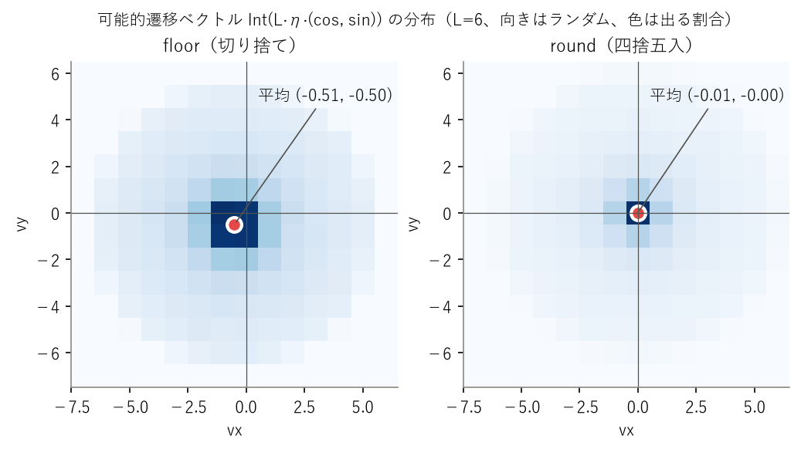
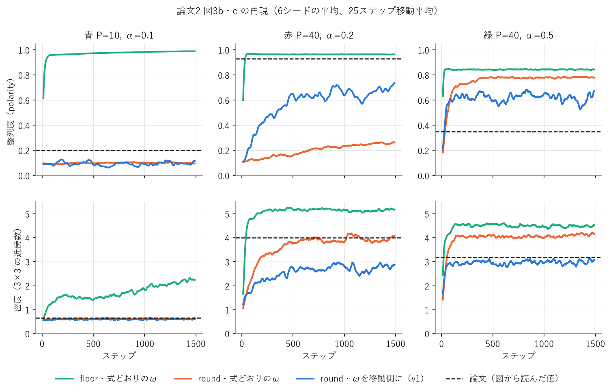
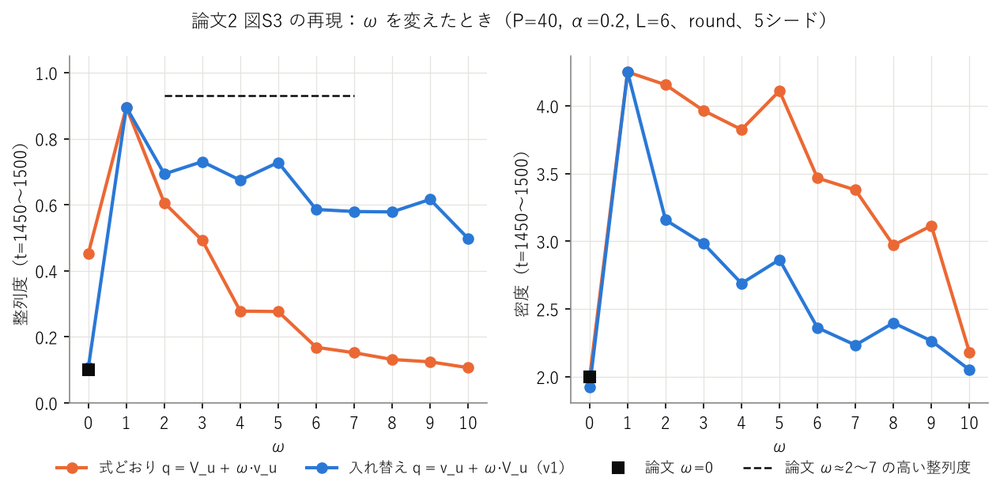
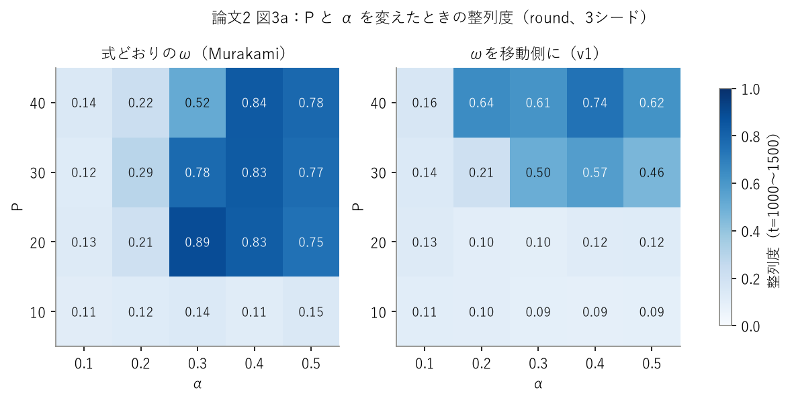
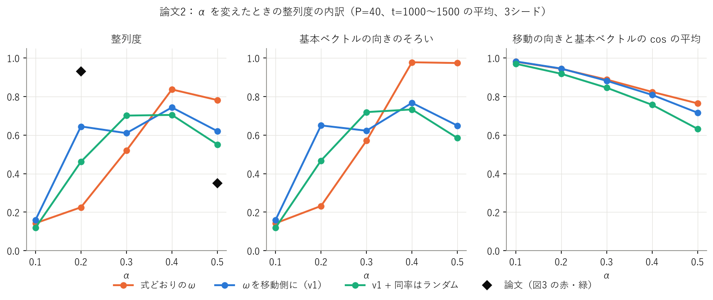
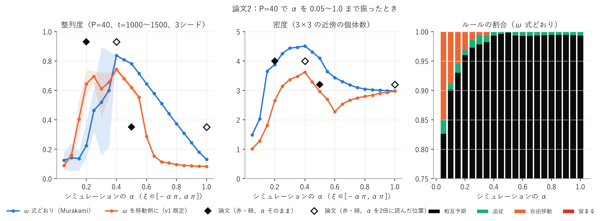
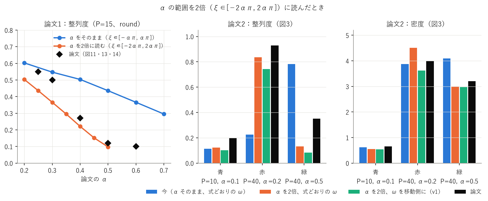
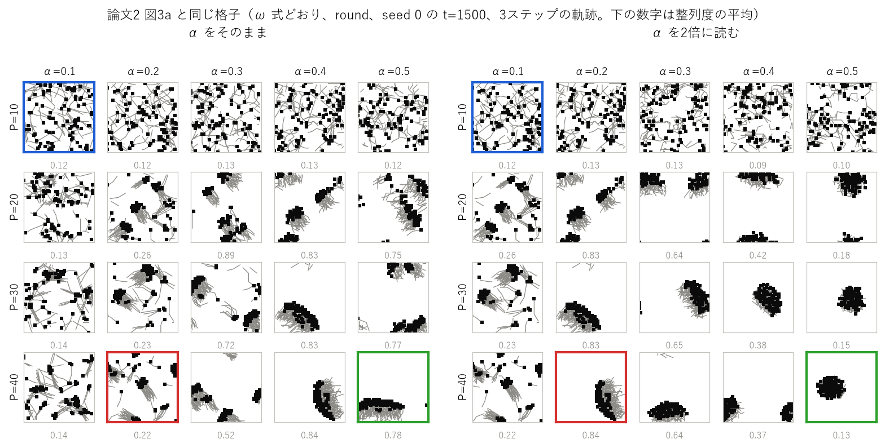
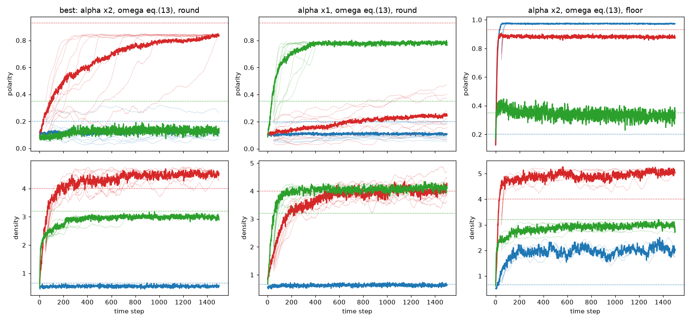

# 論文2の検証（速度一致なし）その1：図3 と α・ω・Int

[← 検証（入口）](../README.md)　｜　論文2：[00 まとめと課題](00_まとめと課題.md)・[01 図3](01_図3.md)・[02 他の図](02_他の図.md)・[α 2倍の全図の再現](α2倍_全図の再現.md)・[03 残ったずれ](03_残ったずれ.md)　｜　共通：[測り方とモデル](../測り方とモデル.md)・[計画](../計画.md)・[変更一覧](../変更一覧.md)

Murakami et al. 2017（Sci. Rep. 7:46447）と Appendix S1 の再現。3.1〜3.6 節。3.7 節から先は [05_論文2_他の図](02_他の図.md)。

- このレポート自身の図は fig17 のようにファイル名の番号で呼ぶ。「図3」「図11」のように書いたものは、論文の図。

---

## やったことと結果の一覧

論文2で試したことを「やったこと → 結果」で並べた表。詳しい説明と図は、この下の各節にある。新しく試したら、ここにも1行足す。

| やったこと | 結果 | 日付 |
|---|---|---|
| 速度一致を外して、基本ベクトルを V と ω で更新する（Murakami の付録どおり） | 論文2のモデルはこれ。論文1とは別のモデルとして扱う | 10/30、11/1 |
| 整数化を floor から round にする | 青の整列度が下がって論文と合った（0.99 → 0.10）。赤・緑は悪くなった。floor だと収束が速すぎるのもこれが原因 | 10/30、11/18 |
| ω を移動の向き側に掛ける（図S3 の説明文に合わせる） | 図S3 の ω=0 は合う。でも2体（図S2b）では2体が離れて合わない ⇒ 式どおりの方が良さそう | 11/18、11/19 |
| α を 0.05〜1.0 まで振る | 整列度は山の形。頂上は α=0.4 で論文の2倍の位置 | 11/19 |
| α 2倍 ＋ ω 式どおり ＋ round ＋ 1個体1票 | 赤 0.84 / 緑 0.13 / 青 0.12 で、図3 の順番がはじめて出た。図3a、図S2 の赤・緑、2体の図S2b も合う | 11/18、11/19 |
| 人気度を遷移の本数で数える | 相互予期が 100% になってそろわない ⇒ 1個体1票を採用 | 11/18 |
| 同率のときランダムに選ぶ | α=0.5 も 0.2 も下がる ⇒ 基本ベクトルに近い向きを選ぶ（式どおり）のまま | 11/18 |
| 競合したら向きが近い個体が勝つ／人気度の高い個体から更新する | どちらも変わらないか、そろわない | 11/18 |
| 止まる個体がいるか調べた | 0%、原因じゃない | 11/19 |
| 図4 の旋回の力を、論文の Methods どおり（向きの差は 0〜45°、ビンを重ねる）に計算し直す（計画C） | どの設定でも縦じまになり、論文の図4b と同じ（左右の距離で決まる）。前に合わなかったのは、向きの差に符号を残し、1つ前の速度を向きに使っていたから | 11/20 |
| P=10 で α を 0.025〜0.3 に振って、青のルールの割合を見る（計画D） | 相互予期の割合は実際の扇の広さで決まる。論文の 63% になるのは α そのまま（±18°）。2倍（±36°）だと 72%。図S2 の青は α 2倍と両立しない | 11/20 |
| 図S3 を ω=0〜10 で細かく、ω と α の読み方2通りずつで（計画H） | 論文の「ω≤1 で低い」は主に ω=0（0.10）。ω=1 は論文 0.70・モデル 0.81 で大差なし。2つの ω の読み方は ω と 1/ω の入れ替え。ω=0 は説明文どおりだけが合い（0.12）、ω≥8 で下がるのは式どおりだけが合う | 11/22 |
| 図3b,c のそろう時間と、平均の取り方による違いを、今のベストの設定で10シードずつ調べる（計画J） | round なら赤がそろうのは t=181〜1292（中央値 418）で、論文の t≈600 は範囲に入る。floor だと 60 ステップでそろい、速すぎる。シードごとにそろう時刻がばらばらなので、時系列を先に平均すると「ゆっくり上がる」ように見える。値は「各シードの時間平均 → 中央値と範囲」で比べるのがよい | 11/22 |
| 本文 図2（流れ図）どおりに、相互予期をサイト中心のループにする（一番人気のサイトから順に、向きが基本ベクトルに一番近い個体が入る）（計画R） | α 2倍で緑 0.13 → 0.52（論文 0.35）。赤は1つの群れの中が 0.94〜0.95（論文 0.93）だが、逆向きの群れが合わさらないシードがあり平均 0.61。青のルールの割合は変わらない。入る個体をランダムにすると元に戻る。α 1倍では順番は逆のまま（[03_残ったずれ](03_残ったずれ.md) 3.14） | 11/26 |

---

## 3. 論文2の検証

論文2で合わせたい図は次のとおり。

- 図3：青（P=10, α=0.1）、赤（P=40, α=0.2）、緑（P=40, α=0.5）の整列度と密度の時間変化
- 図3a：P × α の格子
- 図S2：ルールの割合
- 図S3：ω を変えたとき
- 図4・図S2b：2体のシミュレーション

図3 の値を読み直した結果は次のとおり。

| 条件 | 整列度 | 密度 |
|---|---|---|
| 青 | 0.2 | 0.65 |
| 赤 | 0.93 | 4.0 |
| 緑 | 0.35 | 3.2 |

- 枠の色と P・α の組み合わせは、本文と図で一致している。
- 赤緑青の値の読み取りも、正しいことを確認した（ゼミの指摘への対応）。

### 3.1 整数化（Int）：floor から round へ

**fig01** floor で整数化すると、遷移ベクトルが平均 (−0.51, −0.50) だけ左下にずれる。round ではずれない。

- **改善したいこと：** 青の整列度が高すぎる。収束も速すぎる（開発メモ 9/19〜10/30）。
- **原因と考えたこと：**
  - 論文2では、基本ベクトルの向きを「自分が実際に動いた向き」で更新する。
  - そのため、floor のずれが毎ステップ積み重なり、全員がそろって左下へ流れる。
- **変更：** round にした。
- **結果：**
  - floor では青も整列度 0.99 になり、50 ステップほどで収束していた。round では 0.10 になり、論文に合った（fig02、表1）。
  - ただし、論文2の付録には floor（X ≤ x < X+1）と書かれている。round の方が合う、というのは結果から見た判断で、文面とは一致しない。

**fig02** 青・赤・緑の3条件の、整列度と密度の時間変化（α はそのまま読んだ場合）。

**表1** t=1000〜1500 の平均（α はそのまま読んだ場合）。ルールの割合は「相互予期 / 追従 / 自由移動」で、単位は %。

| 条件 | 論文 | floor・ω 式どおり | round・ω 式どおり（Murakami） | round・ω 移動側（v1） |
|---|---|---|---|---|
| 青 P=10, α=0.1 整列度 / 密度 | 0.2 / 0.65 | 0.99 / 2.09 | **0.10 / 0.62** | **0.10 / 0.59** |
| 青のルールの割合（図S2） | 63 / 5 / 32 | 87 / 4 / 10 | **64 / 5 / 32** | **61 / 5 / 33** |
| 赤 P=40, α=0.2 | 0.93 / 4.0 | 0.96 / 5.13 | 0.25 / **3.96** | 0.66 / 2.72 |
| 緑 P=40, α=0.5 | 0.35 / 3.2 | 0.84 / 4.48 | 0.78 / 4.10 | 0.62 / **2.99** |

- round にすれば、青は ω をどちらに掛けても合う。
- ただし、α をそのまま読む限り、赤は低く緑は高い。論文と逆になっている（3.3 節で詳しく見る）。

### 3.2 ω をどちら側に掛けるか（11/18 に試し、11/19 に見直した）

- **改善したいこと：** 赤の整列度が 0.25 までしか上がらない。
- **原因と考えたこと：** 付録の式(13)は q = V_u + ω·v_u（ω は前の基本ベクトルの重み）。一方、図S3 の説明文は「ω が小さいと前の基本ベクトルのまま、大きいと速度の向きにほぼ一致する」で、式とは逆に読める。
- **変更：** 説明文の読み方 q = v_u + ω·V_u（`omega_on="velocity"`）を試した。

**fig03** ω を 0〜10 に変えたときの整列度と密度（α はそのまま読んだ場合）。

- **結果（α をそのまま読んだ場合）：**
  - ω=0：入れ替えた版は整列度 0.11、密度 1.92 で、論文（0.1 / 2.0）と一致した。式どおりの版は 0.45 で合わない。
  - ω=2〜7：論文は整列度が高い（約 0.93）。式どおりの版は 0.6 から 0.15 まで下がる。入れ替えた版は 0.6〜0.7。
  - ω=1：論文は「ω≤1 で整列度が低い」としているが、どちらの版も 0.9 になる（ω=1 では2つの式が同じになる）。
  - 赤は 0.25 から 0.66 まで上がった。そこで v1 の既定にした。
- **見直し（11/19）：** 2体のシミュレーション（3.7 節）では、入れ替えた版は論文と合わず、式どおりの版が合った。α を2倍に読む場合は、式どおりの版でも図3 に合う（3.5 節）。**⇒ 今は式どおりの方が有力。**

### 3.3 α をそのまま読むと、α の効き方が逆になる

**fig04** P と α を変えたときの整列度（α はそのまま読んだ場合）。論文の図3a では、整列するのは P が大きく α が小さい赤の条件。

- 式どおりの版は、α≥0.3 で整列度が 0.75〜0.89 になる。α が大きいほど整列する、という逆の傾向。
- v1（ω 移動側）でも、α=0.5 で整列度が下がるところまでは届かない。

**fig10** P=40 で α を 0.1〜0.5 に変えたとき（3シード）。整列度を2つに分けた（(a) 基本ベクトルのそろい、(b) 実際の移動が基本ベクトルに沿っている度合い。2.3 節を参照）。

- (b) は、期待どおり α で下がる（0.98 → 0.72〜0.76）。α のノイズとしての効果は出ている。
- ところが (a) は、α が大きいほど上がる（式どおりの ω で 0.14 → 0.98）。
  - α が大きいと扇が広がって、遷移先が重なりやすくなる。
  - そのため相互予期が増え（90% → 100%）、密度も上がる（2.0 → 4.5）。
  - 密な群れの中では、互いの移動を通して θ がそろっていく。
- 赤（α=0.2）は、そろうのが遅く、運しだいになっている。式どおりの ω で 4000 ステップまで回すと、最後の 500 ステップの整列度はシードごとに 0.05 / 0.23 / 0.37 / 0.42 / 0.92 とばらばらだった。

### 3.4 α を広く振ると、整列度は山の形になる（ゼミの指摘への対応）

**fig14** P=40 で α を 0.05〜1.0 に変えたとき（3シード、t=1000〜1500 の平均）。
- 薄い帯は、3シードの最小〜最大。
- 黒い菱形は、論文の赤・緑の値を α そのままの位置に置いたもの。
- 白い菱形は、同じ値を α を2倍に読んだ位置に置いたもの。

- **ゼミの指摘：** 「Murakami 版で α が大きくなると整列度が上がるのがおかしい。P=40 で α を変えて確認する」
- **結果：整列度は単調に上がるのではなく、山の形になった**（ω は式どおり）。
  - α=0.05〜0.2 は低い（0.12〜0.22）。シードによってばらつく。
  - α=0.4 で最大の 0.84 になり、そこから α=1.0 の 0.13 まで、なめらかに下がる。
  - これまでは α=0.1〜0.5 しか見ていなかったので、上り坂だけを見ていた。
- **山の形は論文と同じで、横にちょうど2倍ずれている。**
  - 論文は α=0.2 で高く（0.93）、α=0.5 で低い（0.35）。
  - シミュレーションで同じ値になるのは、α=0.4（0.84）と α≈0.8〜0.9（0.37〜0.24）。
- 密度も同じ形で、α=0.4 で最大（4.5）になり、α=1.0 で 3.0 に下がる。論文の赤 4.0、緑 3.2 と、2倍の位置で近い。
- **α が小さいと整列しない理由：** α が小さいと可能的遷移の扇が狭く、他の個体と遷移先が重なりにくい。相互予期の割合は 83%（α=0.05）から 99%（α=0.4）まで上がる。
- **ω 移動側（v1 の既定）では、** 頂上は α=0.25〜0.4 に来る。ただし α≥0.6 で急に 0.1 まで落ち、論文の緑（0.35）にあたる中間の値が出ない。
- **止まる個体：** すべての α で、「留まる」個体も変位が 0 の個体も 0%。

### 3.5 α を2倍に読むと、図3・図3a が再現できる

- **改善したいこと：** α の効き方が逆になる（3.3 節）。
- **原因と考えたこと：**
  - 論文2 p.4：α が大きすぎると、個体は「ほぼ全方向」の近傍と相互作用する、とある。これは緑（α=0.5）のことを指している。
  - ξ∈[−απ, απ] だと、α=0.5 は前方 ±90° にしかならない。2倍に読めば ±180° で、この記述と合う。
  - 3.4 節の山の頂上が、ちょうど2倍の位置にあることとも合う。
- **変更：** ξ∈[−2απ, 2απ] にする（v1 の `alpha_scale=2`）。
- **ただし、** 式(1)と付録の式(3)は「ξ を [−απ, απ] から選ぶ」と明記している。コードの中で α が「半周 π でなく、1周 2π に対する割合」として使われていた、といった可能性は考えられるが、確かめようがない。

**fig12** 左：論文1の整列度（2.5 節）。中・右：論文2の図3 の3条件。

**表2** 論文2 の図3（round、t=1000〜1500 の平均、整列度 / 密度）

| 条件 | 論文 | α そのまま・ω 式どおり | **α 2倍・ω 式どおり** | α 2倍・ω 移動側 |
|---|---|---|---|---|
| 青 | 0.2 / 0.65 | 0.11 / 0.62 | **0.12 / 0.54** | — |
| 赤 | 0.93 / 4.0 | 0.22 / 3.88 | **0.84 / 4.51** | 0.74 |
| 緑 | 0.35 / 3.2 | 0.78 / 4.09 | **0.13 / 2.98** | 0.08 |

- 赤は高く、緑と青は低い。これまでどの版でも出なかった、論文と同じ順番が出た。
- 赤の整列度は、3シードとも t≈450〜1050 で 0.84 に達して、そのまま保たれた。3.3 節のような運しだいではない。
- 緑は 0.13 で、論文の 0.35 より低い。α=0.8（論文の α=0.4 にあたる）では 0.37 / 3.05 で、論文の緑に近い。

**fig15** 論文の図3a と同じ P × α の格子（ω 式どおり、seed 0、t=1500、3ステップの軌跡、下の数字は整列度の平均）。左は α そのまま、右は2倍に読んだもの。枠の色は論文の青・赤・緑。

- **2倍に読んだ方（右）は、論文の図3a の見た目に近い。**
  - α=0.2：P≥20 で、一方向に進む細長い群れになる。
  - α=0.4〜0.5：P≥30 で、丸い塊になる。論文の緑の枠（P=40, α=0.5）も丸い塊。
- **そのまま読んだ方（左）は合わない。**
  - α=0.2 の P=20〜40 は、小さな群れに分かれる。
  - α=0.4〜0.5 は、一方向に進む細長い群れになる。

### 3.6 図3b,c：そろうまでの時間と、平均の取り方（計画J、11/22）

- **ねらい：** 前から「安定するまでのステップ数が論文より短い」という問題があった（課題11）。floor が原因で、round にすれば直ると考えていたが（3.1 節）、今のベストの設定（α 2倍・ω 式どおり・round・1個体1票）で、シードを増やしてきちんと確かめていなかった。あわせて、論文の値と比べるときに、どんな平均を取るのがよいかを考えた。
- **論文の書き方（本文 p.4〜5）：**
  - 図3b,c は「整列度・密度を時間に対して描いたもの」で、**1本のシミュレーションの時系列**と思われる。平均を取ったとは書かれていない。
  - 赤は「どちらの量も時間とともに上がり、高い値で飽和する」、緑は「密度は上がるが、整列度は低いまま」、青は「どちらも低いまま」。
  - 図を目で読むと、赤の整列度は t≈600 ごろまでに上がりきる（11/18 の読み取り）。
  - 図S3 の値は「t=1500 での値」。これも1点の値で、平均ではない。
- **試したこと：** 3条件（青・赤・緑）× 3つの設定（ベスト、α そのまま、ベストの Int だけ floor）を、10シード（floor は5シード）、1500 ステップ回し、毎ステップの整列度・密度を記録した。
  - そろうまでの時間は、t90（50 ステップの移動平均が、最初の値から t=1000〜1500 の平均までの 90% に初めて届く時刻）で測った。上がり幅が小さいもの（整列度 0.2 未満、密度 0.5 未満）は「上がらない」とした。
  - スクリプト：`report_scripts/planJ_best.py`、`planJ_analyze.py`。結果は `report_data/planJ_best.json`。

**fig29** 整列度（上）と密度（下）の時系列。細い線は各シード（50 ステップの移動平均）、太い線はシードの平均、点線は論文の図3 の値。左：ベスト（α 2倍・ω 式どおり・round）、中：α そのまま、右：ベストの Int だけ floor。

**そろうまでの時間（t90、シードの中央値 [最小〜最大]）**

| 条件 | 設定 | 整列度 | 密度 | 時系列を先に平均したときの t90（整列度 / 密度） |
|---|---|---|---|---|
| 赤 | **ベスト（round）** | **418 [181〜1292]** | **261 [165〜412]** | 746 / 270 |
| 赤 | ベストの Int だけ floor | 59 [56〜59] | 133 [72〜367] | 59 / 107 |
| 赤 | α そのまま | 10本中8本は上がらない | 460 [233〜700] | — / 461 |
| 緑 | ベスト | 上がらない（論文どおり） | 249 [109〜710] | — / 257 |
| 青 | ベスト | 上がらない（論文どおり） | 上がらない（論文どおり） | — |
| 青 | ベストの Int だけ floor | 66 [64〜70]（青まで整列する） | 194 [125〜448] | 67 / 193 |

- **「安定するまでが速すぎる」のは floor のときだけ。** floor では赤も青も 60 ステップほどで整列しきる（青まで整列するのは 3.1 節のとおり）。round（ベスト）では、赤の整列度が上がりきるのは t=181〜1292 で、論文の t≈600 はこの範囲に入る。**課題11 は解決と言ってよい。**
- **ただし、そろう時刻はシードによって大きくばらつく。** 各シードの整列度は、しばらく 0.2〜0.3 にとどまったあと、100 ステップほどで一気に 0.84 まで上がる（fig29 左の細い線）。上がり始める時刻がシードごとにばらばら。
  - そのため、**時系列を先にシードで平均すると、ゆっくり上がる曲線に見える**（太い線、t90 は 746）。1本1本はゆっくり上がっていない。
  - 論文の図3b は1本の線なので、比べるなら1本1本の線と比べる方がよい。論文の線が目で読んで「ゆっくり上がる」なのか「途中で一気に上がる」なのかは、画像の解像度が足りず、まだ確かめられていない。
- **密度は整列度より先に上がる**（赤で 261 と 418）。群れが先に詰まり、そのあと向きがそろう。論文の「どちらも時間とともに上がる」と矛盾はしない。
- **赤の整列度は、どのシードでも 0.85 を超えない**（論文は 0.93）。平均の取り方ではなく、モデルの値そのものが論文より 0.1 低い。密度は逆に 4.5 で、論文（4.0）より高い。

**平均の取り方による違い（ベストの設定、整列度 / 密度）**

| 取り方 | 青 | 赤 | 緑 |
|---|---|---|---|
| **論文（1本、図を目で読む）** | 0.2 / 0.65 | 0.93 / 4.0 | 0.35 / 3.2 |
| ① 各シードの t=1000〜1500 の時間平均 → シードの平均 ± 標準偏差 | 0.12±0.06 / 0.54±0.01 | 0.81±0.09 / 4.50±0.13 | 0.13±0.00 / 2.99±0.01 |
| ② ① のシードの中央値 | 0.10 / 0.54 | 0.83 / 4.52 | 0.13 / 2.99 |
| ③ t=1500 の1ステップの値 → シードの平均 ± 標準偏差 | 0.11±0.05 / 0.57±0.09 | 0.83±0.01 / 4.51±0.26 | 0.15±0.05 / 2.89±0.17 |
| ④ t=200〜1500 の時間平均（そろう前を含む） | 0.12 / 0.54 | 0.73 / 4.40 | 0.13 / 2.98 |
| ⑤ 1本（seed 0）の t=1500 の1ステップの値 | 0.06 / 0.46 | 0.81 / 4.50 | 0.13 / 2.58 |

- **② と ① はほとんど同じだが、赤は ① の方が低い（0.81 と 0.83）。** 1本だけ t=1292 まで整列しなかったシードがあり、その時間平均が全体を引き下げている。整列する時刻がばらつく条件では、中央値の方が「そろったあとの値」をよく表す。
- **③（1ステップの値）は、平均は同じでもばらつきが大きい。** 密度の標準偏差は ① の2倍（赤で 0.26 と 0.13）。1ステップの値は揺らぎ（赤の整列度で ±0.03、密度で ±0.25）がそのまま乗る。
- **④（そろう前も含める）は、赤の整列度を 0.08 低く見せる。** そろうまでの時間がシードで違うので、平均の区間にそろう前の部分が混ざる。
- **⑤（1本の1点）は、青で 0.06〜0.21 と大きくぶれる**（α そのままの設定の seed 0 は 0.21）。論文の青の 0.2 も1本の1点なので、こちらの 0.10 との差（0.1）は、平均の取り方の違いで説明できる範囲かもしれない。

**どんな平均を取るのがよいか（この節の結論）**

1. **値を比べるとき：** 各シードで、そろったあとの区間（t=1000〜1500）を時間平均する → シードの**中央値と範囲（最小〜最大）**を出す → **論文の値がその範囲に入るか**を見る。
   - 論文の値は1本のシミュレーションの値なので、こちらの平均と完全に一致する必要はない。こちらのシードの範囲に入っていれば「同じ現象が出ている」と言える。
   - そろう時刻がシードでばらつく条件（赤）では、平均より中央値の方が外れ値に強い。
   - 時間方向の標準誤差（ステップごとの値のばらつき / √ステップ数）は、隣り合うステップの値が強く相関しているので、本当の誤差より小さく出る。誤差はシードどうしのばらつきで見る。
2. **そろうまでの時間を比べるとき：** シードごとに t90 を測り、中央値と範囲で比べる。**時系列を先に平均してから測らない**（ゆっくり上がるように見えて、時間が長く出る）。
3. **図S3 のような「t=1500 の値」と比べるとき：** 1ステップの値は揺らぎが大きいので、t=1400〜1500 くらいの短い区間の時間平均を各シードで取り、その範囲と比べる（3.10 節はこの方法）。
4. **時系列を描くとき：** シードの平均の線だけでなく、1本1本の線も重ねて描く（fig29 のように）。
5. 算術平均以外（幾何平均など）を使う理由はない。整列度は 0〜1、密度は個体数の平均で、どちらも足し算で意味のある量。外れ値への強さが要るときだけ中央値を使う。

- これまでの表は、ほとんどが ① の「シードの平均」で書いてある。中央値・範囲で集計し直すのは、4章の「次にやること」に入れた（課題29）。結論が変わりそうなのは、そろう時刻がばらつく赤のような条件だけ。

