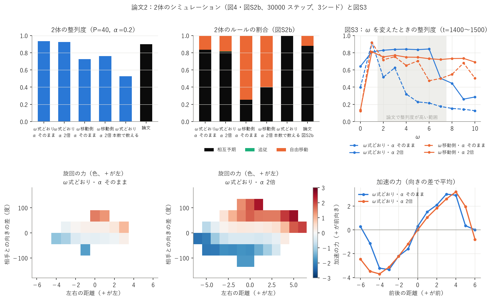
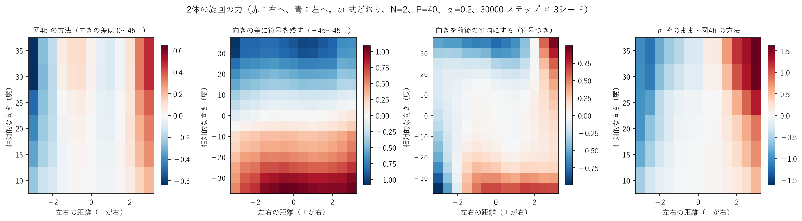
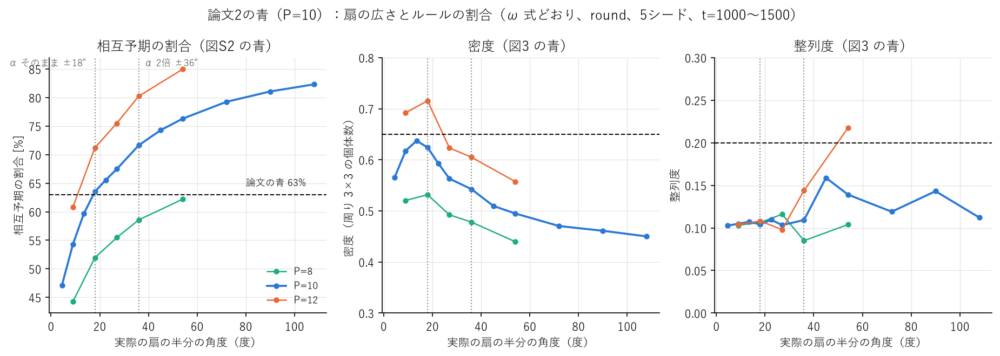
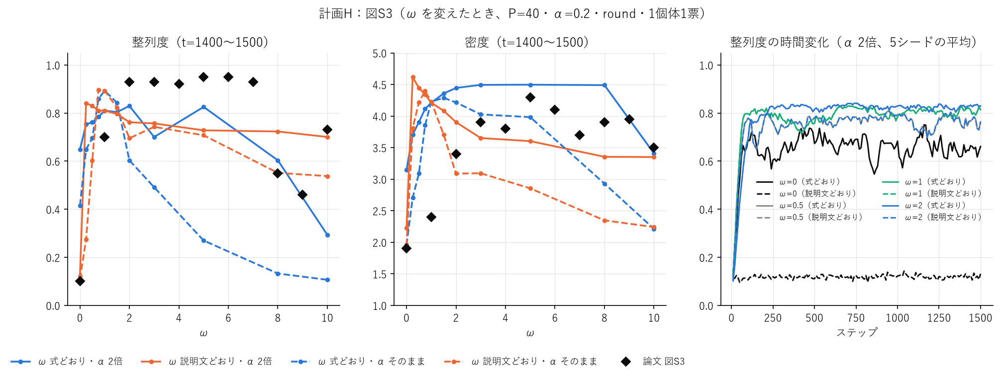

# 論文2の検証（速度一致なし）その2：図S2・2体（図4）・図S3、まとめ

[← 検証（入口）](../README.md)　｜　論文2：[00 まとめと課題](00_まとめと課題.md)・[01 図3](01_図3.md)・[02 他の図](02_他の図.md)・[α 2倍の全図の再現](α2倍_全図の再現.md)　｜　共通：[測り方とモデル](../測り方とモデル.md)・[計画](../計画.md)・[変更一覧](../変更一覧.md)

3.7〜3.12 節。3.1〜3.6 節と「やったこと → 結果」の表は [04_論文2_図3](01_図3.md)。

- このレポート自身の図は fig17 のようにファイル名の番号で呼ぶ。「図3」「図11」のように書いたものは、論文の図。

---

### 3.7 他の図との比較：図S2・2体（図4・図S2b）・図S3（ゼミの指摘への対応）

**図S2：ルールの割合**（ω 式どおり、t=1000〜1500 の平均。相互予期 / 追従 / 自由移動、%）

| 条件 | 論文 | α そのまま | α 2倍 |
|---|---|---|---|
| 青 | 63 / 5 / 32 | **63 / 5 / 32** | 72 / 4 / 24 |
| 赤 | 約 99 / 1 / 0（t≥600） | 96 / 1 / 3 | **99 / 1 / 0** |
| 緑 | 約 98 / 2 / 0 | **100 / 0 / 0** | **99 / 1 / 0** |

- 赤・緑は、どちらの読み方でも論文とほぼ同じ。
- 青は、そのまま読む方がぴったり合う。2倍に読むと、相互予期が少し多すぎる。
- **止まる個体：** 論文の図S2 では3つのルールの合計が 100% なので、論文にも止まる個体はいない。実装でも論文2は 0%、論文1でも最大 0.65%（P=2）。論文には、止まるルールの記述もない。**⇒ 止まる個体は原因ではない。**

**fig16** 上段の左・中：2体のシミュレーション（N=2、P=40、α=0.2、30000 ステップ、3シード）。上段の右：図S3。下段：2体での社会的な力（論文の図4 と同じ考え方の解析）。

**2体（図S2b）。** 論文には次のように書かれている。
- 本文 p.6：2体は「かなり近くにいて、整列度は約 0.9 に保たれる」。
- 図S2b：ルールの割合は「相互予期 0.88 / 追従 0 / 自由移動 0.12」。

| 設定 | 整列度 | 相互予期 / 追従 / 自由移動 | 平均距離 |
|---|---|---|---|
| 論文 | 約 0.9 | 0.88 / 0 / 0.12 | 近い |
| ω 式どおり・α そのまま | **0.93** | **0.83 / 0.00 / 0.17** | 2.4 |
| ω 式どおり・α 2倍 | **0.93** | **0.81 / 0.00 / 0.19** | 5.5 |
| ω 移動側（v1 既定）・α そのまま | 0.72 | 0.25 / 0.00 / 0.75 | 15.1（離れる） |
| ω 移動側・α 2倍 | 0.76 | 0.40 / 0.00 / 0.60 | 12.7（離れる） |
| ω 式どおり・人気度を遷移の本数で数える | 0.53 | 1.00 / 0 / 0 | 19.3（離れる） |

- **ω は式どおりが合う。**
  - 2体がくっついて進み、整列度もルールの割合も論文とほぼ同じになる。
  - ω を移動側に掛けると、2体が離れてしまい、自由移動が 60〜75% になる。
- **人気度は「1個体につき1サイト1票」が合う。** 遷移の本数で数えると、1体だけでも自分の遷移どうしが重なって人気度が 2 以上になる。そのため相互予期が 100% になってしまう。
- この2つは、α の読み方によらない。

**社会的な力（図4）。** 一部だけ合う。
- **合うところ：**
  - 左右の距離で平均すると、相手のいる側に曲がる。
  - 相手が前にいると加速し、後ろにいると減速する。
  - どちらも論文と同じ向き。
- **合わないところ：**
  - 「向きの差」と「左右の距離」に分けて見ると、旋回の向きは主に向きの差で決まっていた（相手の向きに合わせて曲がる）。
  - 論文の図4b は、「向きの差より左右の距離で決まる」としている。
  - これは、今のどの設定でも同じだった。
- **注意：** ここでの解析は、1ステップの速度の差で力を求めている。ノイズの大きい速度が平均に戻る分（平均への回帰）が混ざっている可能性がある。論文の計算方法（速度をならしているか）を確かめる必要がある。

**図S3（ω を 0〜10）。** ω 式どおり・α 2倍（上段右の青の実線）の結果。
- **合うところ：**
  - ω=1〜6 で整列度が高い（0.81〜0.84）。
  - ω≥7 で下がる（0.50 → 0.26）。論文の「ω≥8 で整列度が低い」に合う。
  - α そのままでは ω≥2 から下がってしまうので、2倍に読む方がよく合う。
- **合わないところ：**
  - ω=0 では 0.64 で、論文の 0.1 より高い。
  - 論文は ω≤1 で低いとしているが、どの設定でも ω=1 で 0.8〜0.9 になる。

### 3.8 図4（2体の旋回の力）の計算方法を見直す（計画C、11/20）

- **ねらい：** 3.7 節では、旋回の向きが「向きの差」で決まっていて、論文の図4b（「左右の距離」で決まる）と合わなかった。1ステップの速度の差で力を求めていたので、速度のぶれが平均に戻る動き（平均への回帰）が混ざっているのでは、と考えた。
- **論文を読み直した結果（本文 p.6 と Methods の「Force map」）：**
  - 加速度は「速度 v_i,t から計算する」とだけあり、速度をならすとは書かれていない。
  - **図4b の縦軸「相対的な向き」は 0〜45°で、左右の符号がない。** 3.7 節の解析は −180〜180°と符号を残していたので、ここが論文と違っていた。
  - 地図はビンを重ねて作る（向きは幅 20°を 5°ずつ、左右の距離は幅 2 を 0.5 ずつずらす）。
- **試したこと：** 2体（N=2、P=40、α=0.2、30000 ステップ、3シード）を回して位置を保存し、力の地図を5通りの計算方法で作った。
  - backward：向き＝1つ前の速度、加速度＝速度の差（3.7 節と同じ）
  - central：向き＝前後2つの速度の平均、加速度は同じ
  - smooth 3 / 5 / 10：位置を移動平均でならしてから central と同じ計算
  - 設定は ω 式どおり・α そのまま、ω 式どおり・α 2倍、ω 移動側（v1 の既定）の3つ。人気度は1個体1票。
  - スクリプト：`report_scripts/planC_pair.py`（実行）、`planC_analyze.py`（集計と図）。位置は `report_data/planC_pair.npz`、地図は `report_data/planC_force.json`。

**fig20** 2体の旋回の力（赤：右へ、青：左へ）。左から、図4b と同じ方法（α 2倍）、向きの差に符号を残したもの、向きを前後2つの速度の平均にしたもの（符号つき）、図4b と同じ方法（α そのまま）。

**旋回の力が何で決まるか**（ω 式どおり）

| 計算方法 | 図4b の方法で「左右の距離」で決まる割合 | 符号つきの回帰の係数（左右の距離 / 向きの差） |
|---|---|---|
| backward（α そのまま） | **1.00** | +0.06 / −0.31 |
| backward（α 2倍） | **1.00** | +0.08 / −0.51 |
| central（α そのまま） | **1.00** | **+0.10 / −0.01** |
| central（α 2倍） | **1.00** | **+0.16 / −0.05** |

「決まる割合」は、地図のばらつきのうち列（左右の距離）の違いで説明できる割合。回帰の係数は標準化したもので、正は「相手のいる側へ曲がる」、負は「相手の向きに合わせて曲がる」。

- **論文の図4b と同じ方法（向きの差を 0〜45°にする）で計算すると、どの設定でも縦じまになり、旋回の向きは左右の距離で決まる。** 相手が右にいれば右へ、左にいれば左へ曲がる。論文の図4b と同じ形。
  - α そのまま（fig20 右）の大きさは ±1.5 で、論文の ±2 に近い。
  - ω 移動側（v1 の既定）でも同じ形になった。図4b は、ω の読み方を決める手がかりにはならない。
- **3.7 節で「向きの差で決まる」と見えたのは、計算方法のせい。**
  - 向きの差の符号を残すと、1つ前の速度を向きに使ったとき（backward）だけ、向きの差の係数が大きくなる（−0.31〜−0.51）。
  - 向きを前後2つの速度の平均にすると（central）、その係数はほぼ 0（−0.01〜−0.05）になり、左右の距離の係数（+0.10〜+0.16）の方が大きくなる。
  - つまり、1ステップでぶれた速度を向きとして使うと、次のステップで元に戻る動きが「相手の向きに合わせて曲がる」ように見えていた（平均への回帰）。
- 位置をならす（smooth）と、力そのものが小さくなり、地図がはっきりしなくなる。論文はならしていないので、ならす必要はない。
- 加速の力（図4c）は、どの方法・設定でも前後の距離で決まっていた（割合 0.94〜1.00）。論文と同じ。
- **⇒ 図4b・4c は再現できた（課題7 は解決）。**

### 3.9 青のルールの割合のずれ（計画D、11/20）

- **ねらい：** α を2倍に読むと、青（P=10, α=0.1）のルールの割合が 72 / 4 / 24% になり、論文の図S2（63 / 5 / 32%）とずれる。α をそのまま読むとぴったり合う。扇が広がって遷移先が重なりやすくなり、相互予期が増えたのだと考えた。
- **試したこと：** P=10 で論文の α を 0.025〜0.3 に振った（alpha_scale 1 / 2、ω 式どおり、round、1個体1票、5シード、t=1000〜1500）。P=8・12 も一部比べた。
  - スクリプト：`report_scripts/planD_blue.py`（実行）、`planD_analyze.py`（集計と図）。結果は `report_data/planD_blue.json`。

**fig21** 横軸は実際の扇の半分の角度（alpha_scale × α × 180°）。点線は、論文の青（α=0.1）を α そのまま（±18°）と2倍（±36°）に読んだ位置。破線は論文の値。

**P=10 の値**（横軸の角度が同じなら、α そのままと2倍の結果は同じになる）

| 実際の扇（±度） | 相互予期 / 追従 / 自由移動 [%] | 整列度 | 密度 |
|---|---|---|---|
| 9 | 54 / 6 / 40 | 0.10 | 0.62 |
| 14 | 60 / 5 / 35 | 0.11 | 0.64 |
| **18**（α そのまま） | **64 / 5 / 31** | 0.10 | **0.62** |
| 27 | 67 / 5 / 28 | 0.10 | 0.56 |
| **36**（α 2倍） | **72 / 4 / 24** | 0.11 | **0.54** |
| 54 | 76 / 4 / 20 | 0.14 | 0.49 |
| 論文の青 | 63 / 5 / 32 | 0.2 | 0.65 |

- **相互予期の割合は、実際の扇の広さだけで決まり、広いほど増える**（±4°で 47%、±108°で 82%）。考えたとおり、扇が広いほど他の個体と遷移先が重なりやすくなる。
- **論文の 63% になるのは扇が ±18° のとき、つまり α をそのまま読んだとき。** 2倍に読むと ±36° になり、相互予期が 72% に増える。密度も、そのまま読む方が論文（0.65）に近い（0.62 と 0.54）。
- P を変えても、2倍に読んだまま合わせるのは無理がある。P=8 なら 2倍でも 59 / 5 / 36% と近くなるが、論文は P=10 と書いている。
- 整列度は、どの扇でも 0.10〜0.16 で、論文の 0.2 より少し低い。100 体がばらばらの向きに動くときの値（約 0.09）に近い。これは α の読み方によらない。
- **⇒ 青のずれの原因（1文）：** 相互予期の割合は実際の扇の広さで決まり、α を2倍に読むと青の扇が ±18° から ±36° に広がるので、相互予期が 63% から 72% に増える。
- **⇒ α の読み方について、図どうしで食い違いがある。**
  - 図3（赤・緑）、図3a、図S3 は「α 2倍」の方が合う（3.5・3.7 節）。
  - 図S2 の青は「α そのまま」の方が合う。
  - 一定の倍率で読み替えるだけでは、両方を同時に合わせられない。先生に確認するときは、この食い違いも一緒に伝える。

### 3.10 図S3 の ω≤1（計画H、11/22）

- **ねらい：** 図S3 では「ω≤1 で整列度が低い」とされるが、モデルではどの設定でも ω=1 で 0.8〜0.9 になっていた（3.7 節）。ω を細かく振って、ω の2つの読み方で何が違うかを調べた。
- **論文の値を読み直した**（図S3、t=1500。1本のシミュレーションと思われる）：整列度は ω=0 → 0.10、1 → 0.70、2〜7 → 0.92〜0.95、8 → 0.55、9 → 0.46、10 → 0.73。**「ω≤1 で低い」のは主に ω=0（0.10）で、ω=1 は 0.70 とやや低い程度**だった。
- **試したこと：** ω=0〜10（0、0.25、0.5、0.75、1、1.5、2、3、5、8、10）を、ω の2つの読み方（式どおり q = V_u + ω·v_u／説明文どおり q = v_u + ω·V_u）× α の2つの読み方（2倍・そのまま）で回した（P=40、α=0.2、round、1個体1票、5シード、1500 ステップ）。
  - スクリプト：`report_scripts/planH_omega.py`、`planH_analyze.py`。結果は `report_data/planH_omega.json`。

**fig27** 左：t=1400〜1500 の整列度。中：密度。右：α 2倍での整列度の時間変化。黒い菱形は論文の図S3。

**整列度（α 2倍、t=1400〜1500、5シードの平均）**

| ω | 0 | 0.5 | 1 | 2 | 3 | 5 | 8 | 10 |
|---|---|---|---|---|---|---|---|---|
| **論文（図S3）** | **0.10** | — | **0.70** | 0.93 | 0.93 | 0.95 | **0.55** | 0.73 |
| ω 式どおり | 0.65 | 0.76 | 0.81 | 0.83 | 0.70 | 0.83 | **0.60** | 0.29 |
| ω 説明文どおり | **0.12** | 0.83 | 0.81 | 0.76 | 0.76 | 0.73 | 0.72 | 0.70 |

- **2つの読み方は、ω と 1/ω を入れ替えただけの関係になっている。** 説明文どおりの ω の結果は、式どおりの 1/ω の結果と完全に一致した（例：α そのままで、式どおり ω=0.5 と説明文どおり ω=2 は、どちらも整列度 0.70・密度 3.09）。q の向きだけを使うので、q = v_u + ω·V_u と q = V_u + (1/ω)·v_u は同じ向きになるため。つまり「ω をどちら側に掛けるか」は「ω を読むか 1/ω を読むか」と同じ。
- **ω=1 は、どちらの読み方でも同じ（0.81）。** 論文の 0.70 より 0.1 高いが、論文の値は1本のシミュレーションの t=1500 の値なので、大きな食い違いとは言えない。5シードの範囲は 0.80〜0.82。
- **食い違いの中心は ω=0。**
  - 式どおりでは ω=0 のとき q = V_u で、θ は直前の移動の向きになる。移動を通して互いの向きがそろうので、整列度は 0.65 まで上がる。
  - 説明文どおりでは ω=0 のとき q = v_u で、θ は最初のランダムな向きのまま変わらない。整列度は 0.12 で、論文の 0.10 と合う。
  - 図S3 の説明文も「ω が小さいと、基本ベクトルは最初にランダムに与えた前の向きとほぼ一致する」で、説明文どおりの読み方と合う。一方、本文 p.4 は「ω=0 のとき基本ベクトルの向きは速度の向きと一致する」で、式どおりの読み方と合う。**論文の中で食い違っている。**
- **ω が大きい側（ω≥8 で下がる）は、式どおりの方が合う。** 式どおりは ω=8 で 0.60、10 で 0.29 に下がる（論文 0.55、0.73）。説明文どおりは 0.70〜0.72 のまま下がらない。
- **そろうまでの時間：** 式どおり・α 2倍の ω=5（本文の設定）では、整列度が 0.6 を超えるのに 610 ステップかかった（シードの中央値）。論文の図3b の赤が t≈600 でそろうのと同じくらい。他の ω は 50〜100 ステップでそろう。
- **⇒ 図S3 全体に合う読み方はない。** ω=0 は説明文どおり、ω≥2 の形と ω≥8 で下がる所は式どおりが合う。2体の結果（3.7 節）と合わせると、式どおりの方が多くの図に合うが、ω=0 だけは説明文どおりでないと出ない。確認したいこと 9 に、この点を足す。
### 3.11 効かなかった候補（論文2）

| 変えたところ | 論文の根拠 | 結果 |
|---|---|---|
| 競合したら、遷移の向きが基本ベクトルに近い個体が取り、負けた個体は2番目へ（全員が同時に狙う） | 本文 p.4 | ω 移動側ではどの α でも 0.14 以下。ω 式どおりでも赤 0.31、緑 0.64 |
| 狙うサイトの人気度が高い個体から更新する | 本文 p.4「人気度の分布が更新の順番を決める」 | ω 式どおりで赤 0.28、緑 0.75 |
| 留まった個体（速度 0）も整列度の平均に入れる | 本文「平均単位速度のノルム」 | 留まる個体が 0% なので、値は同じ |
| Int を付録どおり floor にする | 付録の式(2) | 青も 0.98 になる（3.1 節と同じ） |
| 人気度が同率のとき、ランダムに選ぶ | なし（付録は「基本ベクトルに近いもの」） | α=0.5 は 0.55 まで下がったが、α=0.2 も 0.46 に下がった |
| 人気度を遷移の本数で数える（`dedupe_votes=False`） | 付録の式(5)の文字どおりの読み方 | どの α でも相互予期が 100% になり、整列度は 0.34 以下。2体でも合わない |
| η を √ にする | なし | 密度は上がるが、α に対する形は変わらない |
| 式(13)の v_u に (cosθ, sinθ) を使う | — | v1 と同じ |

（α はそのまま読んだ場合の結果）

### 3.12 論文2のまとめ

**表3** 設定ごとに、論文の図と合うか（○ 合う、△ 一部、× 合わない）

| 図 | α そのまま・ω 式どおり（Murakami） | α そのまま・ω 移動側（今の v1 既定） | **α 2倍・ω 式どおり** |
|---|---|---|---|
| 図3 青 | ○ | ○ | ○ |
| 図3 赤（整列する） | × 0.22 | △ 0.66 | **○ 0.84** |
| 図3 緑（整列しない） | × 0.78 | × 0.62 | **○ 0.13**（やや低い） |
| 図3a の格子 | × | × | **○** |
| 図3b,c のそろうまでの時間（3.6 節） | × 赤が10本中8本は整列しない | —（調べていない） | **○** t=181〜1292（論文 t≈600） |
| 図S2 青 | ○ | ○ | △ |
| 図S2 赤・緑 | ○ | ○ | ○ |
| 図S2b・2体の整列度 | ○ | × | **○** |
| 図S3 ω=0 | × | ○ | × |
| 図S3 ω≥8 で下がる | △ | × | **○** |
| 図4b 旋回の力（論文の Methods どおりに計算、3.8 節） | ○ | ○ | ○ |

- **一番多くの図に合うのは「α 2倍・ω 式どおり」**（＋ round、1個体1票）。
- 残っているのは、図S2 の青と、図S3 の ω≤1 の2つ。図S2 の青は、α を2倍に読むことと両立しないことが分かった（3.9 節）。図4b は、論文の Methods どおりに計算し直すと、どの設定でも合った（3.8 節、11/20）。
