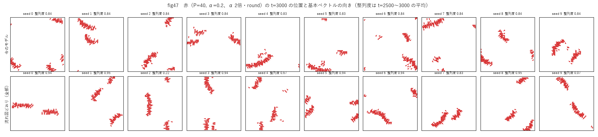

# 論文2：α 2倍で残ったずれの理由を探す

[← 検証（入口）](../README.md)　｜　論文2：[00 まとめと課題](00_まとめと課題.md)・[01 図3](01_図3.md)・[02 他の図](02_他の図.md)・[α 2倍の全図の再現](α2倍_全図の再現.md)・[03 残ったずれ](03_残ったずれ.md)　｜　共通：[測り方とモデル](../測り方とモデル.md)・[計画](../計画.md)・[変更一覧](../変更一覧.md)

ベストの設定（α 2倍・round・ω 式どおり・1個体1票）で論文2 の全図を作り直すと、形はほぼ合ったが、いくつかの値がずれた（[α2倍_全図の再現](α2倍_全図の再現.md) 7節）。

| 残ったずれ | モデル（α 2倍） | 論文 |
|---|---|---|
| 青のルールの割合（相互予期 / 追従 / 自由移動 %） | 71.7 / 4.4 / 24.0 | 63 / 5 / 32 |
| 緑の整列度 | 0.13 | 0.35 |
| 赤の整列度 | 0.81 | 0.93 |
| 図4b の旋回の力の幅 | 0.62 | 約 2 |

α の倍率は 1倍と 2倍だけを考える（11/25 に決めた）ので、ここでは **α 以外の所**で理由を探す。このファイルは 3.13 節から始める（論文2 の節番号の続き）。

- **3.12 まで（計画O、11/25）で分かったこと：** θ の揺らぎの大部分は、選ばれた遷移（実際の移動 V）から来ている。θ の入れ方（式(2) の丸め、式(13)）は理由ではない（[α2倍_全図の再現](α2倍_全図の再現.md) 9節）。なので次は「どの遷移が選ばれるか」を見る。

## 3.13 遷移の選び方の読み方（計画P、11/26）

- **ねらい：** 付録の式(6)〜(11) と本文 p.4 で、遷移の選び方の読み方が分かれる所を1つずつ入れ、ベストの設定で残ったずれが減るかを見た。
- **試した読み方**（どれも本文か付録に書いてあること）：

| 名前 | 変えたところ | 論文の根拠 |
|---|---|---|
| 今のモデル | ランダムな順に1体ずつ、人気度 ≥ c の空きサイトのうち一番人気へ（先に決めた個体が取る） | 付録 式(6)〜(8)、「更新は非同期」 |
| 競合（bid） | 全員が同時に一番人気を狙い、同じサイトを狙ったら遷移の向きが基本ベクトルに一番近い個体が入る。負けた個体は2番目に人気のサイトへ | 本文 p.4「同じサイトに行きたい個体が複数いたら…一番近い個体が入り、他の個体は2番目に人気のサイトへ動く」（変更一覧 2-7。α そのままでしか試していなかった） |
| 人気度の順 | 狙うサイトの人気度が高い個体から順に更新する | 本文 p.4「サイトの人気度の分布が更新の順番を決める」（2-8。同上） |
| 2番目は c 未満でも | 人気のサイトが先に取られたら、残りの中で一番人気のサイトへ（人気度が c 未満でも相互予期として動く） | 本文 p.4「他の個体は2番目に人気のサイトへ動く」（人気度が 2 以上とは書いていない） |
| 追従はサイトごと | 空いたサイトごとに、そこへ遷移を向けている個体からランダムに1体を選ぶ | 本文 p.4「新しく空いたサイトに遷移を向けている個体の中から、ランダムに選ばれた個体が動く」 |

- 青・赤・緑 × 10シード、1500 ステップ。整列度・密度は t=1000〜1500 の平均。扇は、実際の移動 V の向きと θ の差（二乗平均の平方根、度）をルールごとに出した。
- 「今のモデル」は `MAM_paper2` と同じ軌跡になることを確かめた（`python planP_selection.py check`）。
- スクリプト：`report_scripts/planP_selection.py`。データ：`report_data/planP_selection.json`。

**表10** 遷移の選び方の読み方ごとの結果（α 2倍、10シードの平均）

| 読み方 | 青 整列度 | 青 ルール % | 赤 整列度 | 赤 密度 | 赤 ルール % | 緑 整列度 | 緑 ルール % |
|---|---|---|---|---|---|---|---|
| **論文** | 0.2 | 63 / 5 / 32 | 0.93 | 4.0 | 99 / 1 / 0 | 0.35 | 98 / 2 / 0 |
| 今のモデル | 0.12 | 71.7 / 4.4 / 24.0 | 0.81 | 4.50 | 99.2 / 0.7 / 0.1 | 0.13 | 99.3 / 0.7 / 0.0 |
| 競合（bid） | 0.12 | **66.2 / 5.3 / 28.5** | 0.75 | **1.79** | **53.2 / 21.0 / 25.8** | 0.12 | **39.9 / 33.0 / 27.1** |
| 人気度の順 | 0.09 | 71.3 / 4.4 / 24.3 | 0.82 | 3.95 | 100 / 0 / 0 | 0.15 | 100 / 0 / 0 |
| 2番目は c 未満でも | 0.10 | 81.4 / 2.5 / 16.1 | 0.84 | 4.51 | 99.4 / 0.6 / 0.0 | 0.13 | 99.3 / 0.7 / 0.0 |
| 追従はサイトごと | 0.11 | 71.7 / 4.4 / 24.0 | 0.83 | 4.49 | 99.3 / 0.7 / 0.0 | 0.13 | 99.3 / 0.7 / 0.0 |

**扇（相互予期で動いたとき、度）**：今のモデルで 青 18、赤 35、緑 100。ほかの読み方でも ±4° 以内でほぼ同じ。

### 分かったこと

- **どの読み方でも、残ったずれは同時には直らない。**
  - 競合（bid）は、青のルールの割合が論文に近づく（相互予期 66%）。しかし赤・緑で相互予期が 40〜53% に下がり（論文 98〜99%）、赤の密度が 1.79 まで下がる（論文 4.0）。赤の群れがまとまらなくなるので使えない。
  - 人気度の順は、赤の密度が 3.95 と論文に近づくが、ほかはほとんど変わらない。
  - 「2番目は c 未満でも」は、青の相互予期が 81% に上がり、論文から遠ざかる。
  - 追従はサイトごとに選んでも、結果は今のモデルと同じ（追従は 1〜5% しかないため）。
- **緑の整列度（0.13、論文 0.35）は、選び方を変えても動かない。** 緑では相互予期の扇が 100°（向きがばらばらの 104° とほぼ同じ）で、どの読み方でも変わらない。α 2倍の緑では、θ の前後に関係なく、全方向に人気のサイトがあり、そこへ動いている。
- **⇒ 遷移の選び方の読み方（式(6)〜(11)、本文 p.4）でも、θ の入れ方（計画O）でも、α 2倍で残ったずれは直らなかった。** 論文の文面で分かれる所はほぼ試し終わった。残ったずれは、α 2倍に読むこと自体の代わりに出ているもの（α 1倍の方が合う1体ずつの値、[α2倍_全図の再現](α2倍_全図の再現.md) 8節）と考えるのが自然。
- 先生に伝えるときは、「論文の文面で分かれる所は全部試したが、α 2倍のまま青のルールの割合・緑の整列度・旋回の力の幅を同時に合わせる読み方はなかった」とまとめられる。

## 3.14 流れ図（本文 図2）どおりの更新順（計画R、11/26）

- **ねらい：** 本文の図2（流れ図）と今の実装を1つずつ見比べ、違う所を入れて試した。「全員の相互予期 → 全員の追従 → 全員の自由移動」の順番自体は、今の実装も流れ図と同じ（付録の「After all wanderers have been updated」どおり）。
- **流れ図と今の実装の違い：**

| 所 | 流れ図（本文 図2） | 今の実装（MAM_paper2） |
|---|---|---|
| 相互予期 | 「人気度が1より大きいサイトはあるか？」→「1体が一番人気のサイトへ」をくり返す。**サイトを中心にしたループ**（本文 p.4「サイトの人気度の分布が更新の順番を決める」） | ランダムな順に1体ずつ、自分の遷移先で一番人気のサイトへ（**個体を中心にしたループ**）。先に順番が来た個体が取る |
| 1つのサイトに入る個体 | 流れ図は「An agent」だけ。本文 p.4 は「そのサイトへの遷移の向きが基本ベクトルに一番近い個体」 | 順番が先の個体（向きで選ぶのは、自分の遷移先が同率のときだけ） |
| 追従 | 空いたサイトごとに、ランダムに選ばれた1体 | ランダムな順に1体ずつ（計画P の「追従はサイトごと」で、同じ結果になると分かっている） |
| 自由移動 | 「遷移の中から1本をランダムに選ぶ」（遷移単位） | 空いている遷移先からサイト単位でランダム（付録 式(11) の集合 Rd{τ}） |

- **試した読み方：**
  - サイト中心（入る個体は向きが一番近い個体、人気度はステップの最初に数えたもの）
  - 同じで、入る個体はランダム
  - 同じで、人気度を「まだ動いていない個体の票」だけで数え直す
  - 自由移動を遷移単位にする
  - 全部を流れ図どおりにしたもの（＋数え直し）
- α 2倍・round・ω=5、青・赤・緑 × 10シード、1500 ステップ（整列度は t=1000〜1500 の平均）。サイト中心の3つの版と今のモデルは、α 2倍・1倍で 3000 ステップも回した（t=2500〜3000 の平均）。
- 「今のモデル」は MAM_paper2 と同じ軌跡になるのを確かめた（`python planR_flowchart.py check`）。
- スクリプト：`report_scripts/planR_flowchart.py`（`long` で 3000 ステップ）、図は `planR_figs.py`。データ：`report_data/planR_flowchart.json`・`planR_flowchart_long.json`。

**表11** 流れ図どおりの更新順（α 2倍、10シードの平均。ルールは 相互予期 / 追従 / 自由移動 %、扇は相互予期で動いたときの V と θ の差の二乗平均の平方根）

| 読み方 | 青 整列度 | 青 ルール % | 赤 整列度 | 赤 密度 | 赤 扇 | 緑 整列度 | 緑 扇 |
|---|---|---|---|---|---|---|---|
| **論文** | 0.2 | 63 / 5 / 32 | 0.93 | 4.0 | — | 0.35 | — |
| 今のモデル | 0.12 | 71.7 / 4.4 / 24.0 | 0.81 | 4.50 | 35° | 0.13 | 100° |
| 相互予期をサイト中心に | 0.11 | 71.1 / 4.3 / 24.7 | **0.55**（シードで 0.08〜0.95） | 4.52 | **21°** | **0.52** | **71°** |
| サイト中心・入る個体はランダム | 0.11 | 71.7 / 4.6 / 23.7 | 0.80 | 4.39 | 39° | 0.08 | 107° |
| サイト中心・人気度を数え直す | 0.08 | 45.2 / 7.6 / 47.1 | 0.68 | **0.68** | 25° | 0.43 | 57° |
| 自由移動を遷移単位で | 0.13 | 71.7 / 4.3 / 23.9 | 0.84 | 4.48 | 35° | 0.13 | 100° |
| 流れ図どおり（全部） | 0.14 | 71.1 / 4.3 / 24.6 | **0.61**（同 0.06〜0.95） | 4.43 | 21° | **0.52** | 71° |
| 流れ図どおり・数え直す | 0.10 | 45.2 / 7.7 / 47.1 | 0.71 | 0.71 | 25° | 0.41 | 57° |

**3000 ステップ**（t=2500〜3000 の平均）

| 読み方 | α | 青 | 赤（シードごと） | 緑 |
|---|---|---|---|---|
| 今のモデル | 2倍 | 0.12 | 0.84（10シードとも 0.83〜0.84） | 0.13 |
| 流れ図どおり（全部） | 2倍 | 0.14 | 0.75（0.94〜0.95 が6シード、0.83・0.67・0.22・0.07） | 0.52 |
| 今のモデル | 1倍 | 0.12（ルール 63.5 / 5.0 / 31.5） | 0.36 | 0.78 |
| 流れ図どおり（全部） | 1倍 | 0.11（ルール 62.5 / 4.7 / 32.8） | 0.22 | 0.90 |

**fig47** 赤（α 2倍）の t=3000 の位置。上が今のモデル、下が流れ図どおり。今のモデルは群れの中の向きがいつも少しばらつき、整列度が 0.84 で止まる。流れ図どおりにすると1つの群れの中はよくそろい（0.94〜0.95、論文 0.93）、群れどうしが同じ向きなら全体も 0.94 になる。群れどうしが逆向きのまま合わさらないシード（seed 2・9）では、全体の整列度が 0.1〜0.2 に下がる。

**fig48** 左・中：赤・緑の整列度の時系列（α 2倍、細線はシードごと）。右：読み方ごとの整列度（10シード、95% 信頼区間、点線は論文の値）。

### 分かったこと

- **流れ図どおりに相互予期をサイト中心にすると、α 2倍で残っていたずれのうち、赤と緑の整列度が大きく動いた。**
  - 緑：0.13 → 0.52（論文 0.35）。今度は論文より高くなったが、初めて「緑も少しそろう」形が出た。相互予期の扇が 100° → 71° に狭くなる。
  - 赤：1つの群れの中は 0.94〜0.95 で、論文の 0.93 とよく合う（今のモデルは 0.84 で頭打ち）。ただし、逆向きの群れが合わさらないシードがあり、平均すると下がる（1500 ステップで 0.61、3000 ステップで 0.75）。
  - 青のルールの割合（71 / 4 / 25%、論文 63 / 5 / 32%）と赤の密度は変わらない。
- **効いているのは「サイトに入る個体を、向きが基本ベクトルに一番近い個体にする」こと。** サイト中心でも入る個体をランダムにすると、今のモデルとほぼ同じに戻る。人気のサイトには「まっすぐ進みたい個体」が優先して入るので、移動 V が θ に近くなり、θ がそろいやすくなる。今の実装は、先に順番が来た個体がサイトを取るので、この優先がほとんど効いていなかった。
- **人気度を数え直す読み方は使えない。** 相互予期が減り（青 45%）、赤の密度が 0.68（論文 4.0）で群れがまとまらない。流れ図は「人気度を数える」箱へは戻らず、問いの箇所へ戻るので、数え直さない方が流れ図に合う。
- **自由移動を遷移単位にしても、何も変わらない。**
- **α 1倍では、流れ図どおりにしても赤と緑の順番は逆のまま**（赤 0.22、緑 0.90）。α 2倍が必要なことは変わらない。
- **⇒ 流れ図どおりのサイト中心の相互予期は、本文 p.4 の文面（「人気度の分布が更新の順番を決める」「向きが一番近い個体が入る」）と図2 の両方を1文ずつ説明できる。** 赤の群れの中の整列度と、緑の整列度が論文に近づく。今の実装より文面に近いので、ベストの設定の候補になる。残るのは、緑の整列度が高すぎること（0.52、論文 0.35）、逆向きの群れが合わさらないシードがあること、青のルールの割合。
- まだ見ていないもの：2体・3体の図（図4・図S2b・図S4）、図S3（ω）、図3a の格子。サイト中心にすると、図4b の旋回の力の幅（論文 約2、今 0.6）が変わる可能性がある。
