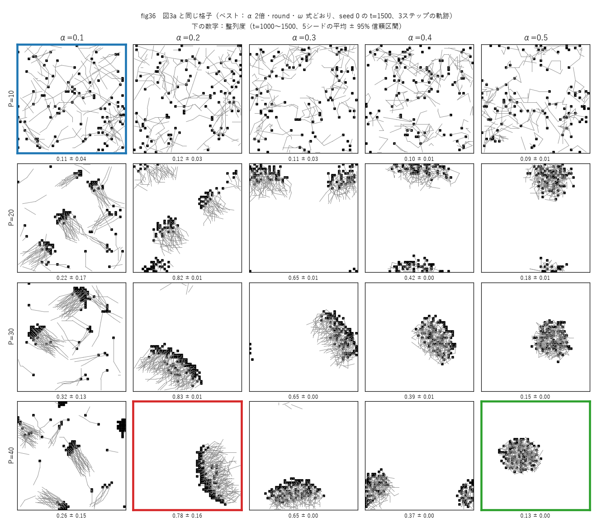
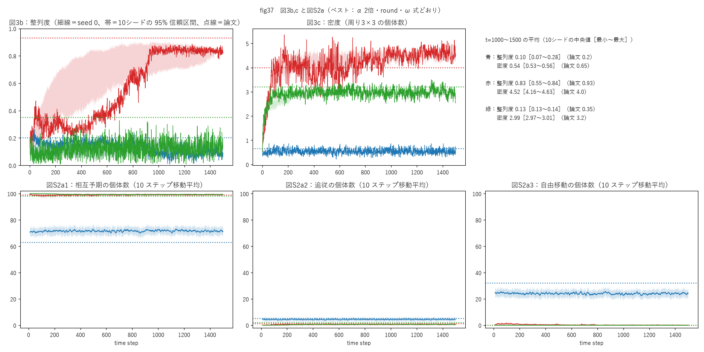
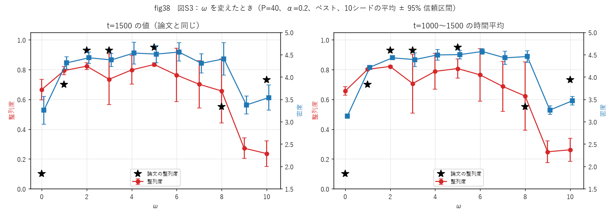
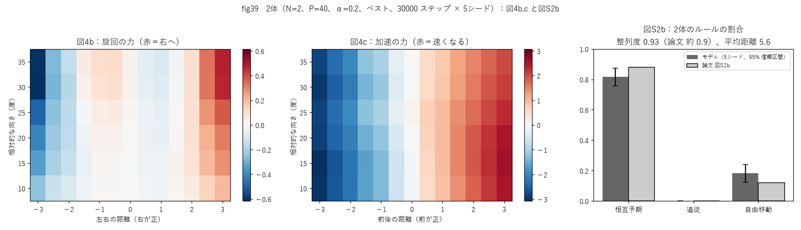
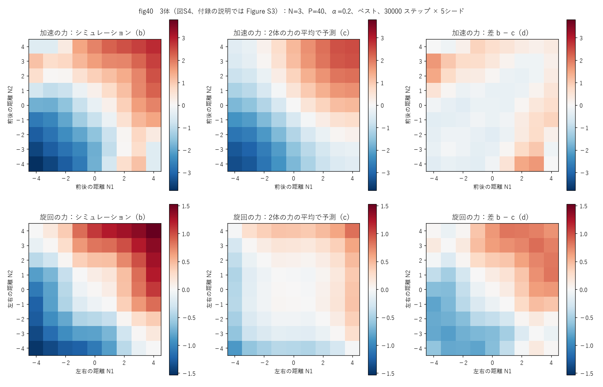
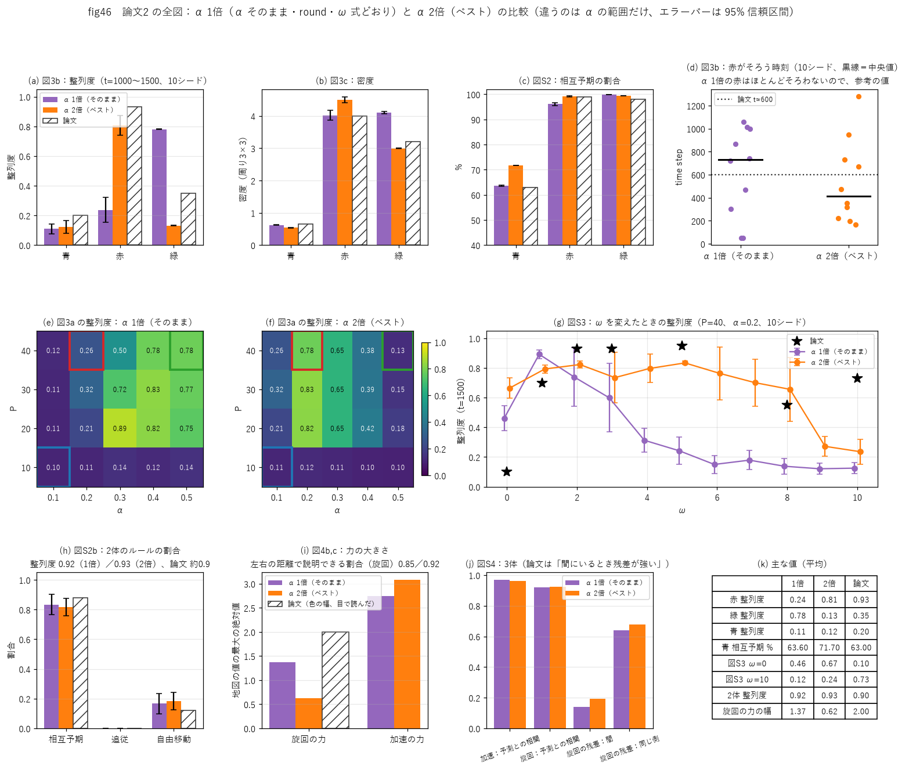
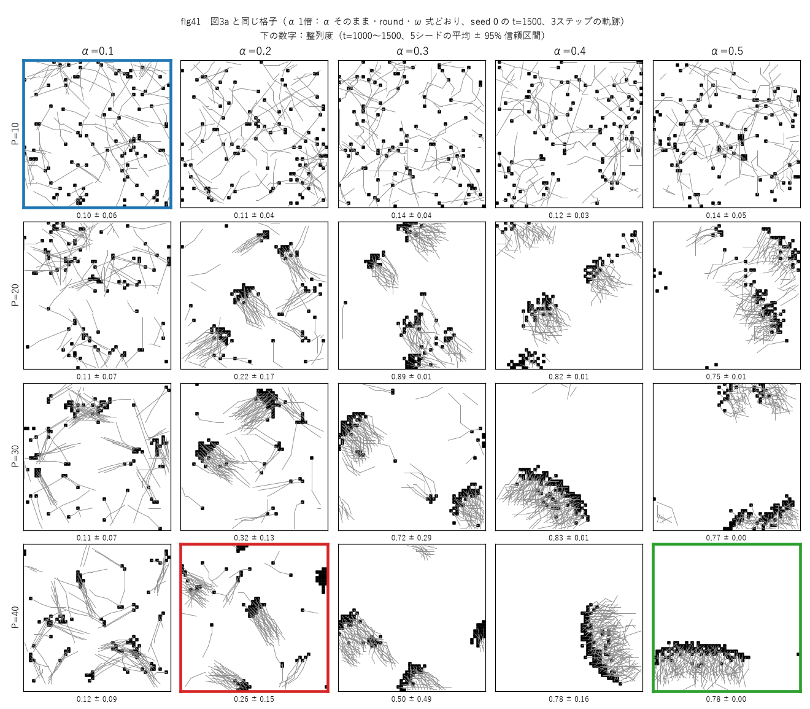

# 論文2 の全図の再現（ベストの設定）

[← 検証（入口）](../README.md)　｜　論文2：[00 まとめと課題](00_まとめと課題.md)・[01 図3](01_図3.md)・[02 他の図](02_他の図.md)・[α 2倍の全図の再現](α2倍_全図の再現.md)　｜　共通：[測り方とモデル](../測り方とモデル.md)・[計画](../計画.md)・[変更一覧](../変更一覧.md)

2026/11/24。論文2（Murakami et al. 2017, *Sci. Rep.* 7:46447）と付録（Appendix S1）のすべての図を、今のベストの設定で作り直し、論文の図と比べて「おかしいところ」がないかを確認した。論文2 の検証（[01 図3](01_図3.md)・[02 他の図](02_他の図.md)）とは別にまとめている。

- **先生の答え（11/24）：** α の範囲を2倍に読むこと、Int を round にすることは、論文に合うならそれで進めてよい。
- **ベストの設定：** α 2倍・round・ω 式どおり（式(13)）・人気度は1個体1票（`model/MAM_paper2.py` の `PRESETS["best"]`）。N=100、50×50、L=6、ω=5。
- **エラーバーと帯は、すべて 95% 信頼区間**（シードの平均 ± t(0.975, n−1)·SD/√n）。
- 論文の値は、論文の図を目で読んだもの（`論文2_図をつくる.ipynb` と同じ）。
- スクリプト：`report_scripts/planN_paper2_sim.py`（実行）、`planN_paper2_analyze.py`（集計と図）。データは `report_data/planN/`（集計は `summary.json`）。図は `report_fig/fig36`〜`fig40`。
- **α 1倍との比較（11/25）は 8節**（fig41〜46）。

## 1. 図の一覧と結果

| 論文の図 | 中身 | 結果 | 図 |
|---|---|---|---|
| 図1・図2・図S1 | モデルの模式図・流れ図 | 再現するものはない | — |
| 図3a | P × α の格子のスナップショット | ○ 見た目は合う | fig36 |
| 図3b,c | 赤・緑・青の整列度と密度の時間変化 | △ 順番とそろう時間は合う。緑の整列度が低い、赤が少し低い | fig37 |
| 図S2a | ルールごとの個体数の時間変化 | ○ 赤・緑は合う／△ 青の相互予期が多い | fig37 |
| 図S2b | 2体のルールの割合 | ○ ほぼ合う | fig39 |
| 図4b,c | 2体の旋回・加速の力 | ○ 形は合う／△ 旋回の力が小さい | fig39 |
| 図S3（付録の説明では「Figure S2」） | ω を変えたときの整列度・密度 | △ ω=1〜8 は合う。ω=0 と ω=9〜10 が合わない | fig38 |
| 図S4（付録の説明では「Figure S3」） | 3体の力（シミュレーション・2体からの予測・差） | ○ 予測とよく似る／△ 旋回の残差の出る場所が論文の説明と違う | fig40 |

- **付録の図の説明の番号がずれている。** 図S3 の説明文は「Figure S2. Polarity (red) and density (blue)…」、図S4 の説明文は「Figure S3. Interaction structures in three-individuals groups…」になっている。論文側の誤植。本文は「Figure S3」「Figure S4」と正しく呼んでいる。

## 2. 図3a（fig36）

**fig36** 図3a と同じ格子（seed 0 の t=1500、3ステップの軌跡）。下の数字は整列度（t=1000〜1500、5シードの平均 ± 95% 信頼区間）。枠の色は図3b,c の青・赤・緑。

- P=10 はどの α でも群れにならない（整列度 0.09〜0.12）。
- P≥20 で、α=0.2 は一方向に進む帯の形の群れ（0.78〜0.83）、α が大きくなるほど丸い塊になり、整列度が下がる（α=0.5 で 0.13〜0.18）。
- α=0.1 は、小さな群れがいくつかできて、それぞれ別の向きに進む（0.22〜0.32、シードでばらつく）。
- 論文の図3a の「P が大きく α が小さいと一方向の群れ、α が大きいと塊」と同じ見た目。
- **気になる点：** P=40・α=0.2（赤）は5シード中1本だけそろうのが遅く、信頼区間が広い（0.78 ± 0.16）。図3b の「そろう時刻がシードでばらばら」と同じ理由（3章）。

## 3. 図3b,c と図S2a（fig37）

**fig37** 上：整列度と密度の時間変化（細線＝seed 0、帯＝10シードの 95% 信頼区間、点線＝論文）。下：ルールごとの個体数（10 ステップの移動平均）。

**t=1000〜1500 の平均**（10シードの中央値［最小〜最大］）

| 条件 | 整列度 | 論文 | 密度 | 論文 | そろう時刻 t90 |
|---|---|---|---|---|---|
| 青 P=10, α=0.1 | 0.10［0.07〜0.28］ | 0.2 | 0.54［0.53〜0.56］ | 0.65 | — |
| 赤 P=40, α=0.2 | 0.83［0.55〜0.84］ | 0.93 | 4.52［4.16〜4.63］ | 4.0 | 167〜1280（中央値 約 400） |
| 緑 P=40, α=0.5 | 0.13［0.13〜0.14］ | 0.35 | 2.99［2.97〜3.01］ | 3.2 | — |

**ルールの割合**（t=1000〜1500、10シードの平均、%。相互予期 / 追従 / 自由移動）

| 条件 | モデル | 論文 図S2 |
|---|---|---|
| 青 | 71.7 / 4.4 / 24.0 | 63 / 5 / 32 |
| 赤 | 99.2 / 0.7 / 0.1 | 99 / 1 / 0 |
| 緑 | 99.3 / 0.7 / 0.0 | 98 / 2 / 0 |

- 赤は整列する、緑と青は整列しない、という順番は合う。赤がそろう時刻（167〜1280）の範囲に、論文の t≈600 が入る。
- 赤・緑のルールの割合は、論文とほぼ同じ。
- **おかしいところ：**
  1. **緑の整列度が低い（0.13、論文 0.35）。** 10シードとも 0.13〜0.14 で、論文の値はシードの範囲に入らない。α を少し小さく読む（2倍の α=0.4 にあたる 0.8）と 0.37 で論文に近い（論文2/01 の 3.5 節）。
  2. **赤の整列度が少し低い（0.83、論文 0.93）。** どのシードも 0.85 を超えない。密度は逆に高い（4.5、論文 4.0）。
  3. **青のルールの割合がずれる。** 相互予期が 72%（論文 63%）、自由移動が 24%（論文 32%）。α をそのまま読むとぴったり合う（63 / 5 / 32）ので、α 2倍の副作用。青の整列度（0.10、論文 0.2）と密度（0.54、論文 0.65）も少し低い。

## 4. 図S3：ω を変えたとき（fig38）

**fig38** ω=0〜10 の整列度（赤）と密度（青）。左：t=1500 の値（論文と同じ）、右：t=1000〜1500 の時間平均。10シードの平均 ± 95% 信頼区間。黒い星は論文の整列度。

| ω | 0 | 1 | 2 | 3 | 5 | 8 | 9 | 10 |
|---|---|---|---|---|---|---|---|---|
| モデル（t=1500） | 0.67 ± 0.07 | 0.79 ± 0.03 | 0.82 ± 0.02 | 0.74 ± 0.17 | 0.83 ± 0.01 | 0.66 ± 0.22 | 0.27 ± 0.07 | 0.24 ± 0.09 |
| 論文 | 0.10 | 0.70 | 0.93 | 0.93 | 0.95 | 0.55 | — | 0.73 |

- ω=1〜8 は、論文の値に近いか、信頼区間に入る（ω=2〜5 は 0.1 ほど低い）。
- **おかしいところ：**
  1. **ω=0 で整列度が高い（0.67、論文 0.10）。** ω を説明文どおり（ω を移動の向きの側に掛ける）に読むと合う（論文2/02 の 3.10 節）。式(13)と図S3 の説明文が逆になっていることによる。
  2. **ω=9・10 で整列度が下がりすぎる（0.24〜0.27、論文の ω=10 は 0.73）。** 論文は ω=8 で 0.55 に下がり、ω=10 で 0.73 に戻っている。論文の値は1本のシミュレーションの t=1500 の値なので揺らぎが大きいかもしれないが、モデルは10シードとも低い。
  3. ω=3・6・7・8 は信頼区間が広い（± 0.16〜0.22）。t=1500 までにそろわないシードがあるため。

## 5. 2体：図4b,c と図S2b（fig39）

**fig39** N=2、P=40、α=0.2、30000 ステップ × 5シード。左：旋回の力（赤＝右へ）、中：加速の力（赤＝速くなる）、右：ルールの割合（95% 信頼区間）。力の地図は論文の Methods どおり（加速度 = v(t) − v(t−1)、向き = v(t−1)、相対的な向き 0〜45°、ビンを重ねる）。

| | モデル | 論文 |
|---|---|---|
| 整列度 | 0.93 ± 0.02 | 約 0.9（本文 p.6） |
| 相互予期 / 追従 / 自由移動 | 0.82 / 0.00 / 0.18 | 0.88 / 0 / 0.12 |
| 平均距離 | 5.6 ± 1.1 | 「かなり近い」（数値なし） |

- **図4b：** 旋回の力は、左右の距離で決まる（地図のばらつきのうち左右の距離で説明できる割合 0.92）。相手が右にいれば右へ曲がる。相対的な向きが大きくなると強くなるが、符号は変わらない。論文の説明どおり。
- **図4c：** 加速の力は、前後の距離で決まる（割合 0.99）。相手が前にいれば速くなる。論文の説明どおり。
- **おかしいところ：**
  1. **旋回の力が小さい。** モデルは −0.6〜+0.5。論文の図4b の色の幅は ±2 くらい。α をそのまま読むと ±1.5 で論文に近い（論文2/02 の 3.8 節）。
  2. 左右の距離が ±1 のあたりで、わずかに逆向き（相手から離れる向き）の値が出る。論文の図4b では、距離 0 を境に白を通ってそのまま入れ替わる。近すぎると避ける動き（1サイトに1個体の決まり）が出ていると考えられる。
  3. 平均距離が 5.6 で、α をそのまま読んだとき（2.4）より離れる。論文には数値がないので、合っているかは分からない。

## 6. 3体：図S4（fig40）

**fig40** N=3、P=40、α=0.2、30000 ステップ × 5シード。上：加速の力、下：旋回の力。左から、シミュレーション（b）、2体の力の平均で予測（c）、差（d）。横軸・縦軸は、2体の相手それぞれの、focal の向きに対する前後の距離（加速）・左右の距離（旋回）。予測（c）は、2体のシミュレーションで求めた「距離だけの関数としての力」を2体分平均したもの。

| | シミュレーションと予測の相関 | 差の大きさ：focal が両隣の間にいるとき | 差の大きさ：両隣が同じ側にいるとき |
|---|---|---|---|
| 加速の力 | 0.96 | **0.56** | 0.27 |
| 旋回の力 | 0.92 | 0.19 | **0.68** |

- **シミュレーション（b）と予測（c）は、よく似ている**（相関 0.92〜0.96）。論文の「2体の力の平均で、力の主な形は説明できる」と同じ。
- **差（d）もある。** 論文の「平均から予想されるより強い相乗効果がある」と同じ。
- **加速の力：** 差が大きいのは、focal が両隣の間にいるとき（0.56、同じ側のときは 0.27）。論文の説明「focal が両隣の間にいるとき、より強い力になる」と同じ。
- **おかしいところ：** **旋回の力の差は、両隣が同じ側にいるときの方が大きい（0.68、間にいるときは 0.19）。** 両隣が同じ側（例えばどちらも右）にいると、モデルは2体の平均より強くその側へ曲がる（足し算に近い）。論文の説明（間にいるときに強い）とは場所が違う。論文の図S4 の d2 の色の分布を、もう一度目で確かめる必要がある。

## 7. まとめ：おかしいところの一覧

| # | 図 | おかしいところ | 考えられる原因・メモ |
|---|---|---|---|
| 1 | 図3b | 緑の整列度が低い（0.13、論文 0.35） | α の読み方。α=0.8（2倍）相当で 0.37 |
| 2 | 図3b,c | 赤の整列度が少し低く（0.83、論文 0.93）、密度が少し高い（4.5、論文 4.0） | どのシードも 0.85 を超えない。モデルの性質 |
| 3 | 図S2a | 青の相互予期が多い（72%、論文 63%） | α 2倍の副作用。α そのままなら合う |
| 4 | 図S3 | ω=0 の整列度が高い（0.67、論文 0.10） | ω の読み方（式(13)と説明文が逆） |
| 5 | 図S3 | ω=9・10 で下がりすぎる（0.24〜0.27、論文 ω=10 は 0.73） | 新しく分かった。論文は1本の値 |
| 6 | 図4b | 旋回の力が小さい（±0.6、論文 ±2） | α 2倍だと小さくなる（α そのままで ±1.5） |
| 7 | 図S4 | 旋回の残差が、両隣が同じ側のときに大きい（論文は間にいるとき） | 新しく分かった。論文の図の読み直しが必要 |
| 8 | 付録 | 図S3・図S4 の説明文の番号が1つずれている | 論文側の誤植 |

- 合っていること：図3a の見た目、赤・緑・青の順番、赤がそろう時刻、赤・緑のルールの割合、2体の整列度とルールの割合、図4b,c の形、図S3 の ω=1〜8、図S4 の主な形と加速の残差。
- **1・3・6 は、どれも「α 2倍」で値がずれる所。** α 2倍は図3 の順番を出すのに必要だが、細かい値はα をそのまま読む方が合う図もある。
- 次に試すとよいこと：α の倍率を 2 ではなく 1.5〜1.8 などにして、緑・青・旋回の力が同時に合う所があるかを見る（先生の答えから、論文に合うなら倍率を調整してよいと考えられる）。

## 8. α 1倍との比較（11/25、fig41〜46）

同じ図を **α 1倍（α そのまま・round・ω 式どおり、`PRESETS["murakami"]`）** でも作り、α 2倍（ベスト）と並べた。2つの設定で違うのは α の範囲（ξ∈[−απ, απ] か [−2απ, 2απ]）だけ。シード・ステップ数・集計のしかたは 1〜6 節と同じ。

- スクリプト：`planN_paper2_sim.py ../report_data/planN_x1 murakami`（実行）、`planN_paper2_analyze.py planN_x1 x1`（α 1倍の図 fig41〜45）、`planN_compare_x1.py`（比較の図 fig46）。データは `report_data/planN_x1/`。
- α 1倍の図は、1〜6 節の図と同じ形：fig41（図3a、fig36 に対応）、fig42（図3b,c・図S2a、fig37）、fig43（図S3、fig38）、fig44（2体、fig39）、fig45（3体、fig40）。

**fig46** 紫＝α 1倍、橙＝α 2倍、斜線・星＝論文。エラーバーは 95% 信頼区間。(e)(f) の枠の色は図3 の青・赤・緑の位置。

**fig41** α 1倍の図3a（fig36 と同じ格子）。

**主な値**（t=1000〜1500 の平均。図S3 は t=1500、力の幅は地図の値の最大の絶対値）

| 図 | 値 | α 1倍 | α 2倍 | 論文 | 合うのは |
|---|---|---|---|---|---|
| 図3b | 赤の整列度 | 0.24 | 0.81 | 0.93 | **2倍** |
| 図3b | 緑の整列度 | 0.78 | 0.13 | 0.35 | **2倍**（順番）。値はどちらも遠い |
| 図3b | 青の整列度 | 0.11 | 0.12 | 0.2 | 同じ |
| 図3c | 赤の密度 | 3.94 | 4.50 | 4.0 | **1倍** |
| 図3c | 緑の密度 | 4.11 | 2.99 | 3.2 | **2倍** |
| 図3c | 青の密度 | 0.63 | 0.54 | 0.65 | **1倍** |
| 図S2 | 青の相互予期 / 追従 / 自由移動（%） | 63.6 / 5.0 / 31.4 | 71.7 / 4.4 / 24.0 | 63 / 5 / 32 | **1倍**（ぴったり） |
| 図S2 | 赤・緑の相互予期（%） | 96.1・99.8 | 99.2・99.3 | 99・98 | どちらもほぼ合う |
| 図3a | 見た目 | 整列する所が α=0.3〜0.5 にずれ、赤の位置（P=40, α=0.2）は小さな群れが別々の向きに進む | 論文と同じ並び | — | **2倍** |
| 図S3 | ω=0 / 1 / 5 / 10 | 0.46 / 0.89 / 0.24 / 0.12 | 0.67 / 0.79 / 0.83 / 0.24 | 0.10 / 0.70 / 0.95 / 0.73 | **2倍**（ω=2〜8）。ω=0 は 1倍の方が近いが、どちらも合わない |
| 図S2b | 2体の整列度 / 相互予期 | 0.92 / 0.83 | 0.93 / 0.82 | 約 0.9 / 0.88 | 同じ |
| 図4b | 旋回の力の幅 | 1.37 | 0.62 | 約 2 | **1倍** |
| 図4c | 加速の力の幅 | 2.75 | 3.09 | — | 同じくらい |
| 図S4 | 予測との相関（加速・旋回） | 0.97・0.92 | 0.96・0.92 | — | 同じ |
| 図S4 | 旋回の残差：間 / 同じ側 | 0.14 / 0.64 | 0.19 / 0.68 | 間で強い | どちらも合わない（同じ形） |

**分かったこと**

- **α 2倍でないと出ないのは、群れ全体の振る舞い**：赤がそろい緑がそろわない順番（図3b）、図3a の並び、図S3 の ω=2〜8 で高い所。α 1倍だと、赤（α=0.2）はほとんどそろわず（0.24）、そろう所が α=0.3〜0.5 にずれる（fig41）。図S3 も、α 1倍では ω≥4 で整列しなくなる（赤の条件そのものがそろわないため）。
- **α 1倍の方が合うのは、1体ずつの動きの細かい値**：青のルールの割合（ぴったり 63 / 5 / 32）、青と赤の密度、図4b の旋回の力の幅（1.37、論文 約 2）。
- **α によらないもの**：2体の整列度とルールの割合、図S4 の形（旋回の残差が「両隣が同じ側」で大きいのは α 1倍でも同じ。α の読み方の問題ではない）、図S3 の ω=9・10 で下がること（α 1倍ではもっと下がる）、ω=0 で論文より高いこと（ω の読み方の問題）。
- 赤がそろう時刻（fig46 の d）は、α 1倍では赤がほとんどそろわないので比べられない。
- **見方：** 群れ全体の振る舞いは「扇が広い（2倍）」方、1体ずつの細かい値は「扇が狭い（1倍）」方が合う。1つの倍率で両方を合わせられるかが次の問い。7節の「倍率 1.5〜1.8 を試す」は、この表の「1倍」の行と「2倍」の行が同時に論文に近づくかを見る形で行うのがよい（緑の整列度 0.35、青の相互予期 63%、旋回の力の幅 約 2、赤の整列度 0.93 を同時に見る）。
